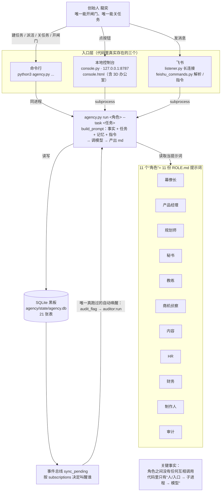

# 图 1｜业务架构图：这家“一人公司”到底有谁、谁听谁的

> 依据：`db.py` 的 `ROLE` 注册表、`agents/*/ROLE.md` 目录、`agency.py` 的 `cmd_run` / `build_prompt` / `_dispatch_execute`、`console.py` 的 `agent_roster()`、`feishu_commands.py`。
> 只看代码，不看设计文档。

## 这张图在说什么

1. **“11 个人”其实是 11 份岗位说明书。** 代码里唯一的“员工”是 `agency.py run`，它把 `agents/<角色>/ROLE.md` 整篇塞进提示词，然后调一次模型。角色不是常驻进程，也没有自己的记忆体，跑完就结束。
2. **谁调谁：只有“人调机器”，没有“机器调机器”。** 创始人通过命令行、控制台、飞书三个入口下指令，入口再起子进程执行。11 个角色之间**零调用**——没有 A 角色让 B 角色干活的代码路径。唯一的例外是事件订阅（`subscriptions` 表）：某类事件发生时，`sync` 可以唤醒某个角色，目前真正跑通过的是 `audit_flag → auditor`。
3. **谁对谁负责：只有创始人有最终权力。** 关任务必须带证据（`cmd_task_close` 强制），Agent 在 `dispatch` 里明确“无关闭权限”。审计角色看起来“独立”，但它和别的角色用的是**同一套执行器、同一个进程模型**，区别只是提示词不同；真正的“审计”是 `audit_output()` 里一段正则，查产出里有没有输入中不存在的日期。

## 看哪里

- 想看“有哪些岗位”：`db.py` 第 41–44 行 `ROLE`，与 `agents/` 下 11 个目录一一对应。
- 想看“角色怎么被调用”：`agency.py` 的 `cmd_run()`（1855 行）和 `_dispatch_execute()`（1093 行）。
- 想看“角色之间能不能互相派活”：搜遍全仓库，没有任何 `run <另一个角色>` 的自动调用；只有 `feishu_commands._run()` 和 `console._execute()` 这种“人触发”的子进程。
- 想看“审计独立不独立”：`agency.py` 的 `audit_output()`（1991 行），它只是对模型输出做日期比对。
