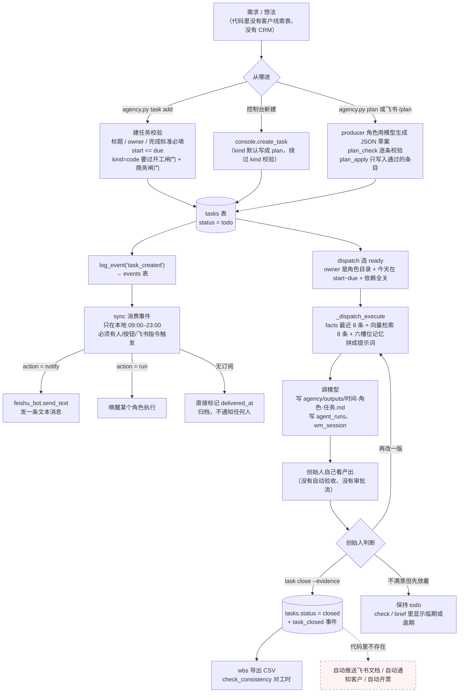

# 图 2｜业务流程图：从“有需求”到“收尾”，代码里真实走的步骤

> 依据：`agency.py` 的 `cmd_task_add` / `cmd_plan` / `plan_check` / `plan_apply` / `cmd_dispatch` / `_dispatch_execute` / `cmd_task_close` / `sync_pending` / `cmd_check` / `cmd_brief` / `cmd_wbs`，以及 `console.py`、`feishu_commands.py`。
> 说明：这是“代码实际能跑的路径”，不是理想流程。代码里没有的环节，图中用虚线标出“不存在”。

## 这张图在说什么

1. **链条的起点是“人已经把需求想清楚了”**，不是“客户来了”。代码里没有线索表、没有客户表、没有跟进记录；`scout` 角色只能生成一段文本，不落任何结构化数据。真正的“接单”动作是创始人手工 `task add` 或让模型 `/plan` 拆任务。
2. **任务只有两种状态在跑：`todo` 和 `closed`。** 建任务固定写 `todo`，关任务固定写 `closed`；中间没有“进行中/阻塞/待评审”的写入代码。你看到的“进行中/临期/逾期”是 `task_state()` 按日期算出来的展示状态，不是数据库里的状态。
3. **“事件驱动”实际是“人驱动 sync”。** 事件写进 `events` 表后不会自己发出去；必须有命令行、控制台按钮或飞书 `/sync` 去踢一脚。而且只在 09:00–23:00 生效。
4. **交付的终点是本地一个 markdown 文件。** 代码里没有“把产出同步到飞书文档”“通知客户”“归档到客户目录”的任何实现，只有 `lark-cli` 在另一个工具里手工推。图中红色虚线那一块，就是“设计上有、代码里没有”的部分。

## 看哪里

- 建任务与双闸门：`agency.py` `cmd_task_add()`（661 行）。
- 拆任务：`cmd_plan()`（1029 行）、`plan_check()`（809 行）、`plan_apply()`（958 行）。
- 派活：`dispatch_ready()`（1062 行）、`cmd_dispatch()`（1121 行）。
- 单次执行：`_dispatch_execute()`（1093 行）、`build_prompt()`（1634 行）。
- 关任务：`cmd_task_close()`（712 行）。
- 事件投递：`sync_pending()`（1312 行）。
- 控制台绕过 `kind` 校验：`console.py` `create_task()` 第 448 行 `kind = str(data.get("kind") or "plan")`。
