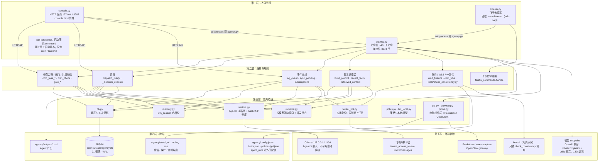

# 图 3｜技术架构图：进程、模块、外部依赖各在哪一层

> 依据：仓库根目录全部 `.py`、`agency/config.json`、`.env` 读取逻辑、`requirements`/`.venv-listener`、`启动服务.command`、`run-listener.sh`、`agency/limits.json`、`agency/policies/gui.json`。
> 判定标准：只有能在代码里找到调用点的依赖才画进来。

## 这张图在说什么

1. **它是“一个 Python 程序 + 两个壳”**：核心是 `agency.py`，控制台和飞书监听都只是两个入口，最后都通过 `subprocess` 回到 `agency.py`。所以你在任何入口做的事，最终都发生在同一个库里、走同一套校验。
2. **只有一个真数据库：SQLite 一个文件。** 没有服务器、没有 ORM、没有缓存中间件。21 张表里，真正每天在用的是 `tasks`、`events`、`agent_runs`、`config_kv`、`wm_session`、`embeddings`、`facts`、`subscriptions` 这 8 张；其余是建好了但没数据（见落差清单）。
3. **零第三方依赖是主路径的硬事实。** 主程序只用标准库（`sqlite3`、`urllib`、`http.server`、`tarfile`）；唯一装了第三方包的是飞书监听（`lark-oapi`，单独 `.venv-listener`）。代价是**两套运行环境**：控制台和命令行不需要它，飞书监听必须用那个 venv 启动。
4. **外部依赖只有 5 个，而且都能降级或缺席**：模型 endpoint（没 key 就只能用离线命令）、Ollama（挂了自动走 hash 检索）、飞书（发不出去进死信）、`lark-cli`（缺失时一致性检查跳过飞书）、Peekaboo/OpenClaw（只影响电脑操作层）。

## 看哪里

- 配置与路径：`agency/config.json`、`agency.py` 第 57–106 行。
- 依赖边界：`agency.py` 顶部 import（44–52 行）——除 `lark_oapi` 外全是标准库或本项目文件。
- 控制台如何回到主程序：`console.py` `_execute()` 第 551 行、`run_sync()` 第 320 行。
- 飞书监听如何回到主程序：`feishu_commands.py` `_run()` 第 175 行。
- 限流参数：`agency/limits.json` + `ratelimit.py`（按模型分桶，实测值写死）。
