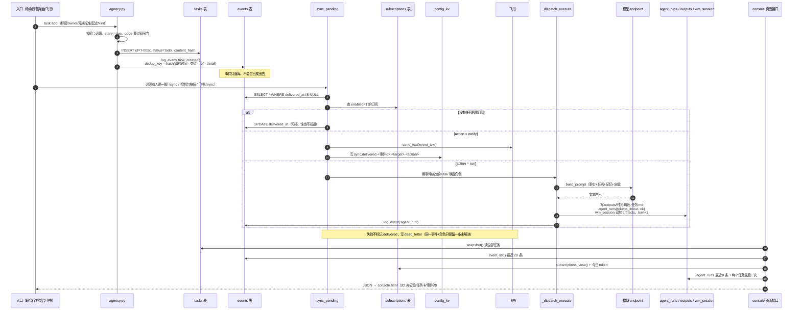
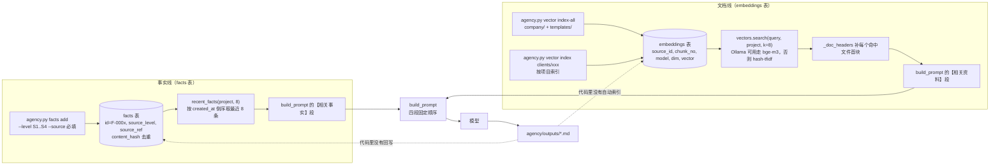

# 图 4｜数据流转图：一条任务、一条事实、一个事件，怎么走、落在哪、怎么显示

> 依据：`agency.py` `log_event()` / `sync_pending()` / `build_prompt()` / `_dispatch_execute()` / `cmd_facts()`，`console.py` `snapshot()` / `event_list()` / `facts_view()`，`vectors.py` `index_all()` / `search()`，`memory.py`。
> 关键点：每条线都标出**表名、函数名、关键字段**。

## 4.1 一条任务 + 一个事件：从创建到出现在 3D 办公室

### 这条线在说什么

- **任务是唯一硬事实，事件是它的影子。** 任务先落 `tasks`，再由 `log_event` 生成一条 `events`。事件没有独立业务含义，只是“某张表变了”的通知。
- **事件去重键里带了微秒时间戳**，所以“重复调用不重复产生事件”这句话只在同一微秒内成立；实际防重复靠的是投递侧的 `config_kv` 标记（`sync.delivered.*`），不是 `events.dedup_key`。
- **投递链路是“拉”不是“推”。** `sync_pending` 每被调用一次，才扫一遍 `delivered_at IS NULL`；没人调用，事件就一直躺着（当前库里还有 24 条未投递）。
- **页面看到的是数据库快照，不是真实进程状态。** `snapshot()` 每次请求都重新查表；3D 办公室里谁在走动、谁在工位，是前端动画模拟，`RUNNING` 只反映控制台内存里正在跑的角色集合。

## 4.2 一条事实 + 一份文档：怎么进提示词

### 这条线在说什么

- **事实和文档是两条互不相通的管道。** `facts` 只按“最近 8 条”进提示词，**不参与向量检索**；`embeddings` 只索引 `.md/.txt` 文件，不会索引 `facts`。所以“事实台账”目前只是提示词顶部的一小段，检索不到历史事实。
- **向量库现在有两份。** 主路径 `bge-m3`（1024 维）和兜底 `hash-tfidf-512` 同时写；查询时 Ollama 在线就只查 bge-m3，离线或查不到才退回 hash。当前库：191 块 bge + 191 块 hash，覆盖 29 个文件。
- **产出不会自动回流。** Agent 写出的 `outputs/*.md` 不会自动变成 `docs` 表记录，也不会自动进向量库；要复用只能人工再跑一次 `vector index`。

## 4.3 关键字段速查

| 表 | 关键字段 | 真实含义 |
|---|---|---|
| `tasks` | `id` / `status` / `owner` / `start_at` / `due_at` / `dep` / `done_when` / `content_hash` | `status` 实际只写 `todo` 或 `closed`；`owner` 只是字符串，不做权限 |
| `events` | `type` / `task_id` / `payload` / `dedup_key` / `delivered_at` | `delivered_at` 为空 = 还没被 `sync` 处理 |
| `subscriptions` | `event_type` / `target` / `action` / `enabled` / `budget` | `action` 只有 `notify`（发飞书）和 `run`（叫醒角色） |
| `config_kv` | `sync.delivered.*` / `sync.spend.*` / `gate.finance.*` / `finance.*` | 投递去重、当日 token 花费、商务闸门状态都塞在这里 |
| `facts` | `source_level`(S1–S4) / `source_ref` / `content_hash` | 没有 `source_ref` 直接拒绝写入（`cmd_facts`） |
| `embeddings` | `source_id` / `chunk_no` / `model` / `dim` / `vector` / `state` | 同一文件同一块会存 bge 和 hash 两份 |
| `wm_session` | `goal` / `constraints` / `decisions` / `open_questions` / `artifacts` / `digest` / `turn` | 六槽位 JSON；超预算先砍 digest，再砍产物，最后砍约束 |
| `agent_runs` | `role` / `task_id` / `model` / `tokens_in` / `tokens_out` / `ok` / `output_path` | 唯一记录 token 花费的地方；失败也记一行 |
| `dead_letter` | `event_id` / `role` / `error` / `attempts` / `resolved_at` | 只有 `sync`/`dispatch` 失败会进；`run` 失败不进 |

## 看哪里

- 事件写入：`agency.py` `log_event()` 388 行。
- 事件消费：`sync_pending()` 1312 行；去重标记 `sync_marker_key()` 1241 行。
- 提示词组装：`build_prompt()` 1634 行；事实注入 `recent_facts()` 1584 行；检索注入 `retrieved_context()` 1611 行。
- 页面快照：`console.py` `snapshot()` 362 行；`event_list()` 279 行；`facts_view()` 301 行。
- 向量索引：`vectors.py` `index_all()` 229 行；`search()` 354 行。
- 记忆压缩：`memory.py` `render()` 149 行。
