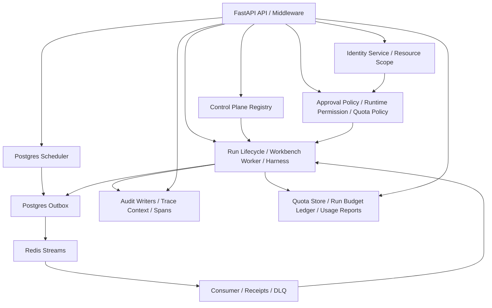

# A3 统一 AI 控制平面八项代码审查

> Issue: [#848 AI Native Enterprise Platform 全仓库差距审查](https://github.com/dujiu1024-dotcom/Agent-pingtai/issues/848)  
> 审查项：A3 统一 AI 控制平面八项检查  
> 基线：`main` @ `b622d5fc9eab1c79c28dcaa13367eec3c138679d`  
> 审查日期：2026-11-21  
> 范围：身份授权、资源注册、任务调度、策略引擎、事件总线、执行运行时、审计追踪、计量结算  
> 方法：按当前主干源代码、API、数据库迁移、前端入口和测试路径交叉核对。本文是代码审查，不代表真实生产部署验收。

## 1. 审查结论

当前仓库已经具备统一控制平面的**重要基础构件**：租户身份与 RBAC、租户资源注册、PostgreSQL 持久化调度、人工审批与风险策略、PostgreSQL Outbox + Redis Streams、持久化 Run 生命周期、追加式审计、配额预留和使用量台账。

但这些构件尚不能据代码证据认定为一个完整、统一、端到端强制执行的 AI 控制平面。主要问题不是“没有模块”，而是**控制职责分布在多个服务与注入式接口中，策略决策与执行、事件与任务、审计与计量之间仍存在闭环断点**。

| 检查项 | 成熟度 | 关键判断 |
|---|---|---|
| 1. 身份与授权 | 基础已完成 | 用户/API 凭据/服务身份和资源授权已有实现；匿名兼容旁路、授权上下文覆盖和端到端统一强制仍需验证 |
| 2. 资源注册 | 基础已完成 | Agent/Workflow/Tool/Skill/模型提供方等有租户版本注册；统一资源目录、跨资产依赖和 Connector/Knowledge 等注册一致性不足 |
| 3. 任务调度 | 部分实现 | 定时作业与 Run Worker 两条链路均存在；尚未证明统一任务队列、优先级、公平调度、取消恢复与事件触发的一致语义 |
| 4. 策略引擎 | 部分实现 | 工具风险审批、运行时权限、配额策略分别存在；未形成统一 Policy API/决策模型/策略版本与全资源执行点 |
| 5. 事件总线 | 基础已完成 | Outbox/Redis Streams/Receipt/DLQ/重放基础较完整；业务事件标准、订阅治理、全链路投递可观测仍需整合 |
| 6. 执行运行时 | 基础已完成 | Run 状态机、PostgreSQL 生命周期、Worker Lease、Registry 快照和 Harness 执行路径已存在；跨 Harness 统一契约及生产恢复证据不完整 |
| 7. 审计追踪 | 基础已完成 | 工具/身份审计、追加式表、Trace/Span、审计 API 已有；决策—审批—副作用—产物关联与不可抵赖性未完全闭环 |
| 8. 计量结算 | 部分实现 | Token/成本预算、预留、实际用量、Run ledger 和报表已存在；非模型资源定价、部门成本分摊、账单/套餐/许可证/生态结算未形成 |

**总判定：** 可复用底座已相当丰富，但应按“统一契约和执行边界”补齐，而不是再建八套独立服务。未验证的生产行为不按已完成处理。

## 2. 当前代码架构映射（由代码反向归纳）

图表示代码职责映射，不代表已经有单一控制平面进程或统一事务边界。主要实现分布于 `agent_platform/identity`、`control_plane`、`scheduling`、`approval`、`events`、`runtime`、`security`、`quotas` 和 `observability`。

## 3. 八项逐项审查

### 3.1 统一身份与授权

**成熟度：基础已完成。**

**代码证据**
- `agent_platform/identity/service.py`：`IdentityService.login/authenticate/logout/authorize`；密码使用 scrypt，Opaque Session/API Token 存储摘要；成员状态与会话撤销检查。
- `agent_platform/identity/postgres.py`：`PostgresIdentityRepository`；租户成员、角色绑定、团队成员和资源授权上下文均通过 tenant 条件查询。
- `agent_platform/identity/resource_scope.py`：`ResourceScopeAuthorizer`；将 Principal、API Credential、Service Principal 绑定到 tenant/resource/permission，并为 Gateway/Harness 生成授权适配器。
- `agent_platform/identity/service_accounts.py`、`agent_platform/api/identity_context.py`：机器身份及请求身份上下文。
- `agent_platform/api/identity.py`：`/auth/login`、`/auth/initialize`、`/auth/logout`。
- `agent_platform/storage/postgres/005_identity_tenant_auth.sql`、`007_service_identity_credentials.sql`：租户身份、服务身份凭据迁移。
- 测试：`tests/test_identity.py`、`test_identity_api.py`、`test_identity_resource_scope.py`、`test_identity_context.py`、`test_service_identity_authorization_integration.py`。

**已实现范围**
- 用户登录、会话过期/撤销、租户成员校验。
- API 凭据 scopes、服务账号身份、租户资源级授权。
- Gateway/Harness 可在调用资源前解析可信主体并做资源授权。

**缺失/风险**
1. `IdentityService.authorize` 对 `user_id == "anon"` 有直接放行分支（注释称供 `auth.enabled=false` 使用）。必须证明该配置只在本地/受控环境开放，生产部署启动时默认拒绝匿名模式，且关键路由不能因配置误用而绕过授权。**P0 安全配置风险**。
2. 当前 RBAC 与资源 Scope 仍由多个 resolver/authorizer 注入 API；尚未证明所有敏感 API、异步消费者、后台 Worker、Connector 和模型调用都统一绑定同一授权上下文。
3. 组织层级（部门/团队继承、委托、临时授权、策略属性条件）与租户授权的统一决策语义需要补齐；SSO/企业身份源的端到端生产验收证据未在本项抽查范围内找到。
4. 缺少完整的授权决策审计关联（请求 ID、Run ID、策略版本、资源版本、拒绝原因）覆盖矩阵。

**建议验收**
- 在生产模式启动测试中断言匿名身份不可用；所有敏感 API/Worker 在授权服务不可用时 fail-closed。
- 建立人类用户/API Key/服务账号/Agent 四类主体的跨租户、跨资源、撤销即时生效测试矩阵。
- 对 API、Tool Gateway、Harness、Scheduler、Event Consumer 做授权覆盖率测试，列出允许匿名的唯一路由白名单。

### 3.2 统一资源注册

**成熟度：基础已完成。**

**代码证据**
- `agent_platform/control_plane/registry.py`：`RegistryVersion`、`RegistryRepository`、`RegistryService`；支持 tenant、kind、item_id、版本、状态、发布、回滚/活动版本；定义中禁止内嵌密钥。
- `agent_platform/api/registry.py`：`/api/platform/v1/registry/{kind}`，通过 Principal、authorize 和 tenant-bound repository 执行读写。
- `agent_platform/runtime/registry_snapshot.py`、`postgres_registry_snapshot.py`：Run 执行时的注册资产快照。
- `agent_platform/tools/registry_catalog.py`、`registry_tools.py`、`agent_platform/models/registry_resolver.py`：工具目录及模型解析。
- `agent_platform/storage/postgres/011_registry_sessions_assets.sql`、`014_run_registry_snapshot.sql`、`024_registry_runtime_governance.sql`：注册表和运行快照迁移。
- 测试：`tests/test_registry_service.py`、`test_registry_listing_api.py`、`test_registry_runtime_assembly.py`、`test_run_registry_snapshot.py`、`test_tool_registry_catalog.py`、`test_model_registry_resolver.py`。

**已实现范围**
- Agent、Workflow、Tool、Skill、model_provider、model_template、routing_policy 的版本化元数据。
- draft/published/disabled/deprecated 状态；发布版本不可变思路、并发版本控制和运行时快照。
- 注册定义不直接承载 secret，密钥通过外部引用解析。

**缺失/风险**
1. Registry kind 集合并非完整企业资源目录；Connector、KnowledgeBase、Prompt、Policy、Event Subscription、Approval、DigitalEmployee 等由独立模块或数据表管理，尚无统一资源 ID/统一生命周期/权限语义。
2. 跨资源依赖图、依赖锁定、兼容性校验、供应链签名、来源/发布者/许可信息与全局搜索索引未形成统一 Registry 契约。
3. Registry 与 Connector/Prompt/Knowledge 各自 API、迁移、版本字段和发布机制并存，易产生重复资产语义。
4. 运行快照解决了“Run 使用哪个版本”的部分问题，但资产撤销/安全事件后的强制失效、依赖完整性与回滚审计需统一。

**建议验收**
- 建立统一 Resource Envelope：resource_id、tenant_id、kind、version、lifecycle、owner、visibility、policy_ref、created_by、provenance。
- 对每种资产实现注册、查询、授权、版本、依赖、发布/撤销与运行快照契约测试。
- 对 Agent→Workflow→Skill→Tool→Model→Connector→Knowledge 的依赖解析做跨租户和版本冲突测试。

### 3.3 统一任务调度

**成熟度：部分实现。**

**代码证据**
- `agent_platform/scheduling/service.py`：`PostgresSchedulerService`，作业定义/执行历史写入 PostgreSQL；启动时恢复过期任务；默认作业、事件订阅和 Webhook enqueue 接口。
- `agent_platform/api/scheduler.py`：`/api/platform/v1/scheduler/jobs`、`/runs`、`/subscriptions` 等租户上下文 API。
- `agent_platform/runtime/lifecycle.py`、`postgres_lifecycle.py`：Run 状态机、乐观版本、Worker lease、恢复查询。
- `agent_platform/runtime/workbench_tasks.py`：持久化任务提交与 `RunExecutionWorker`。
- `agent_platform/quotas/concurrency.py`、`quotas/production_worker.py`：队列/Worker Pool 并发准入。
- 测试：`tests/test_scheduler_service.py`、`test_run_lifecycle.py`、`test_workbench_task_runtime.py`、`test_runtime_reliability.py`、`test_quota_concurrency.py`。

**已实现范围**
- 定时作业、手动触发、启停、运行历史和租户级事件订阅。
- Run Worker 领取任务、租约、超时、取消、暂停/恢复和并发配额基础。
- PostgreSQL 是持久化调度/运行状态的关键存储。

**缺失/风险**
1. 定时 Job Scheduler 与 Workbench Run Worker 是两套调度入口；事件订阅、Webhook、Outbox、Run Worker 之间缺少统一 Task/Trigger/Dispatch 契约和统一优先级模型。
2. 尚未发现统一支持任务优先级、公平队列、租户权重、延迟/定时任务、依赖 DAG、容量弹性和 SLA deadline 的全功能调度策略。
3. 定时服务描述为单集群调度器；多实例领导者选举、分区容错、跨地域调度与高可用恢复需要真实 PostgreSQL 并发集成验证。
4. 取消/重试与业务副作用幂等需要跨 Task、Run、Event、Tool Effect 统一关联；不能仅凭状态机推断端到端“恰好一次”。

**建议验收**
- 以统一 Task Envelope 贯穿 API→Scheduler→Queue→Run→Event→Receipt。
- 多 Worker 并发竞争、租约过期、重启恢复、优先级/公平性、取消与重试测试；所有任务都有确定性终态和可查执行记录。
- 对任务副作用提供稳定幂等键和补偿记录。

### 3.4 统一策略引擎

**成熟度：部分实现。**

**代码证据**
- `agent_platform/approval/policy.py`：`SupervisedPolicy`，从可信工具注册表读取风险等级；未知工具拒绝；高风险操作要求审批摘要匹配；金融/安全级操作必须由授权人直接执行。
- `agent_platform/approval/service.py`：租户审批请求、TTL、策略版本、撤销、执行摘要绑定。
- `agent_platform/security/permission_runtime.py`：`LeastPrivilegeRuntimeGuard`，每次副作用重新授权；授权失败或拒绝时审计并中断 Run。
- `agent_platform/identity/resource_scope.py`：统一资源范围授权适配器。
- `agent_platform/quotas/policies.py`、`quotas/admission.py`：预算/并发策略与准入。
- API：`api/approvals.py`、`api/quota_admin.py`、`api/quotas.py`。
- 测试：`tests/test_policy.py`（legacy policy）、`test_approval_service.py`、`test_approval_execution_binding.py`、`test_runtime_permission_guard.py`、`test_quota_policies.py`。

**已实现范围**
- 工具风险分级、人工审批和审批参数摘要绑定。
- Runtime 调用级重新授权、默认拒绝和权限服务不可用时中断。
- 配额预算/并发策略有独立决策和持久化实现。

**缺失/风险**
1. 当前至少存在身份 ACL、SupervisedPolicy、审批服务、Runtime Permission Guard、Quota Policy 多套决策边界；缺少统一 Policy Decision API、标准输入输出、策略组合/优先级和策略版本解析。
2. 数据读取、知识检索、Connector 同步、Webhook 投递、Agent/Workflow 发布、模型路由等资源和动作是否都纳入统一 Policy Enforcement Point，未形成完整证据。
3. 审批策略版本有记录，但授权决策的策略版本、上下文属性、命中规则、策略包版本与最终副作用关联不完整。
4. 预算/配额属于策略的一部分，但其拒绝、降级、审批例外与审计事件未证明统一汇入决策链。

**建议验收**
- 定义统一 PDP/PEP 契约：主体、资源、动作、环境、风险、租户、策略版本、decision、obligations、reason。
- API、工具、模型、知识、Connector、任务和发布操作逐一覆盖；默认拒绝、策略后端故障关闭。
- 同一策略版本下实现可复现决策日志和审批/执行绑定测试。

### 3.5 统一事件总线

**成熟度：基础已完成。**

**代码证据**
- `agent_platform/events/outbox.py`：PostgreSQL Outbox 批量领取，`FOR UPDATE SKIP LOCKED`、lease token、attempts、退避、dead-letter 和有界重放。
- `agent_platform/events/redis_streams.py`：Redis Streams，tenant/topic stream、consumer group、pending claim、ACK、DLQ。
- `agent_platform/events/consumer.py`、`receipts.py`：消费收据、幂等、重试与失败处置。
- `agent_platform/events/outbox_worker.py`、`webhook_worker.py`、`webhook_replay.py`：投递 Worker 与重放。
- `agent_platform/blackboard/event_delivery.py`、`memory/event_handler.py`：其他领域事件投递实现。
- 迁移：`002_event_receipts.sql`、`003_event_retry_and_dlq.sql`、`077_outbox_delivery_dead_letter.sql`、`079_blackboard_event_delivery.sql`。
- 测试：`tests/test_outbox.py`、`test_outbox_delivery_guarantee.py`、`test_outbox_recovery.py`、`test_event_consumer.py`、`test_idempotent_event_effects.py`、`test_issue_18_a_18_03_redis_outbox_recovery_integration.py`。

**已实现范围**
- PostgreSQL Outbox 到 Redis Streams 的至少一次投递模式。
- 消费组 pending 恢复、事件 ID 收据去重、重试与死信。
- Redis 不可用时保留数据库 Outbox 作为事实源的设计。

**缺失/风险**
1. Outbox/Redis Streams、Scheduler 事件订阅、Webhook、Blackboard、Memory 各有事件路径；尚无统一事件目录、Schema Registry、兼容策略和订阅授权模型。
2. “至少一次 + 幂等”不能直接等价“端到端恰好一次”；外部系统副作用仍需对方幂等键或本地补偿/对账。
3. Topic 生命周期、保留/归档、租户隔离容量、消息大小、排序保证、消费者版本兼容和事件数据分级策略尚需统一。
4. 缺少事件延迟、积压、投递成功率、重放率、DLQ 年龄等统一运营 SLO 视图。

**建议验收**
- 统一事件信封：event_id、tenant_id、producer、topic、schema_version、occurred_at、correlation_id、causation_id、actor、payload_ref。
- 事件发布/订阅必须通过租户与资源策略授权；契约兼容、重放、死信修复、外部副作用去重纳入集成测试。
- 提供按租户/topic/consumer 的积压和投递 SLO 指标。

### 3.6 统一执行运行时

**成熟度：基础已完成。**

**代码证据**
- `agent_platform/runtime/lifecycle.py`：RunStatus 状态机、合法迁移、暂停/恢复/取消、ToolCallRegistry。
- `agent_platform/runtime/postgres_lifecycle.py`、`postgres_checkpointer.py`：PostgreSQL Run 状态、租约和 Checkpoint。
- `agent_platform/runtime/production_composition.py`：生产组合要求 API 与 Worker 共享同一 RunStateStore；执行器由受信任部署入口提供。
- `agent_platform/runtime/workbench_tasks.py`：Registry-backed Task/Run Worker；固定注册表快照、Worker lease、超时和并发限制。
- `agent_platform/runtime/adapter_contract.py`、`protocols.py`、`harness_factory.py`、`langgraph_adapter.py`、`strands_agents.py`：Harness/Runtime 适配。
- `agent_platform/runtime/tool_gateway.py`、`sandbox/oci.py`、`extensions/oci_runtime.py`：工具网关和隔离运行边界。
- 测试：`tests/test_runtime_acceptance.py`、`test_runtime_adapter_contract.py`、`test_runtime_reliability.py`、`test_issue_12_a_12_03_runtime_acceptance.py`、`test_issue_614_runtime_composition.py`。

**已实现范围**
- Run 有明确状态机、租户作用域、Checkpoint、租约、超时和人工恢复入口。
- 生产执行路径要求可信 Registry/Executor Resolver，拒绝从 Agent 定义导入任意代码。
- Worker 在执行前使用共享配额并发限制。

**缺失/风险**
1. Harness 适配契约虽有接口和多个 Adapter，但不同 Harness 的暂停/恢复、工具权限、流式事件、Token 统计、结构化输出和失败语义一致性需通过跨 Harness 契约套件验证。
2. Run、Task、Session、Approval、Artifact、Trace 的关联分散；需形成稳定 Run Envelope 与全链路 correlation/causation。
3. 真实 PostgreSQL lease 争抢、进程崩溃恢复、Checkpoint 一致性和外部副作用恢复未在本次执行环境验证。
4. 运行时隔离配置存在模块，但沙箱启动、资源限制、网络策略与宿主部署的端到端生产证明不能仅由单元测试代替。

**建议验收**
- 同一 Harness Adapter Contract 套件覆盖所有适配器。
- 执行进程被强杀、数据库短暂不可用、Worker lease 过期、模型超时、工具副作用成功但 ACK 失败等故障注入测试。
- 每个 Run 输出统一可查询的输入/输出、Registry Snapshot、Trace、Policy Decision、Approval、Usage 和 Artifact 引用。

### 3.7 统一审计追踪

**成熟度：基础已完成。**

**代码证据**
- `agent_platform/security/audit.py`：`PostgresAuditWriter` 写入经脱敏的工具/身份审计；`PostgresIdentityAuditReader` 按 tenant/actor/action 查询。
- `agent_platform/api/audit.py`：工具事件、身份事件、Run Budget 事件查询路由，显式审计读取授权。
- `agent_platform/security/audit_context.py`、`audit_http.py`：请求上下文与 HTTP 审计中间件。
- `agent_platform/observability/trace_context.py`、`trace_middleware.py`、`trace_spans.py`、`run_trace.py`：Trace/Span 关联。
- `agent_platform/storage/postgres/011_audit_append_only.sql`、`015_audit_append_only.sql`、`004_tool_audit_run_context.sql`：追加式审计及 Run Context 迁移。
- 测试：`tests/test_audit_api.py`、`test_audit_context.py`、`test_audit_http.py`、`test_postgres_audit_sink.py`、`test_audit_append_only_postgres.py`、`test_trace_context.py`、`test_trace_span_correlation.py`。

**已实现范围**
- 工具与身份审计写入、租户范围查询、敏感字段脱敏。
- 数据库触发器拒绝 UPDATE/DELETE/TRUNCATE，应用运行角色权限另有集成测试。
- Trace/Span 中间件和 Run 追踪模块。

**缺失/风险**
1. 审计表、Trace、Run Budget Ledger、Approval 和 Event Receipt 分属不同数据模型；统一事件 ID/Trace ID/Run ID/Approval ID/副作用 ID 的强制关联尚未完全证明。
2. 审计查询 API 有授权入口，但审计写入失败时各类业务操作是否一律 fail-closed 或进入可靠缓冲，需按动作风险分类形成契约。
3. 数据库追加式不等于防管理员篡改；缺少外部 WORM/签名链/远端归档/密钥轮换等不可抵赖性证据。
4. 审计字段保留策略、合规导出、跨租户安全运营视图和敏感信息分类需要统一。

**建议验收**
- 高风险动作必须在执行前后写入策略决策、审批、执行结果和副作用审计；审计存储不可用时按风险策略拒绝执行。
- 用统一 correlation_id 贯通 HTTP→Task→Run→Policy→Approval→Tool/Event→Artifact→Usage。
- 在集成环境验证运行角色非表 Owner、不能更新/删除/截断；归档副本具备独立权限和完整性校验。

### 3.8 统一计量结算

**成熟度：部分实现。**

**代码证据**
- `agent_platform/quotas/service.py`：Budget、QuotaReservation、UsageEvent 与原子预留/结算抽象。
- `agent_platform/quotas/postgres.py`：共享 PostgreSQL Quota Store。
- `agent_platform/quotas/run_ledger.py`：`PostgresRunBudgetLedger`，模型调用预估预留、实际 usage 结算和超支记录。
- `agent_platform/quotas/production_worker.py`：生产 Worker 必须使用 PostgresQuotaStore 和共享并发限制。
- `agent_platform/quotas/pricing.py`、`pricing_store.py`、`storage_meter.py`、`usage_reporting.py`、`observability/cost.py`：价格卡、资源计量与成本报表。
- `agent_platform/api/quotas.py`、`quota_admin.py`：预算管理、使用量查询与导出。
- 迁移：`016_tenant_quotas_cost.sql`、`049_run_model_call_budget_ledger.sql`、`071_hierarchical_quota_policies.sql` 及相关 quota migrations。
- 测试：`tests/test_quotas.py`、`test_quota_postgres_integration.py`、`test_run_budget_ledger.py`、`test_quota_usage_reporting.py`、`test_quota_reporting_api.py`、`test_production_quota_wiring.py`。

**已实现范围**
- Tenant/Project/Agent/Model/Run 等范围预算，Token/成本/并发预留。
- Run 级模型调用预算预检、实际 usage 对账、超支记录。
- 按模型/项目/Agent 聚合 Token、成本、运行时、工具调用和存储用量；估算、供应商报告、对账成本分开。
- 配额拒绝可在模型执行前阻断生产 Worker。

**缺失/风险**
1. Usage 报表明确将 Tool 与 Storage 价格排除，只报计数；CPU/GPU/内存/容器时长、外部 API/Connector 调用和人工审批成本尚未统一货币化。
2. 部门/团队/成本中心的组织归集与预算继承虽有 quota scope/policy 基础，但缺少统一财务维度、分摊规则、结算周期、账单和成本中心对账流程。
3. 当前能力主要是内部用量计量和配额管理；套餐、合同、许可证、离线授权、生态资产授权/订阅和合作伙伴收益分配没有形成结算闭环。
4. 价格卡版本与供应商账单导入、税费/币种/折扣/最低消费、发票与财务系统核对的端到端证据不足。

**建议验收**
- 统一 Usage Event 计量信封，支持模型/Token、Tool/API、CPU/GPU/存储/网络、Connector、人工审批等来源。
- 将实际供应商账单导入并按价格卡版本对账；估算、provider actual、reconciled 分开保留。
- Tenant→Organization/Department/Team→Project→Agent→Run 维度可追溯分摊；预算告警和超额策略可审计。
- 商业结算单独定义 Contract/Plan/Entitlement/Invoice/PartnerShare 领域模型，不与运行配额表混用。

## 4. 跨项架构断点

| 断点 | 代码现状 | 影响 | 优先级 |
|---|---|---|---|
| 多套授权决策入口 | Identity ACL、ResourceScope、Approval Policy、Runtime Guard、Quota Policy | 同一动作可能使用不同上下文/版本/失败策略 | P0 |
| 资源语义分散 | Registry、Connector、Prompt、Knowledge、Approval、Policy 各有存储和 API | 资产依赖、版本、授权、审计无法统一查询 | P1 |
| 调度与事件双轨 | Postgres Scheduler、Run Worker、Outbox/Redis、Webhook、Blackboard | 任务状态、优先级、幂等和 SLA 语义不一致 | P1 |
| Trace/Audit/Usage 多账本 | Trace、审计表、预算 ledger、事件 receipt 独立 | 事故复盘、成本归因与责任链断裂 | P0 |
| 生产证据不足 | 多项 PostgreSQL/Redis/OCI 集成测试受环境变量控制 | 单元测试不能证明 HA、恢复和真实副作用语义 | P0 |

## 5. P0/P1/P2 缺口 Backlog 与验收标准

### P0 — 安全边界与责任链

**A3-B01：关闭生产匿名授权旁路**
- 缺口：`IdentityService.authorize` 对 anon principal 放行。
- 目标：生产环境启动强制 auth enabled；敏感 API/Worker 不接受 anon。
- 验收：生产配置组合测试；匿名访问敏感路由全 401/403；授权服务故障 fail-closed；仅显式白名单公开路由例外。

**A3-B02：统一策略决策与强制执行契约**
- 缺口：Identity/Approval/Runtime/Quota 各自决策，缺少统一 PDP/PEP。
- 目标：统一主体/资源/动作/环境/风险/策略版本/decision/obligations 结构。
- 验收：API、Tool、Model、Knowledge、Connector、Event、Task、Registry 发布均有 PEP 覆盖测试；未知动作默认拒绝；决策可复现。

**A3-B03：打通高风险动作审计责任链**
- 缺口：Policy、Approval、Run、Tool Effect、Event Receipt、Usage 独立关联。
- 目标：统一 correlation_id/causation_id 与审计事件契约。
- 验收：构造一次审批后工具执行，能从 actor 查到策略版本、审批摘要、Run/Trace、工具副作用、事件回执、产物与用量；审计不可用时符合风险分级拒绝规则。

### P1 — 统一资源、任务和事件平面

**A3-B04：统一资源注册契约**
- 缺口：多类资产不在 Registry kind 集合。
- 目标：统一 Resource Envelope 和跨资产引用，不要求所有数据物理迁入同一表。
- 验收：Agent/Workflow/Skill/Tool/Model/Prompt/Connector/Knowledge/Policy 均可按 tenant+resource_id+version 查询和授权；依赖图与撤销语义有测试。

**A3-B05：统一 Task/Dispatch/Run 调度语义**
- 缺口：Scheduler Jobs 与 Workbench Run Worker 双轨。
- 目标：统一 Task Envelope、Trigger、Priority、Deadline、Retry、Cancel、Lease、Run。
- 验收：多 Worker 并发、优先级公平性、租约恢复、超时/取消、幂等重试和事件触发测试通过。

**A3-B06：统一事件目录与 Schema 治理**
- 缺口：Outbox、Redis Streams、Webhook、Blackboard、Memory 分散。
- 目标：事件信封、Schema 版本、订阅权限、保留策略、DLQ 和重放标准。
- 验收：跨模块事件兼容性测试、重复投递去重、DLQ 修复重放、租户隔离和积压 SLO 指标齐全。

**A3-B07：跨 Harness 执行契约与故障恢复**
- 缺口：适配器行为和生产故障恢复缺少统一证据。
- 目标：统一 Run/Context/Tool/Trace/Usage/Checkpoint 契约。
- 验收：所有 Harness 跑同一适配器测试集；进程崩溃、租约丢失、Checkpoint 回放和副作用恢复测试通过。

### P2 — 企业运营与商业结算

**A3-B08：审计不可抵赖归档**
- 缺口：数据库追加式不足以防止高权限管理员篡改。
- 目标：签名/哈希链、独立 WORM/对象锁归档、导出校验。
- 验收：归档校验能发现记录篡改/缺失；归档写入身份与业务数据库管理员分离。

**A3-B09：组织成本归集与资源计价**
- 缺口：模型成本较完整，非模型资源及部门成本中心未闭环。
- 目标：统一 Usage Event 和组织成本分摊规则。
- 验收：模型、工具、API、GPU/CPU、存储等按部门/项目/Agent/Run 汇总，账单对账结果可追溯。

**A3-B10：合同/许可/生态结算接口**
- 缺口：内部 quota 不等于商业账单或生态分成。
- 目标：Contract、Plan、Entitlement、Invoice、PartnerShare 与运行配额解耦集成。
- 验收：套餐额度可映射运行配额；许可离线校验；伙伴资产调用产生可对账结算明细。

依赖关系：B01→B02→B03；B04→B05→B06→B07；B03 与 B07 为 B08 的数据基础；B09 依赖 B03/B07 的统一关联和 usage 事件；B10 依赖 B04/B09 的资产授权和计量语义。

## 6. 前端/API/数据/测试链路检查

- 前端已存在 `OrganizationAccessPage.tsx`、`ApprovalDetailPage.tsx`、`AuditCenterPage.tsx`、`CostQualityCenter.tsx`，对应组织权限、审批、审计和成本质量入口；`frontend/e2e/organization-access.spec.ts` 提供组织访问 E2E 线索。
- 后端 API 有 `api/identity.py`、`api/registry.py`、`api/scheduler.py`、`api/approvals.py`、`api/audit.py`、`api/quotas.py`；`api/app.py` 通过依赖注入组装服务。
- 运行与事件核心 Worker 并非所有均由单一 API 组装自动启用，部署宿主需要提供 resolver、worker、store、authorizer 等依赖；配置遗漏时可能导致功能 503/不启动。
- 本次静态核对没有逐页运行浏览器、逐路由做端到端点击，也未连接真实数据库/Redis；因此前端真实 API 交互和生产组装状态标记为**待验证**。

## 7. 测试、CI 与验证边界

### 仓库内已有测试证据（仅证明测试资产存在）
- 身份授权：`tests/test_identity.py`、`test_identity_resource_scope.py`、`test_service_identity_authorization_integration.py`
- 注册：`tests/test_registry_service.py`、`test_registry_listing_api.py`、`test_run_registry_snapshot.py`
- 调度/运行：`tests/test_scheduler_service.py`、`test_run_lifecycle.py`、`test_workbench_task_runtime.py`、`test_runtime_reliability.py`
- 策略审批：`tests/test_approval_service.py`、`test_approval_execution_binding.py`、`test_runtime_permission_guard.py`
- 事件：`tests/test_outbox_delivery_guarantee.py`、`test_event_consumer.py`、`test_outbox_recovery.py`、`test_issue_18_a_18_03_redis_outbox_recovery_integration.py`
- 审计：`tests/test_audit_api.py`、`test_audit_append_only_postgres.py`、`test_trace_span_correlation.py`
- 计量：`tests/test_quota_postgres_integration.py`、`test_run_budget_ledger.py`、`test_quota_usage_reporting.py`、`test_production_quota_wiring.py`

### 验证说明
- 本轮通过 GitHub 主干文件和迁移进行代码审查；没有在真实数据库、Redis、OCI 沙箱或外部模型供应商上执行测试。
- 若测试需要 `AGENT_PLATFORM_TEST_DSN`、Redis URL 或运行时角色等环境变量，未配置时集成测试会 skip；本轮不将其算作通过。
- PR 创建后以 GitHub Actions 对该 PR 的实际结果作为 CI 结论；CI 通过也不等于真实生产环境验收。
- 真机验证按调度要求跳过；未申请真实服务器或外部资源。

## 8. 复用与演进建议

**保留并复用：** Identity Repository/ResourceScope、Registry + immutable Run snapshot、PostgreSQL Scheduler、Run Lifecycle/Worker Lease、Approval digest binding、Outbox/Redis Streams/Receipt、Append-only Audit、Quota Reservation/Run Budget Ledger。

**优先整合：** 统一 Policy Decision 契约、Resource Envelope、Task/Run/Event correlation envelope、Audit/Trace/Usage 统一关联 ID 和标准化错误/恢复语义。

**暂不建议：** 把八项能力拆成八个微服务；将 Registry 变成所有业务数据的单表；将内部 quota 表直接扩展为商业账单；在缺少端到端证据前宣称生产级统一控制平面已完成。

## 9. 最终判定

A3 八项均找到不同程度的代码基础，没有足够证据将任一项标为“已完成且生产验收”。其中身份授权、资源注册、事件总线、执行运行时、审计追踪为“基础已完成”；任务调度、策略引擎、计量结算为“部分实现”。首要风险是匿名授权旁路配置约束、策略决策分散和审计/Trace/副作用/Usage 多账本缺少统一关联。

本报告仅增加审查文档，不修改业务代码。下一步应先处理 P0 安全与责任链，再收敛资源、任务和事件契约，最后补齐企业成本分摊和商业结算。
