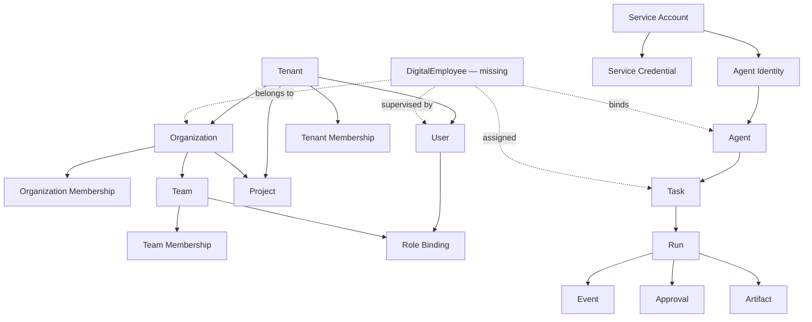
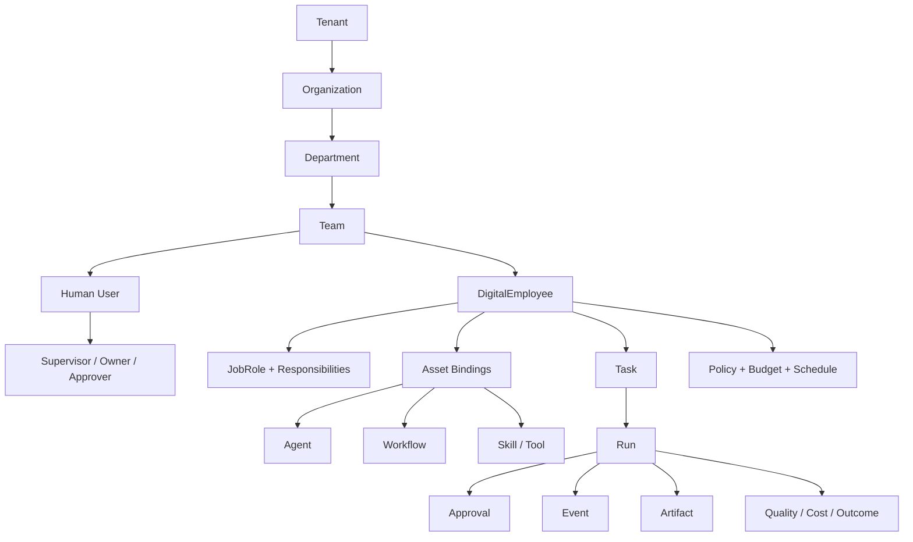

# Issue #848 — D2 统一资源模型、数字员工组织关系与生产就绪度专项审查

- 工作包：D2（仅本专项）
- 审查基线：`main` @ `b622d5fc9eab1c79c28dcaa13367eec3c138679d`
- 审查日期：2026-11-21
- 仓库：`dujiu1024-dotcom/Agent-pingtai`
- 方法：GitHub main Tree（1,742 项）+ 源码/SQL/API/前端/测试/CI/部署/生产验收文档交叉核对。
- 边界：本 Issue 明确要求 Code Audit / Gap Assessment，不是功能开发；本文件是审查交付，不修改产品业务代码。未申请真实服务器、凭据或外部资源。

## 1. 结论摘要

**总判断：统一身份与资源授权已有真实基础，但尚未形成完整统一资源语义；人类组织关系只覆盖租户/组织/团队/项目的部分关系；数字员工仍停留在 Agent + Service Account 的机器身份映射，缺少组织岗位与监督责任模型。部署自动化与 CI 有较完整的工程骨架，但仓库自己的生产验收登记明确为 NO-GO，不能判定生产就绪。**

| 审查主题 | 成熟度 | 结论 |
|---|---|---|
| Tenant / User / Organization / Team | 基础已完成 | 有 tenant、人类用户、租户成员、组织、团队、项目及关系表；组织树/部门层级/跨层级继承未完整建模 |
| 统一资源身份与授权 | 部分实现 | ResourceRef、ResourceScopeAuthorizer 和 RBAC 绑定支持多个入口；资源注册/元数据/版本/可见性/生命周期没有统一资源目录证据 |
| DigitalEmployee | 尚未建设（未找到有效实现证据） | 无独立数字员工领域实体；Agent 与 service account 身份绑定不包含岗位、职责、主管、绩效等组织语义 |
| 人类—数字员工—Agent—Task/Run 关系 | 部分实现 | 人类 Principal、Agent identity、Task/Run、Approval 各自存在；缺少数字员工作为业务责任主体的稳定关联 |
| 管理前端/API | 部分实现 | 有组织成员、角色权限只读页面和 admin API；当前 API 展示租户/用户/角色绑定/权限，未形成组织树、部门、团队成员与数字员工的可操作管理闭环 |
| 部署与环境 | 基础已完成 | 有本地/生产 Compose、健康检查、密钥文件挂载、资源限制、出站代理约束、升级与迁移状态机 |
| CI / 自动化测试 | 基础已完成 | 有 Python 3.11/3.12 单测、身份专项、PostgreSQL/Redis/Vault 集成、前端 CI、发布 Gate；workflow 存在不代表本次主干全量检查通过 |
| 生产就绪度 | 待验证 / NO-GO | 生产验收登记明确标记 NO-GO；缺少目标环境 preflight、真实 smoke、迁移预检、恢复与回滚演练、责任人和证据归档 |

## 2. 统一资源模型审查

### 2.1 当前代码可证实的资源与关系

| 目标资源 | 当前实现证据 | 成熟度 | 关键缺口 |
|---|---|---|---|
| Tenant | `platform_tenants`；`agent_platform/identity/tenants.py:create_tenant_with_owner`；`api/identity.py:/auth/initialize` | 基础已完成 | Tenant 状态、初始化和归属存在；跨公共控制面/企业运行面实例注册与离线授权不是此模型的职责，尚需独立契约 |
| Organization | `platform_organizations(tenant_id, organization_id, name, status)`，migration `005_identity_tenant_auth.sql` | 部分实现 | 无 parent_id、组织类型、负责人、组织路径/层级版本；无法直接表达多级部门树 |
| Department | 未找到独立 Department 模型/表/API | 尚未建设 | 组织表不能自动等同部门树；部门层级、主管、部门成员与数据范围继承缺失 |
| Team | `platform_teams` 与 `platform_team_memberships` | 基础已完成 | Team 可选关联 Organization，但没有 Team 负责人/岗位/成员任职历史/组织层级约束的完整证据 |
| User | `platform_users`、`platform_tenant_memberships`、`UserRecord`、`Principal` | 基础已完成 | 人类身份和租户成员关系清晰；多组织任职、部门岗位、雇佣状态/离职交接等人力组织语义未见 |
| Agent | `platform_agents`；`platform_agent_identities`；Agent Registry/Run 路径 | 基础已完成 | Agent 定义与执行身份已有，但 Agent 不是员工身份；缺岗位职责、主管关系、任职生命周期与绩效 |
| ServiceAccount | `platform_service_accounts`、`platform_service_credentials` | 基础已完成 | 机器主体、凭据、scope、吊销和状态重验存在；不应拿它替代 DigitalEmployee |
| DigitalEmployee | Tree/SQL 搜索未发现 `DigitalEmployee`、`digital_employee` 对应领域模型或迁移 | 尚未建设 | 缺独立 ID、岗位/职责、目标、组织归属、负责人、监督人、执行等级、工作时段、额度、绩效与交接 |
| Workflow / Skill / Tool / Model | Registry、Workflow、Harness、Tool Gateway、Model Router 等独立子域 | 部分实现 | 有资产专属模型和 API，但本轮未发现统一资源目录将统一 ID、版本、依赖、可见性、所有者、生命周期和授权汇总为通用资源契约 |
| KnowledgeBase | Knowledge、Connector、Graph、Memory 子域和租户/项目范围 | 部分实现 | 知识库/连接器/项目 ACL 由各子域表达；统一资源语义和跨模块共享策略需进一步整合 |
| Task / Run | Task Center、Run Lifecycle、Postgres Run State、Task/Run API | 基础已完成 | 任务与执行实例可追踪；数字员工责任主体 ID 尚未纳入统一执行上下文的证据 |
| Event | Outbox、Redis Streams、Webhook、Run events | 基础已完成 | 事件存在可靠投递基础；Event Envelope 中统一资源 owner、责任主体与跨域引用仍需核验 |
| Policy / Approval | Identity RBAC、ResourceScope、ApprovalService、审计 | 部分实现 | RBAC 角色绑定和审批域存在，但数字员工策略包、岗位授权模板、组织范围策略继承未形成完整模型 |
| Artifact | 文件资产/会话产物/执行产物分别存在 | 部分实现 | 未确认统一 Artifact 根资源、产物类型/来源 Run/版本/保留/可见性/签名与删除传播契约 |

### 2.2 已有组织/身份模型

Migration `agent_platform/storage/postgres/005_identity_tenant_auth.sql` 定义了：

- `platform_users`：人类用户身份；
- `platform_tenant_memberships`：用户加入企业租户的成员关系；
- `platform_organizations`：租户内组织单元；
- `platform_organization_memberships`：用户与组织成员关系；
- `platform_teams` / `platform_team_memberships`：团队与团队成员关系；
- `platform_projects` / `platform_project_members` / `platform_workspaces`：项目和工作空间；
- `platform_roles` / `platform_role_permissions` / `platform_role_bindings`：角色、权限和资源范围绑定；
- `platform_service_accounts` / `platform_agent_identities`：机器服务身份与 Agent 绑定；
- `platform_invitations`：邀请记录；
- `platform_identity_audit`：身份与授权审计记录。

`agent_platform/identity/models.py` 的 `Principal` 明确代表人类登录主体；`AuthorizationContext` 也以 tenant/user 为中心。机器主体另由 `ServicePrincipal` 表达（`identity/service_accounts.py`）。这是正确的身份类型分离方向，但尚无 DigitalEmployee 作为组织业务主体的模型。

### 2.3 组织授权与资源隔离边界

- `ResourceScopeAuthorizer.authorize()`（`agent_platform/identity/resource_scope.py`）先校验 principal.tenant_id 与 scope.tenant_id 一致，再按 Human/API Credential/Service Principal 分发到对应授权服务；默认拒绝未知主体。
- `PostgresIdentityRepository.get_authorization_context()`（`identity/postgres.py`）解析有效租户成员、用户/团队角色绑定，并把 tenant/project/organization 授权投影到项目权限集合。
- `platform_role_bindings.subject_type` 的数据库约束当前为 user/team/service_account/agent，没有 digital_employee 或 organization/department subject 类型。组织授权通过资源作用域绑定和成员/团队关系部分实现，不代表具备完整部门级策略继承。
- `ResourceScopeAuthorizer` 有 Gateway、Harness media read/write 适配器；`tests/test_identity_resource_scope.py` 覆盖跨租户拒绝、精确资源权限委派、Gateway actor/tenant 绑定、媒体读写授权前置。
- Migration `048_resource_project_scope.sql` 和 `057_resource_project_scope.sql` 重复表达 project_id scope 扩展；NULL 明确表示 tenant-scope，旧数据不猜测项目归属。重复迁移编号/内容需纳入迁移治理核验，不可仅凭文件名推断执行顺序。

**重要安全发现（P1，需优先复核/修复）：** `agent_platform/api/admin.py:create_admin_router` 的 `/organization`、`/access-control`、`/settings` 只调用 `_principal()` 取得已认证主体，并按 `principal.tenant_id` 查询；该文件内未调用 `IdentityService.authorize` 或专用 admin authorizer。生产组合 `agent_platform/api/app.py` 在 `connection_factory` 存在时直接注册该 router，且把 `admin` 加入 bootstrap capabilities。Identity middleware 提供认证边界，不等于 RBAC 管理授权。需确认是否存在 router 外部统一授权层；若无，则普通租户成员可能读取角色/绑定/预算等管理数据。报告不擅自断言可利用，列为必须通过负向 API 测试验证的授权风险。

### 2.4 资源关系图（现状与目标缺口）

虚线关系是目标缺口，不是现有外键/服务关系。Task/Run/Event/Approval/Artifact 的具体关联在各子域中分散实现；本轮没有证明它们由单一统一资源主表管理。

## 3. 数字员工组织关系专项差距

| 目标能力 | 当前证据 | 判断 | 必须补齐的功能 |
|---|---|---|---|
| 数字员工独立身份 | 无 DigitalEmployee 模型/表/路由 | 尚未建设 | DigitalEmployee ID、身份类型、状态、租户归属、审计 |
| 组织/部门/团队任职 | User/Organization/Team 表存在；Agent identity 只绑定 ServiceAccount | 部分实现 | 数字员工任职关系、部门/团队多归属规则、生效时间、调岗/离职 |
| 岗位与职责 | 未发现岗位/职责/服务范围实体 | 尚未建设 | JobRole、Responsibility、ServiceScope、目标与 KPI |
| Agent/Workflow/Skill/Tool 绑定 | Agent/Workflow/Skill/Tool 各自存在；Agent identity 与 ServiceAccount 绑定 | 部分实现 | 数字员工可绑定多个执行资产及版本，定义主 Agent、备用 Agent、工作流与工具许可 |
| 知识与业务权限 | RBAC/ResourceScope 存在 | 部分实现 | 将岗位职责映射成可审计策略包；按数据域/业务动作实施最小权限 |
| 人类负责人/主管/审批人 | Approval 与 User Principal 存在 | 部分实现 | owner/manager/supervisor/approver 明确关系，禁止由 Agent 自行声明；支持主管变更与委托审计 |
| 执行等级/额度/时段 | Policy、Quota、Approval 基础存在 | 部分实现 | DigitalEmployee 级执行模式、风险上限、日/月预算、并发、时间窗与紧急停用 |
| 任务/交付/接管 | Task/Run/Approval 存在 | 部分实现 | 每项任务归属数字员工；记录执行人/监督人、交付物、失败原因、人工接管及交接 |
| 绩效/成本 | Evaluation、Quota、Observability 存在 | 部分实现 | 以岗位目标计算 SLA、质量、成本、业务结果；区分 Agent 技术指标与数字员工绩效 |

**建议领域关系：** DigitalEmployee 作为企业组织主体；通过 Employment/Assignment 关系归属 Organization/Department/Team/JobRole；通过 AssetBinding 绑定 Agent/Workflow/Skill/Tool 的固定版本；通过 SupervisorBinding 指定人类负责人/主管/审批人；Task/Run/Approval/Artifact 都记录 digital_employee_id 与责任链快照。不要把 DigitalEmployee 和 Agent 合并为同一张身份表。

## 4. 部署与混合部署能力审查

### 4.1 已有部署基础

- `deploy/compose.yaml`：PostgreSQL、Redis、MinIO，持久卷、健康检查、资源限制、loopback 端口绑定。
- `deploy/production.compose.yaml`：API 与 Worker 分离；固定非 root UID、read-only filesystem、cap_drop ALL、no-new-privileges、tmpfs、PID/CPU/内存限制；Postgres/Redis/MinIO 健康依赖；凭据文件挂载；强制配置出站代理和 hostname allowlist。
- `deploy/.env.production.example`：要求不可变镜像 digest、HTTPS origins、出站代理和 allowlist、外部 secret file 路径。
- `agent_platform/production.py`：生产 ASGI composition root；导入时校验配置并装配 PostgreSQL、Redis、对象存储、身份、Runtime、任务、审批、Graph、Events、Quota、Observability 等服务。
- `agent_platform/deployment/migrations.py`：Expand/Dual-write/Backfill/Validate/Cutover/Contract/rollback 状态机；切换前要求 validation digest。
- `agent_platform/deployment/versioned.py`：Rolling/Blue-Green/Canary/Gray 策略、分阶段流量、健康阈值、暂停和回滚状态机。
- `scripts/release_upgrade.sh`、`deploy/RELEASE_UPGRADES.md`：升级流程、已知良好版本快照与失败回退配置测试。
- `agent_platform/api/health.py`、`docs/deployment/health-readiness-probes.md`：Liveness 与 Readiness 语义分离；readiness 依赖失败返回 503。

### 4.2 部署就绪缺口

- 生产 Compose 主要是单主机容器编排，不等于跨可用区高可用；未找到本轮可证实的 Kubernetes/Helm/Operator 多节点生产部署基线。
- 企业运行平面依赖企业本地 Postgres/Redis/MinIO 是可行的基础，但公共控制平面断网后许可证、版本分发、生态市场和企业侧授权续期的独立运行行为未在本轮证明。
- 环境模板要求代理变量和主机 allowlist；文档也承认代理变量本身不是网络防火墙。仍需网络层 egress policy、DNS/证书、镜像签名与 SBOM/供应链验收证据。
- Compose 的 healthcheck、依赖健康和 rollout state machine 是部署基础；实际 traffic switch、跨节点状态、自动故障转移与多区域恢复未获真实执行证据。
- 环境变量、配置、密钥轮换、备份加密密钥恢复和离线升级包的端到端验收仍需补齐。

## 5. CI、测试与工程质量审查

### 5.1 CI 工作流

| 工作流 | 实际覆盖 | 不能据此证明 |
|---|---|---|
| `.github/workflows/ci.yml` | Python 3.11/3.12 全量 unittest、身份/租户隔离专项、ruff、mypy；调用平台集成工作流 | 主干某个 commit 的实际通过状态；生产数据/真实组织流程 |
| `.github/workflows/platform-integration.yml` | CI 容器 PostgreSQL、Redis、Vault；数据库迁移、租户创建、服务身份、知识/运行/消息集成 | 生产环境容量、HA、备份恢复、公共控制平面断网 |
| `.github/workflows/platform-release-gate.yml` | PostgreSQL/Redis E2E、安全、故障恢复、核心旅程、发布证据校验；部分作业需要 workflow_dispatch 输入 | 真实生产 smoke、真实迁移和生产回滚；文档明确 workflow 不执行生产部署 |
| `.github/workflows/frontend-ci.yml` | 前端单测、lint、typecheck、build、Playwright E2E；按 frontend 路径变化触发 | 后端 API 的真实权限闭环；不触发时不能视作本次前端检查通过 |

### 5.2 相关测试证据

- `tests/test_identity.py`、`tests/test_identity_api.py`、`tests/test_identity_resource_scope.py`：身份会话、认证 API、租户资源 scope 的单元/路由测试。
- `tests/test_service_identity_authorization_integration.py`：真实 PostgreSQL DSN 下验证机器主体、Agent 状态变化后的授权重验、主体与 Agent 不匹配拒绝；无 DSN 时跳过。
- `tests/test_tenant_creation_integration.py`：PostgreSQL 下 tenant + first owner 原子创建及失败回滚；无 DSN 时跳过。
- `frontend/e2e/organization-access.spec.ts`：通过 Playwright route.fulfill 拦截并伪造 admin API payload，验证页面渲染；这是前端路由/渲染测试，不是端到端后端 RBAC/数据库验收。
- `tests/test_production_deployment_contract.py`、`tests/test_deployment_compose.py`、`tests/test_issue_18_a_18_01_deployment_acceptance.py`：验证 Compose 配置、安全基线、健康检查、资源限制、升级脚本语法和失败后恢复已知良好配置；不运行真实生产服务。
- 本轮未在当前执行环境运行仓库测试命令；测试文件存在仅作为覆盖证据。PR CI 会提供该文档提交的实际检查状态。

### 5.3 测试覆盖断点

1. 缺 DigitalEmployee 组织关系、岗位权限继承、主管审批、停用/调岗/离职与任务接管的领域测试。
2. 缺部门树父子约束、组织循环、组织成员多归属、组织权限继承/撤销即时生效等 PostgreSQL 集成测试。
3. admin API 缺少普通成员访问管理接口的 403 负向测试；应覆盖匿名、普通成员、租户管理员、跨租户请求。
4. 组织前端 E2E 使用 route mock，不验证 API 权限和真实数据库数据。
5. 集成测试会在有 DSN 时执行真实服务测试，但无 DSN 时 skip；CI 的 Postgres/Redis 服务 job 是可复现证据，仍不代表生产验收。
6. 迁移集成测试对 migration 文件按路径排序执行；应有独立 migration inventory 检查唯一编号、重复 SQL 和旧版本升级路径。
7. 发布 Gate 有生产证据 schema 验证；证据缺失时应保持 NO-GO，而不能由 CI success 自动替代生产审批。

## 6. 生产就绪度判定

<badge>NO-GO / 未完成生产验收</badge>

直接证据：`docs/release/PRODUCTION_ACCEPTANCE_REGISTER.md` 标题和结论明确为 **NO-GO / production acceptance incomplete**。其中 Deployment preflight、Production smoke、Migration、Rollback 均为 BLOCKED；Core E2E、Fault injection、Performance、Security、Backup/restore 标记为 automation evidence only / production acceptance pending。

`docs/release/PRODUCTION_RELEASE_ACCEPTANCE.md` 规定每个检查必须提供具名 owner、UTC 时间戳、持久证据引用、准确候选 SHA、artifact digest、独立审批；CI、synthetic fixture、workflow 定义和未执行测试不能作为生产通过证据。

| 生产门禁 | 当前状态 | 退出条件 |
|---|---|---|
| Deployment preflight | BLOCKED | 目标环境配置、依赖健康、镜像 digest、变更窗口、回滚准备证据 |
| Core E2E / Security / Performance | 自动化证据基础；生产验收未完成 | 最新 CI 运行结果 + 目标环境授权验证（按环境政策） |
| Fault injection / Recovery | 自动化测试存在；跨主机/生产演练未验证 | 演练记录、数据损失评估、恢复时间与审计日志 |
| Backup / Restore | 脚本和集成测试存在；生产恢复未验证 | 不可变备份标识、隔离恢复报告、完整性与 RPO/RTO |
| Migration | BLOCKED | 精确迁移集、预检结果、应用/Schema 兼容窗口、审批 |
| Production smoke | BLOCKED | 授权变更流程中的目标环境 smoke 证据 |
| Rollback | BLOCKED | 指定候选 SHA 的真实回滚/恢复演练及结果 |
| Release approval | NO-GO | 完整证据归档、具名 release owner 与独立 approver、无 blocker |

**本轮按要求跳过真机验证，因此不可能把生产就绪度升级为 GO。**

## 7. 高风险问题与优先级

| ID | 严重度 | 缺口 | 影响 | 建议优先级 |
|---|---|---|---|---|
| D2-R1 | High | DigitalEmployee 领域身份和组织任职关系缺失 | 无法表达数字员工岗位责任、主管监督、绩效与交接 | P1 |
| D2-R2 | High | 部门树/组织层级/主管关系模型不完整 | 组织范围授权、汇报关系和部门数据边界无法统一 | P1 |
| D2-R3 | High | admin API 需要验证是否仅有认证、缺少管理权限授权 | 可能导致普通租户成员读取管理数据；需负向 API 测试确认 | P0 |
| D2-R4 | High | 统一资源目录/资源元数据契约未形成 | 跨模块资产 ID、版本、所有权、可见性与授权不一致 | P1 |
| D2-R5 | High | 生产验收登记 NO-GO，真实 preflight/smoke/migration/rollback 缺证据 | 不具备可审计的生产发布批准条件 | P0（发布门禁） |
| D2-R6 | Medium | Compose 单主机部署，不足以证明高可用/多故障域 | 单机故障和容量上限可能影响企业核心运行平面 | P1/P2 |
| D2-R7 | Medium | 组织页面 E2E mock API，缺少真实 API + DB + RBAC 全链路验证 | UI 看似正常但服务端权限/数据可能未验收 | P1 |
| D2-R8 | Medium | CI workflow 定义和生产验收之间有证据边界 | CI 绿灯可能被误读为生产 ready | P1 |
| D2-R9 | Medium | migration 编号/重复内容需系统治理 | 新环境安装、旧环境升级顺序和重复执行风险 | P1 |

## 8. 建议的统一目标模型（不等于当前实现）

设计约束：
- Human User 与 DigitalEmployee 是同一组织体系下不同 Principal Type，数字员工不能复用人类登录凭据。
- DigitalEmployee 与 Agent 一对多/多版本绑定；Agent 仍是可复用执行资产，员工是岗位责任与工作分配主体。
- 每次 Task/Run 保存 DigitalEmployee、Agent 版本、监督人、策略快照、审批和产物引用；主管调整不篡改历史责任记录。
- 组织/部门/团队权限由服务端策略解析，遵循显式继承和 deny/allow 规则；前端隐藏按钮不构成安全边界。
- 资源目录可以作为统一语义/索引层，不要求所有资源强制迁入单一表或拆成独立微服务。

## 9. 可执行研发 Backlog

| 优先级 | 任务 | 依赖 | 验收标准 |
|---|---|---|---|
| P0 | D2-A 管理 API 权限专项核验与加固 | Identity/ResourceScopeAuthorizer、admin router | 普通成员/匿名返回 401/403；管理员按 tenant scope 可访问；跨租户和伪造 principal 测试拒绝；审计记录 actor/resource/action |
| P0 | D2-B 发布证据门禁落地 | release gate、环境 owner、备份/迁移/回滚流程 | 精确候选 SHA 的九项生产检查齐备；具名 owner/独立 approver；真实演练证据完整；否则保持 NO-GO |
| P1 | D2-C 统一资源目录与元数据契约 | Registry、Tenant、RBAC、Asset Registry | 统一 resource_id/type/tenant/owner/visibility/version/status/created_by/audit；各资产可通过 API 查询授权后的元数据 |
| P1 | D2-D Organization/Department/Team 层级模型 | Identity migration、组织 API、RBAC | 支持 parent/child、循环拒绝、负责人、成员任职历史、范围继承/撤销；PostgreSQL 集成测试通过 |
| P1 | D2-E DigitalEmployee 组织身份与任职模型 | D2-C/D、Agent Registry、Task/Run、Approval、Quota | 数字员工可入职/调岗/停用；绑定岗位/职责/Agent/Workflow/Skill/Tool；负责人和审批人必填；权限变更立即生效 |
| P1 | D2-F 组织与数字员工管理前后端闭环 | D2-D/E、Bootstrap Capability、API ACL | 页面读取真实 API；组织树、员工档案、岗位绑定、主管/审批、权限与审计可操作；Playwright 不 mock 核心业务 API |
| P1 | D2-G 资源关系和数据隔离集成测试 | D2-C/D/E | Tenant/Organization/Department/Team/Employee/Asset/Task/Run/Artifact 跨边界访问负向测试覆盖；权限撤销即时生效 |
| P1 | D2-H 数据库迁移治理 | Migration Orchestrator、SQL inventory | migration 编号唯一且可排序；新库全量初始化、N-1 升级、重复执行和失败回滚均通过 |
| P2 | D2-I 多节点企业部署基线 | Compose 基线、DR、配置/密钥、网络策略 | 至少一个受支持的多节点/多故障域部署方案；节点故障/滚动升级/恢复演练达到定义的 RPO/RTO |
| P2 | D2-J 离线企业运行与控制面断连验收 | Hybrid boundary、License/Entitlement、Artifact mirror | 公共控制面断网时已授权企业运行平面可继续执行；离线许可证校验、续期宽限、版本缓存和审计可复现 |
| P2 | D2-K 生产观测与容量验收 | Prometheus、Trace、Quota、SLO | 明确 SLI/SLO、容量阈值、告警责任人；压测报告覆盖并发、延迟、成本和故障恢复 |

## 10. 最终判定

1. **可保留复用：** IdentityService、PostgresIdentityRepository、ResourceScopeAuthorizer、ServiceIdentity、RBAC、Task/Run、Approval、Registry、Migration/Deployment state machine、Production Compose、Release Gate。
2. **应扩展整合：** Tenant/Organization/Team/Project 关系、统一资源元数据、组织策略继承、Task/Run/Approval/Artifact 责任关联。
3. **应新增领域能力：** DigitalEmployee、JobRole/Responsibility、SupervisorBinding、Employment/Assignment、员工级策略/额度/绩效。
4. **必须优先复核：** admin API 管理授权是否完整；生产验收 NO-GO 的阻塞证据是否逐项关闭。
5. **生产判断：** 当前代码具备部署和自动化验证基础，但按仓库自己的生产验收规则仍为 NO-GO。真机验证本轮跳过，未对任何生产环境做结论性验证。

本报告只完成 D2 差距审查；不表示 Issue #848 全部目标完成，不建议关闭 Issue。
