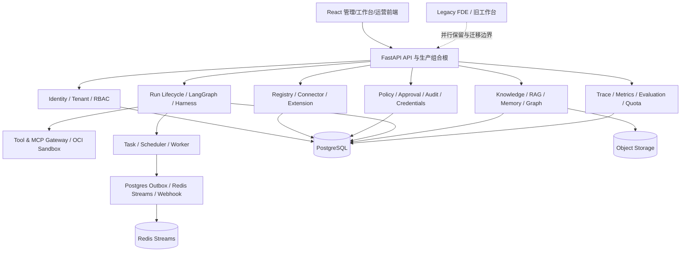

# D3：AI Native Enterprise Platform 最终差距汇总

> Issue：[#848](https://github.com/dujiu1024-dotcom/Agent-pingtai/issues/848)  
> 审查基线：`main` @ `b622d5fc9eab1c79c28dcaa13367eec3c138679d`（2026-11-21）  
> 汇总范围：A1/A2/A3、B1/B2/B3、C1/C2/C3、D1/D2 专项审查；本文件是跨专项的最终综合结论，不替代各专项源证据。  
> 方法：按 Issue #848 目标能力、架构原则和成熟度定义归并专项审查结论；同一根因只保留一个主 Backlog 项，注明跨域影响与依赖。  
> 边界：本轮为代码差距审查与报告合并，不实现产品业务功能；本地全量测试、真实服务联调、真机/生产验证均未执行。

## 1. 最终结论

**总体成熟度：已有真实平台底座，但尚未达到可证明的企业级 AI 原生基础设施生产就绪状态。**

仓库已具备身份/RBAC、Registry、Run 生命周期、LangGraph 多 Agent、Outbox/Redis Streams、审批、Tool Gateway/OCI 沙箱、知识检索、Trace/Metrics、Evaluation、Quota、部署升级/备份等可复用机制。主要问题不是“没有代码”，而是统一契约、生产组合根强制接线、异步身份复核、跨存储租户隔离、全资产发布治理、端到端测试和生产验收证据不足。

当前不能作出以下结论：全链路强租户隔离已证明；所有工具/业务副作用均经过统一策略审批；企业断开公共控制面仍能完整自治；数字员工已成为组织主体；平台具备经过演练的 HA/DR；AI 质量门禁覆盖所有生产发布路径；生产环境已 GO。

**建议决策：保留现有模块化底座，优先补齐 P0 安全与生产门禁，再完成 P1 跨域统一能力，最后推进 P2 产品化和生态商业化。不要启动全平台推倒重写。**

### 成熟度口径

| 等级 | 本报告采用的判定 |
|---|---|
| 已完成 | 核心前后端链路可运行，关键场景有测试与验收证据 |
| 基础已完成 | 真实机制/服务已实现，但产品闭环、集成或验收不足 |
| 部分实现 | 只覆盖部分职责，或存在接口/模块但端到端链路未闭合 |
| 仅有设计 | 主要证据为设计/文档，未找到足够代码实现 |
| 尚未建设 | 在本轮专项检查范围内未找到有效实现证据 |
| 待验证 | 有实现线索，但缺可复现运行、集成或生产证据 |

> “测试文件存在”不等于测试通过；“API/页面存在”不等于端到端完成；“可部署”不等于生产可用。未验证项不得升级成熟度。

## 2. 审查基线、范围与证据边界

- 仓库：`dujiu1024-dotcom/Agent-pingtai`
- 唯一代码基线：`main @ b622d5fc9eab1c79c28dcaa13367eec3c138679d`
- 专项报告 Tree 统计：1,742 项（D2 枚举记录）；初始阶段报告曾记录较早基线 1,568 项。最终成熟度以本轮各专项统一声明的上述 main SHA 为准。
- 覆盖：后端领域/服务/API、SQL migrations、前端路由与页面、运行时/模型/工具、任务/事件/知识/记忆、身份/组织/审批/审计、部署/CI/测试/运维文档。
- 执行限制：当前执行环境无完整本地 checkout，未运行全量 pytest、前端 build 或本地静态扫描；未连接真实 PostgreSQL、Redis、MinIO、OCI runtime、模型供应商、企业 SaaS 或生产集群。
- CI：专项 PR 多次出现已知失败，重点包括 release-evidence fixture/Markdown 断言、Identity 文件资产隔离接口预期 200 实际 405、Graph tenant/project membership 不一致、PostgreSQL/Redis 集成测试失败及迁移序号重复。安全单测和部分依赖审计通过，但不足以抵消失败项。生产 release evidence 有 skipped 记录。
- 生产验收：`docs/release/PRODUCTION_ACCEPTANCE_REGISTER.md` 标记 NO-GO；生产 preflight、smoke、migration、rollback 等证据尚未闭合。

专项交付入口（均为审查增量，未在本轮合并）：
- A1 八大核心引擎：[#850](https://github.com/dujiu1024-dotcom/Agent-pingtai/pull/850)
- B1 核心技术能力 6–10：[#851](https://github.com/dujiu1024-dotcom/Agent-pingtai/pull/851)
- A2 核心技术能力 1–5：[#852](https://github.com/dujiu1024-dotcom/Agent-pingtai/pull/852)
- B2 产品中心 1–7：[#853](https://github.com/dujiu1024-dotcom/Agent-pingtai/pull/853)
- C2 新增产品中心：[#854](https://github.com/dujiu1024-dotcom/Agent-pingtai/pull/854)
- D2 资源模型/组织/生产就绪度：[#855](https://github.com/dujiu1024-dotcom/Agent-pingtai/pull/855)
- B3 产品分层映射：[#856](https://github.com/dujiu1024-dotcom/Agent-pingtai/pull/856)
- C3 生态资产治理/商业协作：[#857](https://github.com/dujiu1024-dotcom/Agent-pingtai/pull/857)
- A3 统一控制平面：[#858](https://github.com/dujiu1024-dotcom/Agent-pingtai/pull/858)
- D1 战略扩展能力与 C1 产品中心专项结论以 Issue #848 既有回填及其对应报告章节为证据；本报告只归并，不重写专项事实。

## 3. 当前系统反向架构与目标边界

### 3.1 代码反向架构（概念图）

图表达源码模块关系，不表示所有路径已在生产完整接线。旧 FDE 与新 `agent_platform/` 并行演进，必须明确哪些旧能力仍处于主产品路径，避免把旧版 Demo/CLI 当作新平台验收。

### 3.2 目标平面

- **企业运行平面**：身份、业务数据、知识、密钥、任务、Runtime、审计和核心策略在企业掌控的环境运行；公共侧不可成为业务运行单点。
- **公共控制/服务平面**：可选实例注册、许可证、版本/组件分发、伙伴目录等；断网时企业已授权核心运行能力应持续工作。
- **生态协作平面**：内部与外部开发者可按统一资产标准构建、签名、审核、分发；企业私有资产和数据默认隔离。
- **横向治理底座**：Tenant/Identity、Resource/Asset、Policy/Approval、Event/Task、Runtime、Data/Knowledge、Observability/Cost 必须跨 API、Worker、DB、缓存、对象存储和前端保持一致。

## 4. 完整成熟度矩阵

### 4.1 八大统一核心引擎

| 引擎 | 成熟度 | 已有代码/机制基础 | 核心差距与验收重点 |
|---|---|---|---|
| 身份与组织 | 基础已完成 | `identity/models.py`、`IdentityService`、Postgres repository、Tenant membership、RBAC、ResourceScope、ServiceAccount | 组织树/部门继承/SSO-SCIM 不完整；DigitalEmployee 缺独立组织身份；Worker/Outbox/Connector 恢复时再授权与跨存储隔离需负向测试 |
| AI 资产 | 部分实现 | `control_plane/registry.py`、版本化 Registry、Extension Manifest/Package、Publisher Trust | Prompt/Connector/Knowledge/Artifact 等统一资产契约不完整；依赖锁、签名/来源证明、环境晋级、全资产灰度/回滚和撤销传播未闭环 |
| 任务与调度 | 基础已完成 | Run Lifecycle、PostgresRunStateStore、lease/checkpoint/recovery、Scheduler API | Task 与 Run 责任链、独立 Run Worker、优先级/公平调度、恢复时授权、外部副作用幂等/补偿不足 |
| 事件驱动 | 基础已完成 | Postgres Outbox、Redis Streams、lease、receipt、退避、DLQ/replay、Webhook | 至少一次投递不是 exactly-once；Consumer 幂等约束、Schema/订阅治理、跨租户重放授权和故障演练不足 |
| 策略与审批 | 基础已完成 | RiskLevel、默认拒绝、Action digest、Approval Service/Verifier、审计 | 生产所有执行入口强制 PDP/PEP 尚未证明；审批人资格、撤权竞态、策略版本治理、ToolEffect reconciliation 需端到端验证 |
| 统一执行运行时 | 基础已完成 | LangGraph、多专家并行、Run state、Harness Adapter、Blackboard、Tool/MCP Gateway、OCI Sandbox | 生产 Runtime Builder/Worker 接线一致性、跨 Harness 质量、真实多专家 PG 恢复、人工接管与安全副作用闭环未验证 |
| 数据与知识 | 基础已完成 | Connector、Knowledge/RAG、Memory、ACL-first 检索、Graph | DB/向量/文件/缓存/日志/备份统一 ACL、分类分级、血缘、删除传播、多模态摄取和企业连接器深度不足 |
| 观测与计量 | 部分实现 | Trace/Span、Prometheus、Alerts、Evaluation、Quota/Usage Ledger | 跨 API/Worker/Connector trace 关联、Provider 实报对账、部门成本分摊、SLO/SLA、ROI 与所有发布入口质量门禁未完成 |

### 4.2 十项核心技术能力（Issue 第八节）

| # | 能力 | 成熟度 | 主要缺口 |
|---|---|---|---|
| 1 | 多智能体协同执行 | 基础已完成 | 规划/委派策略、生产 checkpointer、委派授权、复杂图重启恢复和人工接管闭环 |
| 2 | 任务执行与工作台 | 基础已完成 | Task/Session/Run/Artifact 统一关联、产物版本交付、前端真实 API 闭环、恢复副作用一致性 |
| 3 | 企业系统集成与连接器 | 部分实现 | 当前 Provider 基础覆盖 PostgreSQL/MySQL/S3/Feishu/Notion/HTTP；ERP/CRM/OA/HR/MES 等领域适配和 SDK/契约测试不足 |
| 4 | 工具安全执行与沙箱 | 基础已完成 | OCI 实际隔离/宿主加固未真机验证；所有工具强制 Gateway、短期凭据、紧急停止和副作用对账需证明 |
| 5 | 事件驱动与可靠调度 | 基础已完成 | Consumer 通用幂等契约、补偿、优先级/公平性、定时/事件统一触发和多实例故障恢复 |
| 6 | Webhook 与开放 API | 部分实现 | API v1/限流/幂等/版本头及 Webhook 有基础；消费者 Key 生命周期、SDK、开发者门户、签名轮换和外部契约验收不足 |
| 7 | 多模型运行时 Harness | 基础已完成 | Adapter/benchmark 结构存在；真实供应商同任务质量/成本比较、降级、流式、取消/恢复和兼容矩阵未验证 |
| 8 | Agent 版本发布部署 | 部分实现 | Registry/Extension 发布基础存在；全资产依赖锁、审批 Gate、环境晋级、灰度、回滚、撤销传播不完整 |
| 9 | 执行链路追踪与质量分析 | 基础已完成 | Trace/metrics/evaluation 有基础；异步全链路、真实评测集、发布 Gate 全覆盖、质量反馈闭环不足 |
| 10 | 企业级部署基础设施 | 部分实现 | Compose/health/upgrade/backup 存在；K8s/IaC、HA、跨组件 DR、离线授权、公共控制面断网自治未验收 |

### 4.3 十四个产品中心

| # | 产品中心 | 成熟度 | 核心缺口 |
|---|---|---|---|
| 1 | 智能体管理中心 | 部分实现 | 定义/管理入口存在；发布审批、依赖锁、环境晋级、灰度/回滚和运行效果闭环 |
| 2 | 多智能体协作中心 | 基础已完成 | 多专家并行/共享状态存在；生产持久化、授权委派、故障隔离和业务场景验收 |
| 3 | 行业智能应用中心 | 待验证 | 行业方案包、模板、数据/流程适配和可复用交付证据不足 |
| 4 | 工作流自动化中心 | 部分实现 | Workflow Designer/执行基础；节点契约、调试、版本、发布与生产运行闭环 |
| 5 | 任务执行与会话中心 | 基础已完成 | Run/Session/Replay 等存在；完整任务责任链、产物交付、人工接管和真实前端闭环 |
| 6 | 模型与工具中心 | 部分实现 | Provider/Template/Routing/Tool/MCP 基础；供应商实测、工具资产统一治理和凭据边界 |
| 7 | 企业知识与记忆中心 | 基础已完成 | Knowledge/RAG/Memory/Graph 有基础；跨存储 ACL、删除传播、数据血缘和多模态 |
| 8 | Agent 应用市场与资产中心 | 部分实现 | Registry/Publisher Trust 有基础；市场搜索/安装/审核/依赖/撤销/许可/结算 |
| 9 | 企业组织与安全中心 | 基础已完成 | Tenant/User/RBAC 有基础；部门层级、SSO/SCIM、异步再授权、全数据面隔离 |
| 10 | AI 治理与合规中心 | 部分实现 | Policy/Approval/Audit/数据治理存在；策略强制接线、DB 角色隔离、控制项证据包与全路径脱敏 |
| 11 | AI 质量评测中心 | 基础已完成 | Dataset/Runner/Comparison/Rollout 存在；人工标注/仲裁、真实企业语料、发布 Gate 全覆盖 |
| 12 | 运行监控与成本中心 | 基础已完成 | Trace/Metrics/Alerts/Cost 页面存在；SLO/值班、成本对账、组织成本归集和业务价值 |
| 13 | 企业资源与成本管理中心 | 部分实现 | Quota/Concurrency/Usage Ledger 存在；CPU/GPU/资源池、Cost Center、部门预算、账单对账 |
| 14 | 企业部署与运维管理中心 | 部分实现 | Compose/Health/Upgrade/Backup 工具存在；HA/DR、断网自治、离线许可、统一运维门户和生产演练 |

### 4.4 八个新增产品中心（C2）

| 中心 | 成熟度 | 主要差距 |
|---|---|---|
| 企业系统集成 | 部分实现 | 通用 Connector 与有限 Provider 已有；专用企业系统适配、SDK、生产凭据轮换/健康/同步验收 |
| 企业数据接入与治理 | 部分实现 | ingestion/sync/retention 基础；统一目录、分类分级、质量、血缘、ACL 与删除传播 |
| AI API 开放平台 | 部分实现 | API v1、分页、幂等、版本头、限流；API Consumer/Key lifecycle、SDK、开发者门户与 SLA |
| AI 资产生命周期管理 | 部分实现 | Registry/Extension 版本发布基础；全资产 manifest、依赖锁、兼容矩阵、环境晋级/回滚 |
| AI 安全执行与沙箱 | 基础已完成 | OCI 安全参数与 Gateway 机制；真实 Runtime 强制接线、容器逃逸/网络隔离测试未验收 |
| AI 服务等级与可靠性 | 部分实现 | Health/alerts/retry/recovery 基础；正式 SLI/SLO、错误预算、熔断/降级、RCA |
| AI 人才与开发者生态 | 待验证 | Publisher key 不等于伙伴体系；SDK/CLI、伙伴空间、认证、提交审核和支持运营 |
| 企业 AI 运营与价值分析 | 待验证 | Token/成本报表不是业务 ROI；工时节省、流程周期、质量收益和财务归因未证明 |

### 4.5 十项战略扩展能力（D1）

| 能力 | 成熟度 | 当前判断/缺口 |
|---|---|---|
| 企业 AI 决策中心 | 待验证 | 未证明指标—异常—预测—方案比较—审批执行的完整决策闭环 |
| AI 数字员工管理 | 尚未建设（有效证据范围） | DigitalEmployee 独立组织身份、岗位职责、主管/负责人、绩效和生命周期缺失 |
| 企业流程挖掘 | 尚未建设（有效证据范围） | 业务事件采集、流程发现、瓶颈分析、自动化机会和效果评估闭环缺失 |
| AI 自主优化 | 部分实现 | Prompt 实验/评测线索存在；失败分析、候选改进、人工批准、回归和发布闭环不足 |
| 企业知识图谱 | 部分实现 | Graph 服务/页面存在；实体抽取、关系治理、冲突消解、血缘和跨源质量待补 |
| 多模态 AI | 部分实现/待验证 | 有局部处理线索但未证明统一 OCR/语音/视频/图纸路由、权限和评测闭环 |
| AI 事件驱动 | 基础已完成 | Outbox/Streams/Webhook 基础真实存在；事件目录、规则运营、消费幂等与恢复验收不足 |
| 合同服务 | 尚未建设（有效证据范围） | 合同生命周期、条款抽取/审查、签署、履约/续约与权限审计未找到完整实现 |
| 业务连续性 | 部分实现 | 备份/恢复/重试/部署机制存在；跨组件 DR、RPO/RTO、故障切换/回切演练缺失 |
| 创新实验室 | 待验证 | 实验空间、沙盒数据、模型/Agent 实验治理、预算/审批和成果转生产证据不足 |

> D1 相关“尚未建设”限定为已检查证据范围内未找到有效实现，不表示对仓库每一个文件作了数学意义上的不存在证明。

### 4.6 统一资源模型、数字员工与生产就绪

| 主题 | 成熟度 | 关键判断 |
|---|---|---|
| Tenant/User/Organization/Team/Project | 基础已完成 | SQL、身份服务、RBAC 和资源作用域存在；组织层级语义不完整 |
| DigitalEmployee | 尚未建设（有效证据范围） | Agent/ServiceAccount 是机器身份/执行身份，不等于员工岗位、职责、主管、绩效和责任主体 |
| Agent/Workflow/Skill/Tool/Model/KnowledgeBase | 部分实现 | 多个 Registry/专用生命周期并存，跨资产版本/依赖/可见性/生命周期不统一 |
| Task/Run/Event/Approval/Artifact | 部分实现 | 各自存在，但统一责任链、所有者、状态一致性、历史审计和删除/归档规则未闭合 |
| 部门/团队共享与个人/企业/伙伴资产隔离 | 部分实现 | tenant scope 基础存在，跨资源可见性和外部伙伴隔离语义未统一 |
| 人类员工与数字员工组织协作 | 尚未建设（有效证据范围） | 缺少共同组织主体模型、岗位关系和审批监督绑定 |
| 管理 API 服务端授权 | 待验证（P0） | admin organization/access-control/settings 路由需确认 router 外统一授权层，并补未授权/跨租户负向测试；目前不直接断言为可利用漏洞 |
| CI/测试/部署工程基础 | 基础已完成 | 多层 CI、Compose、health/readiness、升级状态机、备份恢复脚本存在 |
| 生产就绪 | 未通过 | Production Acceptance Register 为 NO-GO；关键 preflight/smoke/migration/rollback 证据未闭合 |

## 5. 横向架构原则符合度

| Issue 原则 | 当前判断 | 主要差距 |
|---|---|---|
| Hybrid First | 待验证 | 企业运行平面离线自治、公共控制面不可用时核心运行连续性无演练证据 |
| Tenant First | 部分符合 | Tenant/RBAC/ResourceScope 存在；Worker/Connector/向量/文件/缓存/审计/备份全链路负向隔离未覆盖 |
| API First | 部分符合 | FastAPI API 丰富；外部 API consumer/key/SDK/契约治理和页面之外调用验证不足 |
| Asset First | 部分符合 | Registry/Extension 有基础；跨资产统一 manifest、依赖、签名、发布和撤销不完整 |
| Policy First | 部分符合 | Approval/Policy/Gateway 存在；所有执行入口和异步恢复路径强制执行未证明 |
| Runtime First | 基础符合 | Run lifecycle/Harness/Worker 有基础；独立弹性、恢复身份和多 Harness 生产一致性不足 |
| Context Engineering | 部分符合 | RunContext/Blackboard/Knowledge/Memory 存在；权限/预算/时效过滤及跨任务上下文审计不完整 |
| Evaluation Loop | 部分符合 | Dataset/Runner/Comparison/Rollout 有基础；生产 Gate 全入口 fail-closed、人工标注和真实反馈闭环不足 |
| Security by Design | 部分符合 | 凭据、审批、沙箱和审计有基础；短期授权、数据面隔离、审计角色隔离和故障时 fail-closed 待证 |
| Open Ecosystem with Isolation | 部分符合 | Registry/Publisher Trust 存在；伙伴认证、全资产供应链和商业授权缺失 |
| Observable and Recoverable | 部分符合 | Trace/metrics/alerts/retry/backup 存在；跨域关联、RPO/RTO、SLO 和副作用对账未验收 |
| No unnecessary rewrite | 符合（建议方向） | 应复用现有服务和契约，针对跨域断点增量统一，不重写已存在引擎 |

## 6. 风险分级

| 风险 ID | 严重度 | 风险 | 影响 | 证据/复核方向 |
|---|---|---|---|---|
| R-01 | Critical / P0 | Worker/重试/恢复时身份与策略未统一再授权 | 撤权后异步任务仍可能按旧授权继续 | Identity、Run Worker、Outbox、Connector 的主体传播和拒绝测试 |
| R-02 | Critical / P0 | 审计 DB 权限边界依赖部署角色配置 | API/Worker 若与 owner/DDL 权限混用，append-only 不能构成不可篡改证明 | Production Compose、migration owner/runtime/audit roles、ACL/trigger release gate |
| R-03 | Critical / P0 | 管理路由授权接线需复核 | 组织/访问控制管理接口可能存在授权边界缺口 | admin router 与外层 dependency/authorizer；匿名、普通成员、跨租户负向测试 |
| R-04 | High / P0 | 升级/迁移/密钥/恢复门禁未闭合 | 失败升级或恢复造成数据不一致/服务中断 | migration uniqueness、备份校验、rollback 和生产 preflight |
| R-05 | High / P0 | 多存储租户隔离证据不完整 | 文件、向量、缓存、异步任务等数据泄露风险 | tenant matrix 与 PG/Redis/object/vector 集成负向测试 |
| R-06 | High / P1 | 全资产发布/签名/依赖/审批链路分散 | 恶意/不兼容资产进入生产或撤销不传播 | Registry、Extension、Prompt、Connector、Knowledge 的统一供应链门禁 |
| R-07 | High / P1 | Run/Task/Event/Approval/Artifact 责任链断点 | 追责、恢复、成本和交付一致性不足 | 统一 resource IDs、correlation、owner、lifecycle、audit link |
| R-08 | High / P1 | 评测 Gate 未证明覆盖全部发布路径 | 质量回归资产可能绕过评测进入生产 | Registry/Extension/Prompt/Workflow/Agent 发布路径 fail-closed 测试 |
| R-09 | High / P1 | Hybrid/HA/DR 生产证据缺失 | 公共控制面故障或基础设施故障时业务连续性不确定 | 离线自治、故障域、RPO/RTO、failover/failback 演练 |
| R-10 | Medium / P1 | 计量来源与组织成本归集不完整 | 预算、部门成本和 ROI 决策失真 | Provider reported/reconciled、Cost Center、云账单对账 |
| R-11 | Medium / P2 | 数字员工、流程挖掘、合同、创新实验室等产品能力缺口 | 战略产品版图不完整 | 独立领域模型和场景化验收，不以页面/Agent 名称替代 |
| R-12 | Medium / P2 | 伙伴市场、SDK、许可证/结算产品化不足 | 外部生态无法规模化交付和商业运营 | Partner workspace、License/Entitlement、SDK、认证/分润 |

## 7. 去重后的研发 Backlog

排序原则：先安全边界和数据正确性，再统一跨域契约和生产可靠性，最后扩展产品化/生态。各项均是建议另建实施 Issue；本审查 Issue 不直接实现。

### P0：上线阻断项（建议先完成）

| ID | 工作包 | 交付范围 | 依赖 | 验收标准 |
|---|---|---|---|---|
| P0-01 | Worker 执行时身份与策略再授权 | 统一 ExecutionPrincipal；Run/Outbox/Webhook/Connector 重试、恢复、回放前重新鉴权 | Identity、Runtime、Policy | 创建后撤销用户/ServiceAccount/角色，排队/重试/恢复/回放均拒绝；拒绝事件有审计；PG+Redis 集成测试通过 |
| P0-02 | 全执行入口 Policy/Approval 强制门禁 | 统一 PDP/PEP/Tool Gateway；审批 digest、policy version、额度/范围/时效、L3 人工执行 | P0-01、Approval、Tool Gateway | 所有生产副作用入口均有不可绕过测试；未知工具/策略服务故障/审批失效 fail closed；无旁路调用 |
| P0-03 | 审计不可篡改部署边界 | 拆分 migration owner、API/Worker runtime、audit writer/reader DB 角色 | Deployment、Audit、Secrets | Release Gate 验证 API/Worker 无 owner/DDL 权限；追加写/读权限测试；审计记录更新/删除失败 |
| P0-04 | Tenant 数据面隔离矩阵 | API/DB/向量/对象存储/缓存/文件/事件/任务/审计/备份全链路 scope enforcement | Identity、Data、Storage | 双租户攻击矩阵覆盖 list/read/write/search/download/export/replay/restore；所有跨租户请求拒绝且无侧信道泄漏 |
| P0-05 | 生产管理路由授权复核 | 对 organization/access-control/settings 等管理 API 明确 admin permission 和租户约束 | Identity、Admin API | 匿名/普通成员/跨租户/过期身份负向测试均拒绝；管理员正向测试通过；授权发生在服务端 |
| P0-06 | Release/Migration/Backup/Restore Gate | 修复迁移编号/依赖冲突；升级前备份校验、兼容窗口、回滚和恢复门禁 | Deployment、DB、Secrets | CI 验证 migration 序号唯一/可升级；失败升级可回滚；跨 PG/Redis/对象存储恢复演练达到定义 RPO/RTO |
| P0-07 | CI 阻断失败清零与验收证据 | 修复现有 focused/identity/integration 失败；生产证据 fixture 契约统一 | P0-01…06、CI | 受保护分支必需检查全部通过；失败用例回归通过；不得以 skipped 代替必需验收 |

### P1：平台统一与企业生产化

| ID | 工作包 | 交付范围 | 依赖 | 验收标准 |
|---|---|---|---|---|
| P1-01 | 统一企业资源/组织模型 | Organization/Department/Team/Position/Member/DigitalEmployee；Tenant scope、owner、visibility、lifecycle、version | P0-04、Identity | 人类/数字员工有不同身份类型但共享组织关系；调岗/离职/停用自动更新权限；资源关系可审计 |
| P1-02 | 跨资产统一 Manifest 与生命周期 | Agent/Workflow/Skill/Tool/Prompt/Model/Connector/Knowledge/Artifact 的统一 ID、版本、依赖锁、签名、来源、可见性 | Registry、Extension、P0-02 | 所有资产通过统一 schema、签名/扫描/审批/兼容检查；发布、灰度、回滚、撤销有审计 |
| P1-03 | Task/Run/Approval/Event/Artifact 责任链 | 统一 correlation/causation、owner、resource link、状态和产物关系 | P1-01、Runtime、Event | 任意任务可追踪创建者/责任主体、执行、审批、事件、产物、成本与审计 |
| P1-04 | 独立 Run Worker 与可靠副作用账本 | 从 API 生命周期解耦 Worker；事件/业务副作用幂等、回执、对账和补偿 | P0-01、P1-03 | API/Worker 独立扩缩；崩溃重启不重复副作用；租约/超时/取消/补偿故障测试通过 |
| P1-05 | 评测门禁覆盖全部生产发布路径 | 数据集/评测器/模型/Prompt/Agent/Workflow/Tool 版本快照；人工评审与回归 | P1-02 | 无有效评测证据、过期证据或回归超阈值时所有发布路径拒绝；灰度恶化自动回滚 |
| P1-06 | 混合部署自治与企业 HA/DR | 企业运行平面独立启动/运行；公共控制面断网自治；IaC/Helm/K8s/故障域 | P0-06 | 断开公共服务仍能完成已授权任务；HA/故障切换/回切演练；RPO/RTO 达标 |
| P1-07 | 企业连接器 SDK 与领域适配 | Provider contract test、OAuth/secret lifecycle、同步/删除/限流；按需求接入 ERP/CRM/OA/HR/MES | P0-04、P1-02 | 每个 Provider 通过契约测试、租户隔离、凭据轮换、增量/删除/重试/审计测试 |
| P1-08 | Trace/成本/预算关联与真实对账 | Trace 贯穿 API/Worker/模型/工具/Connector；Provider 账单和费率版本 | P1-03、Quota | 单个 Run 可关联账单行、预算预留/结算、告警和部门归属；estimated/provider_reported/reconciled 分开 |
| P1-09 | 开放 API 与生态供应链安全 | API Consumer/Key lifecycle、SDK/CLI、伙伴工作区、认证审核、全资产签名/撤销 | P1-02、P0-02 | 外部开发者可按最小权限接入；资产审核/兼容/撤销；企业私有数据不可被伙伴越权读取 |

### P2：产品化、规模化与商业能力

| ID | 工作包 | 交付范围 | 依赖 | 验收标准 |
|---|---|---|---|---|
| P2-01 | Marketplace 与商业许可 | 搜索/安装/卸载/授权/订阅/离线许可/伙伴结算 | P1-09 | 企业/伙伴/公共目录隔离；授权过期/撤销/离线宽限可验证；结算可对账 |
| P2-02 | 数字员工运营中心 | 岗位、职责、目标、主管、绩效、工作时间、预算和人机交接 | P1-01、P1-03 | 数字员工任职/授权/任务/交付/异常接管/绩效闭环 |
| P2-03 | 部门成本中心与资源池 | CPU/GPU/内存/存储/并发/网络资源池、Cost Center、预算审批 | P1-08、P1-01 | 部门/项目/Agent 成本分摊可复算；资源预约/配额/审批可审计 |
| P2-04 | SLO/SLA 与值班运营 | SLI/SLO、错误预算、升级路由、静默、RCA、容量预测 | P1-06、P1-08 | 注入故障后触发告警/升级/复盘，SLO 窗口和错误预算可追踪 |
| P2-05 | 人工标注与 AI 价值分析 | 标注分派/仲裁、真实任务质量、工时节省、流程周期、ROI | P1-05、P1-08 | 质量/业务价值基线可追溯，人工评分和财务口径可复算 |
| P2-06 | 流程挖掘与自主优化 | 业务事件采集、流程发现、瓶颈分析、候选改进、审批发布 | P1-03、P1-05 | 生产改进必须有评测证据与人工批准，不可自行修改生产策略 |
| P2-07 | 多模态与行业方案包 | OCR/语音/视频/图纸统一入口；行业模板/方案包和数据权限 | P1-02、P1-07 | 多模态任务权限/质量/成本统一计量；行业方案可安装、评测和回滚 |
| P2-08 | 合同与创新实验室 | 合同生命周期、条款审查/审批；隔离实验空间和成果转生产 | P1-02、P1-05 | 合同操作可审计；实验预算/数据隔离/审批和转生产门禁完整 |

## 8. 分阶段研发路线图

| 阶段 | 建议时间窗 | 主目标 | 对应工作包 | 阶段退出条件 |
|---|---|---|---|---|
| Phase 0：安全与可发布基线 | 0–4 周 | 清除 P0 安全、租户隔离、审计、升级和 CI 阻断 | P0-01…07 | CI required checks 全绿；越权/撤权/审计/迁移/恢复负向测试通过；Release Register 从 NO-GO 转为可审查状态 |
| Phase 1：统一平台契约 | 4–10 周 | 统一组织资源、资产生命周期、任务责任链与 Worker | P1-01…04 | 资源/身份/执行链路可端到端追踪；异步恢复不重复副作用；资产发布契约统一 |
| Phase 2：企业生产化与生态接入 | 10–18 周 | 质量门禁、混合自治、连接器、成本对账、API/伙伴安全 | P1-05…09 | 发布 Gate 全覆盖；断网自治与 DR 演练通过；成本对账和连接器契约通过 |
| Phase 3：产品中心扩展 | 18–30 周 | 数字员工、资源成本、SLO、标注/价值、流程挖掘和多模态 | P2-02…07 | 新中心有真实数据/真实 API/权限/测试/运营闭环，不以 Demo 或 mock 验收 |
| Phase 4：生态商业化 | 30 周以后 | Marketplace、许可、伙伴商业协作、合同和创新实验室 | P2-01、P2-08 | 资产签名/许可/伙伴/结算可审计，企业数据边界保持不变 |

时间窗是建议规划，不是当前承诺；每个阶段以退出条件为准。Phase 0 未退出前，不建议扩大自主执行范围或开放公共市场交易。

## 9. 统一验收门禁

每个研发工作包至少同时满足以下验收维度，才能把成熟度从“基础/部分”提升到“已完成”：

1. **代码**：领域模型、服务、API、生产组合根均真实接线；无空实现、无仅 UI 假入口。
2. **数据**：迁移、索引、外键/唯一约束、租户过滤、删除/归档/版本策略明确。
3. **安全**：匿名/普通用户/跨租户/撤权/过期凭据/审批失效/策略服务不可用负向测试通过。
4. **前端**：真实 API 数据、加载/错误/空态、权限隐藏与服务端拒绝一致；不得用 route mock 代替真实链路验收。
5. **运行**：至少覆盖重启、超时、取消、重试、恢复、重复事件、外部副作用对账和人工接管。
6. **质量**：测试数据、版本快照、评测器和发布 Gate 可复现；所有生产发布路径 fail-closed。
7. **运维**：部署、升级、回滚、备份、恢复、监控、告警、SLO 和故障演练有证据。
8. **企业化**：混合部署/断网自治、数据驻留、密钥控制、审计和伙伴隔离按目标拓扑验证。
9. **生产验收**：Preflight、smoke、migration、rollback、DR、权限审查均有签名/时间戳/commit 关联证据。

## 10. 建议保留、扩展、整合与暂缓

| 决策 | 模块/方向 | 原因 |
|---|---|---|
| 保留 | IdentityService/Repository、RunLifecycle/PostgresRunStateStore、Outbox/Redis Streams、ApprovalVerifier、Tool Gateway、Knowledge/RAG、Trace/Evaluation/Quota | 已有真实机制和测试基础，重写成本高且无必要 |
| 扩展 | ResourceScope/ExecutionPrincipal、Registry/Asset Manifest、Worker lifecycle、Policy enforcement、Data Governance | 主要差距在跨域一致性和生产接线 |
| 整合 | Task/Run/Event/Approval/Artifact 资源关系；Registry/Extension/Prompt/Connector 生命周期；Trace/Cost/Audit 关联 | 当前多套局部契约造成状态、权限、版本和责任链断裂 |
| 暂缓 | 全面拆微服务、重写 Runtime、一次性建设完整 Marketplace/合同/流程挖掘/创新实验室 | P0/P1 未完成前投入会扩大攻击面与维护成本，且缺真实业务验收依据 |

## 11. D3 汇总自检

- [x] 记录统一 main 基线 SHA 和审查方法。
- [x] 汇总八大核心引擎成熟度与代码映射。
- [x] 汇总十项核心技术能力。
- [x] 汇总十四个产品中心。
- [x] 汇总八个新增产品中心。
- [x] 汇总十项战略扩展能力。
- [x] 纳入统一资源模型、数字员工组织关系和部署/CI/生产就绪度。
- [x] 去重形成 P0/P1/P2 Backlog，明确依赖和验收标准。
- [x] 给出分阶段路线图和阶段退出门槛。
- [x] 区分源码存在、测试存在、测试通过、生产验收与真机验证。
- [x] 明确本报告为审查合并，不修改产品业务代码。

**最终判断：Issue #848 的目标能力清单已经形成统一差距视图，但研发实施和生产验收尚未完成。Issue 不应因本报告提交而关闭。**
