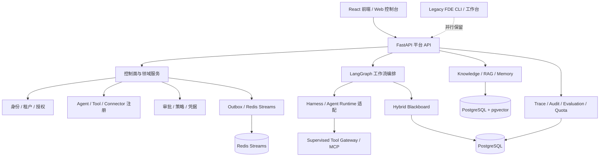

# AI 原生企业基础设施平台：全仓库差距审查（阶段性报告）

> 审查状态：**阶段性审查，尚未满足 Issue #848 的最终验收条件**  
> 基线分支：`main`  
> 基线 commit：`3fa0415b76aa06375859362e2e1bfa69a4094e16`  
> 审查日期：2026-11-21  
> 仓库：`dujiu1024-dotcom/Agent-pingtai`

## 0. 重要结论与审查限制

本报告基于基线 SHA 下可读取的仓库文件、架构文档、前端路由、生产 Compose 配置、CI 配置和指定测试源码形成。它不是完整的逐文件审计结论。

本轮审查遇到以下客观限制：

1. GitHub 仓库连接器提供单文件读取，但当前没有可用的仓库目录树枚举能力；仓库代码搜索索引状态为不可用（repository metadata: `is_code_search_indexed=false`）。
2. 尝试在执行环境浅克隆仓库时，网络 DNS 无法解析 `github.com`，无法在本地执行全量测试、静态检查、前端构建或启动服务。
3. 因无法完整枚举所有文件、迁移、路由和页面，也无法连接 PostgreSQL/Redis/模型服务，不能声称完成了 Issue 要求的全仓库逐项审查或运行验收。
4. 以下“已具备/基础已具备”仅代表已读取源码中存在相应机制；是否在生产组合中完整接线、可运行和生产可用，仍需按报告中的验证要求补证。

**因此，本报告应作为第一轮证据盘点和审查基线，不应据此关闭 Issue #848。** 需由具备完整仓库 checkout 和集成环境的审查人员继续完成剩余审计，并更新本报告。

## 1. 审查范围、方法和证据等级

### 已读取的关键文件

| 范围 | 已读取文件/证据 |
|---|---|
| 仓库定位 | `README.md`、`pyproject.toml`、`requirements-platform.txt` |
| 架构设计 | `docs/architecture/智能体平台改造总设计.md` |
| 领域契约 | `agent_platform/contracts.py` |
| 多 Agent | `agent_platform/workflows/multi_expert.py` |
| 生产组装 | `agent_platform/production.py` |
| 安全与凭据 | `agent_platform/security/credentials.py` |
| 审批与审计 | `agent_platform/approval/postgres.py` |
| 知识与记忆 | `agent_platform/knowledge/service.py`、`agent_platform/memory/service.py` |
| 沙箱 | `agent_platform/sandbox/oci.py` |
| 运行基准 | `agent_platform/runtime/harness_benchmark.py` |
| 前端 | `frontend/package.json`、`frontend/src/App.tsx`、`frontend/src/routes/route-config.ts` |
| 部署 | `deploy/production.compose.yaml` |
| CI | `.github/workflows/ci.yml` |
| 测试源码 | `tests/test_platform_postgres_integration.py`、`tests/test_redis_streams_integration.py`、`tests/test_issue_755_c_dual_mode_integration.py` |

本轮未能读取全部目录内容，因此表中列出的“未找到”不能解释为仓库不存在，只能解释为本轮未获得证据。

### 成熟度定义

- **基础已具备**：已读取到实际机制/服务/页面或测试代码，但生产链路、验收或覆盖仍不完整。
- **部分实现**：存在部分领域代码、路由或流程，尚不能证明端到端闭环。
- **仅有设计**：本轮仅找到设计文档描述。
- **待验证**：本轮没有足够证据确认代码实现或可运行性。
- **尚未建设**：只有在完成全仓库检索后才能使用；本轮不轻易作此判定。

## 2. 当前代码反向架构

从已读取文件看，仓库采用“旧 FDE 工作台保留 + 新平台在 `agent_platform/` 独立演进”的并行迁移结构，而不是单体一次性替换。

上述图是依据本轮读取的模块和设计文档归纳的结构示意，不代表所有组件均已在生产环境完整连通。

### 已确认的架构事实

1. `README.md` 明确说明旧 FDE 工作台继续保留，新平台位于 `agent_platform/` 并行建设；旧 CLI 仍为标准库路线，新平台依赖单独安装。
2. 架构设计明确采用 PostgreSQL 为业务事实源、Redis Streams 做事件分发、LangGraph 做有状态流程编排、Hybrid Blackboard 做跨 Agent 共享认知、Harness Adapter 做运行时适配。
3. `agent_platform/production.py` 是生产 ASGI 组合根，导入并组装身份、知识、记忆、审批、运行生命周期、事件、审计、配额、调度、连接器、评测和追踪等模块。
4. `frontend/src/App.tsx` 使用 React Router、懒加载和多个产品功能页面；`route-config.ts` 定义了工作空间、运行运营和管理路由。
5. `deploy/production.compose.yaml` 定义生产 API、worker、PostgreSQL、Redis、对象存储等运行服务，并配置只读根文件系统、非 root 用户、cap drop、no-new-privileges、资源限制、健康检查和受控出口代理。

## 3. 核心技术能力成熟度（Issue 第 8 节十项）

| 目标能力 | 阶段性判断 | 已读取证据 | 当前明确缺口/待验证 |
|---|---|---|---|
| 多智能体协同执行引擎 | 基础已具备 | `workflows/multi_expert.py` 定义专家规划、并行执行、汇总、Review、冲突处理、审批、归档/拒绝；`test_platform_postgres_integration.py` 有真实 LangGraph + PostgreSQL 黑板集成测试源码 | 需在真实依赖环境执行；进一步验证动态任务拆解质量、黑板并发冲突、专家超时/失败隔离、委派授权、人工介入后重分配和端到端业务副作用 |
| 任务执行与工作台引擎 | 基础已具备 | `production.py` 组装 RunLifecycleManager、PostgresRunStateStore、RunInterventionService、RunReplayService、RunContextSnapshotService；前端有任务指挥中心、Run 详情、回放和批量执行路由 | 需核验状态机全状态、取消/恢复竞态、幂等副作用、产物版本/下载权限和前后端真实 API 闭环 |
| 企业系统集成与连接器 | 部分实现 | 生产组装包含 DataConnectorService、PostgresConnectorRepository、Webhook 订阅/投递；README 描述 MCP Gateway | 尚未逐项确认 ERP/CRM/OA/HR/MES/PLM/飞书/钉钉/企业微信等真实适配器。通用 Connector 框架不等于完成各厂商连接器 |
| 工具安全执行与沙箱 | 基础已具备 | `sandbox/oci.py` 强制镜像 digest、隔离网络、只读根文件系统、资源限制、禁用敏感环境变量；README 描述 Gateway-only MCP、Run 级短期 Token 和 JSON Schema | 需验证生产容器运行时/rootless 配置、daemon/socket 边界、真实网络策略、文件输入输出边界、沙箱生命周期和安全负向测试 |
| 事件驱动与可靠任务调度 | 基础已具备 | README 描述 PostgreSQL Outbox、Redis Streams、Pending 恢复、消费回执、幂等和 DLQ；生产组装 OutboxRelay/Worker；Redis 集成测试源码存在 | 需执行真实 Redis/Postgres 故障注入；验证消息积压、重复投递、死信重放、外部副作用幂等和跨版本迁移 |
| Webhook 与开放 API 生态 | 部分实现 | 生产组装含 WebhookSubscriptionService、PostgresWebhookStore、投递 Worker、DLQ Replay；FastAPI API 组合存在 | 尚需核验签名、密钥轮换、租户级 API Key、配额/限流、Webhook 重放权限、OpenAPI 完整性、SDK 和外部开发者文档 |
| 多模型运行时与 Harness 架构 | 基础已具备 | README 和架构设计列出 LangGraph、DeepSeek Harness、Strands Agents、MCP Provider；`harness_benchmark.py` 有同任务基准数据结构和汇总 | 设计文档明确 DeepSeek/Strands 尚未真实模型同任务质量/成本对比；需验证流式、超时、取消、恢复、供应商降级和真实模型质量 |
| Agent 版本发布与部署管理 | 部分实现 | 前端路由有 Agent 定义、Workflow 设计、模型模板、扩展发布等入口；生产组装含 Registry 与 TrustedPublisherKeyRegistry | 需核验资产统一版本、依赖锁定、环境晋级、灰度、回滚、签名包、兼容性矩阵及生产发布审计 |
| 执行链路追踪与质量分析 | 基础已具备 | 生产组装 PostgresRunTraceRepository、PostgresEvaluationRepository、Prometheus 指标、OperationalHealthMonitor；前端有回放、质量成本、告警路由 | 需验证 Trace 跨模型/工具/Agent 关联、成本准确性、评测数据闭环、质量回归 Gate、SLA 指标和真实告警投递 |
| 企业级部署与运行基础设施 | 部分实现 | 生产 Compose 配置 PostgreSQL/Redis/MinIO/API/worker、健康检查、资源限制、secrets file、egress proxy/allowlist | 本轮未验证 Kubernetes、私有云/本地安装、离线授权、控制平面断网自治、备份恢复/灾备演练、升级回滚和多环境部署 |

## 4. 八大统一引擎与资源模型

| 统一引擎 | 现有映射（已读取） | 阶段性结论 |
|---|---|---|
| 身份与组织引擎 | `agent_platform/identity/`、`production.py` 的 PostgresIdentityRepository/IdentityService | 基础已具备；组织层级、部门/团队授权、SSO、跨服务身份传播和越权测试需完整审查 |
| AI 资产引擎 | `control_plane/registry.py`、扩展发布者注册、Agent/Workflow 前端管理入口 | 部分实现；需统一资产类型、版本依赖、签名、发布回滚和市场分发证据 |
| 任务与调度引擎 | `runtime/lifecycle.py`、PostgresRunStateStore、scheduler、batch、interventions | 基础已具备；需检查任务与 Run 的完整关联、长任务恢复和业务副作用去重 |
| 事件驱动引擎 | `events/outbox.py`、Redis Streams、receipt、webhook worker | 基础已具备；需运行故障注入和死信运营验收 |
| 策略与审批引擎 | `approval/service.py`、`approval/postgres.py`、RiskLevel、Tool Gateway | 基础已具备；需验证服务端策略来源、动作摘要绑定、审批人资格和 L3 强人工执行边界 |
| 统一执行运行时 | `runtime/`、LangGraph、Harness Adapter、MCP Gateway | 基础已具备；真实模型对比、生产执行器配置、跨 Harness 一致性需补证 |
| 数据与知识引擎 | `knowledge/service.py`、PostgresKnowledgeRepository、RAG、Memory、Graph | 基础已具备；数据血缘、删除传播、ACL 全链路和多模态摄取需补证 |
| 观测与计量引擎 | `observability/`、RunTrace、Evaluation、Prometheus、Quota | 基础已具备；企业/部门/团队成本归集、业务价值、SLA 与结算未形成已验收证据 |

### 资源语义核验

`contracts.py` 定义 Scope、BlackboardEntry、BlackboardEvent、ModelTemplateRef、RunContext；运行/任务/项目/租户上下文已有初步契约。已读取的 identity、knowledge、memory、approval、runtime、events 代码说明部分核心实体存在。

但本轮没有完整检查数据库所有迁移、外键、唯一约束、删除策略和全量 API，因此 Tenant、Organization、User、DigitalEmployee、Agent、Workflow、Skill、Tool、Model、KnowledgeBase、Task、Run、Event、Policy、Approval、Artifact 的统一资源关系仍应标记为**待完整验证**。尤其没有足够证据证明 DigitalEmployee 已作为区别于 Agent 的组织身份资源实现。

## 5. 产品中心及扩展能力盘点

以下状态仅代表本轮已读取到的前端路由/后端模块线索，不能将页面入口等同于功能完成。

### 5.1 十四个产品中心

| 产品中心 | 已读取线索 | 阶段性判断 |
|---|---|---|
| 智能体管理中心 | `/admin/agents`，AgentDefinitionPage | 部分实现；发布/版本/回滚待验证 |
| 多智能体协作中心 | `/workspace/collaboration`，AgentCollaborationCenter，multi_expert workflow | 基础已具备；生产协作场景待验证 |
| 行业智能应用中心 | 本轮未读取到真实行业方案包实现 | 待验证 |
| 工作流自动化中心 | `/admin/workflows`，WorkflowDesignerPage | 部分实现；节点语义、调试、版本和运行闭环待验证 |
| 任务执行与会话中心 | Tasks、Runs、Conversations、Files、Replay 路由 | 基础已具备；逐页面 API 与恢复链路待验证 |
| 模型与工具中心 | Providers/Templates/Routing/Tools 路由，MCP Gateway | 部分实现；模型供应商真实接入清单待验证 |
| 企业知识与记忆中心 | Knowledge、RAG、Graph、Memory 路由与服务 | 基础已具备；ACL、数据治理和引用质量待验证 |
| Agent 应用市场与资产中心 | Registry、Extension Publishers 路由/服务 | 部分实现；市场交易、安装、撤销和生态授权待验证 |
| 企业组织与安全中心 | OrganizationAccess、Identity、Approval、Audit | 基础已具备；SSO、组织层级和隔离证明待验证 |
| AI 治理与合规中心 | Approval、Audit、RiskLevel、Policy 相关服务 | 部分实现；合规控制面与合规报告待验证 |
| AI 质量评测中心 | Evaluation Store、质量成本页面 | 基础已具备；评测数据集/门禁/版本对比需执行验证 |
| 运行监控与成本中心 | Trace、Prometheus、Alerts、Quota、CostQuality | 基础已具备；SLA 和准确成本归集待验证 |
| 企业资源与成本管理中心 | Quota、Budget、Token usage 相关模块 | 部分实现；计算资源池、部门预算与分摊待验证 |
| 企业部署与运维管理中心 | Compose、Health、运维/告警路由 | 部分实现；升级、备份、灾备、容量和离线运维待验证 |

### 5.2 八个新增产品中心

| 新增中心 | 阶段性结论 | 缺失/待验证重点 |
|---|---|---|
| 企业系统集成中心 | 部分实现 | 各企业系统的真实连接器、认证刷新、同步策略、健康状态和兼容矩阵 |
| 企业数据接入与治理中心 | 部分实现 | 数据目录、分类分级、质量规则、血缘、删除传播、敏感数据识别 |
| AI API 开放平台 | 部分实现 | API Key 生命周期、外部开发者配额、SDK、契约版本和 SLA |
| AI 资产生命周期管理中心 | 部分实现 | 全资产统一版本、依赖锁定、环境晋级、签名、回滚和导入导出 |
| AI 安全执行与沙箱中心 | 基础已具备 | 真实容器运行安全、资源/网络隔离和红队负向测试 |
| AI 服务等级与可靠性管理中心 | 部分实现 | SLA SLI/SLO、错误预算、熔断/降级、容量预测和故障复盘 |
| AI 人才与开发者生态中心 | 待验证 | SDK、开发者门户、伙伴认证、兼容性测试和生态协作空间 |
| 企业 AI 运营与价值分析中心 | 待验证 | 部门价值指标、工时节省估算、ROI 和业务效果基线 |

### 5.3 十项战略扩展能力

| 能力 | 阶段性结论 | 需要重点验证的具体功能 |
|---|---|---|
| 企业 AI 决策中心 | 待验证 | 指标/异常/预测/方案对比/依据追溯/审批执行 |
| AI 数字员工管理中心 | 待验证 | 独立组织身份、岗位职责、负责人、授权边界、绩效和调岗 |
| 企业流程挖掘中心 | 待验证 | 业务日志采集、流程发现、瓶颈、自动化机会与效果分析 |
| AI 自主优化中心 | 部分有基础线索 | Prompt 实验/评测存在相关模块；失败分析、候选改进、人工批准发布闭环待验证 |
| 企业知识图谱中心 | 部分实现 | Graph 服务与页面存在；实体抽取、关系治理、冲突检测和数据血缘待验证 |
| 多模态 AI 中心 | 待验证 | OCR、语音、视频、图纸、多模态统一路由和权限 |
| AI 事件驱动中心 | 基础已具备 | Outbox/Streams/Webhook 存在；业务事件目录、规则管理、运营可视化待验证 |
| 企业 AI 合同与服务管理中心 | 待验证 | 合同、套餐、许可、离线授权、续期和商业结算 |
| AI 业务连续性管理中心 | 部分实现 | 重试、恢复、回放和灾备脚本需做真实恢复演练；业务副作用不重复执行需证据 |
| 企业 AI 创新实验室 | 待验证 | 自然语言建 Agent/Workflow、沙箱试运行、创新项目转生产闭环 |

## 6. 前端、API 和产品化观察

### 已读取到的前端产品入口

`frontend/src/App.tsx` 采用 React 18、React Router、React Query、Zustand，按功能懒加载页面。路由配置至少覆盖：

- 工作空间：概览、快速使用、状态看板、任务指挥中心、智能体协作、成本质量、数字办公室；
- 运营：Agent、任务、Run、审批、知识库、知识图谱、RAG、批量执行、回放、告警、记忆、会话、文件；
- 管理：Agent 定义、Workflow 设计、模型供应商/模板/路由、工具与 MCP、扩展发布等。

### 发现的产品化风险

1. `route-config.ts` 的概览页描述明确写明“当前仅展示导航框架，不填充未经 API 证实的指标”。因此不能把该页面视为完整经营驾驶舱。
2. 路由配置中的页面说明和 owner/Issue 编号只是页面规划线索，不代表页面真实操作已连接生产 API。
3. 本轮未能逐页检查数据请求、错误/空状态、权限隐藏、表单提交和端到端交互。
4. 需要建立“目标能力—路由—组件—API—服务—表/迁移—测试”映射表，避免页面存在但业务链路断开。

## 7. 多租户、身份、安全和数据边界

### 正向证据

- `contracts.py` 的 RunContext 带 tenant_id；Blackboard scope 包含 tenant。
- `memory/service.py` 定义 MemoryPrincipal，并包含 tenant、user、project、agent 和权限上下文。
- `security/credentials.py` 的 CredentialService 在凭据记录和授权中使用 tenant_id、consumer_type/id、scope，并在创建/授权后写审计。
- `approval/postgres.py` 的审批消费按 tenant_id、approval_id、action_digest、policy_version、approved 状态和过期时间原子更新；审计读取按 tenant_id 限定。
- `sandbox/oci.py` 对镜像 digest、网络、文件系统、资源和敏感环境变量采取 fail-closed 约束。
- 生产 Compose 配置使用 secrets file、精确 ALLOWED_ORIGINS、出口代理与 EGRESS_ALLOWED_HOSTS、非 root、只读根文件系统和 capability drop。
- `tests/test_issue_755_c_dual_mode_integration.py` 有认证模式与 no-auth 模式 HTTP 集成测试源码，并明确测试无凭据请求访问业务 handler 的行为。

### 重大待验证风险

1. **No-auth 双模式风险**：测试证明存在无认证模式的应用装配路径，但不代表生产环境默认安全。必须检查生产配置的默认值、启动参数、反向代理和环境变量，并证明生产部署无法意外进入 no-auth 模式。
2. **租户隔离覆盖面**：已读取若干服务按 tenant 过滤，不足以证明 API、数据库、向量检索、对象存储、缓存、事件、文件下载和异步 Worker 全链路均隔离。
3. **部门/团队边界**：Tenant 级隔离不等于 Organization/Department/Team 级数据隔离，必须检查资源授权与继承策略。
4. **数字员工身份**：本轮未找到充分证据证明数字员工具有独立组织身份、负责人、岗位和绩效模型。
5. **凭据与沙箱**：需要实测密钥注入、短期 Token 撤销、进程退出清理、容器逃逸防护和网络出口 allowlist。
6. **审计完整性**：需核验身份认证、策略决策、审批、模型调用、工具调用、外部副作用、人工接管和产物的统一关联 ID，以及审计写失败时的 fail-closed 行为。

## 8. 混合部署、可用性和业务连续性

### 已读取部署证据

`deploy/production.compose.yaml` 以不可变镜像变量部署 API，定义 PostgreSQL、Redis、MinIO、worker 和告警 worker 等服务；配置健康检查、资源限制、受控代理出口和容器加固。

### 尚未证明的混合部署关键条件

- 企业运行平面在公共控制平面不可用/断网时，已授权业务是否继续运行；
- 公共控制平面是否只承担可选的注册、许可证、分发等非核心控制职责；
- 企业原始数据、知识、会话、凭据和审计数据是否默认不离开企业环境；
- 企业到公共侧的远程运维是否具备授权、最小权限、限时和完整审计；
- 离线许可证校验、续期宽限、版本分发缓存和紧急撤销策略；
- 私有云/本地部署的安装、升级、回滚、备份、恢复和灾备演练。

**阶段性结论：已看到单实例生产 Compose 部署基础，但不能据此判定 Hybrid First 已成立。**

## 9. 测试、CI 与运行验证

### 已读取 CI 证据

`.github/workflows/ci.yml` 配置：

- Python 3.11/3.12 矩阵；
- identity-focused 测试；
- 全量 unittest discover；
- Ruff、mypy；
- 单独的 platform-integration reusable workflow。

### 已读取测试证据及边界

- `tests/test_platform_postgres_integration.py`：由 `AGENT_PLATFORM_TEST_DSN` 控制，包含真实 PostgreSQL 集成测试源码，未配置 DSN 时跳过。
- `tests/test_redis_streams_integration.py`：由 Redis URL 和 PostgreSQL DSN 控制，真实 Redis Streams 测试源码，未配置环境时跳过。
- `tests/test_issue_755_c_dual_mode_integration.py`：使用 FastAPI TestClient 的双模式集成测试，但 fixture 中使用内存知识/记忆仓库和 stub Redis，不是完整生产基础设施 E2E。
- `frontend/package.json` 定义 build、lint、typecheck、Vitest、Playwright E2E 脚本。

### 本轮实际执行结果

| 检查 | 本轮结果 |
|---|---|
| 仓库浅克隆 | 未完成：执行环境无法解析 github.com |
| Python unittest | 未执行 |
| PostgreSQL 集成测试 | 未执行：无可用 DSN/数据库 |
| Redis Streams 集成测试 | 未执行：无可用 Redis |
| Ruff / mypy | 未执行 |
| 前端 build / lint / typecheck | 未执行 |
| Vitest / Playwright | 未执行 |
| 生产 Compose 启动验证 | 未执行 |

不能将 CI 配置文件存在等同于最近一次 CI 全绿；需另行读取基线 SHA 对应的 workflow run 和 job 结果。

## 10. P0/P1/P2 差距 Backlog（第一轮建议）

| 优先级 | 建议任务 | 缺失点/风险 | 可验证验收标准 |
|---|---|---|---|
| P0 | 完成完整仓库清点和能力矩阵 | 当前审查覆盖不完整，无法满足 Issue 全量要求 | 导出 main 全部文件树；逐项覆盖 Issue 第 2/7/8 节；每项包含源码、API、数据、前端、测试证据 |
| P0 | 生产身份模式与租户隔离安全审计 | no-auth 双模式与 tenant 边界需要证明生产安全 | 生产启动默认强制认证；跨租户/跨部门 API、DB、文件、向量、事件负向测试全通过 |
| P0 | 混合部署断网自治验收 | Compose 不证明公共控制平面解耦 | 断开公共侧后企业运行平面持续执行已授权任务；数据不外流；恢复后状态一致 |
| P0 | 生产运行链路 E2E | 多模块存在但生产装配与实际副作用链路尚未实测 | 从登录/授权到任务、Agent、工具审批、产物、审计、Trace 全链路真实服务通过 |
| P1 | Agent/Workflow/Tool/Skill 统一资产生命周期 | 当前 Registry/发布入口不能证明完整资产生命周期 | 版本、依赖锁定、环境晋级、灰度、回滚、签名、权限和审计端到端通过 |
| P1 | 连接器真实适配矩阵 | 连接器框架不等于企业系统适配完成 | 对每个已支持连接器提供认证、读写、刷新、限流、重试、健康检查和契约测试 |
| P1 | 可靠性与灾备演练 | 重试/恢复代码不能替代演练 | 注入 DB/Redis/模型/网络故障；验证恢复、DLQ 重放、补偿和业务副作用幂等 |
| P1 | 质量评测与成本治理闭环 | 已有评测/配额模块，尚未证明企业运营闭环 | 形成数据集、版本对比、回归 Gate、Token/资源成本归集和预算告警报告 |
| P1 | 前端产品中心端到端验收 | 路由/页面存在不代表真实功能完成 | 所有页面逐项绑定真实 API，验证权限、加载、空态、错误态和核心操作 |
| P2 | 数字员工组织模型 | 尚未证明 DigitalEmployee 是独立资源 | 建立身份、岗位、负责人、组织归属、授权、绩效和生命周期验收 |
| P2 | 开发者与伙伴生态 | SDK、市场、伙伴认证/结算证据不足 | 提供 SDK、文档、示例、扩展包签名、兼容测试和伙伴发布流程 |
| P2 | 战略扩展中心 | 决策、流程挖掘、多模态、创新实验室等未完成验证 | 每项形成独立范围、依赖、原型/接口、数据治理和阶段性验收标准 |

## 11. 保留、扩展、整合建议

### 建议保留并复用

- Hybrid Blackboard 的事实/证据/质疑/冲突/裁决语义；
- PostgreSQL 作为业务事实源、Redis Streams 作为消息传输层的分工；
- LangGraph 工作流与 Harness Adapter 分层；
- Supervised Tool Gateway、审批动作摘要绑定、审计和 OCI 沙箱；
- 已有身份、知识、记忆、Trace、Evaluation、Quota、Webhook 和 Connector 服务。

### 建议优先整合

- 将旧 FDE 工作台与新平台的边界、迁移策略、数据归属和前端入口形成正式架构清单；
- 将 Agent、Workflow、Skill、Tool、Connector、Prompt、Model、Knowledge 等统一到可版本化资产契约；
- 将 Tenant、Organization、User、DigitalEmployee、Agent、Task、Run、Event、Approval、Artifact 的资源关系统一起来；
- 建立页面/API/服务/数据/测试追踪矩阵，避免重复模块和孤立页面。

### 不建议在证据不足时重写

现有新平台已有较多可复用的运行时、审批、事件、知识、安全和观测基础。应先完成完整审查和生产验证，再按 P0 缺口拆分实施 Issue，不应以“AI 原生平台”为由推倒重来。

## 12. 下一轮审查必须补齐的工作

1. 在可访问 GitHub 的执行环境 checkout 精确 SHA `3fa0415b76aa06375859362e2e1bfa69a4094e16`，生成完整文件清单。
2. 遍历所有 `agent_platform/`、`frontend/src/`、`tests/`、SQL migrations、deploy、scripts、docs 和 CI 文件。
3. 按 Issue 的 14 个产品中心、8 个新增中心、10 个战略扩展、10 个核心技术能力、8 个统一控制平面能力逐项建立完整对照表。
4. 对每项补充具体类/函数/API/表/迁移/前端组件/测试路径，不能只引用目录。
5. 执行 Python 全量测试、PostgreSQL/Redis 集成测试、Ruff、mypy、前端 build/lint/typecheck/Vitest/Playwright。
6. 读取基线 SHA 对应的 GitHub Actions 实际运行记录；对失败、跳过和未覆盖项分别记录。
7. 完成跨租户/部门负向测试、no-auth 生产配置审查、断网自治和灾备恢复演练。
8. 将最终审查结果更新到本报告，并在 Issue #848 回填最终验收结论。

## 13. 阶段性结论

当前仓库不是只有产品原型或简单 Agent Demo：从已读取源码看，已具备相当数量的平台级基础模块，包括多专家工作流、黑板、身份与授权、审批、MCP 工具网关、沙箱、事件 Outbox/Streams、知识/记忆、运行追踪、评测、配额和生产 Compose。

但目前仍不能得出“已具备完整 AI 原生企业基础设施平台”的结论。主要差距不是简单缺少几个页面，而是：

- 目标能力与真实实现尚未形成全量、逐项、可追溯映射；
- 生产环境的租户/组织隔离、no-auth 配置边界、混合部署断网自治尚缺完整证明；
- 多模型/Harness 真实质量对比、连接器真实适配、资产发布治理、SLA/灾备和生态商业化能力尚需补证；
- 前端路由、API、领域服务、数据迁移和测试的端到端映射尚未完成；
- 本轮无法执行完整测试与生产环境验证。

**本报告完成的是第一轮证据盘点，不是 Issue #848 的最终交付。Issue 应保持 Open，直到全量代码审查、运行验证和正式差距清单全部完成。**
