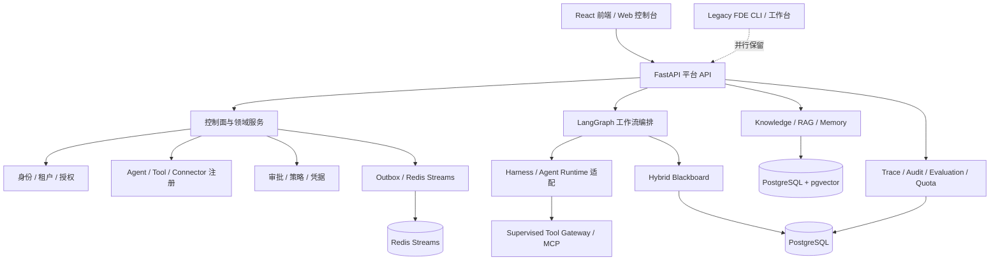

# AI 原生企业基础设施平台：全仓库差距审查（阶段性报告）

> 审查状态：**阶段性审查，尚未满足 Issue #848 的最终验收条件**  
> 基线分支：`main`  
> 基线 commit：`3fa0415b76aa06375859362e2e1bfa69a4094e16`  
> 审查日期：2026-11-21  
> 仓库：`dujiu1024-dotcom/Agent-pingtai`

## 0. 重要结论与审查限制

本报告已完成第二轮源码核查：成功枚举 main 的递归文件树（1,568 个文件，其中 agent_platform/ 532、frontend/src/ 100、tests/ 489、PostgreSQL SQL migrations 127），并继续读取关键后端实现、API 路由、数据库迁移、前端页面和 GitHub Actions 失败日志。它仍不是完整的逐文件语义审计结论。

本轮仍存在以下客观限制：

1. GitHub 仓库代码搜索索引不可用（repository metadata: is_code_search_indexed=false），但通过 Git Trees API 已成功枚举完整文件路径；因此不能再将“无法枚举目录树”作为当前限制。
2. 尝试在执行环境浅克隆仓库时，网络 DNS 无法解析 github.com，无法在本地执行全量测试、静态检查、前端构建或启动服务。
3. 已读取大量关键源码并检查了基线 SHA 对应的 CI 实际运行结果，但尚未逐一阅读全部 1,568 个文件，也没有本地 PostgreSQL/Redis/模型服务可供复现所有失败。
4. 以下“已具备/基础已具备”仅代表源码中存在相应机制；是否在生产组合中完整接线、可运行和生产可用，仍需按报告中的验证要求补证。

**因此，本报告应作为第一轮证据盘点和审查基线，不应据此关闭 Issue #848。** 需由具备完整仓库 checkout 和集成环境的审查人员继续完成剩余审计，并更新本报告。

## 1. 审查范围、方法和证据等级

### 已读取的关键文件

| 范围 | 已读取文件/证据 |
|---|---|
| 仓库定位 | `README.md`、`pyproject.toml`、`requirements-platform.txt` |
| 架构设计 | `docs/architecture/智能体平台改造总设计.md` |
| 领域契约 | `agent_platform/contracts.py` |
| 多 Agent | `agent_platform/workflows/multi_expert.py` |
| 生产组装 | `agent_platform/production.py` |
| 安全与凭据 | `agent_platform/security/credentials.py` |
| 审批与审计 | `agent_platform/approval/postgres.py` |
| 知识与记忆 | `agent_platform/knowledge/service.py`、`agent_platform/memory/service.py` |
| 沙箱 | `agent_platform/sandbox/oci.py` |
| 运行基准 | `agent_platform/runtime/harness_benchmark.py` |
| 前端 | `frontend/package.json`、`frontend/src/App.tsx`、`frontend/src/routes/route-config.ts` |
| 部署 | `deploy/production.compose.yaml` |
| CI | `.github/workflows/ci.yml` |
| 测试源码 | `tests/test_platform_postgres_integration.py`、`tests/test_redis_streams_integration.py`、`tests/test_issue_755_c_dual_mode_integration.py` |

已成功枚举全仓库文件路径，但尚未逐个读取全部文件内容。因此表中列出的“未找到”不能解释为仓库不存在，只能解释为本轮未获得实现证据。

### 成熟度定义

- **基础已具备**：已读取到实际机制/服务/页面或测试代码，但生产链路、验收或覆盖仍不完整。
- **部分实现**：存在部分领域代码、路由或流程，尚不能证明端到端闭环。
- **仅有设计**：本轮仅找到设计文档描述。
- **待验证**：本轮没有足够证据确认代码实现或可运行性。
- **尚未建设**：只有在完成全仓库检索后才能使用；本轮不轻易作此判定。

## 2. 当前代码反向架构

从已读取文件看，仓库采用“旧 FDE 工作台保留 + 新平台在 `agent_platform/` 独立演进”的并行迁移结构，而不是单体一次性替换。

上述图是依据本轮读取的模块和设计文档归纳的结构示意，不代表所有组件均已在生产环境完整连通。

### 已确认的架构事实

1. `README.md` 明确说明旧 FDE 工作台继续保留，新平台位于 `agent_platform/` 并行建设；旧 CLI 仍为标准库路线，新平台依赖单独安装。
2. 架构设计明确采用 PostgreSQL 为业务事实源、Redis Streams 做事件分发、LangGraph 做有状态流程编排、Hybrid Blackboard 做跨 Agent 共享认知、Harness Adapter 做运行时适配。
3. `agent_platform/production.py` 是生产 ASGI 组合根，导入并组装身份、知识、记忆、审批、运行生命周期、事件、审计、配额、调度、连接器、评测和追踪等模块。
4. `frontend/src/App.tsx` 使用 React Router、懒加载和多个产品功能页面；`route-config.ts` 定义了工作空间、运行运营和管理路由。
5. `deploy/production.compose.yaml` 定义生产 API、worker、PostgreSQL、Redis、对象存储等运行服务，并配置只读根文件系统、非 root 用户、cap drop、no-new-privileges、资源限制、健康检查和受控出口代理。

## 3. 核心技术能力成熟度（Issue 第 8 节十项）

| 目标能力 | 阶段性判断 | 已读取证据 | 当前明确缺口/待验证 |
|---|---|---|---|
| 多智能体协同执行引擎 | 基础已具备 | `workflows/multi_expert.py` 定义专家规划、并行执行、汇总、Review、冲突处理、审批、归档/拒绝；`test_platform_postgres_integration.py` 有真实 LangGraph + PostgreSQL 黑板集成测试源码 | 需在真实依赖环境执行；进一步验证动态任务拆解质量、黑板并发冲突、专家超时/失败隔离、委派授权、人工介入后重分配和端到端业务副作用 |
| 任务执行与工作台引擎 | 基础已具备 | `production.py` 组装 RunLifecycleManager、PostgresRunStateStore、RunInterventionService、RunReplayService、RunContextSnapshotService；前端有任务指挥中心、Run 详情、回放和批量执行路由 | 需核验状态机全状态、取消/恢复竞态、幂等副作用、产物版本/下载权限和前后端真实 API 闭环 |
| 企业系统集成与连接器 | 部分实现 | 生产组装包含 DataConnectorService、PostgresConnectorRepository、Webhook 订阅/投递；README 描述 MCP Gateway | 尚未逐项确认 ERP/CRM/OA/HR/MES/PLM/飞书/钉钉/企业微信等真实适配器。通用 Connector 框架不等于完成各厂商连接器 |
| 工具安全执行与沙箱 | 基础已具备 | `sandbox/oci.py` 强制镜像 digest、隔离网络、只读根文件系统、资源限制、禁用敏感环境变量；README 描述 Gateway-only MCP、Run 级短期 Token 和 JSON Schema | 需验证生产容器运行时/rootless 配置、daemon/socket 边界、真实网络策略、文件输入输出边界、沙箱生命周期和安全负向测试 |
| 事件驱动与可靠任务调度 | 基础已具备 | README 描述 PostgreSQL Outbox、Redis Streams、Pending 恢复、消费回执、幂等和 DLQ；生产组装 OutboxRelay/Worker；Redis 集成测试源码存在 | 需执行真实 Redis/Postgres 故障注入；验证消息积压、重复投递、死信重放、外部副作用幂等和跨版本迁移 |
| Webhook 与开放 API 生态 | 部分实现 | 生产组装含 WebhookSubscriptionService、PostgresWebhookStore、投递 Worker、DLQ Replay；FastAPI API 组合存在 | 尚需核验签名、密钥轮换、租户级 API Key、配额/限流、Webhook 重放权限、OpenAPI 完整性、SDK 和外部开发者文档 |
| 多模型运行时与 Harness 架构 | 基础已具备 | README 和架构设计列出 LangGraph、DeepSeek Harness、Strands Agents、MCP Provider；`harness_benchmark.py` 有同任务基准数据结构和汇总 | 设计文档明确 DeepSeek/Strands 尚未真实模型同任务质量/成本对比；需验证流式、超时、取消、恢复、供应商降级和真实模型质量 |
| Agent 版本发布与部署管理 | 部分实现 | 前端路由有 Agent 定义、Workflow 设计、模型模板、扩展发布等入口；生产组装含 Registry 与 TrustedPublisherKeyRegistry | 需核验资产统一版本、依赖锁定、环境晋级、灰度、回滚、签名包、兼容性矩阵及生产发布审计 |
| 执行链路追踪与质量分析 | 基础已具备 | 生产组装 PostgresRunTraceRepository、PostgresEvaluationRepository、Prometheus 指标、OperationalHealthMonitor；前端有回放、质量成本、告警路由 | 需验证 Trace 跨模型/工具/Agent 关联、成本准确性、评测数据闭环、质量回归 Gate、SLA 指标和真实告警投递 |
| 企业级部署与运行基础设施 | 部分实现 | 生产 Compose 配置 PostgreSQL/Redis/MinIO/API/worker、健康检查、资源限制、secrets file、egress proxy/allowlist | 本轮未验证 Kubernetes、私有云/本地安装、离线授权、控制平面断网自治、备份恢复/灾备演练、升级回滚和多环境部署 |

## 4. 八大统一引擎与资源模型

| 统一引擎 | 现有映射（已读取） | 阶段性结论 |
|---|---|---|
| 身份与组织引擎 | `agent_platform/identity/`、`production.py` 的 PostgresIdentityRepository/IdentityService | 基础已具备；组织层级、部门/团队授权、SSO、跨服务身份传播和越权测试需完整审查 |
| AI 资产引擎 | `control_plane/registry.py`、扩展发布者注册、Agent/Workflow 前端管理入口 | 部分实现；需统一资产类型、版本依赖、签名、发布回滚和市场分发证据 |
| 任务与调度引擎 | `runtime/lifecycle.py`、PostgresRunStateStore、scheduler、batch、interventions | 基础已具备；需检查任务与 Run 的完整关联、长任务恢复和业务副作用去重 |
| 事件驱动引擎 | `events/outbox.py`、Redis Streams、receipt、webhook worker | 基础已具备；需运行故障注入和死信运营验收 |
| 策略与审批引擎 | `approval/service.py`、`approval/postgres.py`、RiskLevel、Tool Gateway | 基础已具备；需验证服务端策略来源、动作摘要绑定、审批人资格和 L3 强人工执行边界 |
| 统一执行运行时 | `runtime/`、LangGraph、Harness Adapter、MCP Gateway | 基础已具备；真实模型对比、生产执行器配置、跨 Harness 一致性需补证 |
| 数据与知识引擎 | `knowledge/service.py`、PostgresKnowledgeRepository、RAG、Memory、Graph | 基础已具备；数据血缘、删除传播、ACL 全链路和多模态摄取需补证 |
| 观测与计量引擎 | `observability/`、RunTrace、Evaluation、Prometheus、Quota | 基础已具备；企业/部门/团队成本归集、业务价值、SLA 与结算未形成已验收证据 |

### 资源语义核验

`contracts.py` 定义 Scope、BlackboardEntry、BlackboardEvent、ModelTemplateRef、RunContext；运行/任务/项目/租户上下文已有初步契约。已读取的 identity、knowledge、memory、approval、runtime、events 代码说明部分核心实体存在。

但本轮没有完整检查数据库所有迁移、外键、唯一约束、删除策略和全量 API，因此 Tenant、Organization、User、DigitalEmployee、Agent、Workflow、Skill、Tool、Model、KnowledgeBase、Task、Run、Event、Policy、Approval、Artifact 的统一资源关系仍应标记为**待完整验证**。尤其没有足够证据证明 DigitalEmployee 已作为区别于 Agent 的组织身份资源实现。

## 5. 产品中心及扩展能力盘点

以下状态仅代表本轮已读取到的前端路由/后端模块线索，不能将页面入口等同于功能完成。

### 5.1 十四个产品中心

| 产品中心 | 已读取线索 | 阶段性判断 |
|---|---|---|
| 智能体管理中心 | `/admin/agents`，AgentDefinitionPage | 部分实现；发布/版本/回滚待验证 |
| 多智能体协作中心 | `/workspace/collaboration`，AgentCollaborationCenter，multi_expert workflow | 基础已具备；生产协作场景待验证 |
| 行业智能应用中心 | 本轮未读取到真实行业方案包实现 | 待验证 |
| 工作流自动化中心 | `/admin/workflows`，WorkflowDesignerPage | 部分实现；节点语义、调试、版本和运行闭环待验证 |
| 任务执行与会话中心 | Tasks、Runs、Conversations、Files、Replay 路由 | 基础已具备；逐页面 API 与恢复链路待验证 |
| 模型与工具中心 | Providers/Templates/Routing/Tools 路由，MCP Gateway | 部分实现；模型供应商真实接入清单待验证 |
| 企业知识与记忆中心 | Knowledge、RAG、Graph、Memory 路由与服务 | 基础已具备；ACL、数据治理和引用质量待验证 |
| Agent 应用市场与资产中心 | Registry、Extension Publishers 路由/服务 | 部分实现；市场交易、安装、撤销和生态授权待验证 |
| 企业组织与安全中心 | OrganizationAccess、Identity、Approval、Audit | 基础已具备；SSO、组织层级和隔离证明待验证 |
| AI 治理与合规中心 | Approval、Audit、RiskLevel、Policy 相关服务 | 部分实现；合规控制面与合规报告待验证 |
| AI 质量评测中心 | Evaluation Store、质量成本页面 | 基础已具备；评测数据集/门禁/版本对比需执行验证 |
| 运行监控与成本中心 | Trace、Prometheus、Alerts、Quota、CostQuality | 基础已具备；SLA 和准确成本归集待验证 |
| 企业资源与成本管理中心 | Quota、Budget、Token usage 相关模块 | 部分实现；计算资源池、部门预算与分摊待验证 |
| 企业部署与运维管理中心 | Compose、Health、运维/告警路由 | 部分实现；升级、备份、灾备、容量和离线运维待验证 |

### 5.2 八个新增产品中心

| 新增中心 | 阶段性结论 | 缺失/待验证重点 |
|---|---|---|
| 企业系统集成中心 | 部分实现 | 各企业系统的真实连接器、认证刷新、同步策略、健康状态和兼容矩阵 |
| 企业数据接入与治理中心 | 部分实现 | 数据目录、分类分级、质量规则、血缘、删除传播、敏感数据识别 |
| AI API 开放平台 | 部分实现 | API Key 生命周期、外部开发者配额、SDK、契约版本和 SLA |
| AI 资产生命周期管理中心 | 部分实现 | 全资产统一版本、依赖锁定、环境晋级、签名、回滚和导入导出 |
| AI 安全执行与沙箱中心 | 基础已具备 | 真实容器运行安全、资源/网络隔离和红队负向测试 |
| AI 服务等级与可靠性管理中心 | 部分实现 | SLA SLI/SLO、错误预算、熔断/降级、容量预测和故障复盘 |
| AI 人才与开发者生态中心 | 待验证 | SDK、开发者门户、伙伴认证、兼容性测试和生态协作空间 |
| 企业 AI 运营与价值分析中心 | 待验证 | 部门价值指标、工时节省估算、ROI 和业务效果基线 |

### 5.3 十项战略扩展能力

| 能力 | 阶段性结论 | 需要重点验证的具体功能 |
|---|---|---|
| 企业 AI 决策中心 | 待验证 | 指标/异常/预测/方案对比/依据追溯/审批执行 |
| AI 数字员工管理中心 | 待验证 | 独立组织身份、岗位职责、负责人、授权边界、绩效和调岗 |
| 企业流程挖掘中心 | 待验证 | 业务日志采集、流程发现、瓶颈、自动化机会与效果分析 |
| AI 自主优化中心 | 部分有基础线索 | Prompt 实验/评测存在相关模块；失败分析、候选改进、人工批准发布闭环待验证 |
| 企业知识图谱中心 | 部分实现 | Graph 服务与页面存在；实体抽取、关系治理、冲突检测和数据血缘待验证 |
| 多模态 AI 中心 | 待验证 | OCR、语音、视频、图纸、多模态统一路由和权限 |
| AI 事件驱动中心 | 基础已具备 | Outbox/Streams/Webhook 存在；业务事件目录、规则管理、运营可视化待验证 |
| 企业 AI 合同与服务管理中心 | 待验证 | 合同、套餐、许可、离线授权、续期和商业结算 |
| AI 业务连续性管理中心 | 部分实现 | 重试、恢复、回放和灾备脚本需做真实恢复演练；业务副作用不重复执行需证据 |
| 企业 AI 创新实验室 | 待验证 | 自然语言建 Agent/Workflow、沙箱试运行、创新项目转生产闭环 |

## 6. 前端、API 和产品化观察

### 已读取到的前端产品入口

`frontend/src/App.tsx` 采用 React 18、React Router、React Query、Zustand，按功能懒加载页面。路由配置至少覆盖：

- 工作空间：概览、快速使用、状态看板、任务指挥中心、智能体协作、成本质量、数字办公室；
- 运营：Agent、任务、Run、审批、知识库、知识图谱、RAG、批量执行、回放、告警、记忆、会话、文件；
- 管理：Agent 定义、Workflow 设计、模型供应商/模板/路由、工具与 MCP、扩展发布等。

### 发现的产品化风险

1. `route-config.ts` 的概览页描述明确写明“当前仅展示导航框架，不填充未经 API 证实的指标”。因此不能把该页面视为完整经营驾驶舱。
2. 路由配置中的页面说明和 owner/Issue 编号只是页面规划线索，不代表页面真实操作已连接生产 API。
3. 本轮未能逐页检查数据请求、错误/空状态、权限隐藏、表单提交和端到端交互。
4. 需要建立“目标能力—路由—组件—API—服务—表/迁移—测试”映射表，避免页面存在但业务链路断开。

## 7. 多租户、身份、安全和数据边界

### 正向证据

- `contracts.py` 的 RunContext 带 tenant_id；Blackboard scope 包含 tenant。
- `memory/service.py` 定义 MemoryPrincipal，并包含 tenant、user、project、agent 和权限上下文。
- `security/credentials.py` 的 CredentialService 在凭据记录和授权中使用 tenant_id、consumer_type/id、scope，并在创建/授权后写审计。
- `approval/postgres.py` 的审批消费按 tenant_id、approval_id、action_digest、policy_version、approved 状态和过期时间原子更新；审计读取按 tenant_id 限定。
- `sandbox/oci.py` 对镜像 digest、网络、文件系统、资源和敏感环境变量采取 fail-closed 约束。
- 生产 Compose 配置使用 secrets file、精确 ALLOWED_ORIGINS、出口代理与 EGRESS_ALLOWED_HOSTS、非 root、只读根文件系统和 capability drop。
- `tests/test_issue_755_c_dual_mode_integration.py` 有认证模式与 no-auth 模式 HTTP 集成测试源码，并明确测试无凭据请求访问业务 handler 的行为。

### 重大待验证风险

1. **No-auth 双模式风险**：测试证明存在无认证模式的应用装配路径，但不代表生产环境默认安全。必须检查生产配置的默认值、启动参数、反向代理和环境变量，并证明生产部署无法意外进入 no-auth 模式。
2. **租户隔离覆盖面**：已读取若干服务按 tenant 过滤，不足以证明 API、数据库、向量检索、对象存储、缓存、事件、文件下载和异步 Worker 全链路均隔离。
3. **部门/团队边界**：Tenant 级隔离不等于 Organization/Department/Team 级数据隔离，必须检查资源授权与继承策略。
4. **数字员工身份**：本轮未找到充分证据证明数字员工具有独立组织身份、负责人、岗位和绩效模型。
5. **凭据与沙箱**：需要实测密钥注入、短期 Token 撤销、进程退出清理、容器逃逸防护和网络出口 allowlist。
6. **审计完整性**：需核验身份认证、策略决策、审批、模型调用、工具调用、外部副作用、人工接管和产物的统一关联 ID，以及审计写失败时的 fail-closed 行为。

## 8. 混合部署、可用性和业务连续性

### 已读取部署证据

`deploy/production.compose.yaml` 以不可变镜像变量部署 API，定义 PostgreSQL、Redis、MinIO、worker 和告警 worker 等服务；配置健康检查、资源限制、受控代理出口和容器加固。

### 尚未证明的混合部署关键条件

- 企业运行平面在公共控制平面不可用/断网时，已授权业务是否继续运行；
- 公共控制平面是否只承担可选的注册、许可证、分发等非核心控制职责；
- 企业原始数据、知识、会话、凭据和审计数据是否默认不离开企业环境；
- 企业到公共侧的远程运维是否具备授权、最小权限、限时和完整审计；
- 离线许可证校验、续期宽限、版本分发缓存和紧急撤销策略；
- 私有云/本地部署的安装、升级、回滚、备份、恢复和灾备演练。

**阶段性结论：已看到单实例生产 Compose 部署基础，但不能据此判定 Hybrid First 已成立。**

## 9. 测试、CI 与运行验证

### 已读取 CI 证据

`.github/workflows/ci.yml` 配置：

- Python 3.11/3.12 矩阵；
- identity-focused 测试；
- 全量 unittest discover；
- Ruff、mypy；
- 单独的 platform-integration reusable workflow。

### 已读取测试证据及边界

- `tests/test_platform_postgres_integration.py`：由 `AGENT_PLATFORM_TEST_DSN` 控制，包含真实 PostgreSQL 集成测试源码，未配置 DSN 时跳过。
- `tests/test_redis_streams_integration.py`：由 Redis URL 和 PostgreSQL DSN 控制，真实 Redis Streams 测试源码，未配置环境时跳过。
- `tests/test_issue_755_c_dual_mode_integration.py`：使用 FastAPI TestClient 的双模式集成测试，但 fixture 中使用内存知识/记忆仓库和 stub Redis，不是完整生产基础设施 E2E。
- `frontend/package.json` 定义 build、lint、typecheck、Vitest、Playwright E2E 脚本。

### 本轮本地执行与 CI 证据

| 检查 | 本轮结果 |
|---|---|
| 仓库递归文件树 | 已读取：1,568 个文件；未逐个读取全部文件内容 |
| 仓库浅克隆 | 未完成：执行环境无法解析 github.com |
| 本地 Python unittest / PostgreSQL / Redis | 未执行：当前执行环境无仓库 checkout 和集成服务 |
| Ruff / mypy / 前端 build / lint / typecheck / Vitest / Playwright | 本地未执行 |
| GitHub Actions（基线 main） | 已读取实际运行记录，结果失败，详见第 14 节 |
| 生产 Compose 启动验证 | 未执行 |

不能将 CI 配置文件存在等同于最近一次 CI 全绿；本轮已读取基线 SHA 对应的实际 workflow run 和 job 结果。

## 10. P0/P1/P2 差距 Backlog（第一轮建议）

| 优先级 | 建议任务 | 缺失点/风险 | 可验证验收标准 |
|---|---|---|---|
| P0 | 完成完整仓库清点和能力矩阵 | 当前审查覆盖不完整，无法满足 Issue 全量要求 | 导出 main 全部文件树；逐项覆盖 Issue 第 2/7/8 节；每项包含源码、API、数据、前端、测试证据 |
| P0 | 生产身份模式与租户隔离安全审计 | no-auth 双模式与 tenant 边界需要证明生产安全 | 生产启动默认强制认证；跨租户/跨部门 API、DB、文件、向量、事件负向测试全通过 |
| P0 | 混合部署断网自治验收 | Compose 不证明公共控制平面解耦 | 断开公共侧后企业运行平面持续执行已授权任务；数据不外流；恢复后状态一致 |
| P0 | 生产运行链路 E2E | 多模块存在但生产装配与实际副作用链路尚未实测 | 从登录/授权到任务、Agent、工具审批、产物、审计、Trace 全链路真实服务通过 |
| P1 | Agent/Workflow/Tool/Skill 统一资产生命周期 | 当前 Registry/发布入口不能证明完整资产生命周期 | 版本、依赖锁定、环境晋级、灰度、回滚、签名、权限和审计端到端通过 |
| P1 | 连接器真实适配矩阵 | 连接器框架不等于企业系统适配完成 | 对每个已支持连接器提供认证、读写、刷新、限流、重试、健康检查和契约测试 |
| P1 | 可靠性与灾备演练 | 重试/恢复代码不能替代演练 | 注入 DB/Redis/模型/网络故障；验证恢复、DLQ 重放、补偿和业务副作用幂等 |
| P1 | 质量评测与成本治理闭环 | 已有评测/配额模块，尚未证明企业运营闭环 | 形成数据集、版本对比、回归 Gate、Token/资源成本归集和预算告警报告 |
| P1 | 前端产品中心端到端验收 | 路由/页面存在不代表真实功能完成 | 所有页面逐项绑定真实 API，验证权限、加载、空态、错误态和核心操作 |
| P2 | 数字员工组织模型 | 尚未证明 DigitalEmployee 是独立资源 | 建立身份、岗位、负责人、组织归属、授权、绩效和生命周期验收 |
| P2 | 开发者与伙伴生态 | SDK、市场、伙伴认证/结算证据不足 | 提供 SDK、文档、示例、扩展包签名、兼容测试和伙伴发布流程 |
| P2 | 战略扩展中心 | 决策、流程挖掘、多模态、创新实验室等未完成验证 | 每项形成独立范围、依赖、原型/接口、数据治理和阶段性验收标准 |

## 11. 保留、扩展、整合建议

### 建议保留并复用

- Hybrid Blackboard 的事实/证据/质疑/冲突/裁决语义；
- PostgreSQL 作为业务事实源、Redis Streams 作为消息传输层的分工；
- LangGraph 工作流与 Harness Adapter 分层；
- Supervised Tool Gateway、审批动作摘要绑定、审计和 OCI 沙箱；
- 已有身份、知识、记忆、Trace、Evaluation、Quota、Webhook 和 Connector 服务。

### 建议优先整合

- 将旧 FDE 工作台与新平台的边界、迁移策略、数据归属和前端入口形成正式架构清单；
- 将 Agent、Workflow、Skill、Tool、Connector、Prompt、Model、Knowledge 等统一到可版本化资产契约；
- 将 Tenant、Organization、User、DigitalEmployee、Agent、Task、Run、Event、Approval、Artifact 的资源关系统一起来；
- 建立页面/API/服务/数据/测试追踪矩阵，避免重复模块和孤立页面。

### 不建议在证据不足时重写

现有新平台已有较多可复用的运行时、审批、事件、知识、安全和观测基础。应先完成完整审查和生产验证，再按 P0 缺口拆分实施 Issue，不应以“AI 原生平台”为由推倒重来。

## 12. 下一轮审查必须补齐的工作

1. 在可访问 GitHub 的执行环境 checkout 精确 SHA `3fa0415b76aa06375859362e2e1bfa69a4094e16`，生成完整文件清单。
2. 遍历所有 `agent_platform/`、`frontend/src/`、`tests/`、SQL migrations、deploy、scripts、docs 和 CI 文件。
3. 按 Issue 的 14 个产品中心、8 个新增中心、10 个战略扩展、10 个核心技术能力、8 个统一控制平面能力逐项建立完整对照表。
4. 对每项补充具体类/函数/API/表/迁移/前端组件/测试路径，不能只引用目录。
5. 执行 Python 全量测试、PostgreSQL/Redis 集成测试、Ruff、mypy、前端 build/lint/typecheck/Vitest/Playwright。
6. 读取基线 SHA 对应的 GitHub Actions 实际运行记录；对失败、跳过和未覆盖项分别记录。
7. 完成跨租户/部门负向测试、no-auth 生产配置审查、断网自治和灾备恢复演练。
8. 将最终审查结果更新到本报告，并在 Issue #848 回填最终验收结论。

## 13. 阶段性结论

当前仓库不是只有产品原型或简单 Agent Demo：从已读取源码看，已具备相当数量的平台级基础模块，包括多专家工作流、黑板、身份与授权、审批、MCP 工具网关、沙箱、事件 Outbox/Streams、知识/记忆、运行追踪、评测、配额和生产 Compose。

但目前仍不能得出“已具备完整 AI 原生企业基础设施平台”的结论。主要差距不是简单缺少几个页面，而是：

- 目标能力与真实实现尚未形成全量、逐项、可追溯映射；
- 生产环境的租户/组织隔离、no-auth 配置边界、混合部署断网自治尚缺完整证明；
- 多模型/Harness 真实质量对比、连接器真实适配、资产发布治理、SLA/灾备和生态商业化能力尚需补证；
- 前端路由、API、领域服务、数据迁移和测试的端到端映射尚未完成；
- 本轮无法执行完整测试与生产环境验证。

**本报告完成的是第一轮证据盘点，不是 Issue #848 的最终交付。Issue 应保持 Open，直到全量代码审查、运行验证和正式差距清单全部完成。**

## 14. 第二轮源码审查与 CI 实证结果（2026-11-21）

### 14.1 审查范围进展

本轮通过 Git Trees API 枚举了 main 的递归文件树：

| 范围 | 文件数 |
|---|---:|
| 全仓库 | 1,568 |
| agent_platform/ | 532 |
| frontend/src/ | 100 |
| tests/ | 489 |
| docs/ | 237 |
| agent_platform/storage/postgres/*.sql | 127 |
| deploy/ | 14 |
| .github/workflows/ | 10 |

已进一步读取任务重试、运行时存储、知识检索/ACL、记忆 API、身份上下文、告警 Outbox、Prompt Registry、文件 API、前端知识工作台和记忆治理页面等实际实现。

### 14.2 已确认的代码级问题

| 优先级 | 文件/位置 | 代码证据与实际影响 | 判断 |
|---|---|---|---|
| P1 | agent_platform/runtime/workbench_tasks.py:529-536；agent_platform/runtime/postgres_lifecycle.py:85-162,164-177 | create_retry_task_run() 返回新 Run 的 run_id，但新记录仍保留源任务的 task_id；调用方随后把返回的 run_id 传给按 task_id 查询的 get_task_record()，因此读回为 None，retry_task() 返回 None。真实 PostgreSQL 测试 tests/test_platform_postgres_integration.py:654 因 retried["status"] 触发 NoneType 错误。 | **确认的任务重试链路缺陷**；重试接口无法可靠返回新任务记录。 |
| P1 | agent_platform/observability/alert_store.py:55-75 | SQL 使用 (%s IS NULL OR event_id=%s)，可空参数在 IS NULL 上缺乏可推断类型；真实 PostgreSQL 返回 IndeterminateDatatype: could not determine data type of parameter $1。 | **确认的 PostgreSQL 参数类型缺陷**；告警投递领取在该查询路径失败。应显式转换为 event_id 对应的 UUID 类型。 |
| P1 | agent_platform/storage/postgres/ | 当前有 127 个迁移文件，但只有 96 个唯一数字前缀；存在 25 组重复编号，包含 038（3 个）、041（3 个）、044（4 个）、079（3 个）等。 | **确认的迁移编号治理缺陷**；test_endpoint_directory_is_shared_and_deactivates 等多个 Gateway 集成用例在 setup 阶段因迁移序号不唯一而失败。需要建立唯一、单调、不可复用的迁移版本序列，并检查已部署数据库兼容性。 |
| P1 | Redis Outbox 相关实现；tests/test_redis_streams_integration.py:324、tests/test_issue_18_a_18_03_redis_outbox_recovery_integration.py:146 | 真实 Redis 集成测试观察到 Outbox 恢复后 claim 数量为 2（预期 1），另一测试在删除 Stream 后恢复结果长度为 0（预期 1）。 | **可靠投递/恢复验收失败**；需进一步沿事件持久化、重放游标、幂等键和 claim 逻辑定位重复或漏恢复原因。 |
| P1 | agent_platform/knowledge/postgres_repository.py:202-215；agent_platform/storage/postgres/098_knowledge_embeddings_bge_m3.sql:1-15 | 数据库迁移将 pgvector 列固定为 1024 维；集成测试却构造 1536 维向量并写入，PostgreSQL 报 expected 1024 dimensions, not 1536。KnowledgeService 在无显式 embedder 时还存在 1536 维默认值。 | **模型维度配置与测试/默认值不一致**；需统一以 embedding provider 的 dimensions 为唯一配置来源，并增加启动时 schema/config 校验。 |

### 14.3 CI 失败中需要区分“产品缺陷”和“测试/契约漂移”

基线 SHA 3fa0415b76aa06375859362e2e1bfa69a4094e16 的 GitHub Actions：

- Platform Integration run：[44888729700](https://github.com/dujiu1024-dotcom/Agent-pingtai/actions/runs/44888729700)，最终 failure。
  - Platform Integration / postgres-redis-integration：failure，114 项测试中 11 failures、10 errors、1 skipped。
  - Identity focused tests (3.11/3.12)：均 failure。
  - test (3.11/3.12)：因 workflow fail-fast 被 cancelled。
- Release Gate run：[44888729744](https://github.com/dujiu1024-dotcom/Agent-pingtai/actions/runs/44888729744)，最终 failure。
  - e2e-focused-unit：failure，48 项测试中 3 failures、1 error。
  - e2e-security-integration：failure，49 项测试中 4 failures、1 error。
  - production-release-evidence：skipped。
- 依赖安全扫描及 security-unit 在此前读取的 CI 结果中通过；不能据此推导整条流水线通过。

已确认的测试/契约漂移线索：

1. tests/test_model_runtime_router.py:9 导入 ModelCircuitBreaker，但 agent_platform/models/circuit_breaker.py 实际定义的是 AsyncCircuitBreaker；导致整个测试模块 ImportError，模型路由相关用例未执行。
2. tests/test_platform_api_app.py 的文件资产测试调用 GET /api/platform/v1/files/{asset_id}，而当前 API 实际提供 GET /files/{asset_id}/metadata、/versions 和版本下载路由，没有裸路径 GET；Identity focused tests 因 405 失败。需统一 API 契约与测试/调用方，不能把该失败误判为租户隔离逻辑失败。
3. tests/test_knowledge_memory_api.py:32-38 的测试 principal resolver 对所有用户默认授予 project-a，而 :383-392 的断言又要求 user-b 看不到 project-a 记忆；该用例的 fixture 与预期矛盾，导致 memory scope 测试失败。应修正 fixture 后再判断生产隔离。
4. tests/test_knowledge_memory_postgres_integration.py:150-215 的 chunk ACL 用例在没有 ACL 的 chunk 上断言非授权用户看不到任何 chunk；当前 list_visible_chunks() 明确允许 acl_enforced=false 的公开 chunk。需澄清预期是“未授权用户不能看到被限制 chunk”，还是“一个文档只要启用 chunk ACL 就必须对所有 chunk 默认拒绝”，再调整代码或测试。
5. tests/test_release_gate_evidence.py 的旧 fixture 未提供当前 release validator 要求的 deployment preflight 证据；tests/test_release_acceptance_report.py 的 Markdown 转义断言与当前输出不一致。当前 CI 因此失败，但需要先更新 fixture/断言并确认生产校验规则是否符合 Issue 预期。
6. Prompt audit 集成测试在迁移/测试过程中报告 platform_prompt_audit_events_action_check 约束冲突。迁移 079_prompt_audit_events.sql、083_prompt_variants.sql、084_prompt_rollouts.sql 分阶段修改 action allowlist；应在干净库和已有库分别验证迁移顺序、历史数据兼容和重复执行。
7. test_intervention_timeline_and_checkpoint_gated_resume 报告测试对象为 list、缺少 record_event 方法；test_extraction_creates_candidates_without_auto_activation 返回 400；当前日志不足以判定是生产实现缺陷还是测试 fixture/接口契约漂移，暂列待定位。

### 14.4 前端与 API 的具体差距证据

- frontend/src/features/knowledge/KnowledgeWorkbench.tsx:403-405 明确说明服务端没有 ACL 列表查询接口，页面只能展示当前页面会话中已提交的授权记录；刷新页面后无法从服务端完整重建授权状态。这是知识治理中心的产品闭环缺口。
- 同一页面提供文档 ACL 和切片 ACL 的授权/撤销交互，但未获得 ACL 列表读取 API，导致管理端无法进行完整的权限盘点、审计和授权差异对账。
- frontend/src/features/memories/MemoryGovernancePage.tsx 已连接 candidates、memories、confirm、archive、conflict resolve、export 等 API；但应与后端身份上下文、项目成员关系一起做真实端到端权限验证，不能只凭页面存在认定治理闭环完成。

### 14.5 本轮结论更新

1. 仓库目录树清点已经完成，之前“不能枚举文件树”的限制已解除；完整逐文件语义审查仍未完成。
2. 已发现至少两项明确的后端代码缺陷（任务重试读回、告警 SQL 参数类型），一项迁移编号治理缺陷，以及 Redis 恢复测试失败。
3. CI 实际失败证据已补入；失败中同时包含产品代码问题、测试 fixture 错误和 API 契约漂移，必须逐项分类，不可简单将全部失败归为产品故障。
4. Issue #848 仍未达到最终验收；本 PR 继续保持 Draft，不合并。下一步应围绕确认的 P1 缺陷建立独立修复 Issue/PR，并继续补齐全量能力映射与真实运行验收。

### 14.6 连接器实现范围与只读安全边界

实际 provider 清单来自 agent_platform/connectors/providers.py，当前包含 PostgreSQL、MySQL、S3、飞书、Notion 和通用 HTTP JSON 六类 Provider。DataConnectorService 提供租户作用域连接记录、Secret Manager 引用、分页同步、持久化队列、撤销和下游清理能力。

这说明连接器框架和部分常见 SaaS/数据源适配已存在，但尚不能等同于 ERP、CRM、OA、HR、MES、PLM、企业微信、钉钉等行业/企业系统的完整适配矩阵。每个具体系统仍需单独验证认证刷新、权限 scope、增量游标、限流、写回、回滚和厂商 API 版本兼容性。

**新增安全审查项（P1，需负向测试确认）：**
- agent_platform/connectors/providers.py:120-178 的 PostgreSQL provider 接受 query: scope，并将 scope 中的 SQL 原样传给 connection.execute()；当前代码没有强制 PostgreSQL read-only transaction，也没有把查询限制为 SELECT。
- Provider 标签称为“只读 SQL”，但只读属性目前主要依赖外部凭据本身是只读账号；若 secret:// 中配置的是具备写权限的数据库账号，任意 SQL scope 存在越权修改数据的风险。
- 建议在连接层启用只读事务（例如连接后强制 SET TRANSACTION READ ONLY），并对 query scope 做严格的只读语法/语句约束；同时要求数据库侧使用最小权限只读角色。MySQL provider 也应采用等价的只读保障，不能只依赖前端提示或连接配置约定。

### 14.7 AI 资产生命周期的实际边界

extensions 模块已实现相对完整的扩展包专用生命周期：manifest 精确版本和依赖 pin、依赖拓扑排序、循环检测、安装/卸载计划、启停/升级/补偿、租户级持久化状态、可信发布者公钥注册/轮换/撤销，以及 OCI 运行时相关代码。

但这不能直接证明 Agent、Workflow、Skill、Tool、Model、Prompt、Connector、Knowledge 等全部 AI 资产已经共用同一套发布/晋级/灰度/回滚机制。当前可见实现分散在 Registry、Extension Manager、Prompt Registry 和 Connector Service 等不同域；仍需建立跨资产统一的版本、依赖锁定、环境晋级、签名、兼容性和回滚追踪矩阵。

## 15. 第三轮审查：身份初始化、灾备验收与混合检索证据（2026-11-21）

### 15.1 P1：公开首次初始化接口存在并发竞争窗口

代码证据：
- `agent_platform/identity/http.py:124-127` 将 `/auth/initialize` 列入公开路径。
- `agent_platform/api/identity.py:59-113` 的初始化处理器先执行 `SELECT count(*) FROM platform_tenants`，仅当结果为 0 时才调用租户和首位 Owner 创建逻辑。
- `agent_platform/identity/tenants.py:7-34` 在独立事务中创建租户并创建首位 Owner。
- `agent_platform/storage/postgres/001_platform_core.sql:7-13` 的 `platform_tenants` 只有 tenant_id 主键，没有“全平台最多一个初始化租户”的唯一约束或初始化状态锁。

判断：空库检查与租户创建不是同一个受互斥保护的原子操作。两个并发请求可能都在任一请求提交租户之前读到 count=0，然后分别创建不同 tenant_id 和首位管理员。因为 tenant_id 只要求唯一，不阻止两个不同租户同时创建，这与接口“仅在任何租户存在之前初始化一次”的语义不一致。

影响：未认证请求可以竞争首次初始化窗口，造成多个独立首位管理员/租户被创建。该风险仅发生于首次初始化尚未完成的窗口，但初始化部署阶段通常也是最容易暴露的阶段。

建议：
1. 将“全局初始化完成”做成数据库级单例记录/唯一约束，或使用事务级 advisory lock 并在锁内检查和创建。
2. 让锁覆盖检查、tenant 创建、owner bootstrap 和审计写入的完整事务。
3. 为公开初始化端点增加独立速率限制、初始化窗口告警和部署前置网络访问限制。当前 IdentityASGIMiddleware 只对 POST /auth/login 应用登录限流；/auth/initialize 不在该限流分支内，且现有 tests/test_identity_api.py 只覆盖登录/登出，没有首次初始化或并发初始化测试。
4. 增加两个或更多并发初始化请求的 PostgreSQL 集成测试，断言全平台最终只有一个初始化租户和一个首位 Owner；失败请求必须返回 409。

### 15.2 灾备能力有策略和工具，但全平台恢复尚未得到真实演练证明

已具备：
- `deploy/disaster-recovery-policy.json` 定义 config、PostgreSQL、Redis、对象存储四类必需组件，以及 full_platform、failover、failback 的 RPO/RTO 目标和一致性/主库隔离门禁。
- `scripts/backup_postgres.sh` 实现 PostgreSQL custom dump、age 加密、SHA-256 校验和 manifest。
- `scripts/restore_postgres.sh` 实现校验、解密、pg_restore 单事务恢复及显式确认。
- `scripts/disaster_recovery.py` 提供恢复计划与演练证据校验。

重要限制：
- `tests/test_issue_18_a_18_02_backup_restore_drill.py` 的真实 CLI 演练只覆盖临时 GitHub Actions PostgreSQL 服务中的源库到目标库恢复。
- 该测试自身在 evidence limitations 中明确说明：Redis、MinIO、配置、全平台一致性和故障切换均未演练；CI 测量不能代表生产 RPO/RTO 或 SLA；独立审核人签字仍未完成。
- `scripts/disaster_recovery.py` 明确声明只做计划和提交证据校验，不会停止服务、恢复数据、提升副本、变更 DNS 或切换流量；校验通过只证明提交的证据符合格式和阈值，不独立证明生产可恢复性。

结论：灾备的策略定义、PostgreSQL 备份/恢复工具和证据格式已有基础，但全平台多组件一致性恢复、Redis/对象存储恢复、配置/密钥恢复、跨可用区故障切换和 failback 仍属待验收能力。不能把“有 RPO/RTO policy”标记为“已达到生产 RPO/RTO”。

### 15.3 混合检索质量测试是确定性编排基准，不是生产模型质量基准

`tests/test_issue_22_a_22_03_hybrid_quality.py` 明确使用：
- 固定的十条合成关系问题和人工构造的 relevant/distractor 文档集合；
- `FixedScoreVectorRetriever` 为每份文档返回预先写死的分数；
- 以相同的确定性分数排序对比向量基线和图约束混合检索。

因此 0.40 到 0.80 的 Recall@5 提升能够证明 GraphQueryService 的候选约束/排序编排在该合成 fixture 上按预期工作，但不能证明真实 BGE-M3 embedding、真实企业语料、真实模型问答质量、跨领域召回率或生产用户体验提升。

建议增加固定版本的真实语料 benchmark（带标注 query/relevant evidence、tenant/project ACL），用真实 embedding provider 和真实向量库执行，报告 Recall@K、MRR、nDCG、引用准确率、拒答率、延迟和单位查询成本；合成测试保留为单元/回归测试。

### 15.4 身份与组织隔离代码覆盖的补充判断

已读取 `PostgresIdentityRepository.get_authorization_context()`、`ResourceScopeAuthorizer` 和机器身份仓储：
- 人类用户需要 active tenant membership；角色绑定按 tenant_id、subject、resource type/id 查询。
- project 权限从 tenant/project/active organization 三种资源授权聚合；agent 权限从 tenant/agent 资源授权聚合。
- ResourceScopeAuthorizer 对 principal tenant 与资源 tenant 不匹配默认拒绝，并为 Gateway、Harness media read/write 提供共享授权适配。
- ServiceIdentityRepository 在 credential、service account、tenant、Agent identity、RBAC binding 和 scope 上进行重新校验；现有 PostgreSQL 集成测试覆盖了 Agent 状态撤销、principal-agent 不匹配和跨租户本地 ID 冲突。

这属于较强的身份/租户隔离代码基础；但目前读取到的证据仍不能替代全业务路由的负向测试，尤其是所有租户资源 ID 可猜测时的跨租户读写、组织禁用后的缓存失效、后台 worker/Outbox/Connector 执行上下文是否始终携带 tenant_id，以及对象存储实际 key/prefix 隔离。

### 15.5 本轮差距优先级更新

| 优先级 | 差距 | 后续验收条件 |
|---|---|---|
| P1 | 首次初始化公开接口并发竞争 | DB 级单例/互斥 + 并发初始化集成测试 |
| P1 | PostgreSQL Connector 未强制只读事务（见 14.6） | 具备写权限的账号执行 INSERT/DDL 必须被数据库拒绝 |
| P1 | Workbench retry、Alert Outbox、迁移编号等已确认缺陷（见 14.2） | 修复 PR + 对应真实 PostgreSQL/Redis 回归测试 |
| P1 | 全平台灾备演练未完成 | Redis、对象存储、配置/密钥、跨组件一致性、failover/failback 真实演练及独立签字 |
| P1 | 知识/记忆/文件/后台 worker 跨租户隔离端到端证据不足 | 完整路由矩阵 + 负向集成测试 + 对象存储隔离验证 |
| P2 | Hybrid 检索质量指标只由合成 fixture 支撑 | 真实语料、真实 embedding、标注集和线上质量/成本指标 |

## 16. 第四轮审查：多智能体持久化、模型故障切换与离线验收（2026-11-21）

### 16.1 多专家并行编排代码已存在，但真实生产恢复证据尚未闭环

已确认实现：
- `agent_platform/workflows/multi_expert.py` 使用 LangGraph `Send` 将专家任务并行 fan-out，按 expert_id/blackboard_entry_id 对并发贡献排序，降低完成顺序不确定性对综合结果的影响。
- 工作流实现 synthesis、review、conflict resolution、human approval interrupt、approved archive 和 rejected 分支。
- `agent_platform/runtime/delegation.py` 对子 Run 委派实现显式 Agent/Tool allowlist、租户绑定 ExpertRegistry、能力校验、最大深度、循环检测、fan-out 上限、超时、稳定 child Run ID/idempotency key；一个子任务失败时取消并等待其他兄弟任务。
- `TaskCenterChildRunExecutor` 把子 Run 提交到持久化 Task Center，复用平台 worker，校验父子 Run 的 tenant/project/task/model template/correlation/ancestry 关系。
- `LangGraphRunExecutor` 强制 graph 带 Checkpointer；`postgres_checkpointer.py` 提供 PostgreSQL Saver 生命周期托管；独立集成测试证明简化审批图在关闭原 Checkpointer 后可由新 PostgreSQL Saver 恢复并继续。

仍缺的验收证据：
- `tests/test_multi_expert_workflow_integration.py` 的四条多专家主流程测试使用 `InMemorySaver`，并非 PostgreSQL。
- `tests/test_postgres_langgraph_checkpoint_integration.py` 的真实 PostgreSQL 重启恢复测试只构造了一个简化的 request_approval → deliver_artifact 图，没有运行 `build_multi_expert_workflow()`，也没有覆盖并行 Send 分支、Blackboard 贡献、冲突解决状态、审批中断后的多专家恢复。
- 因此目前能证明“多专家流程在内存 Checkpointer 下可走通”和“LangGraph 简化审批图可通过 PostgreSQL Checkpointer 重启恢复”，但不能把两项分开的测试拼接成“多专家生产工作流已通过 PostgreSQL 崩溃恢复验收”。

建议新增真实 PostgreSQL 集成测试：多专家并行节点执行到审批 interrupt 后关闭 worker/Checkpointer；重启进程、重新组装同一 pinned registry snapshot 和工作流；恢复审批后确认专家分支没有重复执行、Blackboard lineage 不重复写入、tenant/run/thread scope 保持一致、最终结果和 trace 连续。

### 16.2 模型路由有候选回退机制，但不等于企业断网自治

已确认：
- `RunScopedModelClient` 从 Run 的不可变 registry snapshot 读取 primary template 和 provider_fallbacks，并将 fallback template IDs 交给 Model Router。
- `OpenAICompatibleModelRouter` 仅从当前 Run snapshot 中解析 primary/fallback 候选，按顺序尝试，避免运行时随意选择 mutable latest 版本。
- `RegistryModelResolver` 允许无 API Key 的本地 provider（例如 Ollama），但 provider 类型仍限定为 OpenAI-compatible；HTTP 明文仅允许通过显式开关对 loopback 地址放行。

边界：
- 这是模型请求层的候选 provider 回退能力，不代表平台控制面、Registry、PostgreSQL、Redis、Secrets、工具网关和 worker 在公共网络/控制面断开时仍可自治运行。
- 本轮没有找到一套可证明生产部署已默认配置本地模型 fallback、模型权重预置、离线依赖镜像、密钥本地解封和控制面断连运行的端到端验收。
- 需要区分“模型供应商故障切换”“本地模型可用”“企业网络断网后整个平台自治”三种不同能力。

### 16.3 P1/P2：离线 Service Worker 验收测试与当前仓库文件/路由不一致

测试证据：
- `tests/test_issue_667_a_667_07_offline_fallback.py` 定义 `SERVICE_WORKER = ROOT / "agent_platform" / "web" / "static" / "sw.js"`，Node runtime 测试直接读取该路径。
- 本次 main 分支递归 Git Trees 文件清单中，`agent_platform/web/static/` 只有 `index.html` 和 `assets/` 下的打包资源；没有 `sw.js` 文件。
- `agent_platform/web/app.py` 当前仅注册 `/app`、`/app/assets/{path}`、`/graph-view` 和通用 `/app/{path}` SPA fallback；没有 `/app/sw.js` 的专用 JavaScript 文件路由。
- 因此即使 SPA fallback 让 `GET /app/sw.js` 返回 200，也会返回 index.html，而不是测试要求的 JavaScript；Node 测试则会因文件不存在而无法读取脚本。

判断：这不是“离线业务执行已实现”的证据。现有测试意图覆盖的是前端 Shell 缓存和离线导航；当前 main 的静态产物/路由没有与该测试契约对齐。该验收测试若在 Node 可用的 CI 环境执行，应失败或被跳过，具体取决于 Node 环境。

建议：
1. 确认离线 UI 是否仍为产品需求；若保留，提交 sw.js 到构建产物并增加精确的 `/app/sw.js` 路由、正确 MIME 和 Service-Worker-Allowed header。
2. 修正测试 fixture，使其与 Vite build/deploy 的真实产物一致，不要依赖不存在的源码静态文件。
3. 明确离线范围：缓存 UI shell、离线只读数据、离线任务草稿、离线执行队列、恢复联网后的冲突合并分别验收。Service Worker 缓存首页不等于离线执行 Agent 任务。

### 16.4 资产治理与发布能力：底座较完整，跨类型运营闭环仍需验证

进一步确认：
- 通用 Registry 对 Agent、Workflow、Tool、Skill、Model Provider/Template 等资产提供 tenant-scoped draft/publish/disable/rollback 和不可变版本；Run Registry Snapshot 固定执行时使用的版本。
- Skill 包专用链路增加 manifest、依赖 pin allowlist、依赖扫描、immutable artifact reference、沙箱安装/卸载和失败补偿。
- `deployment/versioned.py` 有 canary/gray/blue-green 策略、健康采样、流量步进、维护窗口和自动/人工回滚状态机。

证据边界：
- `tests/test_registry_service.py` 主要使用 InMemoryRegistryRepository；`tests/test_versioned_deployment.py` 验证的是纯 Python 部署状态机。不能据此认定 Registry Postgres 持久化和真实 Kubernetes/Compose/企业环境流量控制已端到端打通。
- 当前代码可证明“资产注册版本控制”和“部署策略状态机”分别存在；仍需证明资产发布审批、依赖兼容性检查、环境晋级、灰度指标采集、流量切换执行、失败自动回滚和审计记录在同一条真实发布链路中闭环。

### 16.5 本轮差距优先级更新

| 优先级 | 差距 | 验收标准 |
|---|---|---|
| P1 | 首次初始化并发竞争（第 15.1 节） | DB 级单例互斥 + 并发初始化测试 |
| P1 | 离线 Service Worker 测试与 main 静态产物/路由不一致 | 测试在真实构建产物上通过；确认离线功能范围 |
| P1 | 多专家工作流没有 PostgreSQL 进程重启恢复验收 | 真实多专家图、并行分支、Blackboard、interrupt/resume 的 PostgreSQL 故障恢复测试 |
| P1 | 企业断网自治没有端到端证据 | 控制面断连演练，验证本地模型、Registry snapshot、worker、数据存储、工具和 secrets 的自治能力 |
| P2 | Registry/部署状态机尚未证明真实环境发布闭环 | 从资产审批到真实灰度、流量切换、回滚的端到端演练 |

## 17. 第五轮审查：生产组合根与统一引擎的实际接线（2026-11-21）

本轮从生产入口反向追踪：`agent_platform.production:app` → `create_production_app()` → `ProductionRunExecution` → `RegistryLangGraphExecutorResolver` → deployment graph factory → Run Registry Runtime。重点不是模块是否存在，而是默认生产装配是否实际调用它们。

### 17.1 P1：默认生产 Run 执行器仍是本地单节点聊天图，多专家工作流没有进入默认任务执行主链路

证据：
- `pyproject.toml:11-12` 注册 Python entry point：`agent_platform.production_run_execution / builder = deploy.local_runtime:build_run_execution`。
- `agent_platform/production.py:1087-1104` 在生产 ASGI 入口加载该 trusted builder；若 entry point 不存在才尝试 fallback；`deploy/production.compose.yaml:14-16` 默认使用 `agent_platform.production:app`，并默认要求 Run execution。
- `deploy/local_runtime.py:1-8` 明确自述为“本地单机版”，说明可信图工厂构造“系统指令 + 用户输入 → 模型回复”的单节点 LangGraph，工具/技能目录当前为空，Agent 定义也不引用它们。
- `deploy/local_runtime.py:578-905` 的 graph factory 最终调用 `build_state_graph`，nodes 只有 `assistant`，edges 只有 `assistant → __end__`；没有调用 `build_multi_expert_workflow()`。
- `agent_platform/workflows/multi_expert.py:150-253` 的多专家图作为独立 builder 存在，但没有被默认生产 graph factory 引用。
- `tests/test_core_business_journey_e2e.py:22,144,220` 直接在测试中导入并构建多专家图，使用 `InMemorySaver`；这证明该图在测试组合中可用，不证明默认生产 Task Center 会选择该图。

判断：
- 生产默认 Run Worker、Registry snapshot、模型路由、配额/审计和单节点 LangGraph 有接线。
- 但多专家工作流并未接入默认 Agent → Task → Run 执行路径。除非部署者替换 trusted entry point / graph factory，否则创建普通任务仍执行单节点 assistant 图。
- 这属于“模块已实现但生产主链路未集成”，不是简单的测试覆盖不足。

建议：
1. 将 Agent 的 workflow_id 与 Workflow Registry definition 映射到可信 Workflow Executor Factory；执行前校验版本、权限、工具/Skill 依赖，执行时从 Run pinned snapshot 装配对应图。
2. 为默认 Task Center 增加至少一条真正调用多专家图的端到端验收：API 提交任务 → Worker claim → Registry snapshot → 多专家并行 → Blackboard → 审批 → Run result/trace。
3. 将“单节点聊天模板”作为一种明确的 Workflow 类型，而不是默认等同于平台完整 Agent Runtime。

### 17.2 P1：Workflow 虽被快照校验，但 RegistryRuntimeAssembler 没有负责装配 Workflow 执行定义

证据：
- `agent_platform/runtime/workbench_tasks.py` 的 `RegistryLangGraphExecutorResolver.__call__` 读取 Agent definition 的 `workflow_id`，校验 Run snapshot 中 Workflow 集合与该 ID 一致；同时校验 Agent、Model Template、Provider、Tool、Skill 的版本引用。
- `agent_platform/runtime/registry_runtime.py:119-220` 的 `RegistryRuntimeAssembler.assemble()` 实际装配 Model client、Tool definitions 和已审核 Skill；返回的 `RunRegistryRuntime` 没有 Workflow executor/compiled graph 字段，也没有 Workflow definition resolver。
- graph factory 被作为外部 trusted callable 注入 `RegistryLangGraphExecutorResolver`，默认 `deploy/local_runtime.py` graph factory 并不读取 snapshot 中 Workflow definition。

判断：
- 当前 Workflow Registry pinning 提供版本一致性约束，但“被 pin 的 Workflow”并没有因此自动成为实际执行图。
- Agent 的 workflow_id 在默认路径中更接近一个被校验的引用，而不是已证明被加载和执行的编排定义。
- 这进一步印证 17.1 的主链路接线差距。

建议：为 Workflow 增加显式的可信执行器注册/解析接口，明确支持的节点类型、条件分支、子图、工具和人工审批；禁止把 Registry 中的任意代码字符串当作可执行入口；增加 Workflow version → compiled graph digest → Run snapshot 的审计关联。

### 17.3 P1：生产部署默认启用本地部署适配器，需澄清其与企业生产版的职责边界

证据：
- Python Entry Point 在项目元数据中固定指向 `deploy.local_runtime:build_run_execution`，并非仅由开发人员手工选择。
- `deploy/production.compose.yaml` 的 API 服务默认运行 `agent_platform.production:app`，且 `AGENT_PLATFORM_REQUIRE_RUN_EXECUTION=true`。
- 因此当镜像安装当前项目 entry point 时，生产 compose 的默认运行时即为 local_runtime builder，而非一个独立的企业级生产 builder。
- 该 adapter 自己声明本地单机语义；包含本地环境变量 Secret Resolver、单节点图工厂和 `_LocalSkillReviewer`。后者只放行 `mode=lightweight` 的 Skill，其他需要 artifact registry 的 Skill 明确拒绝（`deploy/local_runtime.py:129-146`）。

判断：
- 这不是说它不能在生产运行，而是“本地单机适配器”目前承担了默认生产 Run execution 的角色；其功能边界必须作为产品部署能力公开说明。
- 如果目标是混合部署、企业级多智能体协同和统一资产运行时，默认 compose 路径与目标架构不一致，且不能依赖“未来由部署方替换 builder”作为默认产品能力。

建议：
1. 拆分 local/dev adapter 与 enterprise production adapter 的 Entry Point/部署配置，生产 profile 必须显式选择企业级 builder。
2. Production startup preflight 输出并验证实际 builder 名称、支持的 Workflow 类型、Skill 模式、Tool catalog、Model provider 能力；能力不足时 fail closed，不要静默降级为单节点聊天。
3. 将不同部署 profile 的能力矩阵写入 deployment contract 和验收测试。

### 17.4 统一引擎/产品中心接线矩阵更新

| 统一能力 | 模块存在 | 默认生产路径接线证据 | 审查结论 |
|---|---|---|---|
| Identity / Tenant / RBAC | 是 | API middleware + production identity repository | 已接线；仍需全路由负向覆盖 |
| Run / Task / Worker | 是 | production builder → Task Center → durable worker | 已接线 |
| Model / Quota / Usage / Audit | 是 | Registry Runtime + model router + quota/audit | 已接线（依赖本地 adapter 配置） |
| Tool Registry / Gateway | 是 | Registry Runtime assembler + trusted handler map；但默认 graph tool loop 独立直接调用 handler | 部分接线，需统一执行边界 |
| Skill Registry / Sandbox | 是 | Registry Runtime 有 reviewer；默认 LocalSkillReviewer 仅放行 lightweight | 部分接线；重型 Skill 不可用 |
| Workflow Engine | 是 | Agent workflow_id 被 snapshot 校验；默认 graph factory 不加载 Workflow definition | 未接入默认执行主链路 |
| Multi-Agent Engine | 是 | 多专家图和独立测试存在；默认 graph factory 为单节点 assistant | 未接入默认执行主链路 |
| Blackboard / Knowledge / Memory | 是 | API、服务和部分 workflow services 存在；默认单节点图未证明自动组合 | 部分接线/按业务显式调用 |

### 17.5 本轮优先级

| 优先级 | 差距 | 验收标准 |
|---|---|---|
| P1 | 默认生产 Run graph 为单节点 assistant，多专家图未接入 | 从生产 Task API 提交任务，真实执行 Registry Workflow / multi-expert graph |
| P1 | Workflow 只做 snapshot 引用校验，未证明被 runtime 装配执行 | Workflow definition/version 解析、编译、执行、审计端到端通过 |
| P1 | 默认生产 Entry Point 指向 local_runtime，本地能力限制成为默认生产边界 | 分离 local 与 enterprise builder；生产 preflight 验证能力 profile |
| P1 | 默认图内工具调用与 Runtime Tool Gateway 边界需统一 | 所有工具调用统一经过权限、超时、幂等、审计和效果对账层 |

## 18. 第六轮审查：产品中心前后端调用闭环（2026-11-21）

本轮抽查前端产品中心真实 API 调用、FastAPI 路由注册和服务端能力开关。结论不以页面是否存在作为功能完成标准。

### 18.1 产品中心已接入真实 API 的证据

抽查的页面中，以下页面存在真实 API 调用和交互，不应归类为纯静态 Demo：
- Agent 定义页：Registry agent 列表、版本读取、创建版本、发布、回滚、禁用。
- Workflow Designer：Registry workflow 列表、版本读取、创建版本、发布、回滚、禁用。
- Task Command Center：任务查询、取消、重试；Run 暂停、恢复、取消；事件和 Tool Effect 对账入口。
- Agent Collaboration Center：Agent、Task、Run、Blackboard 条目/历史、SSE 事件流及修订/挑战/决策操作。
- Batch Execution：批量任务创建、查询、取消、重试。
- Knowledge Workbench：Collection、Document、上传、检索、问答、Chunk、ACL 授权/撤销。
- Memory Governance：候选、记忆列表、激活/治理、删除和导出相关 API。
- Prompt Lifecycle：Prompt 列表、版本、审计、渲染、激活、灰度和回滚 API。
- Run Replay、Audit、Alerts、Knowledge Graph、RAG Playground、Quick Start 等页面也能观察到真实 apiClient 请求。

这些证据证明多个产品中心已具备服务端交互，不代表所有操作在生产 profile 都已配置，也不代表 API 背后的真实执行能力已完整闭环。多项 API 在依赖未配置时会返回 503，前端已有部分显式错误态。

### 18.2 P2：多模型变体评测 API 实现存在，但没有挂载到生产 FastAPI 应用

证据：
- `agent_platform/api/evaluation_variants.py` 实现了 `create_eval_variants_router()`，路由前缀为 `/api/platform/v1/observability/evaluations`，并定义 `POST /variants/run`，会校验登录用户、评测管理权限，并调用变体评测 service。
- `agent_platform/api/app.py` 导入并挂载 `evaluation_rollout`、`observability` 等路由，但没有导入 `create_eval_variants_router`，也没有对应的 service/authorizer 参数和 `include_router`。
- `frontend/src/features/evaluation/EvaluationInsightsPage.tsx:882-883` 明确提示：多模型变体评测接口尚未在平台应用中挂载，本页不提供变体运行入口。

判断：
- 这是一个明确的“后端模块存在但生产 API 未接线”的产品能力缺口，不是前端漏写按钮。
- 当前 Evaluation Insights 支持读取评测报告、对比运行、评分和 Prompt rollout（具体受配置影响），但不能在该页面直接启动多模型变体评测。
- `evaluation_variants.py` 当前属于孤立 API router 模块，不能计入生产已交付能力。

建议：
1. 如果多模型变体评测属于产品范围，为 `create_production_app` 增加明确的 service/authorization 注入参数，挂载 router，并增加生产 app route contract 测试。
2. 增加端到端验收：导入 dataset version → 选择多个 model variants → 启动评测 → 持久化各 variant 的 pass rate、score、token/cost、latency → Evaluation Insights 展示结果。
3. 如果短期不做，保留页面明确提示，并在产品能力矩阵标注“后端模块已实现、生产入口未开放”。

### 18.3 P2：产品中心的可用状态由多组独立依赖开关决定，需形成部署级能力契约

证据：
- `agent_platform/api/app.py` 按服务/仓储/授权器是否注入来决定是否注册 Registry、Sessions、Evaluation、RAG、Blackboard、Graph、Approvals、Audit、Connectors、Runs 等路由。
- 部分能力要求依赖成组配置，例如 Evaluation rollout 必须同时配置 bridge、authorizer 和 audit writer；Approval 必须配置 service、authorizer、risk resolver；Connector routes 必须配置 service resolver 和 authorizer。
- `/workbench/capabilities` 和前端 Status Board 会展示部分能力启用状态，StatusBoardPage 明确区分“未接入或未配置”和“探测失败”。

判断：
- 条件化装配本身是合理的模块化设计，不是缺陷。
- 但仅凭一个统一“生产部署成功”状态，无法推断所有产品中心均已可用；需要把 compose profile / environment variables / dependency health / route registration 映射成一份部署能力清单。
- 当前前端能力状态主要是功能开关和部分探测，不足以证明每个产品中心的完整依赖链路已就绪。

建议：
1. 生成机器可读的 Deployment Capability Manifest：每项能力列出 API routes、required services、stores、workers、secrets、external dependencies、health probes 和限制。
2. CI 按 local、single-node production、hybrid enterprise 等部署 profile 分别启动 app，断言应开放/应关闭的路由及 capability map。
3. 对关键产品中心执行最小业务冒烟，而非只检查 HTTP health endpoint。

### 18.4 本轮产品中心接线状态

| 产品中心/能力 | 前端交互 | 后端 API | 本轮结论 |
|---|---|---|---|
| Agent Registry | 有 | 有 | 已接入；执行语义仍受第 17 节 Workflow 装配差距影响 |
| Workflow Designer | 有 | Registry CRUD/发布/回滚有 | 资产治理接入；不代表 Workflow 已进入生产执行器 |
| Task / Run Center | 有 | Task/Run API 有 | 主链路已接入；实际默认 graph 能力见第 17 节 |
| Collaboration / Blackboard | 有 | Blackboard/SSE API 有 | 已接入；多专家生产执行闭环仍未证明 |
| Batch Execution | 有 | Batch API 有 | 已接入；依赖配置和 worker 执行仍需 profile 验收 |
| Knowledge / RAG | 有 | Knowledge、Graph、RAG API 有 | 已接入；ACL 列表读取仍缺（第 14 节） |
| Memory Governance | 有 | Memory API 有 | 已接入；需继续核对 extraction worker 与自动激活策略 |
| Prompt Lifecycle | 有 | Prompt Registry API 有 | 已接入；评测门禁和审计缺失时部分操作受限 |
| Evaluation Insights | 有 | 评测、对比、评分、rollout 有 | 多模型 variants router 未挂载，不能运行变体评测 |
| Extension Publisher | 有 | Publisher key API 有 | 仅证明发布者密钥治理入口，不等同于 Extension Marketplace |
| Cost / Quota | 有 | Quota/Usage API 有 | 已接入；实际账单 reconciliation 与 provider usage 对账需单独验收 |
| Alerts / Audit / Replay | 有 | 对应 API 有 | 已接入；受存储、权限和 trace 配置约束 |

### 18.5 本轮新增差距优先级

| 优先级 | 差距 | 验收标准 |
|---|---|---|
| P2 | 多模型变体评测 router 未挂载 | 生产 app 注册路由并通过 dataset→variants→report→UI E2E |
| P2 | 缺少部署级产品能力契约 | 每种 deployment profile 有 capability manifest 和路由/依赖/worker 验收 |
| P2 | 多产品中心真实业务冒烟分散 | 按产品中心维护从 UI/API 到 service/store/worker 的关键业务旅程测试 |

## 19. 第七轮审查：执行时工具治理与记忆提取闭环（2026-11-21）

本轮继续沿 Task Worker → Graph Factory → Registry Runtime → Tool Handler，以及 Session → Memory Extraction → Candidate → Confirmation 路径追踪。重点检查“运行时是否真正执行了已装配的治理策略”。

### 19.1 P1：默认生产工具调用循环绕过 SupervisedToolGateway

证据链：
- `agent_platform/runtime/registry_runtime.py:180-222` 的 `RegistryRuntimeAssembler.assemble()` 从 Run snapshot 读取已发布 Tool Registry 版本，通过 `build_tool_definitions()` 生成 Gateway ToolDefinition；要求 trusted handler 同时提供 resource_resolver/resource_authorizer，并校验 risk_level、JSON Schema、allowed_roles。
- `agent_platform/tools/gateway.py:180-330` 的 `SupervisedToolGateway` 执行路径包含角色检查、可信资源解析、JSON Schema 校验、资源授权、外部/不可逆操作幂等存储、审批消费、策略决策和审计。
- 但默认生产 Entry Point 指向的 `deploy/local_runtime.py`，其 graph 的 assistant 节点在模型返回 tool_calls 后（约 830-862 行）直接执行 `REGISTRY_TOOL_HANDLERS.get(tool_name)`，随后直接调用 `_run_tool_handler(handler=handler.handler, ...)`。
- `_run_tool_handler()`（约 526-544 行）只注入 tenant_id/run_id/agent_id/session_id 并直接调用 handler；这条路径没有调用 `SupervisedToolGateway.execute()`。
- 同一 graph 节点暴露给模型的 schema 来自静态 `tool_schemas_for_llm()`，再按 Agent definition 的 tool_ids 过滤；并非从 Run Registry Runtime 的 `runtime.tools` 构造。

判断：
- 这不是“Gateway 模块不存在”，而是默认生产图中的工具执行路径没有消费 Gateway 装配结果。
- 因而不能证明 Tool Registry 中的 risk_level、allowed_roles、resource_resolver/resource_authorizer、Gateway 输入校验、审批消费、外部副作用幂等和统一审计策略对默认生产工具调用生效。
- 该路径仍可能由具体 handler 自身做部分业务授权，但不能替代 Gateway 所承诺的统一策略边界。
- 属于生产执行链路中的治理绕过风险，优先级 P1。是否构成可利用漏洞还需结合每个 trusted handler 的内部校验逐项验证；本报告不推断所有 handler 均可越权。

建议：
1. 默认生产 graph 不直接调用全局 handler map；必须从当前 Run 的 Registry Runtime 获取已 pin 的 ToolDefinition，并通过 SupervisedToolGateway 统一执行。
2. 从模型 tool_call 提取稳定 call_id、resource、approval_id、actor_roles 和 correlation_id；缺少必要上下文时 fail closed。
3. 对 read-only、reversible、external/irreversible、financial/security 四类风险分别增加端到端测试，断言授权拒绝、审批消费、重复调用幂等、审计记录和副作用对账。
4. 加一条架构约束测试：默认生产 graph 的工具执行代码不得直接引用 `REGISTRY_TOOL_HANDLERS` 或绕开 Gateway 调用 handler。

### 19.2 P1：Memory Extraction API 的请求构造与服务契约不兼容，按当前路径无法成功提取

证据：
- `agent_platform/api/knowledge_memory.py:620-632` 的 `POST /memories/extract` 从请求体构造 `MemoryTurn`，只传 tenant_id、user_id、source_ref、user_message、assistant_message、agent_id、project_id，没有传 `completed=True`。
- `agent_platform/memory/extraction.py` 的 `MemoryTurn.completed` 默认值为 `False`；`MemoryExtractionService.propose_from_turn()` 明确拒绝 `completed=False`，错误为 `memory extraction requires a completed assistant turn`。
- 同一 service 还要求 source_ref 通过 `MemoryBoundaryPolicy.validate_reference()`，且 source domain 必须为 SESSION、tenant 必须匹配。
- `tests/test_knowledge_memory_api.py:248-260` 的旧测试却提交 `source_ref="conversation:turn-42"`，并断言 200；该 fixture 与当前 SESSION 来源契约也不一致。
- 另一条 `POST /sessions/{session_id}/memory-extract` 路径（`agent_platform/api/sessions.py:300-383`）从已持久化 Session 读取消息，检查 Session owner、最后一条消息为 Assistant、定位对应 User turn，并以持久化 Assistant message ID 作为 source_ref；这条路径更接近服务契约要求。

判断：
- `/memories/extract` 路由按当前实现把默认 completed=False 的 MemoryTurn 传入服务，必然在 extractor 调用前被拒绝；即使补上 completed=True，现有测试的 conversation:// 来源仍会被 SESSION 来源校验拒绝。
- 该 API 当前不能作为有效的记忆提取入口。旧测试对成功结果的断言没有覆盖当前服务契约，属于 API/测试契约漂移。
- 不应简单将 completed=True 写死来“修复”：客户端提交的消息内容和 source_ref 并不能证明对应 Session 中确实存在已完成轮次。会话专用接口已经提供更可信的服务端取证方式。

建议：
1. 如果不再支持客户端直接提交任意 MemoryTurn，移除/废弃 `/memories/extract`，将 UI/调用方统一迁移到 session 专用提取接口。
2. 如果保留通用 API，改为只接受 session_id / assistant_message_id，由服务端加载和验证持久化轮次，不接受客户端自证 completed 和任意消息正文。
3. 修订测试：有效 Session message source 成功；不存在的 message、非 Session source、跨租户 source、未完成轮次均拒绝；提取结果仍保持 candidate，不能自动激活。

### 19.3 P1/P2：Registry Runtime 已构造 Gateway ToolDefinition，但默认 graph 没有使用其输出

此项与 19.1 属于同一根因，作为架构接线问题记录，不重复计数：
- Registry Runtime 生成的 tools 和 skill_reviews 是可信装配结果。
- 默认 local graph 使用静态 tool schemas 和全局 handler map。
- Registry 发布、Run snapshot pinning、Runtime assembly、模型工具调用、Gateway 执行之间尚未形成同一条可信运行时链路。

### 19.4 本轮结论更新

本轮把“工具治理闭环”从第 17 节的接线疑问提升为有代码路径证据的 P1：默认 graph 的工具调用直接执行 handler，绕过 SupervisedToolGateway 的统一授权/风险/审批/幂等/审计执行链。

同时确认 Memory Extraction 有两条入口，其中 session 专用入口具备服务端轮次验证；通用 `/memories/extract` 则与 extraction service 契约不兼容，且旧 API 测试使用过期的 conversation source_ref。

本轮仅更新审查报告和 Issue 记录，没有修改产品代码；未在本环境运行测试，因此结论基于 main 分支静态代码路径与测试断言对照。

## 20. 第八轮审查：审批消费契约与企业数据连接器安全边界（2026-11-21）

本轮检查 PostgreSQL-backed approval verifier、Gateway 执行调用契约、审批记录的 Run 绑定，以及 PostgreSQL/MySQL connector 的 SQL 执行边界。区分明确接口缺陷与依赖部署配置的安全风险。

### 20.1 P1：PostgresApprovalVerifier 与 SupervisedToolGateway 的 consume 契约不兼容

证据：
- agent_platform/tools/gateway.py:27-33 的 ApprovalVerifier.consume() Protocol 声明 tenant_id、approval_id、action_digest、policy_version，没有 run_id。
- agent_platform/tools/gateway.py:310-320 的 SupervisedToolGateway.execute() 实际调用 consume 时额外传入 run_id=run_id。
- agent_platform/approval/postgres.py:10-34 的 PostgresApprovalVerifier.consume() 实现只接受 tenant_id、approval_id、action_digest、policy_version，同样没有 run_id。
- tests/test_tool_gateway.py:30-49 的 FakeApprovalVerifier 却接受 run_id，因此单元测试 mock 与真实 PostgreSQL verifier 的接口不一致。
- ApprovalRecord 和 ApprovalService.approved_action_hash()（agent_platform/approval/service.py）明确把 approval 绑定到 run_id；tests/test_approval_execution_binding.py 覆盖跨 Run 拒绝。

判断：
- 当 Gateway 对 external/irreversible 工具携带 approval_id 进入消费分支时，传给 PostgresApprovalVerifier 的 run_id 会触发 Python unexpected keyword argument TypeError。
- 这会使 PostgreSQL 持久化审批验证器无法按 Gateway 当前调用方式完成审批消费。它不是审批拒绝，而是执行时接口异常。
- 即使只给 verifier 增加 run_id 参数，当前 SQL 也没有 AND run_id=%s，仍未在数据库原子 UPDATE 中绑定 Run；需同时增加 Run 条件（并明确 run_id 为 NULL 的兼容策略）。
- 当前可见的 Gateway 单元测试使用 FakeApprovalVerifier，未覆盖真实 PostgresApprovalVerifier 与 Gateway 的组合，因此测试没有发现此契约错位。

建议：
1. 统一 Protocol、Postgres 实现和 Gateway 调用签名，强制 run_id 为必填（如果审批允许无 Run，则拆分明确的调用契约，不允许隐式忽略）。
2. 在 UPDATE platform_approvals 中增加 tenant_id + approval_id + run_id + action_hash + policy_version + approved status + expires_at 的原子匹配。
3. 增加真实 PostgreSQL 集成测试：同租户同动作不同 Run 的审批不能互相消费；过期、撤销、重复消费只能失败；正确 Run 只允许一次成功。
4. 增加 Gateway + PostgresApprovalVerifier 的集成测试，避免只用宽松 Fake 隐藏签名漂移。

### 20.2 P1：PostgreSQL/MySQL Connector 的 query scope 可执行任意 SQL，连接器层没有只读强制

证据：
- agent_platform/connectors/providers.py:120-178 的 PostgreSQL provider 对 query: scope 仅 strip 末尾分号，按需拼接 LIMIT/OFFSET，然后直接 connection.execute(sql, params)；未检查语句类型、未设置只读事务。
- agent_platform/connectors/providers.py:194-252 的 MySQL provider 对 query: scope 同样直接执行 SQL；没有只读事务或语句类型限制。
- DataConnectorService.create_connection() 只校验 scope 字符串非空、长度不超过 128，不验证 query 是只读 SQL。
- Connector API 允许有权限的管理员创建 connection 并提交 scopes；Secret Manager 负责解析凭据。
- provider 文档和错误提示将其定位为数据源读取/同步，但安全边界实际依赖配置人员为数据库账号提供只读权限。

判断：
- 这是可确认的代码级安全边界缺口：连接器本身没有强制只读。
- 若配置的数据库账号具有写权限，query scope 可尝试执行写 SQL 或其他数据库语句；实际影响取决于驱动、数据库权限、语句及数据库配置，不能据此断言所有环境都可成功写入。
- LIMIT/OFFSET 字符串拼接不是 SQL 只读控制，也不能作为语句安全边界。
- 与之前第 14 节发现的 PostgreSQL connector 风险一致；本轮补充 MySQL 同类路径，并将风险提升为跨两个 SQL provider 的一致性问题。

建议：
1. 优先在数据库层使用只读专用账号，并在连接器创建/健康检查时验证其权限；这应作为强制部署条件，而不是仅文档建议。
2. PostgreSQL 使用只读事务（如 READ ONLY transaction），并将 query scope 限制为单条 SELECT/受控只读语句；拒绝多语句、DDL、DML、CALL/DO、COPY 等。
3. MySQL 使用只读事务/只读账号，并对查询语句做可靠解析或采用结构化 table/column/filter 查询 DSL；不要用简单正则声称可安全解析 SQL。
4. 增加真实 PostgreSQL/MySQL 集成测试，使用具备写权限的测试账号证明 connector 仍无法写入；再使用只读账号验证合法读取。
5. 若业务确实需要写入外部系统，应走 Tool Gateway 的风险分级、资源授权、审批、幂等和审计路径，不应复用数据同步 Connector 的 query scope。

### 20.3 已验证的安全正向设计与测试边界

- Connector API 对 connection、project 分别执行授权；Service 从 tenant-scoped repository 读取连接；secret_ref 必须以当前 tenant 的 secret://{tenant_id}/ 开头。
- tests/test_connectors_api.py 覆盖 tenant header 不能访问另一租户 connection、项目权限拒绝 sync/revoke、明文 secret reference 拒绝。
- DataConnectorService.sync_page() 检查同步期间连接是否被撤销、version 是否变化，并使用 cursor compare-and-swap；Sink 侧需要幂等 upsert 以容忍页重放。
- MCP Gateway bridge 固定 tenant/actor/run/agent 上下文；每次 call 检查 live Run authorization，执行 JSON Schema、可信资源解析，再交给 SupervisedToolGateway；HTTP host 对非 loopback bind 要求显式 transport security。
- 上述正向实现说明平台已有安全基座，但不能抵消默认 local_runtime 绕过 Gateway 的第 19 节问题，也不能弥补 PostgresApprovalVerifier 的签名错位。

### 20.4 本轮新增优先级

| 优先级 | 差距 | 验收标准 |
|---|---|---|
| P1 | PostgresApprovalVerifier 缺少 Gateway 所需 run_id 参数，SQL 也未 Run-bind | 真实 PG Gateway 集成测试通过；跨 Run、重复消费和过期审批均拒绝 |
| P1 | PostgreSQL/MySQL Connector query scope 未强制只读 | 写权限 DB 账号下写操作仍被拒绝；合法 SELECT 可正常同步 |
| P2 | Connector 页写入与 cursor CAS 需要端到端重放/并发验证 | 并发同步、撤销竞态、sink 成功但 cursor CAS 失败时无重复业务副作用，且可恢复 |

本轮只更新审查文档和 Issue 记录，没有修改产品代码；当前环境未执行数据库集成测试。结论来自 main 分支静态代码与现有测试源码对照。

## 21. 第九轮审查：模型成本归因与 Evaluation 发布门禁接线（2026-11-21）

本轮聚焦真实 Provider 用量进入统一账本后的来源标记，以及 Evaluation 结果是否实际接入 Prompt 发布路径。

### 21.1 P2：Provider 返回的实际用量被统一记为 estimated，成本来源报表失真

证据：
- agent_platform/quotas/harness.py:174-226 在 inner Harness 成功返回后，调用 _reported_usage(result) 读取 Provider 返回的 input_tokens/output_tokens，并通过 estimate_actual_cost(request, result) 计算基于实际响应的成本。
- 同一调用随后执行 quota_service.settle_run(...)，传入真实 input_tokens/output_tokens、实际响应计算出的 cost_usd 和 price_card_version，但没有传 source。
- agent_platform/quotas/service.py:488-519 的 settle_run() 默认 source="estimated"，并将该值写入 UsageEvent。
- agent_platform/quotas/usage_reporting.py:51-61 按 event.source 分别聚合 estimated、provider_reported、reconciled 成本，并计算 estimated_vs_provider_actual_variance_usd。
- tests/test_quota_usage_reporting.py 覆盖了三种来源分类，但没有覆盖 QuotaEnforcedHarnessAdapter → QuotaService.settle_run 的端到端来源标记。

判断：
- Harness 已拿到 Provider 返回的实际 Token 数，但通过统一 Harness 结算的成本事件默认归类为 estimated。
- 因而实际用量的 Token 计数可能正确，成本金额也可能由 Provider 返回 usage 计算，但报表的 provider_reported_cost_usd 会漏掉这些事件，estimated_cost_usd 会被高估，estimated_vs_provider_actual_variance_usd 也不能代表真实估算偏差。
- 这是账务分类与运营报表语义错误，不等于金额必然算错；金额正确性仍取决于 estimate_actual_cost 使用的定价卡、模型 ID 和费率。
- 建议：明确 Harness 返回的成本来源。若金额由可信 Pricing Catalog 对 Provider 实际 usage 计算，应至少区分 provider_usage_priced（或在当前枚举语义允许时使用 provider_reported）；如果金额只是估算，则不要把 Provider 实际账单口径与估算混为一谈。增加从 Harness adapter 到 Postgres usage ledger、再到 usage report 的端到端测试，断言 source、price_card_version、model/project/agent 归属和 variance。

### 21.2 P1：生产 Prompt Registry 已挂载，但 Prompt Evaluation Gate 未注入

证据：
- agent_platform/api/prompts.py:53-76 的 create_prompt_registry_router() 支持 evaluate_gate；require_evaluation_gate() 在 evaluate_gate 为 None 时返回 HTTP 503。
- agent_platform/api/prompts.py:235-315 的 activate、canary、rollback 路由均在修改 Registry 前调用 require_evaluation_gate()，要求返回 gate_passed=true 和有效 eval_run_id；否则阻止发布。
- agent_platform/api/app.py:403-414 只要 prompt_registry 和 prompt_manage_authorizer 已配置就会挂载 Prompt Registry，并将 prompt_evaluation_gate 原样传给 evaluate_gate。
- agent_platform/production.py 的 create_platform_app(...) 生产调用传入 prompt_registry 和 prompt_manage_authorizer，但没有传入 prompt_evaluation_gate。生产代码中也没有找到 prompt_evaluation_gate 的定义或赋值。
- 因此，在当前默认生产组合下，Prompt Registry 页面/读写路由可以挂载，但 activate、canary、rollback 三个发布动作会因 evaluate_gate=None 返回 503。
- tests/test_evaluation_rollout.py 测试的是 Model Eval 实验结果到 Prompt Lab rollout 的另一条链路；不能替代 Prompt Registry activate/canary/rollback 所依赖的 prompt_evaluation_gate。

判断：
- Prompt 发布门禁在 API 层有 fail-closed 设计，但生产 composition root 没有提供实现，导致门禁无法执行，发布动作被全部阻断。
- 这比“门禁策略不够完善”更具体：当前默认生产配置下，门禁依赖缺失，实际表现为不可发布，而不是绕过门禁。
- 本轮没有证据证明生产环境通过其他外部路由注入该参数；若部署方自行替换应用装配，需另行提供证据。按仓库默认生产入口审查，应判定为生产接线缺失。

建议：
1. 在生产组合根实现可信 prompt_evaluation_gate，按 tenant_id + prompt_id + version + action 查找该候选版本对应的 Evaluation 结果，不允许只返回任意已通过 eval_run_id。
2. Gate 必须核对 Eval Run 所属租户、候选 Prompt 版本、数据集版本、评测模型/策略版本和报告内容摘要；过期或不匹配证据 fail closed。
3. 将 Prompt 发布操作与 Evaluation evidence 引用写入同一审计链，确保 activate/canary/rollback 能回溯具体评测报告。
4. 增加生产装配测试：验证 Prompt Registry 已挂载时 Gate 也必须被配置；对无 Gate、跨租户证据、错误 Prompt 版本、失败评测、旧评测报告均拒绝；正确证据允许发布。
5. 增加 API E2E 覆盖 activate、canary、rollback 三种发布动作，避免仅测试 gate helper 或 rollout bridge。

### 21.3 Evaluation 能力成熟度补充

- Evaluation primitives、数据集/报告存储、阈值策略、对比服务、Prompt rollout bridge 均有代码和单元测试。
- EvaluationGovernanceService 能生成带 policy snapshot、comparison、evidence_refs 和 SHA-256 的 gate evidence；但静态检查没有发现其在默认生产 Prompt 发布组合中的直接装配。它不能被视为已自动约束所有 Agent、Workflow、Skill、Tool 的发布。
- Prompt Registry API 确实强制要求 Gate 返回有效 eval_run_id；这是正向的 fail-closed 设计，但当前生产未注入 Gate，形成上述发布阻塞。
- 当前 EvalCase 的基础评分主要由 expected_terms、forbidden_terms、expected_document_ids 的确定性匹配计算。它适合可复现的回归检查，但不能单独代表开放式答案质量、事实准确性、工具执行正确性或企业真实业务成功率。生产验收仍需真实语料、真实 Provider、人工复核和版本化评测数据。
- EvaluationRunService 的测试使用 FakeRunner；本轮没有证明默认生产入口已将 EvaluationRunService、真实模型执行器、持久化数据集和发布门禁串成完整端到端链路。

### 21.4 本轮新增优先级

| 优先级 | 差距 | 验收标准 |
|---|---|---|
| P1 | Prompt Registry 发布 Gate 未在默认生产组合根注入 | 默认生产配置下 Gate 可执行；三种发布动作按租户、Prompt 版本和 Eval Run 证据正确放行/拒绝 |
| P2 | Harness 实际 Provider usage 成本事件默认标记 estimated | 端到端账本/报表来源分类正确，金额、价格卡版本和归属可追溯 |
| P2 | 确定性 Eval 指标不足以代表开放式企业任务质量 | 真实语料/真实 Provider/人工评审组合评测，并建立按业务风险分层的门禁 |

本轮只更新审查文档和 Issue 记录，没有修改产品代码；当前环境未运行本地或数据库测试。结论来自 main 分支静态代码路径与测试源码对照。

## 22. 第十轮审查：多实例运行拓扑、健康就绪与持久化事件恢复（2026-11-21）

本轮检查生产 Compose、ASGI startup/shutdown、RunExecutionWorker、独立 Outbox worker、readiness checks、Outbox 租约和 Secret Manager 生命周期。区分已有生产硬化设计与尚未形成可验收运行闭环的部分。

### 22.1 P2：Run 执行 Worker 与 API 生命周期耦合，独立 Worker 服务并不承载 Run 执行

证据：
- deploy/production.compose.yaml 的 platform-api 默认启动 uvicorn，WEB_CONCURRENCY 默认 2；platform-worker 默认执行 python -m agent_platform.worker，并配置 WORKER_CONCURRENCY。
- agent_platform/production.py:930-960 将 start_run_worker/stop_run_worker 注册到 FastAPI startup/shutdown；每个 API 进程在启动时从 run_execution.task_worker 启动 RunExecutionWorker。
- agent_platform/worker.py:1-62 只装配 PostgresOutboxStore → RedisStreamsTransport → OutboxRelayWorker；未创建 RunExecutionWorker，也没有读取 WORKER_CONCURRENCY。
- deploy/OPERATIONS.md 明确说明：独立 Worker 是 PostgreSQL Outbox 到 Redis Streams 的 relay；Workbench Task API 和 LangGraph Run worker 由可信 builder 装配并在 ASGI 进程中启动。
- RunExecutionWorker.run_once() 对批次中的 claimed Runs 使用 asyncio.gather 并发处理，并通过共享 concurrency_limiter 取得 queue/worker_pool slot；RunStateStore 通过 claim/lease 防止同一 Run 被多个 Worker 同时执行。

判断：
- 这不是“没有 Run Worker”：RunExecutionWorker 存在，且生产 API 在 builder 提供 task_worker 时会启动它。
- 但当前 Compose 的 platform-worker 并不是可独立扩缩的 Run 执行 Worker。Run 执行并发跟随 API 进程数和 WEB_CONCURRENCY，API 横向扩容同时扩大执行 Worker 数量，无法独立调整 API 与 Run 计算资源。
- WORKER_CONCURRENCY 被写入独立 worker 环境，但默认 agent_platform.worker 没有读取该变量；它不是 Run 执行并发配置，也不能据此推断 Outbox relay 有多 worker 并发。
- 对企业混合部署而言，Web/API 与长时模型执行具有不同资源、弹性和故障域。当前耦合增加了容量规划和独立升级难度。
- 多实例 Run claim/lease 的数据库竞争逻辑存在，但本轮没有发现针对真实多 API 进程/多节点、滚动重启、worker 扩缩容和长任务租约的端到端生产验收证据。

建议：
1. 增加独立 Run Worker 入口，API 只负责提交/查询任务；API 和 Run Worker 使用相同的可信 runtime builder 契约与 tenant-bound repositories。
2. 将 Run worker concurrency、batch size、lease/heartbeat、queue scope 配置独立于 WEB_CONCURRENCY；删除或落实当前未被默认 worker 消费的 WORKER_CONCURRENCY。
3. 使用共享 PostgreSQL lease/claim 与分布式 quota slot 保证多 Worker 竞争安全；明确 worker drain、SIGTERM、长任务续租、崩溃恢复和滚动升级语义。
4. 建立至少两个独立 Run Worker 实例的集成验收：同一 Run 不重复执行、不同 Run 并行、租约过期可接管、旧 Worker 失去 lease 后被取消、跨租户配额隔离。
5. 增加 API 与 Worker 独立扩缩容和故障隔离演练，形成容量基线。

### 22.2 P2：生产 Readiness 未检查 MinIO/Object Storage 运行时可用性

证据：
- deploy/production.compose.yaml 中 platform-api depends_on postgres、redis、minio，三者都要求 service_healthy 后才启动。
- agent_platform/production.py 的 readiness_checks 只注册 postgres_ready、redis_client.ping、quota_schema_ready；没有 MinIO/S3 bucket 的运行时检查。
- deploy/production.compose.yaml 的 MinIO 自身有健康检查，能约束初始 Compose 启动依赖；但 API 的 /health/ready 不会在 MinIO 后续不可用时反映对象存储故障。
- agent_platform/api/health.py 对配置的 readiness checks 逐一执行，任一失败返回 503；未注册的依赖自然不参与 ready 判定。
- tests/test_production_deployment_contract.py 验证 Compose 初始依赖与 readiness URL，但没有断言应用 readiness 必须检查对象存储。

判断：
- 如果对象存储是文件、知识附件或运行产物的关键依赖，MinIO 运行期间故障时 API 仍可能报告 ready，形成“健康探针绿、关键业务不可用”的误导。
- Compose depends_on 只解决启动顺序与初始健康条件，不替代运行期依赖探测。
- 当前结论是 readiness 覆盖不足，不代表对象存储没有自身健康检查或持久卷。

建议：
1. 将 S3/MinIO bucket 访问纳入 readiness 或单独的依赖健康状态；使用低成本、权限受限的 HEAD/读探针，避免每次探测写业务对象。
2. 区分 critical 与 degraded 依赖：如果文件/知识核心功能依赖对象存储，应让 readiness 反映；若允许降级，应在健康响应明确标记并限制相关功能。
3. 增加 MinIO 运行中断、凭据失效、bucket 不存在、恢复后的 readiness 转换测试。
4. readiness 响应不得暴露 endpoint、凭据或底层异常内容。

### 22.3 Outbox 与 Secret Lifecycle：已具备的可靠性机制及剩余验收

正向证据：
- PostgresOutboxStore.claim_batch() 使用 FOR UPDATE SKIP LOCKED、租约 token、lease_until、attempts、max_attempts、next_attempt_at、dead_lettered_at；多 relay 可竞争领取不同记录。
- mark_published/mark_failed 均按 tenant_id + outbox_id + lease_token 更新，避免旧租约持有者覆盖新持有者状态。
- OutboxRelay 明确采用 at-least-once：Redis publish 成功但 PostgreSQL 未确认时可能重复投递，注释要求消费者按 event_id 去重。
- Redis Streams key 包含 tenant_id/topic；publish 不使用 MAXLEN trim，避免删除仍在 Pending Entries List 的消息；DLQ 采用事务 pipeline 同时写入 DLQ 并 ACK 源消息。
- SecretManager 只在 metadata repository 保存 secret_ref/version/status；密钥材料存放在注入的 backend。轮换先激活新版本并撤销旧版本 metadata，再重试 backend 清理；backend 清理失败保留待重试状态。resolve 在 active backend material 缺失时 fail closed，不回退旧版本。
- platform_secret_versions 有 (secret_ref, version) 主键和每个 secret_ref 仅一个 active 版本的唯一部分索引；ciphertext 表通过外键绑定版本。

剩余验证边界：
- Outbox 当前语义是 at-least-once，不是 exactly-once；外部消费者必须按 event_id 幂等。现有 tests/test_outbox_delivery_guarantee.py 主要检查 SQL 结构和参数，不等同于多进程崩溃窗口下的真实 Redis/PostgreSQL 故障注入。
- 第 2 轮已经记录 Redis Streams 恢复集成测试的失败（claim 数量与恢复预期不符）。在修复并通过真实恢复演练前，不应宣称 Redis 全量丢失后的自动恢复已生产验收。
- Secret Manager 的单元测试覆盖轮换、撤销失败重试、backend 清理失败，但本轮没有证明真实 Vault/KMS 后端的并发轮换、凭据轮换传播到所有 Worker、旧凭据立即失效和跨区域灾备。
- Secret version 的版本号由读取最大版本后加一，再依赖数据库主键防止重复；并发写入会有一个请求因唯一键冲突失败，调用方需要具备可理解的冲突重试策略。当前未发现自动重新分配版本号的逻辑。

建议：
1. 对 Outbox 以真实 PostgreSQL + Redis 做 kill-after-publish、kill-before-mark、lease-expiry、双 Worker 并发和 consumer dedupe 故障注入。
2. 将事件消费端的 tenant_id、event_id receipt 与业务副作用放入同一原子事务，或提供等效幂等机制。
3. 对 Secret rotation 做并发冲突处理、Vault/KMS 故障重试和多进程缓存失效测试；证明已撤销版本不会被任何服务继续使用。
4. 对外报告明确标注 Outbox at-least-once、备份非原子跨组件快照、真实 RPO/RTO 尚未测量。

### 22.4 本轮新增优先级

| 优先级 | 差距 | 验收标准 |
|---|---|---|
| P2 | Run Worker 与 API 进程生命周期耦合，Compose 独立 Worker 只负责 Outbox relay | Run Worker 独立部署/扩缩容；多实例 lease、drain、故障接管 E2E 通过 |
| P2 | API readiness 未检查 MinIO/S3 运行期可用性 | MinIO 故障时 readiness/降级状态与业务能力一致 |
| P2 | Outbox at-least-once 与 Secret rotation 仍缺真实多实例故障注入证据 | PostgreSQL+Redis/Vault 故障演练通过，重复消费可幂等，撤销传播可验证 |

本轮只更新审查报告和 Issue 记录，没有修改产品代码；未在本环境运行容器或多实例故障测试。结论来自 main 分支静态代码、生产 Compose、运维文档和测试源码对照。

## 23. 第十一轮：工具副作用对账生产装配与授权审计闭环

### 23.1 P1：生产 Tool Effect Reconciliation Resolver 注入了无效审计依赖和无条件授权

证据：
- `agent_platform/production.py` 的 `_resolve_tool_effects(principal)` 创建 `ToolEffectReconciliationService`，传入：
  - `store=PostgresToolEffectStore(...)`
  - `authorize_operator=lambda *a, **kw: None`
  - `audit_sink=None`
- `agent_platform/tools/idempotency.py` 的 `ToolEffectReconciliationService.reconcile()` 先调用 `authorize_operator(operator_id, tenant_id, run_id, call_id)`，随后调用 `self.audit_sink.record(... reconciliation_started ...)`，再写入 Store，最后再次写入 `reconciliation_completed` 审计。
- 因此生产 resolver 中的授权 callback 返回值为 `None`，会被服务解释为 falsy，触发 `PermissionError("operator is not authorized...")`；即使把 callback 改成返回 True，`audit_sink=None` 仍会在首次审计调用时触发 `AttributeError`。当前生产装配下该服务无法成功执行 reconcile。
- `agent_platform/api/runs.py` 的 `POST /{run_id}/tool-effects/{call_id}/reconcile` 只捕获 `PermissionError`、`KeyError`、`ValueError` 和 `EffectConflict`，不捕获 `AttributeError`；因此空审计依赖会表现为未处理的 500。
- 路由在调用服务前还执行 `context(..., "reconcile")`，即要求 Run 级 reconcile 权限。这是独立的第一道授权，不足以替代服务所设计的操作员/资源级授权策略；生产 resolver 不能以无条件 callback 代替真实策略。
- `tests/test_tool_effect_reconciliation_api.py` 使用自定义 Fake `ReconciliationService`，直接更新内存对象，不会执行真实 `ToolEffectReconciliationService` 的授权和审计逻辑。
- `tests/test_tool_effect_reconciliation_postgres_integration.py` 只在配置 DSN 时验证 migration 的状态列和审计表结构，没有验证生产 resolver、审计写入器或完整 reconcile 事务路径。

判断：
- 这是生产组合根的确定性装配缺陷，不是“尚未证明”的一般性风险。
- 当前接口即使调用者具有 Run reconcile 权限，也不能通过生产注入的服务完成对账；接口错误会阻断对外部副作用状态的人工确认和后续重试决策。
- 由于服务先审计后更新状态，当前空审计依赖会在状态变更前失败；本轮没有证据表明该缺陷会直接导致未经授权的状态修改，不能把无条件授权 callback 误报为已验证的越权利用。
- 如果只修复 audit_sink 而保留授权 lambda，服务仍会拒绝所有请求；如果只让 lambda 返回 True 而不接入审计，则会在审计调用处失败。必须同时修复授权策略和审计依赖。
- 现有 Fake API 测试与 migration schema 测试均未覆盖生产装配，因此不能作为该闭环已通过的证据。

建议：
1. 在生产组合根注入真实的操作员授权函数，至少校验 principal 在当前 tenant 对该 Run/ToolEffect 具有专门的 reconcile 权限；不要复用无条件 lambda。
2. 注入 append-only 的生产审计 writer，并保证审计失败时对账状态不发生变更；明确审计与状态更新的事务/补偿语义。
3. 对审计开始与完成事件使用一致的 correlation/action digest，记录 actor、tenant、Run、call、resolution 和结果摘要，避免把敏感外部结果全文写入审计。
4. 增加使用真实 `ToolEffectReconciliationService` + Postgres Store + 生产 resolver 的集成测试：授权通过/拒绝、审计 writer 缺失时启动失败、审计写入失败时不更新状态、成功对账、重复对账拒绝、跨租户 Run 不可见。
5. 在服务构造时将必需的 `authorize_operator` 和 `audit_sink` 设为不可缺省的强类型依赖，并在启动阶段 fail fast，避免服务运行到请求时才因 None 失败。

### 23.2 本轮优先级

| 优先级 | 差距 | 验收标准 |
|---|---|---|
| P1 | 生产 Tool Effect Reconciliation 使用无效授权 callback 和空 audit sink | 生产 resolver 接入真实 tenant/Run 级操作员授权与 append-only audit writer；完整 PostgreSQL 集成测试通过 |
| P2 | 现有 API Fake 测试未覆盖真实 Service/Production Resolver 组合 | 测试真实服务注入、授权拒绝、审计失败原子性、成功/重复对账和跨租户边界 |

本轮只更新审查报告和 Issue 记录，没有修改产品代码；未在本环境运行 PostgreSQL 测试。结论来自 main 分支生产组合根、服务实现、API 路由和测试源码对照。

## 24. 第十二轮：审计不可篡改边界与生产数据库角色隔离

### 24.1 P1：审计表的 append-only 防护与生产数据库账号权限模型冲突

证据：
- `agent_platform/storage/postgres/011_audit_append_only.sql` 创建审计表 UPDATE/DELETE 行级拒绝触发器，以及 TRUNCATE 语句级拒绝触发器，并对 PUBLIC 撤销 UPDATE、DELETE、TRUNCATE。
- 该 migration 的注释明确写明前提：runtime DB role 不得拥有审计表，也不得拥有 DDL/TRIGGER 权限；migration ownership 必须与 runtime 分离。
- `deploy/production.compose.yaml` 中 platform-api、platform-worker 和 PostgreSQL 服务都使用同一组 `POSTGRES_USER` / `POSTGRES_DB` 配置；API 和 Worker 通过该账号连接 PostgreSQL，PostgreSQL 官方镜像初始化该账号作为数据库初始化超级用户。
- `agent_platform/production_config.py` 在未显式设置 `AGENT_PLATFORM_DSN` 或 `DATABASE_URL` 时，直接使用 `POSTGRES_USER` 和密码文件构造应用 DSN。
- Compose 没有定义独立的 runtime 最小权限账号、migration owner 账号或审计写入专用角色；也没有在启动/部署验收中验证应用连接角色不是表 owner/superuser。
- PostgreSQL 的表 owner / superuser 能绕过普通对象权限限制，能够修改触发器或表结构；因此仅靠触发器和 REVOKE PUBLIC 不能对当前高权限应用账号形成有效的不可篡改边界。

判断：
- 仓库确实实现了 append-only 触发器，不能说“没有审计防篡改代码”。
- 但生产部署默认将应用运行账号与 PostgreSQL 初始化账号复用，和 migration 注释要求的角色隔离前提冲突；不能据此宣称生产审计账本对应用运行身份不可篡改。
- 本轮确认的是数据库权限模型层面的设计缺口，不代表已通过生产环境尝试删除审计记录；实际权限仍应以部署时数据库角色与对象 owner 查询结果复核。

建议：
1. 拆分 migration owner、API runtime、Worker runtime、audit writer/read-only reader 数据库角色；API/Worker 不得是 superuser，不得拥有审计表或审计 schema。
2. 运行时角色只授予业务表所需 DML；审计写入角色只允许 INSERT，审计读取角色只允许 SELECT；撤销不必要的 CREATE、ALTER、TRIGGER、TRUNCATE 权限。
3. 将角色初始化与权限 GRANT/REVOKE 纳入版本化部署脚本，禁止应用启动时自动以初始化超级用户身份运行。
4. 增加部署验收 SQL：检查 `current_user`、`rolsuper`、`pg_class.relowner`、审计表 ACL、触发器状态；若 runtime 是 superuser 或审计表 owner，Release Gate 必须失败。
5. 对更高等级的审计不可抵赖要求，定期将审计事件摘要/签名或 WAL 证据导出到独立权限域、不可变对象存储或外部 SIEM，避免同一数据库管理员能够同时改写业务库与审计库。

### 24.2 本轮核查的正向能力与边界

- `PostgresAuditWriter` 写入前执行递归 key/value 脱敏；审计 Reader 按 tenant_id 查询并限制返回条数。
- `SecretManager` 采用 secret reference + version metadata，支持 active/revoked 状态、backend revoke 和 pending revocation retry；不将 secret value 写入 metadata repository。
- `redact_payload` 和 `SecretRedactionFilter` 提供结构化敏感字段、Bearer/API key 模式与已注册精确 secret 的脱敏。
- 这些实现证明存在审计写入、密钥版本生命周期和脱敏基础能力，但不能替代数据库角色隔离、外部不可变审计副本、日志过滤器在所有进程/handler 的实际安装证明，以及密钥轮换/撤销端到端演练。

### 24.3 本轮优先级

| 优先级 | 差距 | 验收标准 |
|---|---|---|
| P1 | API/Worker 默认复用 PostgreSQL 初始化账号，破坏 append-only migration 的最小权限前提 | 运行时角色非 superuser、非审计表 owner；migration owner 独立；Release Gate 验证 ACL/owner/trigger |
| P2 | 审计不可抵赖与跨权限域备份缺少部署证据 | 外部不可变副本/签名摘要、恢复演练与独立审计访问验证 |
| P2 | Secret redaction 的全进程安装覆盖未由本轮证据证明 | API、Worker、子进程和第三方 handler 的日志脱敏集成测试及 canary secret 验收 |

本轮只更新审查报告和 Issue 记录，没有修改产品代码；未连接实际部署数据库验证角色权限。结论来自 main 分支 migration、生产 Compose 和 DSN 组合逻辑的静态对照。

## 25. 第十三轮：身份撤销、机器身份与 No-auth 部署边界

### 25.1 正向证据：人类会话/API Credential/Service Credential 均在请求时重新校验生命周期状态

本轮核对到以下实现，需作为现有能力保留：
- `IdentityService.authenticate()` 通过 token hash 查询会话，并检查 revoked_at、expires_at、user_status、membership_status；随后调用 `touch_session()` 再次确认会话、用户、租户成员关系仍有效。
- `PostgresIdentityRepository.touch_session()` 的 SQL 同时要求 session 未撤销且未过期、user active、tenant membership active、tenant active。因此用户停用、成员关系暂停或租户暂停后，下一次会话认证会失败，而不是仅依赖 JWT/本地缓存 TTL。
- API Credential 认证同样检查 revoked_at、expires_at、用户状态、成员关系和租户状态；`touch_api_credential()` 在数据库中再次验证并更新时间。
- Service Credential 的 repository 查询关联 service account 与 active tenant；认证检查 credential 撤销/过期、service account 状态和 Agent Identity 状态；`authorize()` 每次通过数据库重新验证 scope、RBAC binding、service account、tenant、Agent identity。
- `ResourceScopeAuthorizer` 对 principal tenant 与目标 resource tenant 不匹配直接拒绝，并分别将人类/API Credential 和 ServicePrincipal 导向对应的身份服务。
- `tests/test_service_identity_authorization_integration.py` 覆盖 Agent Identity 在认证后被禁用、principal-agent 不匹配，以及跨租户复用本地 ID 时拒绝授权。该 PostgreSQL 测试需要 `AGENT_PLATFORM_TEST_DSN`，本轮未执行。

### 25.2 P2：No-auth 模式是全平台身份与 CSRF 旁路，必须由部署策略显式禁止误用于生产

证据：
- `IdentityASGIMiddleware` 在 `auth_enabled=False` 时跳过身份认证与 CSRF 检查，并为每个请求注入 `user_id='anon'`、`tenant_id='default'` 的 Principal。
- `IdentityService.authorize()` 对该 anon Principal 直接返回成功；`IdentityContextResolver` 对 Knowledge/Memory 返回全量管理权限的匿名 Principal。
- `tests/test_issue_755_d_noauth_middleware_smoke.py` 明确测试无凭证访问多个 API namespace 成功，并测试无 Cookie/CSRF 的 POST /connectors 也成功。这是测试刻意验证的双模式行为，不是测试意外。
- `create_platform_app(..., auth_enabled: bool = True)` 默认开启认证；当前 `production.py` 的 `create_production_app()` 调用没有传入 `auth_enabled`，因此当前生产组合根使用默认 True。未发现本轮证据证明当前默认 production entrypoint 会关闭认证。
- 但 No-auth 是公开的应用装配选项，且它不仅跳过 HTTP middleware，还会被下游 RBAC 和 Knowledge/Memory principal resolver 视为全权匿名身份。若其他部署入口误将其设为 False 对应的 `auth_enabled=False`，其效果是全 API namespace 的匿名读写，不只是本地健康检查或只读 Demo。

判断：
- 当前默认 production composition 的认证默认值是安全的；不应将 No-auth 双模式能力本身误报为当前生产已暴露的漏洞。
- 仓库仍缺少本轮可见的生产环境硬性防误配门禁：没有看到 production profile 对 `auth_enabled=False` 的启动拒绝，也没有 Release Gate 对 bootstrap 返回的 `auth.enabled` 执行必须为 true 的断言。
- 这是一项 P2 部署配置风险；生产默认值为 true 是积极证据，但不能替代对所有部署入口、Helm/Compose/外部工厂的配置约束。

建议：
1. 在 production profile / production composition root 明确固定 `auth_enabled=True`，禁止由通用环境变量静默关闭；确需 No-auth 的开发/演示入口应使用独立命令和独立网络边界。
2. Release Gate 对生产启动后的 `/api/platform/v1/bootstrap` 断言 `auth.enabled == true`；若为 false，部署验收失败。
3. 对 No-auth 入口限制绑定 loopback 或隔离演示网络，并禁用敏感业务路由；不能仅依赖 CORS，因为非浏览器客户端不受 CORS 约束。
4. 保留现有双模式测试，同时增加 production composition regression test，证明生产 app 永远以认证开启的方式装配。

### 25.3 本轮尚未证明的边界

- 已有代码支持人类会话、API Credential、Service Credential 的撤销后重新校验；但仍需真实多实例环境验证数据库状态变更到下一次请求的生效延迟，以及长时间运行中的 Run/Worker 是否在每个高风险副作用点重新授权。
- 本轮没有发现可据以断言“用户禁用后已认证会话仍可继续发起新请求”的代码证据；会话认证 SQL 明确检查 user/membership/tenant 状态。
- 仍需进一步检查 Worker 接收任务时及执行工具副作用前是否重新检查 tenant、Agent、service identity 状态；这将纳入第十四轮异步任务与事件链路审查。

### 25.4 本轮优先级

| 优先级 | 差距 | 验收标准 |
|---|---|---|
| P2 | No-auth 全 API 旁路缺少生产 profile 硬性防误配门禁 | 生产组合根强制 auth_enabled=true，Release Gate 校验 bootstrap capability |
| P2 | 长运行任务对身份撤销的执行时重新授权覆盖尚未证明 | Worker 在领取、恢复和每次高风险副作用前重新验证租户/Agent/机器身份状态 |
| 已具备 | 会话/API Credential/Service Credential 请求时生命周期校验 | 保留当前数据库状态复核及跨租户机器身份测试，补多实例撤销生效测试 |

本轮只更新审查报告和 Issue 记录，没有修改产品代码；未运行 PostgreSQL 集成测试。结论来自 main 分支身份服务、数据库查询、ASGI middleware、应用组合根和对应测试源码对照。

## 26. 第十四轮：异步任务、Outbox/Redis Streams 与 Worker 恢复链路

### 26.1 正向证据：事件投递具备可恢复的至少一次语义和持久化去重

本轮确认：
- PostgreSQL Outbox 通过 `FOR UPDATE SKIP LOCKED` 原子领取批次，使用 lease_token/lease_until 防止并发 Worker 同时确认同一条记录；发布失败采用指数退避，达到 max_attempts 后进入 dead-letter 状态。
- Outbox relay 先记录审计意图再发布 Redis；发布成功但 PostgreSQL 确认失败时允许重复投递，并明确依赖消费者按 event_id 去重。
- Redis Streams 不在发布时执行 MAXLEN 裁剪，避免删除仍处于 Pending Entries List 的消息；提供基于所有 Consumer Group 已确认边界的安全裁剪。
- Consumer 先 claim_pending 再读取新消息；PostgreSQL receipt 以 (tenant_id, consumer_name, event_id) 唯一身份竞争领取，带 lease 和 retry backoff；处理成功后先完成 receipt 再 ACK Redis。失败保持消息 pending 或进入 DLQ，DLQ 写入与源消息 ACK 在 Redis transaction pipeline 中执行。
- `tests/test_postgres_redis_worker_recovery_integration.py` 包含 Worker 崩溃后过期 receipt + Redis pending message 恢复、并发 receipt claim 单一胜者、handler 暂时失败后重试成功等真实 PostgreSQL+Redis 集成测试（需要 AGENT_PLATFORM_TEST_DSN 与 AGENT_PLATFORM_TEST_REDIS_URL，本轮未运行）。
- Durable Run Worker 使用 PostgreSQL lease、heartbeat；失去 lease 会取消执行协程；中断 Run 使用 checkpoint resume 而不是从头执行；测试覆盖 lease 丢失取消执行和 checkpoint 恢复。
- Connector Sync Worker 使用 PostgreSQL lease、过期 processing job 重新领取、退避重试；处理前检查连接是否 active，撤销清理有独立 job 类型。

### 26.2 P2：Durable Run Worker 未在领取/恢复执行时重新验证发起人的身份与当前授权状态

证据：
- `RunExecutionWorker.run_once()` 领取 Run 后读取 run record/task record，再通过 executor_resolver 构建执行器并调用 `_execute_claimed()`；该路径没有调用 `task_authorizer`，也没有调用 IdentityService/ResourceScopeAuthorizer。
- `RunExecutionWorker._execute_claimed()` 从持久化 task record 读取 `created_by`、`session_id`，将二者作为 session_context 传给 executor；它们是任务创建时持久化的身份标识，不是当前会话凭证，也不构成当前身份仍有效的证明。
- `build_production_run_execution()` 将 `task_authorizer` 注入 API task service 和 ProductionRunExecution 对象，但构造 `RunExecutionWorker` 时没有把授权器传给 Worker；Worker 构造参数也没有授权器/主体状态检查端口。
- `RegistryLangGraphExecutorResolver`（位于 `runtime/workbench_tasks.py`）验证 tenant/run identity、不可变 registry snapshot、Agent/Template/Provider/Tool/Skill/Workflow 版本一致性；这是执行配置完整性保护，不等同于重新验证 created_by 用户、Tenant membership、Service Account 或 Agent Identity 当前状态。
- Session persistence 的 `begin_run()` 检查 session.status == active，但没有在此处检查 session 所属用户当前 status、tenant membership status 或 tenant.status；因此不能将 Session active 等同于用户/租户授权仍有效。

判断：
- 已确认的是 Worker 执行路径没有显式的主体身份/权限重新授权接口；不能据此断言所有生产 resolver 都必然不做任何额外检查，因为 resolver、graph factory 和工具执行器由部署注入。
- 对已经入队、等待重试或中断恢复的 Run，如果用户被禁用、成员关系被撤销、租户被暂停或 Agent Identity 被禁用，仓库的 Worker 公共执行路径没有统一的强制复核点。是否有部署扩展补充该检查需通过具体生产 builder 继续验证。
- 这属于 P2 安全与治理缺口，尤其影响长任务、延迟任务、重试任务和人工恢复任务；不将其定性为已证实的跨租户越权漏洞。

建议：
1. 为 RunExecutionWorker 增加必需的 execution_authorizer / principal_status_resolver，基于 task record 的 tenant_id、created_by、agent_id、service identity 重新验证 user、membership、tenant、Agent/Service Account 状态和本次 Run 所需权限。
2. 在领取后、checkpoint resume 前、每次高风险工具副作用前执行授权复核；拒绝后将 Run 转为明确的 cancelled/permission_revoked 状态并审计原因。
3. 若产品策略允许用户停用后继续既有任务，应将该策略显式建模为不可伪造的执行授权快照、有效期和撤销策略，而不是默认信任 created_by 字段。
4. 增加真实 PostgreSQL 集成测试：Run 入队后分别禁用 user、暂停 membership、暂停 tenant、禁用 Agent Identity，再由 Worker 领取/恢复，验证在执行模型调用和工具副作用前按策略拒绝或取消。

### 26.3 P2：Consumer 侧的事件幂等依赖 Handler 自身遵守契约，通用 Consumer 无法保证外部副作用恰好一次

证据：
- `RedisStreamsConsumer` 在 Handler 完成后才完成 PostgreSQL receipt；如果 Handler 已产生外部副作用、但 Worker 在 receipt complete 前崩溃，消息会在 lease 过期后重新执行。
- 仓库提供 `IdempotentEventHandler` 与 `event_idempotency_key()`，但 Consumer 的 handler 参数仍是普通 callable；Consumer 没有强制所有 Handler 必须实现 IdempotentEventHandler，也无法替任意外部 API 建立原子幂等事务。
- 现有 consumer 单元测试验证 receipt、pending、retry、DLQ 状态转换；集成测试验证 worker restart 和 handler retry，但没有证明每个生产 Handler 的外部副作用均使用稳定幂等键。

判断：
- 这是至少一次投递模型的固有边界和生产 Handler 接线验收缺口，不是 Outbox/Consumer 本身丢消息的已确认缺陷。
- 业务副作用若未使用下游幂等键/Inbox 事务，仍可能在“副作用成功、receipt 未完成”的崩溃窗口重复执行。

建议：
1. 生产事件 Handler 注册必须声明幂等策略（Inbox transaction、下游 idempotency key 或可恢复 reconciliation），不满足策略的 handler 不允许进入生产注册表。
2. 对每个产生外部副作用的事件类型做 crash-after-effect-before-receipt-complete 集成测试，断言最终只有一个业务效果。
3. 明确业务语义是 at-least-once + idempotent effect，而不是笼统宣传 exactly-once。

### 26.4 本轮结论与优先级

| 优先级 | 差距 | 验收标准 |
|---|---|---|
| P2 | Run Worker 缺少统一的执行时主体身份/权限复核接口 | 用户、成员关系、租户、Agent/Service Identity 状态撤销后，排队/恢复 Run 在模型调用和高风险副作用前按策略被拒绝 |
| P2 | 生产事件 Handler 幂等性依赖约定，Consumer 无法强制 | 所有副作用 Handler 注册幂等策略并通过崩溃窗口集成测试 |
| 已具备 | Outbox/Redis Streams 至少一次投递、receipt 去重、lease 恢复、DLQ | 保留当前持久化 lease/receipt 机制，补齐生产运行指标和真实部署演练 |
| 已具备 | Durable Run lease heartbeat、checkpoint resume、Connector Sync lease retry | 增加身份撤销和多实例争抢的端到端覆盖 |

本轮只更新审查报告和 Issue 记录，没有修改产品代码。源码审查覆盖 Outbox、Redis Streams Consumer/Receipt、Durable Run Worker、生产 Run execution composition、Connector Sync Worker 及对应测试；PostgreSQL/Redis 集成测试未在本环境执行。

## 27. 第十五轮：生产部署、网络边界、密钥与灾备能力

### 27.1 正向证据：仓库已有可运行的单机生产 Compose 基线和较完整的容器加固

核对 `deploy/production.compose.yaml`、`deploy/.env.production.example`、`deploy/OPERATIONS.md` 与部署测试：
- API、Worker、PostgreSQL、Redis、MinIO 均配置资源上限、healthcheck、restart policy；API/Worker 使用非 root UID、read-only root filesystem、cap_drop ALL、no-new-privileges、tmpfs 限制。
- PostgreSQL/Redis/MinIO/API host ports 默认仅绑定 127.0.0.1；Worker 不发布 host port；服务通过私有 Compose bridge 网络通信。
- 应用镜像要求 digest pinning；生产 env 文件权限 0600；DB/Redis/MinIO 密码通过 file-mounted Compose secrets，而非直接写入容器环境变量。
- 应用出站配置要求 managed proxy URL 和 EGRESS_ALLOWED_HOSTS；示例配置明确写出仅设置代理变量不构成网络强制边界，防火墙/安全组必须拒绝应用工作负载直连 Internet。
- 部署 runbook 区分基础设施 Compose 与完整生产应用 Compose；生产 ASGI、Worker 入口默认明确；Run execution builder 缺失时按默认配置启动失败，不把基础设施健康误报为应用完整部署。
- PostgreSQL backup 使用 pg_dump custom format；Redis RDB、MinIO 对象镜像、配置归档均 age 加密，并生成 SHA-256 sidecar + JSON manifest；提供校验、解密格式检查和独立 PostgreSQL 备份恢复集成测试。
- DR policy 定义了恢复顺序、RPO/RTO 目标和恢复一致性 gates；备份完整性校验器拒绝缺失/损坏 sidecar、manifest 和不安全归档路径。

### 27.2 P1/P2：出站代理变量不是网络强制控制，仓库没有提供可验证的防绕过网络策略

证据：
- Compose 将 HTTP_PROXY/HTTPS_PROXY 与 EGRESS_ALLOWED_HOSTS 注入 API、Worker 和 Alert Dispatcher。
- `deploy/.env.production.example` 明确声明代理环境变量本身不是网络强制边界，并要求 firewall/security group deny direct Internet egress。
- 仓库的生产 Compose 只定义单一 bridge network；没有看到 egress gateway、NetworkPolicy、主机防火墙规则或云安全组 IaC 来落实“禁止直连 Internet”。
- 当前 `tests/test_production_deployment_contract.py` 验证代理变量和 allowlist 被注入，但没有启动网络隔离环境验证绕过代理的直接 TCP/UDP 出站被拒绝。

判断：
- 这是 P1 安全控制落地/验收缺口：平台把网络强制边界作为生产前提，但仓库未提供可复现的 enforcement artifact 或 release gate。不能据此断言实际部署网络一定允许直连；实际防火墙/安全组由仓库外配置决定。
建议：
1. 提供可审查的部署 IaC（云安全组、Kubernetes NetworkPolicy 或主机 nftables）落实应用 workload 默认拒绝出站，仅允许代理和明确内部依赖。
2. 加入部署验收：从 API/Worker 容器尝试直连非 allowlist 外网、DNS/IPv6/UDP 旁路，均必须失败；经代理访问批准 host 成功。
3. 将 EGRESS_ALLOWED_HOSTS 与代理侧策略做一致性校验，避免应用环境变量只是声明而不 enforce。

### 27.3 P1：MinIO Root 凭据被 API/Worker 复用，缺少最小权限对象存储身份

证据：
- Compose 使用 `MINIO_ROOT_USER` + `MINIO_ROOT_PASSWORD_FILE` 启动 MinIO root credential。
- platform-api 与 platform-worker 均将同一 `MINIO_ROOT_USER`、root password file 作为 `OBJECT_STORAGE_ACCESS_KEY` / secret key，未见独立的 bucket-scoped service account。
- 生产 Compose 没有对象存储初始化 job、policy provisioning 或单独的只读/读写身份；API 和 Worker 共用 root credential，任一应用进程凭据泄漏即可获得 MinIO 管理级权限，而非仅目标 bucket 所需权限。
- 与第 24 节 PostgreSQL runtime 使用高权限账号的问题类似，这是生产身份分权不足，但对象存储范围是独立的，不重复计算为同一个缺陷。

建议：
1. MinIO root credential 仅用于初始化/管理任务，不挂载到 API/Worker。
2. 建立专用 bucket-scoped service account / policy，按 API、Worker、备份任务分权；备份身份只读源 bucket、写入独立备份目标。
3. 增加生产启动检查，拒绝将 root identity 配置为应用对象存储身份；轮换 root 凭据并审计旧凭据撤销。

### 27.4 P2：备份脚本具备加密和完整性验证，但没有自动异地复制与跨组件一致性快照

证据：
- `deploy/backup-policy.json` 定义 PostgreSQL 每小时、Redis 每 6 小时、对象存储每日、配置每日备份；PostgreSQL 35 天、对象/配置 90 天保留。
- `scripts/backup_platform.sh` 逐组件执行 PostgreSQL、Redis、对象、配置备份并应用本地目录 retention；脚本本身没有将产物上传到独立 off-site account / region，也没有跨组件共同 checkpoint。
- `scripts/backup_object_storage.sh` 使用 `mc mirror` 备份当前对象状态，不保留历史对象版本；policy 也明确版本保留/复制需另行启用。
- `deploy/OPERATIONS.md` 明确 PostgreSQL 与对象备份独立运行、不形成原子跨组件快照；需停 API/Worker 和全部 writers 后按维护窗口备份，再一起恢复。
- `docs/deployment/backup-disaster-recovery.md` 明确 BackupCoordinator 的生产 adapter、持久化 catalog、off-site replication、durable scheduler、restore adapter 均由外部基础设施实现；模块本身不执行云快照/调度/恢复。
- `agent_platform/deployment/backups.py` 的 BackupCoordinator 支持 offsite_required 与 replicate_offsite callback，但测试用内存 BackupCatalog 和 fake callback；不是生产持久化目录或真实异地复制证据。
- `deploy/disaster-recovery-policy.json` 有 RPO/RTO 目标与 failover/failback gates，但当前脚本 `restore_platform.sh` 仅按序调用组件恢复脚本，不会 provision infra、停止服务、提升副本或执行 failover。

判断：
- 代码具备加密、校验、备份和单数据库隔离恢复基础；不应描述为“没有备份能力”。
- 但 policy 中的 RPO/RTO 是目标，不是已测量的实际结果；未见真实异地复制、自动化跨组件一致性快照、持久化备份 catalog、自动调度/故障切换与完整平台恢复演练证据。
- 这属于 P2 灾备成熟度差距；若企业业务要求单区域故障下可恢复，应在上线前提升优先级。

建议：
1. 将 PostgreSQL、对象存储、配置、加密身份/密钥的备份复制到独立账号/区域，并配置 object lock/不可变保留。
2. 引入持久化备份 catalog、durable scheduler/lease、失败告警和最近成功备份 SLA。
3. 设计跨组件一致性点：暂停写入或使用版本化对象与数据库 checkpoint，记录共同恢复点与引用校验。
4. 在隔离环境定期执行全平台恢复，记录真实 RPO/RTO、租户隔离 smoke test、Outbox reconcile、对象引用一致性与 failover/failback 证据。

### 27.5 P2：当前仓库生产部署是单机 Compose 参考拓扑，不能据此认定混合部署/高可用能力已经交付

证据：
- `deploy/production.compose.yaml` 只定义单个 API service、单个 Worker service 和单组 PostgreSQL/Redis/MinIO named volumes，使用单一 bridge network；没有副本集、跨主机调度、负载均衡、数据库 HA、Redis HA 或对象存储分布式部署配置。
- `deploy/OPERATIONS.md` 将该组合描述为 initial repository-owned production composition slice，并明确 live Provider、Vault、checkpoint、多进程和生产执行证据仍需部署验证。
- 当前测试验证 Compose YAML 的安全契约、健康检查、资源限制和端口绑定；不构成多节点故障切换、横向扩缩容或混合云部署验收。

判断：
- 该 Compose 可作为单节点/单环境部署基线，不代表平台已经具备企业私有云、公有云、边缘节点混合部署的交付模板。
- 本轮没有证据证明产品代码无法部署到其他环境；结论仅限仓库当前提供的部署工件和验证证据不足。

建议：
1. 明确支持的拓扑矩阵：单机开发、单节点生产、企业 Kubernetes/私有云、公有云托管依赖、混合部署控制面/执行面。
2. 为目标生产拓扑提供 IaC、HA 依赖配置、证书/密钥接入、网络策略、备份与灾备自动化。
3. 为 API/Worker 多副本、数据库主从切换、Redis 恢复、对象存储故障分别建立故障注入和恢复演练。

### 27.6 本轮优先级汇总

| 优先级 | 差距 | 验收标准 |
|---|---|---|
| P1 | Egress 代理仅通过环境变量配置，缺仓库内可审查的网络强制策略与旁路测试 | API/Worker 不能绕过代理直连外网；仅 allowlist 域名经代理可达 |
| P1 | API/Worker 复用 MinIO root credential | 应用使用 bucket-scoped 最小权限身份；root credential 不进入应用容器 |
| P2 | 备份缺少真实异地复制、跨组件一致性恢复点和全平台恢复演练 | 独立区域/账号备份、持久化 catalog、恢复演练记录真实 RPO/RTO |
| P2 | 当前部署工件仅覆盖单节点 Compose，混合部署/HA 未形成可验收交付模板 | 至少提供目标拓扑 IaC、HA 依赖、网络/密钥策略和故障演练 |
| 已具备 | 容器基础加固、loopback 端口、digest pin、文件密钥、加密备份、校验器 | 保留现有安全契约并补网络/恢复端到端验收 |

本轮只更新审查报告和 Issue 记录，没有修改产品代码。审查依据为 main 分支生产 Compose、部署/备份/灾备文档、脚本、Vault 适配器和部署测试源码；未连接真实云网络、MinIO 或生产备份目标，也未执行灾备恢复演练。

## 28. 第十六轮：全平台目标能力映射、成熟度校准与最终审查结论

### 28.1 最终审查基线与证据边界

- 审查对象：`dujiu1024-dotcom/Agent-pingtai` 的 `main` 分支。
- 本轮读取到的 main HEAD：`b622d5fc9eab1c79c28dcaa13367eec3c138679d`（2026-11-21T10:17:51Z）。
- 递归 Tree API 返回 1,568 个路径；本轮结合前十五轮已读取的后端服务、API、迁移、前端页面、部署、测试与 CI 证据，重新对照 Issue #848 的战略目标与能力清单。
- 审查报告维护在独立审查分支；产品代码基线始终是 main，不将审查分支上的文档提交误认为产品实现。
- 本轮仍不能在当前执行环境 clone 仓库并运行完整测试矩阵，也没有真实企业云、模型供应商、对象存储、LDAP/SSO 或混合网络环境。因此“源码存在”“生产组合已接线”“集成测试通过”“生产可用”必须继续分开表述。

### 28.2 全平台能力成熟度总矩阵

成熟度含义：
- **基础已具备**：核心领域机制和部分生产装配/测试存在，但端到端或生产验收未闭合。
- **部分实现**：有服务、API、页面或契约，但缺少统一主链路、产品闭环或重要子能力。
- **待验证**：发现设计/入口/局部实现，但证据不足以判定可运行。
- **尚无实现证据**：本次全树路径与已读代码范围未发现有效实现；不等于证明所有隐藏路径均不存在。

| Issue 目标域 | 当前成熟度 | 已确认的可复用基础 | 最终缺口/验收结论 |
|---|---|---|---|
| 多智能体协同执行 | 基础已具备 | LangGraph 多专家 workflow、Blackboard、并行专家、证据/冲突/裁决、持久化与回放测试 | 默认生产 Runtime 与多专家 Workflow 接线差距见第 19 节；真实业务任务质量、动态分配、失败隔离和人工接管需部署验收 |
| Agent/Workflow/Tool/Skill 资产生命周期 | 部分实现 | Registry 多租户版本、发布/回滚、Run 固定快照、扩展发布者密钥注册 | 资产类型与版本契约并非全部统一；依赖安装、环境晋级、灰度、签名验证、撤销/清理和生态分发仍不完整 |
| 任务、Run、调度与人工接管 | 基础已具备 | PostgreSQL 状态/租约、Checkpoint、暂停/恢复、Task Center、Intervention、Replay、Batch | Run Worker 身份重新授权缺口；独立 Run Worker 与 API 耦合、外部副作用补偿和端到端生产恢复仍待验收 |
| 模型目录、路由与 Harness | 基础已具备 | Provider/Template Registry、Run Snapshot、Harness Adapter、MCP Provider、Strands 适配器和用量记录 | 真实供应商兼容矩阵、跨 Harness 同任务质量/成本基准、生产 fallback、真实 usage 账务分类仍需闭环 |
| 工具、MCP、连接器和沙箱 | 基础已具备 | Tool Gateway、MCP、OCI sandbox、Connector Provider/Sync、审批与审计接口 | 默认 Runtime 绕过统一 Gateway 的路径问题；SQL Connector 未强制只读；MinIO 身份权限过大；厂商连接器覆盖不能由通用框架替代 |
| 知识、RAG、Graph 与 Memory | 基础已具备 | 文档摄取、Embedding、混合检索、Rerank、ACL、Graph、Memory 生命周期/删除和版本化检索 | ACL、删除传播、索引维度、生产向量模型与真实语料质量需端到端验收；知识图谱与企业数据治理成熟度不等同于已有页面 |
| 身份、租户、组织、策略和审批 | 基础已具备 | User/Tenant/Membership、Identity/API/Service Credential、资源范围授权、Approval、Audit | 数字员工独立组织身份未获证据；部门/团队级授权继承、SSO/企业目录、Worker 执行时身份复核、审计 DB 权限模型仍有缺口 |
| 事件总线、Webhook 与开放 API | 基础已具备 | PostgreSQL Outbox、Redis Streams、Receipt、DLQ、Webhook 签名/投递/重放、Python SDK、扩展 manifest | 至少一次投递的外部副作用幂等责任未强制；SDK/API 覆盖面、OpenAPI 完整性、外部开发者自助接入和真实 webhook 生产演练未闭合 |
| Evaluation、Prompt、观测和成本 | 基础已具备 | Trace、Metrics、Alerts、Evaluation Dataset/Runner/Governance、Prompt Registry、Quota/Budget | Prompt Evaluation Gate 默认生产装配缺失；成本来源标记偏差；开放式任务质量和业务价值评测仍不足 |
| 前端工作台和产品中心 | 部分实现 | React 路由覆盖 Agent、协作、任务、审批、知识、RAG、Graph、Memory、评测、成本、告警、扩展发布等页面 | 路由存在不等于端到端产品完成；概览页明确是导航框架；Digital Employee、伙伴/开发者门户、商业市场与完整行业应用未见同等成熟产品路径 |
| 企业部署、混合运行与灾备 | 部分实现 | 单节点生产 Compose、容器加固、健康检查、Secrets、加密备份、恢复脚本、RPO/RTO 策略 | 缺少仓库可验证的 egress 强制策略、MinIO 最小权限、异地复制/完整恢复演练、HA 拓扑和公共控制面断网自治证明 |
| 生态开放与商业协作 | 部分实现 | 版本化 Registry、扩展发布者公钥注册/撤销、SDK、Webhook、扩展 manifest/权限声明 | 未形成完整资产市场、第三方代码安全安装/运行隔离、伙伴认证、开发者门户、商业许可/订阅/收益分配闭环 |

### 28.3 八大统一引擎最终映射

| 引擎 | 现有模块映射 | 结论 |
|---|---|---|
| 身份与组织引擎 | identity、tenant、membership、resource scope、service identity | 基础已具备；组织/部门/团队与数字员工组织身份仍需扩展 |
| AI 资产引擎 | control_plane.registry、extensions、model/provider/template、prompt registry | 部分实现；缺完整供应链、环境发布和市场分发闭环 |
| 任务与调度引擎 | runtime lifecycle、task center、scheduler、batch、interventions | 基础已具备；执行身份复核、独立 Worker、外部副作用补偿待补 |
| 事件驱动引擎 | events/outbox、Redis Streams、receipt、webhook worker | 基础已具备；明确 at-least-once，消费副作用幂等和真实故障演练待补 |
| 策略与审批引擎 | approval、policy、Tool Gateway、audit、quota | 基础已具备；Gateway 生产接线、审批 verifier 契约和执行身份持续复核存在缺口 |
| 统一执行运行时 | LangGraph、Harness Adapter、Run Snapshot、MCP Gateway、Blackboard | 基础已具备；默认 Runtime 生产入口并非所有路径都统一受治理 |
| 数据与知识引擎 | connectors、knowledge、RAG、memory、graph、object storage | 基础已具备；数据分类分级、端到端 ACL/删除、真实连接器覆盖与最小权限存储身份待补 |
| 观测与计量引擎 | trace、metrics、alerts、evaluation、usage/quota | 基础已具备；成本口径、Prompt Gate、SLA 和业务价值指标未闭环 |

### 28.4 统一资源模型与组织生态的最终判断

- Tenant、User、Membership、Agent/Workflow/Tool/Skill 版本、Task/Run/Checkpoint、Approval/Audit、Knowledge/Memory、Connector/Event/Artifact 等语义在代码和迁移中均有不同程度体现；但不能据此宣称完整统一资源模型已经完成。
- Run/Task/Approval/Artifact/Trace 之间存在部分持久化关联；应继续以复合租户键、跨租户引用校验、版本快照、删除生命周期和历史审计作为验收标准。
- DigitalEmployee 不能等同于 Agent。当前已读资源模型、生产组合和前端路由中，没有足够证据证明数字员工已具有独立的组织身份、岗位/职责、负责人、授权包、绩效和调岗生命周期；列为待建设的产品域，而非简单补一个 Agent 字段。
- Organization/Team 模型与身份/项目权限已有基础，但完整部门层级继承、团队共享/个人私有/企业共享/伙伴资产的统一可见性模型仍需端到端核验。
- 扩展发布者密钥注册与撤销属于供应链信任的一部分，不等于完整 Marketplace。当前证据不足以证明第三方扩展具备受控下载、签名包校验、依赖锁定、隔离执行、升级回滚和收益结算。
- 当前架构决策采用模块化单体是合理的，不应为追求“八大引擎”而拆成八个微服务；优先修复跨模块契约和生产装配。

### 28.5 Copilot / Co-pilot / 受控自主三个阶段

| 演进阶段 | 当前可复用基础 | 不能宣称已完成的部分 |
|---|---|---|
| AI 辅助人（Copilot） | 对话/会话、知识检索、RAG、Agent 运行、结构化输出、任务产物和 SDK | 真实企业语料质量、数据 ACL 全链路、跨 Provider 可靠性和全产品易用性尚未整体验收 |
| 人机协同（Co-pilot + Agent） | 审批、暂停/恢复、人工补充上下文、任务接管、Run Replay、风险等级和审计 | 默认生产执行链路的统一 Gateway/审批接线存在差距；Worker 恢复身份和外部副作用补偿需补齐 |
| 受控自主执行（Autonomous Agent） | Tool Gateway、Policy、Quota、短期 Run Token、沙箱、审批、幂等键和审计基础 | 不能证明所有 Runtime 路径均强制经过治理；缺统一执行身份复核、网络强制出口、最小权限凭据、端到端停止/恢复和生产演练 |

结论：平台已有从 Copilot 走向 Co-pilot 的关键技术积木；受控自主执行目前只能判为**有基础但生产治理闭环未完成**，不应对外宣传为已具备全面自主执行能力。

### 28.6 跨轮次去重后的研发优先级

下表将前十五轮发现合并为可执行的能力主题，避免把同一根因重复计数。P0 代表上线/高风险执行前必须阻断的控制；P1 代表关键生产链路/安全治理缺口；P2 代表规模化、生态和运营成熟度提升。

| 优先级 | 合并主题 | 覆盖的已发现问题 | 建议验收门槛 |
|---|---|---|---|
| P0 | 统一执行入口与工具治理 | 默认 Runtime 未统一接入多专家 Workflow / Supervised Tool Gateway；高风险动作可能绕过统一策略链路 | 所有生产 Run 使用同一可信 Runtime Builder；工具执行必须绑定 tenant/actor/run、版本快照、授权、风险、审批和审计；负向测试证明绕过失败 |
| P0 | 数据访问最小权限与租户隔离 | SQL Connector 缺强制只读；Postgres runtime 角色隔离；MinIO Root 凭据复用；ACL/跨租户路径需持续验收 | DB/对象存储/Connector 身份最小权限；只读连接器不可写；跨租户 API/DB/向量/文件/事件/Worker 测试全通过 |
| P0 | 生产身份与副作用安全 | Run Worker 缺统一执行时身份复核；审批 verifier 调用契约不一致；工具副作用 reconciliation resolver 装配失败 | 真实 PostgreSQL + Gateway + Worker 集成测试；身份撤销后 queued/resume/high-risk action 全拒绝；对账授权和审计正常写入 |
| P1 | 发布与质量门禁 | Prompt Evaluation Gate 未注入默认生产组合；资产发布/回滚/灰度与评测证据未统一 | Prompt/Agent/Workflow/Skill 发布绑定同租户、精确版本和有效 Eval Evidence；缺 Gate 必须 fail closed 且可用 |
| P1 | 异步执行与可靠副作用 | Run Worker 与 API 生命周期耦合；事件 at-least-once 需要 handler 幂等；恢复时副作用对账/补偿不完整 | API 与 Run Worker 可独立扩缩；崩溃窗口测试证明重复投递不会重复业务效果；明确补偿与人工接管路径 |
| P1 | 网络出口与凭据隔离 | 代理环境变量非强制网络边界；MinIO Root 凭据注入 API/Worker | 防火墙/NetworkPolicy/egress gateway 可审查；旁路访问失败；应用容器不持有 Root 凭据 |
| P1 | 生产部署和数据连续性 | 单节点 Compose、缺 HA/混合拓扑模板、真实 offsite/跨组件恢复未验收 | 目标部署拓扑 IaC、独立故障域、备份不可变副本、全平台恢复演练和实测 RPO/RTO |
| P2 | 成本与质量运营 | Provider usage 成本来源标记偏差；Eval 指标偏确定性；缺业务价值归因 | Provider usage → ledger → report 端到端准确；真实任务评测与人工评分；部门/项目成本与 ROI 报表 |
| P2 | 开放生态产品化 | 市场、开发者门户、伙伴认证、安装分发、商业许可/收益分配不足 | SDK/OpenAPI、签名资产包、依赖锁定、沙箱安装、伙伴认证和资产授权生命周期形成端到端产品 |
| P2 | 数字员工与组织运营 | 缺数字员工独立组织身份、职责、主管、授权和绩效证据 | 人/数字员工统一组织模型；数字员工岗位、负责人、Agent/Workflow/Skill 绑定、授权、任务与绩效审计闭环 |
| P2 | 混合控制平面自治 | 企业侧离线运行、公共控制面不可用时继续运行的可复现证明不足 | 断开公共侧网络，企业身份、任务、运行、知识、密钥和审计核心链路继续工作；恢复连接后安全同步许可/目录/版本 |

### 28.7 推荐实施顺序与依赖

1. **先修执行安全主链路（P0）**：统一 Runtime Builder → Tool Gateway → Policy/Approval → Audit；同步修复生产 Resolver 装配和 verifier 契约。
2. **再做身份/数据边界（P0）**：PostgreSQL 分角色、MinIO bucket service account、Connector read-only、Worker execution authorization、跨租户测试。
3. **补可靠执行（P1）**：独立 Run Worker、租约/取消/恢复、事件 handler 幂等注册、外部副作用对账/补偿。
4. **补发布质量门禁（P1）**：Evaluation Gate 生产装配，建立 Agent/Workflow/Skill/Prompt 统一版本证据与环境晋级。
5. **补企业生产交付（P1）**：网络 egress 强制策略、HA/IaC、offsite backup、完整 restore drill、混合控制面断网自治演练。
6. **再做产品与生态扩展（P2）**：数字员工、开发者/伙伴门户、Marketplace、行业解决方案、价值运营和商业授权。

### 28.8 最终结论

当前代码已经形成一个有实质技术基础的企业 Agent 平台：具备多租户身份、版本化资产注册、LangGraph/Harness Runtime、Blackboard、多专家协作、工具/MCP、审批审计、知识与记忆、任务持久化、Outbox/Redis Streams、Webhook、Evaluation、观测计量及单节点生产部署等核心积木。

但它**尚不能被判定为 Issue #848 所定义的完整 AI 原生企业基础设施平台已交付**。主要原因不是缺少某一个孤立模块，而是多个核心能力在默认生产组合、统一执行治理、最小权限、发布门禁、异步副作用、混合部署自治和生态产品化方面仍有未闭合链路。

最重要的判断：
- **可复用基础已经存在**：不建议推倒重写；保持模块化单体和渐进迁移。
- **生产安全主链路尚未整体闭合**：优先解决 P0 执行治理、身份/审批/审计装配和数据最小权限。
- **产品生态仍处于平台底座到完整产品之间**：Digital Employee、Marketplace、伙伴认证、许可商业化和企业价值分析需要独立规划。
- **混合部署目标尚未被当前仓库工件证明**：单节点 Compose 不等于 Hybrid First；必须用断网自治和跨环境恢复演练验收。

本轮为最终综合审查与报告校准，没有修改产品代码，没有关闭 Issue，没有合并审查 PR。报告仍保留“源码静态审查、未在本环境执行全量测试/真实生产演练”的限制；因此最终结论是**完成阶段性全仓库差距审查报告，生产验收仍待目标环境执行**。

## 29. 报告完整性复核：Issue #848 验收项尚未全部满足

### 29.1 复核结论

本节不是新一轮产品代码审查，而是对 Issue #848 原始要求、当前报告 0～28 节和已提交证据进行验收级逐项复核。

**结论：当前报告覆盖面广、已形成重要源码发现和研发优先级，但不能判定 Issue #848 的所有审查要求均已完成。** 第 28 节的“最终综合审查”表示十六轮阶段性源码审查已收束，不代表 Issue 的逐功能验收清单全部闭合。原始 Issue 明确要求每项目标能力和子功能逐项对照，且给出前端、API、数据、权限、测试的具体映射；现有报告仍有以下交付缺口。

### 29.2 原始验收标准复核表

| Issue 验收要求 | 当前报告证据 | 复核状态 | 尚需完成的工作 |
|---|---|---|---|
| 记录 main 基线 SHA | 第 28.1 节记录 `b622d5fc9eab1c79c28dcaa13367eec3c138679d`；报告开头保留早期基线 `3fa0415...` | 部分满足 | 在报告首页明确“初始基线”和“最终复核基线”的区别，避免读者误将旧 SHA 当最终基线 |
| 覆盖后端、前端、数据、运行时、安全、部署、测试、生态 | 多轮读取大量源码、API、迁移、页面、测试、部署和 CI | 部分满足 | 递归 Tree 有 1,568 个路径，但未逐一阅读全部文件；需补齐模块级文件清单、抽样方法及未覆盖范围 |
| 第 2、7、8 节全部目标能力和子功能逐项盘点 | 第 3、5、28 节提供能力域/产品中心/扩展能力的汇总矩阵 | **未满足** | 仍以汇总判断为主；未逐项列完每个产品中心下的具体功能点，例如 Workflow 的节点类型、循环、条件、人工任务、定时触发、调试、版本、恢复等 |
| 每项能力具备代码路径、API、数据模型、测试证据 | 各专项章节有具体路径和函数；总矩阵多为模块级摘要 | **未满足** | 建立逐功能证据表，列出前端入口、API 路由、Service、Repository/迁移、权限检查、测试文件与验证状态 |
| 目标架构图：控制平面、企业运行平面、生态平面 | 第 2 节只有当前架构反向 Mermaid 图；第 28 节有文字判断 | **未满足** | 补目标架构图和各平面边界/数据流/断网依赖说明 |
| 八大引擎映射 | 第 4、28.3 节有八大引擎汇总映射 | 部分满足 | 需要补每个引擎的调用入口、依赖关系、复用程度、主链路接线和具体缺失功能 |
| 统一资源模型及关系图 | 第 4、28.4 节有资源语义文字判断 | **未满足** | 缺 Tenant/Organization/User/DigitalEmployee/Agent/Task/Run/Approval/Artifact 等资源关系图，以及逐资源字段、外键、租户键、生命周期和授权证据矩阵 |
| 人类员工与数字员工组织关系 | 第 28.4 节明确数字员工模型证据不足 | 部分满足 | 尚缺与现有组织表、Agent、负责人、岗位、权限包、绩效、任务关系的逐表/逐 API 对照 |
| 六层产品能力分层与现有页面映射 | 第 5、6、28 节列出若干页面/模块 | 部分满足 | 缺少完整“目标功能→路由/组件→API→服务→数据→权限→测试”映射及断点 |
| 生态资产生命周期与信任边界图 | 第 28.4 节有文字判断，涉及发布者密钥和扩展发布 | **未满足** | 缺资产从创建、扫描、签名、审核、分发、安装、隔离执行、升级、撤销的流程图及企业私有/内部共享/伙伴/公共资产边界 |
| 连接器真实适配对象清单 | 多处说明通用框架不等于 ERP/CRM/OA 等已适配 | 部分满足 | 尚未形成逐个厂商/系统适配器清单，包含认证方式、读写范围、同步方式、测试环境和已验证状态 |
| 测试命令、实际结果和 CI 覆盖 | 报告记录静态测试源码检查及无法本地 clone 的限制 | **未满足** | 当前执行环境未跑完整测试矩阵；需在具备 checkout 的 CI/执行机按模块执行并附命令、结果、跳过原因和 CI run |
| 前端/API/数据/权限/测试断点逐项标明 | 第 18～26 节有若干具体断点 | 部分满足 | 尚未对所有目标功能完成同一格式的端到端映射 |
| 风险清单与可执行 Backlog | 第 10、14～28 节及 28.6/28.7 有风险和优先级 | 部分满足 | 仍需把每条合并主题拆成独立研发任务，补依赖、涉及文件/接口、验收测试和完成定义 |
| 分阶段路线图与保留/扩展/整合/重构建议 | 第 11、28.7 节有建议 | 部分满足 | 需将战略扩展项纳入逐项路线图，并明确里程碑与验收产物 |

### 29.3 当前最重要的遗漏清单

以下工作是将“阶段性差距报告”提升为 Issue 要求的“可直接指导研发的完整审查交付物”所必需的：

1. **目标功能原子化清单**：从 Issue 第 2、7、8 节逐条拆分，覆盖十项核心技术能力、十四个产品中心、八个新增产品中心、十项战略扩展能力、八大引擎、统一控制平面及架构原则。每个子功能单独给成熟度，不能只用一个域级结论覆盖。
2. **端到端证据矩阵**：每个原子功能关联实际前端页面/组件、API method/path、Router、Service、Repository/SQL migration、tenant/authorization enforcement、测试文件和 CI 运行结果；不存在的层明确标“缺失/未找到证据”。
3. **目标架构与资源关系图**：补控制平面/企业运行平面/生态平面目标架构图、统一资源 ER/关系图、数字员工组织关系图、生态资产生命周期/信任边界图。
4. **模块级审查覆盖清单**：当前报告已枚举全仓库 Tree，但没有逐文件阅读全部 1,568 个路径。需要按后端模块、前端 feature、数据库迁移、测试、部署和文档建立覆盖表，标记已读/抽查/未读及原因，不能把全量路径枚举等同全量语义审查。
5. **真实测试执行补证**：在具备完整 checkout、PostgreSQL、Redis、MinIO、Node 和所需外部依赖的环境执行测试；区分通过、失败、跳过、环境阻塞和 fixture/契约漂移，并链接 CI run。
6. **完整研发任务化**：把 28.6 的合并主题拆成可单独实施的 backlog，给出目标、具体缺失功能、代码位置、依赖、验收用例和完成定义。

### 29.4 建议的剩余审查工作包

| 工作包 | 内容 | 完成标志 |
|---|---|---|
| A. 目标清单拆解 | 从 Issue 原文提取所有目标能力与子功能，建立稳定编号 | Issue 每一条目标均有唯一编号，不遗漏、不合并丢失 |
| B. 全链路映射 | 逐项追踪页面、API、Service、DB、授权、测试 | 每项都有证据链或明确标记缺失 |
| C. 资源与目标架构图 | 控制/运行/生态平面、资源关系、数字员工、生态资产信任边界 | 图与代码事实分开，目标与现状清晰标注 |
| D. 模块覆盖审计 | 后端、前端、迁移、测试、CI、部署、文档覆盖矩阵 | 每个主要目录有已读/抽查/未读清单和理由 |
| E. 可运行验证 | 在完整执行环境跑测试、构建和关键 E2E/集成场景 | 有可复现命令、结果、CI run 和环境限制 |
| F. 最终研发 Backlog | 将差距拆为独立实施项及依赖、验收标准 | 产品/研发可直接据此创建实施 Issue |

### 29.5 最终状态与 Issue 处理建议

- 当前可以确认：十六轮源码审查发现、专项代码问题、部署风险、成熟度总览和优先级方向已记录。
- 当前不能确认：Issue 第 2、7、8 节全部子功能已逐项覆盖；所有页面/API/数据/权限/测试链路已逐项映射；全仓库全部文件已语义审阅；全量测试已执行。
- 当前报告首页和第 28 节的“阶段性/最终综合”措辞必须以本节为准：这是**阶段性全仓库差距评估 + 十六轮专项审查结果**，不是全量逐功能审查验收完成。
- 建议 Issue #848 继续保持 Open；PR #849 继续 Draft，直到工作包 A～F 完成并重新核对验收清单。
- 本节只修订审查报告，不修改产品代码，不关闭 Issue，不合并 PR。

**复核结论：审查尚未全部完成。当前已完成的是高价值专项源码审查和总体差距归纳；剩余核心工作是目标子功能原子化、端到端证据映射、架构关系图、模块覆盖清单及真实测试执行。**

## 30. C1 专项审查：十四个产品中心（8–14）

### 30.1 范围、基线与方法

本节只覆盖 Issue #848 第八节产品中心 8～14：Agent 应用市场与资产、企业组织与安全、AI 治理与合规、AI 质量评测、运行监控与成本、企业资源与成本、企业部署与运维。审查基线为本轮读取的 `main` commit `b622d5fc9eab1c79c28dcaa13367eec3c138679d`（2026-11-21）。核对前端路由/组件、API Router、生产组合根、领域服务、迁移和针对性测试路径。文件/测试存在不代表运行通过。本轮没有本地 checkout 和 PostgreSQL/Redis/MinIO 集成环境，未执行本地测试、构建或真机验证。

### 30.2 七个中心成熟度矩阵

| 产品中心 | 成熟度 | 现有证据 | 主要缺口 |
|---|---|---|---|
| 8. Agent 应用市场与资产中心 | 部分实现 | Registry API/Service、Postgres Registry、通用资产目录 CRUD、Extension Publisher 信任密钥注册/撤销、Skill Registry | 缺市场搜索/分类、审核上架、伙伴/公共资产授权、安装升级撤销、依赖兼容、许可与商业结算端到端闭环 |
| 9. 企业组织与安全中心 | 基础已完成（身份/RBAC 基础）；部分实现（企业治理） | Tenant/Principal/IdentityService、组织与访问控制 API、组织/RBAC 页面、Service Identity、Resource Scope、审计 | 组织页面主要展示租户/用户和角色/绑定/权限键；部门团队层级、SSO/SCIM、离职撤权、全数据面隔离仍需补证 |
| 10. AI 治理与合规中心 | 部分实现 | Policy/Risk/Approval、Audit API/页面、redact_payload、append-only audit migration、data_governance 生命周期模块 | 缺统一合规控制目录、数据分类分级强制执行、全存储删除传播、可验证合规报告；审计不可篡改受 DB runtime 角色配置影响 |
| 11. AI 质量评测中心 | 基础已完成（评测引擎）；部分实现（产品中心） | Dataset/Runner/Store/Comparison/Governance、Evaluation Rollout Bridge、评测洞察页和多组测试 | 人工标注运营、真实业务质量基准、不可变版本快照、所有资产发布入口的强制 Gate 尚未形成可验收证据 |
| 12. 运行监控与成本中心 | 基础已完成（观测基础）；部分实现（运营闭环） | Run Trace/Span、Prometheus、OperationalHealth、Alert Store/Worker/Dispatch、成本质量页、预算审计 | SLA/SLO、值班升级、跨异步组件 Trace、成本真实账单准确性、组织维度成本运营未整体验收 |
| 13. 企业资源与成本管理中心 | 部分实现 | Quota/Budget、层级策略、并发准入、Run Budget Ledger、Usage Reporting（model/project/agent）、Quota Admin API | 缺 CPU/GPU/内存等资源池、部门 Cost Center/分摊、云账单对账、预算审批预测和容量管理 |
| 14. 企业部署与运维管理中心 | 部分实现 | Production Compose、health/readiness、版本化 rollout 状态机、升级脚本/manifest、Postgres/Redis/对象存储备份恢复工具 | 单节点 Compose 不等于混合部署；缺 HA/IaC、多环境漂移、全组件一致性灾备、公共控制面断网自治与真实升级回滚演练 |

### 30.3 8. Agent 应用市场与资产中心

**源码与入口。** `agent_platform/api/registry.py` 的 `create_registry_router` 提供按 kind 列表、创建版本、读取 active、publish、disable 等接口；请求解析 Principal、调用 authorize 并检查 repository tenant 与 Principal tenant 一致。领域层为 `agent_platform/control_plane/registry.py`、`skill_registry.py`，生产组装在 `agent_platform/production.py`。前端 `frontend/src/components/crud/RegistryCatalogPage.tsx` 通过真实 API 拉取列表、创建新版本、发布和停用。扩展发布者密钥管理属于供应链信任基础，不等同完整市场。测试路径：`tests/test_registry_listing_api.py`、`test_registry_service.py`、`test_registry_runtime_assembly.py`、`test_skill_registry.py`、`test_tool_registry_catalog.py`。

| 功能点 | 判断 | 具体边界 |
|---|---|---|
| 资产注册/列表 | 基础已完成 | Registry API/UI 已有；repository 不支持 list_items 时 API 返回 501 |
| 版本/发布/停用 | 基础已完成 | 保存可创建新版本并 publish/disable；回滚审批和版本差异待验证 |
| 搜索/分类/推荐 | 待验证 | 已读通用列表页按 kind 获取条目，未确认统一跨资产搜索/推荐 |
| 依赖/兼容性 | 部分实现 | Extension 有独立依赖和签名机制；未证明 Agent/Workflow/Prompt/Skill/Tool 全资产统一依赖图 |
| 企业/伙伴/公共可见性 | 待验证 | 缺少伙伴租户授权、目录可见性和撤销传播完整证据 |
| 安装/升级/卸载 | 部分实现 | Extension 生命周期存在；不能推断所有 AI 资产均具备安装晋级回滚闭环 |
| 许可/收益分成 | 待验证 | Quota 计量不等于资产订阅、许可与商业结算 |

**缺失功能。** 统一 Asset Manifest（稳定 ID、版本、依赖锁、兼容平台版本、权限/数据声明、签名、许可、可见性）；Marketplace 搜索分类；安装前权限差异预览、审批、签名/漏洞扫描、依赖解析、安装回执；私有/企业共享/伙伴/公共四级信任边界；撤销后阻止新安装并定义已安装副本处置。增加跨租户列举、伪造 tenant、版本冲突、撤销后运行拒绝和升级失败回滚测试。优先级：P1 资产发布安全与授权，P2 市场产品化及商业生态。

### 30.4 9. 企业组织与安全中心

**源码与入口。** 身份核心位于 `agent_platform/identity/{models,service,postgres,tenants,resource_scope,service_accounts}.py`；API 有 `agent_platform/api/identity.py` 和 admin 组织/访问控制路由；前端 `frontend/src/components/OrganizationAccessPage.tsx` 调用 `/platform/v1/admin/organization` 与 `/platform/v1/admin/access-control`，呈现 tenants/users 以及 roles/role_bindings/role_permissions。路由 `/admin/organization`、`/admin/access-control` 标记 authOnly。测试：`tests/test_identity.py`、`test_identity_api.py`、`test_identity_resource_scope.py`、`test_service_identity.py`、`test_service_identity_authorization_integration.py`、`test_tenant_creation_integration.py`、`frontend/e2e/organization-access.spec.ts`。

| 功能点 | 判断 | 具体边界 |
|---|---|---|
| Tenant/用户/会话 | 基础已完成 | Principal、IdentityService、Postgres Repository、登录/初始化接口存在；企业 IdP 集成待验证 |
| 组织/部门/团队层级 | 部分实现 | 页面描述组织/部门/项目，但已读组件主要展示 tenants/users；层级继承、团队生命周期未证实 |
| RBAC 角色绑定 | 基础已完成 | UI/API 有角色、绑定、权限键；策略模拟、变更审批和访问复核待验证 |
| 资源级授权/租户隔离 | 基础已完成（局部） | ResourceScope 与跨租户测试存在；Worker/Outbox/Connector/对象存储/缓存/向量全链路矩阵不完整 |
| SSO/OIDC/SAML/SCIM | 待验证 | 本轮未取得完整企业身份联邦和自动入离职同步证据 |
| 数字员工组织身份 | 尚未建设（当前证据范围） | 未见区别于 Agent 的岗位、主管、职责、组织成员和绩效身份闭环 |
| 离职/调岗撤权运营 | 部分实现 | 身份撤销机制存在；组织事件触发的自动撤权与异步任务再授权待补 |

**缺失功能。** Organization/Department/Team/Position/Member 关系和有效期；OIDC/SAML/SCIM 与紧急本地 Owner 流程；策略解释/模拟 API；撤销身份后 queued/retried/resumed Run 再授权；覆盖 Worker、Outbox、Connector、对象存储、缓存、向量库和审计的隔离负向测试；DigitalEmployee 独立领域资源。优先级：P0 执行身份复核/数据隔离，P1 组织层级与 SSO/SCIM，P2 数字员工运营。

### 30.5 10. AI 治理与合规中心

**源码与入口。** `agent_platform/approval/policy.py`、`approval/service.py`、`graph/governance.py`、`data_governance/`、`security/audit.py`；`agent_platform/api/audit.py` 提供 tool-events、identity-events、run-budget-events，只读请求要求 Principal 和 authorize_read，响应经 redact_payload。前端 `frontend/src/features/audit/AuditCenterPage.tsx`、`AuditEventDetailPage.tsx`。迁移包含 append-only audit 约束。测试：`tests/test_audit_api.py`、`test_audit_append_only_postgres.py`、`test_data_lifecycle_governance.py`、`test_data_lifecycle_audit_migration.py`、`test_graph_governance.py`。

| 功能点 | 判断 | 具体边界 |
|---|---|---|
| 风险分级/审批/策略 | 基础已完成 | Policy/Risk/Approval 存在；所有 Runtime/Connector/业务副作用强制经过策略尚未证实 |
| 身份/工具/预算审计 | 基础已完成 | 多类审计 API/页面存在；缺数据源会返回 503，需验证生产装配覆盖 |
| 敏感数据脱敏 | 部分实现 | 审计响应脱敏；日志、Trace、Prompt、文件导出、遥测和备份全路径策略未证实 |
| 数据分类分级/保留 | 部分实现 | 生命周期与迁移审计模块存在；自动分类、各数据面强制策略与删除传播待补 |
| 合规报告/责任追踪 | 待验证 | 未取得控制项证据采集、签名导出、周期复核的完整产品链路 |
| 审计不可篡改 | 部分实现且有部署风险 | append-only migration 依赖 runtime role 无 owner/DDL 权限；此前审查发现 production Compose/API/Worker 共用 POSTGRES_USER，不能宣称生产审计账本已不可篡改 |
| 策略例外/审批留痕 | 部分实现 | Approval/Audit 存在；策略版本快照、例外到期和复核待验证 |

**缺失功能。** 合规控制目录（控制项、适用数据、责任人、证据、周期、例外到期）；统一分类标签覆盖 DB/向量/文件/缓存/日志/Trace/导出/备份；拆分 migration owner、API/Worker runtime、audit writer/reader 并在 Release Gate 校验 role/owner/ACL/DDL/TRIGGER；可验证的合规证据包和证据读取审计。优先级：P0 审计 DB 权限与策略强制，P1 数据治理/证据报告，P2 自动化合规运营。

### 30.6 11. AI 质量评测中心

**源码与入口。** 后端 `agent_platform/observability/{evaluation_datasets,evaluation_runner,evaluation_store,evaluation_comparison,evaluation_governance,evaluation_rollout}.py`，知识评测另有 `agent_platform/knowledge/evaluation_dataset.py`、`knowledge/evaluation.py`。API 由 `agent_platform/api/observability.py` 注入 Dataset/Run/Governance/Comparison 服务；`api/evaluation_rollout.py` 校验 Principal、tenant、publish 权限并写审计。前端路由 `/operations/evaluation/datasets`、`/operations/evaluation/runs`、`/operations/evaluation/insights`，页面 `frontend/src/features/evaluation/EvaluationInsightsPage.tsx`。测试：`tests/test_evaluation_datasets.py`、`test_evaluation_runner.py`、`test_evaluation_comparison.py`、`test_evaluation_governance.py`、`test_evaluation_rollout.py`、`test_evaluation_worker.py`、`test_knowledge_evaluation_reproducibility.py`。

| 功能点 | 判断 | 具体边界 |
|---|---|---|
| 数据集管理/版本 | 基础已完成 | Dataset Repository 与 tenant version migration 存在；标注协作、导入导出和敏感样本治理待验证 |
| 自动评测运行 | 基础已完成 | Runner/Worker/Store 有实现；真实模型、企业样本和大规模并发未在本轮运行 |
| 指标体系 | 部分实现 | pass rate、score、retrieval、citation、latency、cost 等有指标；开放式业务质量依赖真实语料与人工评审 |
| 人工标注/仲裁 | 待验证 | 未确认分派、双人标注、分歧仲裁和标注一致性工作台 |
| 版本对比/回归 | 基础已完成 | Comparison/Insights 有实现；模型/Prompt/Agent/Workflow 快照复现待验证 |
| 发布门禁 | 部分实现 | Gate Evidence 和 Prompt Rollout Bridge 存在；Gate 未证明接入所有生产资产发布路径 |
| 用户反馈闭环 | 部分实现 | 有评测反馈基础；反馈→候选修复→复测→审批→发布未证实 |

**缺失功能。** 数据集需记录来源、许可、敏感级别、版本和抽样策略；人工标注分派、双标、仲裁和质量抽检；评测绑定不可变模型/Prompt/Agent/Workflow/Tool 与评测器版本；所有发布入口强制 fail-closed；使用真实企业语料/任务并结合人工评分。优先级：P1 Gate 生产接线/版本快照，P2 标注运营与真实任务质量闭环。

### 30.7 12. 运行监控与成本中心

**源码与入口。** `agent_platform/observability/` 包含 run_trace、trace_context、trace_spans、instrumentation、metrics、prometheus、operational_health、alerts、alert_policy、alert_store、alert_dispatch、alert_worker、cost。API：`agent_platform/api/observability.py`；预算审计：`agent_platform/api/audit.py`。前端：`/operations/alerts`、`/workspace/quality-cost`，对应 `frontend/src/features/alerts/AlertsPage.tsx`、`features/quality-cost/CostQualityCenter.tsx`。测试：`tests/test_run_trace.py`、`test_trace_context.py`、`test_trace_spans.py`、`test_observability.py`、`test_alert_policy.py`、`test_alert_dispatch.py`、`test_alert_worker.py`、`test_issue_16_a_16_03_alert_worker_composition.py`、`test_issue_26_a_26_02_metric_accuracy.py`。

| 功能点 | 判断 | 具体边界 |
|---|---|---|
| Run/模型/工具 Trace | 基础已完成 | Trace/Span/上下文机制存在；跨异步 Worker、Connector、Webhook 的端到端关联待验证 |
| Metrics/健康状态 | 基础已完成 | Prometheus/Health/metrics API 存在；依赖完整性与指标覆盖需核验 |
| 告警规则/投递/处置 | 基础已完成 | Policy/Store/Worker/Dispatch 和确认/解决 UI 存在；值班升级、静默、复盘流程待补 |
| Token/模型/运行成本 | 部分实现 | cost/ledger/report 存在；估算、Provider 实报、reconciled 需严格区分 |
| SLA/SLO/容量 | 待验证 | 有指标但未取得产品化 SLO、错误预算、容量预测和 SLA 违约闭环证据 |
| 运营报表 | 部分实现 | 成本质量页面存在；组织维度、导出、趋势和业务价值归因待验证 |

**成本口径核验。** `agent_platform/quotas/usage_reporting.py` 将 estimated、provider_reported、reconciled 三种来源分开，并把 tool_calls/runtime_ms/storage_bytes 作为资源计数，不虚构货币成本。该口径设计合理，但 Provider 实报覆盖率、对账作业和 UI 来源标识仍待验证。

**缺失功能。** Trace Context 贯穿 API/Run/Worker/Outbox/模型/工具/Connector/Webhook；SLO/错误预算/延迟分位数/积压/恢复时间；告警升级、认领、值班路由、静默、抑制和复盘；成本报表展示来源、费率版本、币种、窗口与数据新鲜度；企业/部门/团队/Agent/项目成本归集。优先级：P1 Trace/告警/成本准确性，P2 SLO/容量/价值运营。

### 30.8 13. 企业资源与成本管理中心

**源码与入口。** `agent_platform/quotas/` 包含 admission、concurrency、groups、inheritance、policies、postgres、pricing、run_ledger、storage_meter、usage_reporting、token_estimator。API：`agent_platform/api/quota_admin.py`、`api/quotas.py`；quota admin 对 tenant scope 要求与 Principal tenant 一致，其他 scope 必须经过 authorize_scope。迁移线索：`016_tenant_quotas_cost.sql`、`071_hierarchical_quota_policies.sql`、`049_run_model_call_budget_ledger.sql`（迁移重复编号问题见前文）。前端 `/admin/settings`、`/workspace/quality-cost`。测试：`tests/test_quota_admin_api.py`、`test_quota_policies.py`、`test_quota_admission_bounds.py`、`test_quota_concurrency.py`、`test_quota_usage_reporting.py`、`test_quota_usage_reporting_api.py`、`test_quota_postgres_integration.py`、`test_issue_17_a_17_03_production_quota_wiring.py`。

| 功能点 | 判断 | 具体边界 |
|---|---|---|
| Token/模型预算 | 基础已完成 | Token estimator、Run ledger、预留/结算和价格目录存在；Provider 实际账单覆盖待验证 |
| 租户/层级配额 | 基础已完成 | hierarchical policy/inheritance/groups 存在；部门/团队预算授权产品闭环待验证 |
| 并发准入 | 基础已完成 | concurrency/admission/reservation lease 与测试存在；多实例压力/故障恢复未运行 |
| 部门预算/成本分摊 | 部分实现 | usage report 可按 project/agent/model 聚合；部门 Cost Center、分摊规则和内部转移价格未证实 |
| 计算/存储资源池 | 部分实现 | storage meter、runtime_ms、tool_calls 计数存在；CPU/GPU/内存/容器池库存与调度未见验收证据 |
| 资源成本对账 | 部分实现 | 成本来源分开；云资源/存储/第三方账单导入与差异处理未形成完整证据 |
| 预算预警/超额审批 | 部分实现 | quota alerts 有代码；周期预测、部门升级、超额申请审批待验证 |

**缺失功能。** ResourcePool/Reservation 覆盖 CPU、内存、GPU、并发、存储、网络、区域和故障域；Cost Center 按 Tenant→Department→Project→Agent/Run 分摊并版本化；接入 Provider/云/对象存储原始账单、费率、币种和对账状态；预算申请/审批/调整/冻结/超额授权；预算预测、单位任务成本和容量规划。优先级：P1 实际用量/预算边界，P2 部门分摊/资源池/账单对账。

### 30.9 14. 企业部署与运维管理中心

**源码与入口。** `deploy/production.compose.yaml` 定义 API、Worker、PostgreSQL、Redis、对象存储及容器安全/健康检查。版本化部署：`agent_platform/deployment/versioned.py`（rolling/blue-green/canary/gray 状态机和健康门槛）、`scripts/release_upgrade.py`、`scripts/release_upgrade.sh`、`docs/deployment/release-upgrade.md`。备份恢复：`agent_platform/deployment/backups.py`、`scripts/backup_platform.sh`、`restore_platform.sh` 及 PG/Redis/对象存储分项脚本、`deploy/BACKUP_POLICY.md`。测试：`tests/test_deployment_compose.py`、`test_versioned_deployment.py`、`test_release_upgrade.py`、`test_backup_disaster_recovery.py`、`test_backup_recovery_scripts.py`、`test_issue_18_a_18_02_backup_restore_drill.py`、`test_production_deployment_contract.py`。

| 功能点 | 判断 | 具体边界 |
|---|---|---|
| 实例/环境配置 | 部分实现 | 有生产 Compose 和 env 样例；多环境配置中心、漂移检测和实例注册待验证 |
| 版本升级/回滚 | 基础已完成（机制） | 状态机/脚本存在；真实集群流量切换、DB 兼容窗口和失败回滚演练待验证 |
| 健康检查/诊断 | 基础已完成 | Health/readiness/Prometheus/告警存在；依赖故障注入和自动诊断不足 |
| 备份/恢复 | 基础已完成（工具/策略），部分实现（完整灾备） | PG/Redis/对象存储脚本存在；此前真实 CLI 演练未覆盖全平台跨组件一致性和 failover/failback |
| 容量/HA | 待验证 | 当前生产工件以单节点 Compose 为主；未取得多 AZ/自动扩缩容/IaC 验收证据 |
| 混合部署/断网自治 | 待验证 | 无公共控制面断网时企业侧身份、任务、知识、密钥、审计持续工作的可复现证明 |
| 许可证/离线授权 | 待验证 | 未确认离线签发/验证/续期宽限/吊销缓存完整链路 |

**缺失功能。** 企业自有云/私有云/本地部署拓扑和 IaC/Helm/Kubernetes 工件；Instance/Environment/Release/ConfigRevision 模型与漂移检测；应用/DB/资产/配置/密钥/备份版本统一发布记录；跨 PostgreSQL/Redis/对象存储/配置/密钥/许可证的完整灾备与 RPO/RTO 演练；公共控制面断网自治测试；实例/环境/版本/升级/备份/恢复/容量/诊断统一运维页面。优先级：P0 升级/凭据/恢复门禁，P1 HA/灾备/混合部署，P2 离线许可和运维门户。

### 30.10 跨中心端到端断点

| 链路 | 已有组件 | 未闭合点 | 验收标准 |
|---|---|---|---|
| 市场资产→安装→运行授权 | Registry、Publisher Key、Identity/Resource Scope、Runtime Registry Snapshot | 市场目录/伙伴授权、安装回执、撤销传播 | 多租户角色执行搜索/安装/升级/运行/撤销，越权拒绝且全链路审计 |
| 组织身份→策略→审批→审计 | Identity、RBAC、Approval、Audit | 部门继承、Worker 执行时复核、DB 角色分离 | 身份撤销后 queued/resumed Run 与副作用拒绝，审计成功且 runtime 无修改权限 |
| 评测→发布门禁→灰度→回滚 | Dataset、Runner、Comparison、Gate Evidence、Rollout Bridge、Deployment State Machine | 所有资产发布入口强制 Gate、证据绑定不可变版本 | 缺证据/过期/回归 fail closed；通过后灰度，恶化自动回滚并审计 |
| Trace→成本→预算→告警 | Trace、Metrics、Usage Ledger、Quota、Alert | trace/run 与账单行、部门成本、告警处置关联 | 模拟 Provider 用量回执，校验 ledger、预算、报表、告警和审计一致 |
| 部署→配置→备份→恢复 | Versioned Deployment、Upgrade Scripts、Backup/Restore | DB/对象存储/配置/密钥版本一致性 | 隔离环境升级失败回滚、跨组件恢复和 RPO/RTO 计时通过 |

### 30.11 C1 去重研发 Backlog

| ID | 优先级 | 任务 | 依赖 | 验收标准 |
|---|---|---|---|---|
| C1-08-01 | P1 | 统一 Asset Manifest、依赖锁、签名/扫描、发布撤销协议 | Registry、Publisher Trust、Identity | 全资产版本统一；无签名/权限越界/依赖冲突时拒绝安装发布 |
| C1-08-02 | P2 | Marketplace 搜索、分类、企业/伙伴/公共目录与授权安装 | C1-08-01、Tenant/Org | 跨租户可见性、安装/卸载/撤销回归和审计通过 |
| C1-09-01 | P0 | Worker/异步恢复时主体身份与策略复核 | Identity、Runtime、Policy | 身份撤销后排队/重试/恢复均拒绝，PG+Redis 集成测试通过 |
| C1-09-02 | P1 | 组织层级、部门/团队继承、SSO/SCIM、访问复核 | Identity、Tenant、Audit | 创建/同步/调岗/离职端到端测试；离职身份访问被拒绝 |
| C1-09-03 | P2 | DigitalEmployee 独立组织身份/岗位/责任模型 | Organization、Agent、Task | 岗位、主管、职责、授权、任务、绩效和停用生命周期闭环 |
| C1-10-01 | P0 | 审计 DB 角色隔离与策略强制执行 | DB roles、Runtime、Approval | Release Gate 证明 API/Worker 无 audit owner/DDL 权限；绕过策略负向测试通过 |
| C1-10-02 | P1 | 数据分类分级、保留/删除传播、合规证据包 | Data Governance、Storage、Audit | DB/向量/文件/缓存/日志/备份策略一致且证据可验证 |
| C1-11-01 | P1 | Evaluation Gate 接入全部资产发布入口 | Evaluation、Registry、Rollout | 无有效版本证据或有回归时拒绝发布；灰度/回滚审计通过 |
| C1-11-02 | P2 | 人工标注、真实业务评测与反馈闭环 | Dataset、Evaluation、Governance | 标注分派/仲裁/一致性、真实语料基准、审批发布验收 |
| C1-12-01 | P1 | Trace 跨 API/Worker/Connector 与成本账单关联 | Trace、Outbox、Usage Ledger | 单一 trace/run 可追溯模型/工具/成本/预算/告警/审计 |
| C1-12-02 | P2 | SLO/SLA、值班升级、容量与价值运营 | Metrics、Alert、Org | SLO/错误预算/告警升级复盘及部门价值报表验收 |
| C1-13-01 | P1 | Provider/云资源真实账单接入和对账 | Usage Ledger、Connector、Quota | 原始账单可追溯，估算/实报/对账分开且差异可复核 |
| C1-13-02 | P2 | 部门 Cost Center、资源池、预算审批和容量预测 | Organization、Quota、Approval | CPU/GPU/存储/并发资源可分配；分摊可重算，审批审计闭环 |
| C1-14-01 | P0 | 升级/迁移/密钥/恢复发布门禁 | Deployment、Secrets、Backup | 迁移兼容/备份校验失败阻断升级；失败回滚一致且有证据 |
| C1-14-02 | P1 | 企业 HA/IaC、完整灾备、混合断网自治 | Deployment、Backup、Hybrid Control Plane | 隔离环境 HA、跨组件恢复、断网自治、RPO/RTO 演练通过 |
| C1-14-03 | P2 | 实例/环境/版本/容量/备份统一运维门户 | Deployment API、Observability、Identity | 运维角色可巡检、比对环境、升级回滚、备份恢复并审计 |

### 30.12 本轮结论与验证状态

七个中心均找到部分后端/数据/前端或测试基础，不应笼统判为未建设；但多数尚未形成完整产品化闭环。P0 集中在异步执行身份复核、审计 DB 权限和升级/恢复门禁；P1 集中在资产安全发布、组织治理、评测 Gate、成本账单对账和企业 HA/灾备；P2 集中在伙伴市场、数字员工、人工标注、部门资源成本和统一运维门户。本节为源码静态审查增量，没有执行本地测试、构建或真机验证；测试文件存在不代表通过。本节只完成 C1 产品中心 8～14，不代表 Issue #848 全部验收完成；Issue 保持 Open，PR 保持 Draft。
