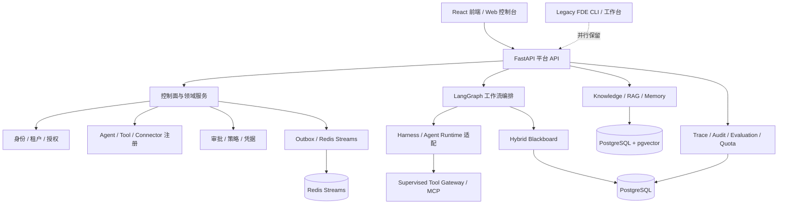

# AI 原生企业基础设施平台：全仓库差距审查（阶段性报告）

> 审查状态：**阶段性审查，尚未满足 Issue #848 的最终验收条件**  
> 基线分支：`main`  
> 基线 commit：`3fa0415b76aa06375859362e2e1bfa69a4094e16`  
> 审查日期：2026-11-21  
> 仓库：`dujiu1024-dotcom/Agent-pingtai`

## 0. 重要结论与审查限制

本报告已完成第二轮源码核查：成功枚举 main 的递归文件树（1,568 个文件，其中 agent_platform/ 532、frontend/src/ 100、tests/ 489、PostgreSQL SQL migrations 127），并继续读取关键后端实现、API 路由、数据库迁移、前端页面和 GitHub Actions 失败日志。它仍不是完整的逐文件语义审计结论。

本轮仍存在以下客观限制：

1. GitHub 仓库代码搜索索引不可用（repository metadata: is_code_search_indexed=false），但通过 Git Trees API 已成功枚举完整文件路径；因此不能再将“无法枚举目录树”作为当前限制。
2. 尝试在执行环境浅克隆仓库时，网络 DNS 无法解析 github.com，无法在本地执行全量测试、静态检查、前端构建或启动服务。
3. 已读取大量关键源码并检查了基线 SHA 对应的 CI 实际运行结果，但尚未逐一阅读全部 1,568 个文件，也没有本地 PostgreSQL/Redis/模型服务可供复现所有失败。
4. 以下“已具备/基础已具备”仅代表源码中存在相应机制；是否在生产组合中完整接线、可运行和生产可用，仍需按报告中的验证要求补证。

**因此，本报告应作为第一轮证据盘点和审查基线，不应据此关闭 Issue #848。** 需由具备完整仓库 checkout 和集成环境的审查人员继续完成剩余审计，并更新本报告。

## 1. 审查范围、方法和证据等级

### 已读取的关键文件

| 范围 | 已读取文件/证据 |
|---|---|
| 仓库定位 | `README.md`、`pyproject.toml`、`requirements-platform.txt` |
| 架构设计 | `docs/architecture/智能体平台改造总设计.md` |
| 领域契约 | `agent_platform/contracts.py` |
| 多 Agent | `agent_platform/workflows/multi_expert.py` |
| 生产组装 | `agent_platform/production.py` |
| 安全与凭据 | `agent_platform/security/credentials.py` |
| 审批与审计 | `agent_platform/approval/postgres.py` |
| 知识与记忆 | `agent_platform/knowledge/service.py`、`agent_platform/memory/service.py` |
| 沙箱 | `agent_platform/sandbox/oci.py` |
| 运行基准 | `agent_platform/runtime/harness_benchmark.py` |
| 前端 | `frontend/package.json`、`frontend/src/App.tsx`、`frontend/src/routes/route-config.ts` |
| 部署 | `deploy/production.compose.yaml` |
| CI | `.github/workflows/ci.yml` |
| 测试源码 | `tests/test_platform_postgres_integration.py`、`tests/test_redis_streams_integration.py`、`tests/test_issue_755_c_dual_mode_integration.py` |

已成功枚举全仓库文件路径，但尚未逐个读取全部文件内容。因此表中列出的“未找到”不能解释为仓库不存在，只能解释为本轮未获得实现证据。

### 成熟度定义

- **基础已具备**：已读取到实际机制/服务/页面或测试代码，但生产链路、验收或覆盖仍不完整。
- **部分实现**：存在部分领域代码、路由或流程，尚不能证明端到端闭环。
- **仅有设计**：本轮仅找到设计文档描述。
- **待验证**：本轮没有足够证据确认代码实现或可运行性。
- **尚未建设**：只有在完成全仓库检索后才能使用；本轮不轻易作此判定。

## 2. 当前代码反向架构

从已读取文件看，仓库采用“旧 FDE 工作台保留 + 新平台在 `agent_platform/` 独立演进”的并行迁移结构，而不是单体一次性替换。

上述图是依据本轮读取的模块和设计文档归纳的结构示意，不代表所有组件均已在生产环境完整连通。

### 已确认的架构事实

1. `README.md` 明确说明旧 FDE 工作台继续保留，新平台位于 `agent_platform/` 并行建设；旧 CLI 仍为标准库路线，新平台依赖单独安装。
2. 架构设计明确采用 PostgreSQL 为业务事实源、Redis Streams 做事件分发、LangGraph 做有状态流程编排、Hybrid Blackboard 做跨 Agent 共享认知、Harness Adapter 做运行时适配。
3. `agent_platform/production.py` 是生产 ASGI 组合根，导入并组装身份、知识、记忆、审批、运行生命周期、事件、审计、配额、调度、连接器、评测和追踪等模块。
4. `frontend/src/App.tsx` 使用 React Router、懒加载和多个产品功能页面；`route-config.ts` 定义了工作空间、运行运营和管理路由。
5. `deploy/production.compose.yaml` 定义生产 API、worker、PostgreSQL、Redis、对象存储等运行服务，并配置只读根文件系统、非 root 用户、cap drop、no-new-privileges、资源限制、健康检查和受控出口代理。

## 3. 核心技术能力成熟度（Issue 第 8 节十项）

| 目标能力 | 阶段性判断 | 已读取证据 | 当前明确缺口/待验证 |
|---|---|---|---|
| 多智能体协同执行引擎 | 基础已具备 | `workflows/multi_expert.py` 定义专家规划、并行执行、汇总、Review、冲突处理、审批、归档/拒绝；`test_platform_postgres_integration.py` 有真实 LangGraph + PostgreSQL 黑板集成测试源码 | 需在真实依赖环境执行；进一步验证动态任务拆解质量、黑板并发冲突、专家超时/失败隔离、委派授权、人工介入后重分配和端到端业务副作用 |
| 任务执行与工作台引擎 | 基础已具备 | `production.py` 组装 RunLifecycleManager、PostgresRunStateStore、RunInterventionService、RunReplayService、RunContextSnapshotService；前端有任务指挥中心、Run 详情、回放和批量执行路由 | 需核验状态机全状态、取消/恢复竞态、幂等副作用、产物版本/下载权限和前后端真实 API 闭环 |
| 企业系统集成与连接器 | 部分实现 | 生产组装包含 DataConnectorService、PostgresConnectorRepository、Webhook 订阅/投递；README 描述 MCP Gateway | 尚未逐项确认 ERP/CRM/OA/HR/MES/PLM/飞书/钉钉/企业微信等真实适配器。通用 Connector 框架不等于完成各厂商连接器 |
| 工具安全执行与沙箱 | 基础已具备 | `sandbox/oci.py` 强制镜像 digest、隔离网络、只读根文件系统、资源限制、禁用敏感环境变量；README 描述 Gateway-only MCP、Run 级短期 Token 和 JSON Schema | 需验证生产容器运行时/rootless 配置、daemon/socket 边界、真实网络策略、文件输入输出边界、沙箱生命周期和安全负向测试 |
| 事件驱动与可靠任务调度 | 基础已具备 | README 描述 PostgreSQL Outbox、Redis Streams、Pending 恢复、消费回执、幂等和 DLQ；生产组装 OutboxRelay/Worker；Redis 集成测试源码存在 | 需执行真实 Redis/Postgres 故障注入；验证消息积压、重复投递、死信重放、外部副作用幂等和跨版本迁移 |
| Webhook 与开放 API 生态 | 部分实现 | 生产组装含 WebhookSubscriptionService、PostgresWebhookStore、投递 Worker、DLQ Replay；FastAPI API 组合存在 | 尚需核验签名、密钥轮换、租户级 API Key、配额/限流、Webhook 重放权限、OpenAPI 完整性、SDK 和外部开发者文档 |
| 多模型运行时与 Harness 架构 | 基础已具备 | README 和架构设计列出 LangGraph、DeepSeek Harness、Strands Agents、MCP Provider；`harness_benchmark.py` 有同任务基准数据结构和汇总 | 设计文档明确 DeepSeek/Strands 尚未真实模型同任务质量/成本对比；需验证流式、超时、取消、恢复、供应商降级和真实模型质量 |
| Agent 版本发布与部署管理 | 部分实现 | 前端路由有 Agent 定义、Workflow 设计、模型模板、扩展发布等入口；生产组装含 Registry 与 TrustedPublisherKeyRegistry | 需核验资产统一版本、依赖锁定、环境晋级、灰度、回滚、签名包、兼容性矩阵及生产发布审计 |
| 执行链路追踪与质量分析 | 基础已具备 | 生产组装 PostgresRunTraceRepository、PostgresEvaluationRepository、Prometheus 指标、OperationalHealthMonitor；前端有回放、质量成本、告警路由 | 需验证 Trace 跨模型/工具/Agent 关联、成本准确性、评测数据闭环、质量回归 Gate、SLA 指标和真实告警投递 |
| 企业级部署与运行基础设施 | 部分实现 | 生产 Compose 配置 PostgreSQL/Redis/MinIO/API/worker、健康检查、资源限制、secrets file、egress proxy/allowlist | 本轮未验证 Kubernetes、私有云/本地安装、离线授权、控制平面断网自治、备份恢复/灾备演练、升级回滚和多环境部署 |

## 4. 八大统一引擎与资源模型

| 统一引擎 | 现有映射（已读取） | 阶段性结论 |
|---|---|---|
| 身份与组织引擎 | `agent_platform/identity/`、`production.py` 的 PostgresIdentityRepository/IdentityService | 基础已具备；组织层级、部门/团队授权、SSO、跨服务身份传播和越权测试需完整审查 |
| AI 资产引擎 | `control_plane/registry.py`、扩展发布者注册、Agent/Workflow 前端管理入口 | 部分实现；需统一资产类型、版本依赖、签名、发布回滚和市场分发证据 |
| 任务与调度引擎 | `runtime/lifecycle.py`、PostgresRunStateStore、scheduler、batch、interventions | 基础已具备；需检查任务与 Run 的完整关联、长任务恢复和业务副作用去重 |
| 事件驱动引擎 | `events/outbox.py`、Redis Streams、receipt、webhook worker | 基础已具备；需运行故障注入和死信运营验收 |
| 策略与审批引擎 | `approval/service.py`、`approval/postgres.py`、RiskLevel、Tool Gateway | 基础已具备；需验证服务端策略来源、动作摘要绑定、审批人资格和 L3 强人工执行边界 |
| 统一执行运行时 | `runtime/`、LangGraph、Harness Adapter、MCP Gateway | 基础已具备；真实模型对比、生产执行器配置、跨 Harness 一致性需补证 |
| 数据与知识引擎 | `knowledge/service.py`、PostgresKnowledgeRepository、RAG、Memory、Graph | 基础已具备；数据血缘、删除传播、ACL 全链路和多模态摄取需补证 |
| 观测与计量引擎 | `observability/`、RunTrace、Evaluation、Prometheus、Quota | 基础已具备；企业/部门/团队成本归集、业务价值、SLA 与结算未形成已验收证据 |

### 资源语义核验

`contracts.py` 定义 Scope、BlackboardEntry、BlackboardEvent、ModelTemplateRef、RunContext；运行/任务/项目/租户上下文已有初步契约。已读取的 identity、knowledge、memory、approval、runtime、events 代码说明部分核心实体存在。

但本轮没有完整检查数据库所有迁移、外键、唯一约束、删除策略和全量 API，因此 Tenant、Organization、User、DigitalEmployee、Agent、Workflow、Skill、Tool、Model、KnowledgeBase、Task、Run、Event、Policy、Approval、Artifact 的统一资源关系仍应标记为**待完整验证**。尤其没有足够证据证明 DigitalEmployee 已作为区别于 Agent 的组织身份资源实现。

## 5. 产品中心及扩展能力盘点

以下状态仅代表本轮已读取到的前端路由/后端模块线索，不能将页面入口等同于功能完成。

### 5.1 十四个产品中心

| 产品中心 | 已读取线索 | 阶段性判断 |
|---|---|---|
| 智能体管理中心 | `/admin/agents`，AgentDefinitionPage | 部分实现；发布/版本/回滚待验证 |
| 多智能体协作中心 | `/workspace/collaboration`，AgentCollaborationCenter，multi_expert workflow | 基础已具备；生产协作场景待验证 |
| 行业智能应用中心 | 本轮未读取到真实行业方案包实现 | 待验证 |
| 工作流自动化中心 | `/admin/workflows`，WorkflowDesignerPage | 部分实现；节点语义、调试、版本和运行闭环待验证 |
| 任务执行与会话中心 | Tasks、Runs、Conversations、Files、Replay 路由 | 基础已具备；逐页面 API 与恢复链路待验证 |
| 模型与工具中心 | Providers/Templates/Routing/Tools 路由，MCP Gateway | 部分实现；模型供应商真实接入清单待验证 |
| 企业知识与记忆中心 | Knowledge、RAG、Graph、Memory 路由与服务 | 基础已具备；ACL、数据治理和引用质量待验证 |
| Agent 应用市场与资产中心 | Registry、Extension Publishers 路由/服务 | 部分实现；市场交易、安装、撤销和生态授权待验证 |
| 企业组织与安全中心 | OrganizationAccess、Identity、Approval、Audit | 基础已具备；SSO、组织层级和隔离证明待验证 |
| AI 治理与合规中心 | Approval、Audit、RiskLevel、Policy 相关服务 | 部分实现；合规控制面与合规报告待验证 |
| AI 质量评测中心 | Evaluation Store、质量成本页面 | 基础已具备；评测数据集/门禁/版本对比需执行验证 |
| 运行监控与成本中心 | Trace、Prometheus、Alerts、Quota、CostQuality | 基础已具备；SLA 和准确成本归集待验证 |
| 企业资源与成本管理中心 | Quota、Budget、Token usage 相关模块 | 部分实现；计算资源池、部门预算与分摊待验证 |
| 企业部署与运维管理中心 | Compose、Health、运维/告警路由 | 部分实现；升级、备份、灾备、容量和离线运维待验证 |

### 5.2 八个新增产品中心

| 新增中心 | 阶段性结论 | 缺失/待验证重点 |
|---|---|---|
| 企业系统集成中心 | 部分实现 | 各企业系统的真实连接器、认证刷新、同步策略、健康状态和兼容矩阵 |
| 企业数据接入与治理中心 | 部分实现 | 数据目录、分类分级、质量规则、血缘、删除传播、敏感数据识别 |
| AI API 开放平台 | 部分实现 | API Key 生命周期、外部开发者配额、SDK、契约版本和 SLA |
| AI 资产生命周期管理中心 | 部分实现 | 全资产统一版本、依赖锁定、环境晋级、签名、回滚和导入导出 |
| AI 安全执行与沙箱中心 | 基础已具备 | 真实容器运行安全、资源/网络隔离和红队负向测试 |
| AI 服务等级与可靠性管理中心 | 部分实现 | SLA SLI/SLO、错误预算、熔断/降级、容量预测和故障复盘 |
| AI 人才与开发者生态中心 | 待验证 | SDK、开发者门户、伙伴认证、兼容性测试和生态协作空间 |
| 企业 AI 运营与价值分析中心 | 待验证 | 部门价值指标、工时节省估算、ROI 和业务效果基线 |

### 5.3 十项战略扩展能力

| 能力 | 阶段性结论 | 需要重点验证的具体功能 |
|---|---|---|
| 企业 AI 决策中心 | 待验证 | 指标/异常/预测/方案对比/依据追溯/审批执行 |
| AI 数字员工管理中心 | 待验证 | 独立组织身份、岗位职责、负责人、授权边界、绩效和调岗 |
| 企业流程挖掘中心 | 待验证 | 业务日志采集、流程发现、瓶颈、自动化机会与效果分析 |
| AI 自主优化中心 | 部分有基础线索 | Prompt 实验/评测存在相关模块；失败分析、候选改进、人工批准发布闭环待验证 |
| 企业知识图谱中心 | 部分实现 | Graph 服务与页面存在；实体抽取、关系治理、冲突检测和数据血缘待验证 |
| 多模态 AI 中心 | 待验证 | OCR、语音、视频、图纸、多模态统一路由和权限 |
| AI 事件驱动中心 | 基础已具备 | Outbox/Streams/Webhook 存在；业务事件目录、规则管理、运营可视化待验证 |
| 企业 AI 合同与服务管理中心 | 待验证 | 合同、套餐、许可、离线授权、续期和商业结算 |
| AI 业务连续性管理中心 | 部分实现 | 重试、恢复、回放和灾备脚本需做真实恢复演练；业务副作用不重复执行需证据 |
| 企业 AI 创新实验室 | 待验证 | 自然语言建 Agent/Workflow、沙箱试运行、创新项目转生产闭环 |

## 6. 前端、API 和产品化观察

### 已读取到的前端产品入口

`frontend/src/App.tsx` 采用 React 18、React Router、React Query、Zustand，按功能懒加载页面。路由配置至少覆盖：

- 工作空间：概览、快速使用、状态看板、任务指挥中心、智能体协作、成本质量、数字办公室；
- 运营：Agent、任务、Run、审批、知识库、知识图谱、RAG、批量执行、回放、告警、记忆、会话、文件；
- 管理：Agent 定义、Workflow 设计、模型供应商/模板/路由、工具与 MCP、扩展发布等。

### 发现的产品化风险

1. `route-config.ts` 的概览页描述明确写明“当前仅展示导航框架，不填充未经 API 证实的指标”。因此不能把该页面视为完整经营驾驶舱。
2. 路由配置中的页面说明和 owner/Issue 编号只是页面规划线索，不代表页面真实操作已连接生产 API。
3. 本轮未能逐页检查数据请求、错误/空状态、权限隐藏、表单提交和端到端交互。
4. 需要建立“目标能力—路由—组件—API—服务—表/迁移—测试”映射表，避免页面存在但业务链路断开。

## 7. 多租户、身份、安全和数据边界

### 正向证据

- `contracts.py` 的 RunContext 带 tenant_id；Blackboard scope 包含 tenant。
- `memory/service.py` 定义 MemoryPrincipal，并包含 tenant、user、project、agent 和权限上下文。
- `security/credentials.py` 的 CredentialService 在凭据记录和授权中使用 tenant_id、consumer_type/id、scope，并在创建/授权后写审计。
- `approval/postgres.py` 的审批消费按 tenant_id、approval_id、action_digest、policy_version、approved 状态和过期时间原子更新；审计读取按 tenant_id 限定。
- `sandbox/oci.py` 对镜像 digest、网络、文件系统、资源和敏感环境变量采取 fail-closed 约束。
- 生产 Compose 配置使用 secrets file、精确 ALLOWED_ORIGINS、出口代理与 EGRESS_ALLOWED_HOSTS、非 root、只读根文件系统和 capability drop。
- `tests/test_issue_755_c_dual_mode_integration.py` 有认证模式与 no-auth 模式 HTTP 集成测试源码，并明确测试无凭据请求访问业务 handler 的行为。

### 重大待验证风险

1. **No-auth 双模式风险**：测试证明存在无认证模式的应用装配路径，但不代表生产环境默认安全。必须检查生产配置的默认值、启动参数、反向代理和环境变量，并证明生产部署无法意外进入 no-auth 模式。
2. **租户隔离覆盖面**：已读取若干服务按 tenant 过滤，不足以证明 API、数据库、向量检索、对象存储、缓存、事件、文件下载和异步 Worker 全链路均隔离。
3. **部门/团队边界**：Tenant 级隔离不等于 Organization/Department/Team 级数据隔离，必须检查资源授权与继承策略。
4. **数字员工身份**：本轮未找到充分证据证明数字员工具有独立组织身份、负责人、岗位和绩效模型。
5. **凭据与沙箱**：需要实测密钥注入、短期 Token 撤销、进程退出清理、容器逃逸防护和网络出口 allowlist。
6. **审计完整性**：需核验身份认证、策略决策、审批、模型调用、工具调用、外部副作用、人工接管和产物的统一关联 ID，以及审计写失败时的 fail-closed 行为。

## 8. 混合部署、可用性和业务连续性

### 已读取部署证据

`deploy/production.compose.yaml` 以不可变镜像变量部署 API，定义 PostgreSQL、Redis、MinIO、worker 和告警 worker 等服务；配置健康检查、资源限制、受控代理出口和容器加固。

### 尚未证明的混合部署关键条件

- 企业运行平面在公共控制平面不可用/断网时，已授权业务是否继续运行；
- 公共控制平面是否只承担可选的注册、许可证、分发等非核心控制职责；
- 企业原始数据、知识、会话、凭据和审计数据是否默认不离开企业环境；
- 企业到公共侧的远程运维是否具备授权、最小权限、限时和完整审计；
- 离线许可证校验、续期宽限、版本分发缓存和紧急撤销策略；
- 私有云/本地部署的安装、升级、回滚、备份、恢复和灾备演练。

**阶段性结论：已看到单实例生产 Compose 部署基础，但不能据此判定 Hybrid First 已成立。**

## 9. 测试、CI 与运行验证

### 已读取 CI 证据

`.github/workflows/ci.yml` 配置：

- Python 3.11/3.12 矩阵；
- identity-focused 测试；
- 全量 unittest discover；
- Ruff、mypy；
- 单独的 platform-integration reusable workflow。

### 已读取测试证据及边界

- `tests/test_platform_postgres_integration.py`：由 `AGENT_PLATFORM_TEST_DSN` 控制，包含真实 PostgreSQL 集成测试源码，未配置 DSN 时跳过。
- `tests/test_redis_streams_integration.py`：由 Redis URL 和 PostgreSQL DSN 控制，真实 Redis Streams 测试源码，未配置环境时跳过。
- `tests/test_issue_755_c_dual_mode_integration.py`：使用 FastAPI TestClient 的双模式集成测试，但 fixture 中使用内存知识/记忆仓库和 stub Redis，不是完整生产基础设施 E2E。
- `frontend/package.json` 定义 build、lint、typecheck、Vitest、Playwright E2E 脚本。

### 本轮本地执行与 CI 证据

| 检查 | 本轮结果 |
|---|---|
| 仓库递归文件树 | 已读取：1,568 个文件；未逐个读取全部文件内容 |
| 仓库浅克隆 | 未完成：执行环境无法解析 github.com |
| 本地 Python unittest / PostgreSQL / Redis | 未执行：当前执行环境无仓库 checkout 和集成服务 |
| Ruff / mypy / 前端 build / lint / typecheck / Vitest / Playwright | 本地未执行 |
| GitHub Actions（基线 main） | 已读取实际运行记录，结果失败，详见第 14 节 |
| 生产 Compose 启动验证 | 未执行 |

不能将 CI 配置文件存在等同于最近一次 CI 全绿；本轮已读取基线 SHA 对应的实际 workflow run 和 job 结果。

## 10. P0/P1/P2 差距 Backlog（第一轮建议）

| 优先级 | 建议任务 | 缺失点/风险 | 可验证验收标准 |
|---|---|---|---|
| P0 | 完成完整仓库清点和能力矩阵 | 当前审查覆盖不完整，无法满足 Issue 全量要求 | 导出 main 全部文件树；逐项覆盖 Issue 第 2/7/8 节；每项包含源码、API、数据、前端、测试证据 |
| P0 | 生产身份模式与租户隔离安全审计 | no-auth 双模式与 tenant 边界需要证明生产安全 | 生产启动默认强制认证；跨租户/跨部门 API、DB、文件、向量、事件负向测试全通过 |
| P0 | 混合部署断网自治验收 | Compose 不证明公共控制平面解耦 | 断开公共侧后企业运行平面持续执行已授权任务；数据不外流；恢复后状态一致 |
| P0 | 生产运行链路 E2E | 多模块存在但生产装配与实际副作用链路尚未实测 | 从登录/授权到任务、Agent、工具审批、产物、审计、Trace 全链路真实服务通过 |
| P1 | Agent/Workflow/Tool/Skill 统一资产生命周期 | 当前 Registry/发布入口不能证明完整资产生命周期 | 版本、依赖锁定、环境晋级、灰度、回滚、签名、权限和审计端到端通过 |
| P1 | 连接器真实适配矩阵 | 连接器框架不等于企业系统适配完成 | 对每个已支持连接器提供认证、读写、刷新、限流、重试、健康检查和契约测试 |
| P1 | 可靠性与灾备演练 | 重试/恢复代码不能替代演练 | 注入 DB/Redis/模型/网络故障；验证恢复、DLQ 重放、补偿和业务副作用幂等 |
| P1 | 质量评测与成本治理闭环 | 已有评测/配额模块，尚未证明企业运营闭环 | 形成数据集、版本对比、回归 Gate、Token/资源成本归集和预算告警报告 |
| P1 | 前端产品中心端到端验收 | 路由/页面存在不代表真实功能完成 | 所有页面逐项绑定真实 API，验证权限、加载、空态、错误态和核心操作 |
| P2 | 数字员工组织模型 | 尚未证明 DigitalEmployee 是独立资源 | 建立身份、岗位、负责人、组织归属、授权、绩效和生命周期验收 |
| P2 | 开发者与伙伴生态 | SDK、市场、伙伴认证/结算证据不足 | 提供 SDK、文档、示例、扩展包签名、兼容测试和伙伴发布流程 |
| P2 | 战略扩展中心 | 决策、流程挖掘、多模态、创新实验室等未完成验证 | 每项形成独立范围、依赖、原型/接口、数据治理和阶段性验收标准 |

## 11. 保留、扩展、整合建议

### 建议保留并复用

- Hybrid Blackboard 的事实/证据/质疑/冲突/裁决语义；
- PostgreSQL 作为业务事实源、Redis Streams 作为消息传输层的分工；
- LangGraph 工作流与 Harness Adapter 分层；
- Supervised Tool Gateway、审批动作摘要绑定、审计和 OCI 沙箱；
- 已有身份、知识、记忆、Trace、Evaluation、Quota、Webhook 和 Connector 服务。

### 建议优先整合

- 将旧 FDE 工作台与新平台的边界、迁移策略、数据归属和前端入口形成正式架构清单；
- 将 Agent、Workflow、Skill、Tool、Connector、Prompt、Model、Knowledge 等统一到可版本化资产契约；
- 将 Tenant、Organization、User、DigitalEmployee、Agent、Task、Run、Event、Approval、Artifact 的资源关系统一起来；
- 建立页面/API/服务/数据/测试追踪矩阵，避免重复模块和孤立页面。

### 不建议在证据不足时重写

现有新平台已有较多可复用的运行时、审批、事件、知识、安全和观测基础。应先完成完整审查和生产验证，再按 P0 缺口拆分实施 Issue，不应以“AI 原生平台”为由推倒重来。

## 12. 下一轮审查必须补齐的工作

1. 在可访问 GitHub 的执行环境 checkout 精确 SHA `3fa0415b76aa06375859362e2e1bfa69a4094e16`，生成完整文件清单。
2. 遍历所有 `agent_platform/`、`frontend/src/`、`tests/`、SQL migrations、deploy、scripts、docs 和 CI 文件。
3. 按 Issue 的 14 个产品中心、8 个新增中心、10 个战略扩展、10 个核心技术能力、8 个统一控制平面能力逐项建立完整对照表。
4. 对每项补充具体类/函数/API/表/迁移/前端组件/测试路径，不能只引用目录。
5. 执行 Python 全量测试、PostgreSQL/Redis 集成测试、Ruff、mypy、前端 build/lint/typecheck/Vitest/Playwright。
6. 读取基线 SHA 对应的 GitHub Actions 实际运行记录；对失败、跳过和未覆盖项分别记录。
7. 完成跨租户/部门负向测试、no-auth 生产配置审查、断网自治和灾备恢复演练。
8. 将最终审查结果更新到本报告，并在 Issue #848 回填最终验收结论。

## 13. 阶段性结论

当前仓库不是只有产品原型或简单 Agent Demo：从已读取源码看，已具备相当数量的平台级基础模块，包括多专家工作流、黑板、身份与授权、审批、MCP 工具网关、沙箱、事件 Outbox/Streams、知识/记忆、运行追踪、评测、配额和生产 Compose。

但目前仍不能得出“已具备完整 AI 原生企业基础设施平台”的结论。主要差距不是简单缺少几个页面，而是：

- 目标能力与真实实现尚未形成全量、逐项、可追溯映射；
- 生产环境的租户/组织隔离、no-auth 配置边界、混合部署断网自治尚缺完整证明；
- 多模型/Harness 真实质量对比、连接器真实适配、资产发布治理、SLA/灾备和生态商业化能力尚需补证；
- 前端路由、API、领域服务、数据迁移和测试的端到端映射尚未完成；
- 本轮无法执行完整测试与生产环境验证。

**本报告完成的是第一轮证据盘点，不是 Issue #848 的最终交付。Issue 应保持 Open，直到全量代码审查、运行验证和正式差距清单全部完成。**

## 14. 第二轮源码审查与 CI 实证结果（2026-11-21）

### 14.1 审查范围进展

本轮通过 Git Trees API 枚举了 main 的递归文件树：

| 范围 | 文件数 |
|---|---:|
| 全仓库 | 1,568 |
| agent_platform/ | 532 |
| frontend/src/ | 100 |
| tests/ | 489 |
| docs/ | 237 |
| agent_platform/storage/postgres/*.sql | 127 |
| deploy/ | 14 |
| .github/workflows/ | 10 |

已进一步读取任务重试、运行时存储、知识检索/ACL、记忆 API、身份上下文、告警 Outbox、Prompt Registry、文件 API、前端知识工作台和记忆治理页面等实际实现。

### 14.2 已确认的代码级问题

| 优先级 | 文件/位置 | 代码证据与实际影响 | 判断 |
|---|---|---|---|
| P1 | agent_platform/runtime/workbench_tasks.py:529-536；agent_platform/runtime/postgres_lifecycle.py:85-162,164-177 | create_retry_task_run() 返回新 Run 的 run_id，但新记录仍保留源任务的 task_id；调用方随后把返回的 run_id 传给按 task_id 查询的 get_task_record()，因此读回为 None，retry_task() 返回 None。真实 PostgreSQL 测试 tests/test_platform_postgres_integration.py:654 因 retried["status"] 触发 NoneType 错误。 | **确认的任务重试链路缺陷**；重试接口无法可靠返回新任务记录。 |
| P1 | agent_platform/observability/alert_store.py:55-75 | SQL 使用 (%s IS NULL OR event_id=%s)，可空参数在 IS NULL 上缺乏可推断类型；真实 PostgreSQL 返回 IndeterminateDatatype: could not determine data type of parameter $1。 | **确认的 PostgreSQL 参数类型缺陷**；告警投递领取在该查询路径失败。应显式转换为 event_id 对应的 UUID 类型。 |
| P1 | agent_platform/storage/postgres/ | 当前有 127 个迁移文件，但只有 96 个唯一数字前缀；存在 25 组重复编号，包含 038（3 个）、041（3 个）、044（4 个）、079（3 个）等。 | **确认的迁移编号治理缺陷**；test_endpoint_directory_is_shared_and_deactivates 等多个 Gateway 集成用例在 setup 阶段因迁移序号不唯一而失败。需要建立唯一、单调、不可复用的迁移版本序列，并检查已部署数据库兼容性。 |
| P1 | Redis Outbox 相关实现；tests/test_redis_streams_integration.py:324、tests/test_issue_18_a_18_03_redis_outbox_recovery_integration.py:146 | 真实 Redis 集成测试观察到 Outbox 恢复后 claim 数量为 2（预期 1），另一测试在删除 Stream 后恢复结果长度为 0（预期 1）。 | **可靠投递/恢复验收失败**；需进一步沿事件持久化、重放游标、幂等键和 claim 逻辑定位重复或漏恢复原因。 |
| P1 | agent_platform/knowledge/postgres_repository.py:202-215；agent_platform/storage/postgres/098_knowledge_embeddings_bge_m3.sql:1-15 | 数据库迁移将 pgvector 列固定为 1024 维；集成测试却构造 1536 维向量并写入，PostgreSQL 报 expected 1024 dimensions, not 1536。KnowledgeService 在无显式 embedder 时还存在 1536 维默认值。 | **模型维度配置与测试/默认值不一致**；需统一以 embedding provider 的 dimensions 为唯一配置来源，并增加启动时 schema/config 校验。 |

### 14.3 CI 失败中需要区分“产品缺陷”和“测试/契约漂移”

基线 SHA 3fa0415b76aa06375859362e2e1bfa69a4094e16 的 GitHub Actions：

- Platform Integration run：[44888729700](https://github.com/dujiu1024-dotcom/Agent-pingtai/actions/runs/44888729700)，最终 failure。
  - Platform Integration / postgres-redis-integration：failure，114 项测试中 11 failures、10 errors、1 skipped。
  - Identity focused tests (3.11/3.12)：均 failure。
  - test (3.11/3.12)：因 workflow fail-fast 被 cancelled。
- Release Gate run：[44888729744](https://github.com/dujiu1024-dotcom/Agent-pingtai/actions/runs/44888729744)，最终 failure。
  - e2e-focused-unit：failure，48 项测试中 3 failures、1 error。
  - e2e-security-integration：failure，49 项测试中 4 failures、1 error。
  - production-release-evidence：skipped。
- 依赖安全扫描及 security-unit 在此前读取的 CI 结果中通过；不能据此推导整条流水线通过。

已确认的测试/契约漂移线索：

1. tests/test_model_runtime_router.py:9 导入 ModelCircuitBreaker，但 agent_platform/models/circuit_breaker.py 实际定义的是 AsyncCircuitBreaker；导致整个测试模块 ImportError，模型路由相关用例未执行。
2. tests/test_platform_api_app.py 的文件资产测试调用 GET /api/platform/v1/files/{asset_id}，而当前 API 实际提供 GET /files/{asset_id}/metadata、/versions 和版本下载路由，没有裸路径 GET；Identity focused tests 因 405 失败。需统一 API 契约与测试/调用方，不能把该失败误判为租户隔离逻辑失败。
3. tests/test_knowledge_memory_api.py:32-38 的测试 principal resolver 对所有用户默认授予 project-a，而 :383-392 的断言又要求 user-b 看不到 project-a 记忆；该用例的 fixture 与预期矛盾，导致 memory scope 测试失败。应修正 fixture 后再判断生产隔离。
4. tests/test_knowledge_memory_postgres_integration.py:150-215 的 chunk ACL 用例在没有 ACL 的 chunk 上断言非授权用户看不到任何 chunk；当前 list_visible_chunks() 明确允许 acl_enforced=false 的公开 chunk。需澄清预期是“未授权用户不能看到被限制 chunk”，还是“一个文档只要启用 chunk ACL 就必须对所有 chunk 默认拒绝”，再调整代码或测试。
5. tests/test_release_gate_evidence.py 的旧 fixture 未提供当前 release validator 要求的 deployment preflight 证据；tests/test_release_acceptance_report.py 的 Markdown 转义断言与当前输出不一致。当前 CI 因此失败，但需要先更新 fixture/断言并确认生产校验规则是否符合 Issue 预期。
6. Prompt audit 集成测试在迁移/测试过程中报告 platform_prompt_audit_events_action_check 约束冲突。迁移 079_prompt_audit_events.sql、083_prompt_variants.sql、084_prompt_rollouts.sql 分阶段修改 action allowlist；应在干净库和已有库分别验证迁移顺序、历史数据兼容和重复执行。
7. test_intervention_timeline_and_checkpoint_gated_resume 报告测试对象为 list、缺少 record_event 方法；test_extraction_creates_candidates_without_auto_activation 返回 400；当前日志不足以判定是生产实现缺陷还是测试 fixture/接口契约漂移，暂列待定位。

### 14.4 前端与 API 的具体差距证据

- frontend/src/features/knowledge/KnowledgeWorkbench.tsx:403-405 明确说明服务端没有 ACL 列表查询接口，页面只能展示当前页面会话中已提交的授权记录；刷新页面后无法从服务端完整重建授权状态。这是知识治理中心的产品闭环缺口。
- 同一页面提供文档 ACL 和切片 ACL 的授权/撤销交互，但未获得 ACL 列表读取 API，导致管理端无法进行完整的权限盘点、审计和授权差异对账。
- frontend/src/features/memories/MemoryGovernancePage.tsx 已连接 candidates、memories、confirm、archive、conflict resolve、export 等 API；但应与后端身份上下文、项目成员关系一起做真实端到端权限验证，不能只凭页面存在认定治理闭环完成。

### 14.5 本轮结论更新

1. 仓库目录树清点已经完成，之前“不能枚举文件树”的限制已解除；完整逐文件语义审查仍未完成。
2. 已发现至少两项明确的后端代码缺陷（任务重试读回、告警 SQL 参数类型），一项迁移编号治理缺陷，以及 Redis 恢复测试失败。
3. CI 实际失败证据已补入；失败中同时包含产品代码问题、测试 fixture 错误和 API 契约漂移，必须逐项分类，不可简单将全部失败归为产品故障。
4. Issue #848 仍未达到最终验收；本 PR 继续保持 Draft，不合并。下一步应围绕确认的 P1 缺陷建立独立修复 Issue/PR，并继续补齐全量能力映射与真实运行验收。

### 14.6 连接器实现范围与只读安全边界

实际 provider 清单来自 agent_platform/connectors/providers.py，当前包含 PostgreSQL、MySQL、S3、飞书、Notion 和通用 HTTP JSON 六类 Provider。DataConnectorService 提供租户作用域连接记录、Secret Manager 引用、分页同步、持久化队列、撤销和下游清理能力。

这说明连接器框架和部分常见 SaaS/数据源适配已存在，但尚不能等同于 ERP、CRM、OA、HR、MES、PLM、企业微信、钉钉等行业/企业系统的完整适配矩阵。每个具体系统仍需单独验证认证刷新、权限 scope、增量游标、限流、写回、回滚和厂商 API 版本兼容性。

**新增安全审查项（P1，需负向测试确认）：**
- agent_platform/connectors/providers.py:120-178 的 PostgreSQL provider 接受 query: scope，并将 scope 中的 SQL 原样传给 connection.execute()；当前代码没有强制 PostgreSQL read-only transaction，也没有把查询限制为 SELECT。
- Provider 标签称为“只读 SQL”，但只读属性目前主要依赖外部凭据本身是只读账号；若 secret:// 中配置的是具备写权限的数据库账号，任意 SQL scope 存在越权修改数据的风险。
- 建议在连接层启用只读事务（例如连接后强制 SET TRANSACTION READ ONLY），并对 query scope 做严格的只读语法/语句约束；同时要求数据库侧使用最小权限只读角色。MySQL provider 也应采用等价的只读保障，不能只依赖前端提示或连接配置约定。

### 14.7 AI 资产生命周期的实际边界

extensions 模块已实现相对完整的扩展包专用生命周期：manifest 精确版本和依赖 pin、依赖拓扑排序、循环检测、安装/卸载计划、启停/升级/补偿、租户级持久化状态、可信发布者公钥注册/轮换/撤销，以及 OCI 运行时相关代码。

但这不能直接证明 Agent、Workflow、Skill、Tool、Model、Prompt、Connector、Knowledge 等全部 AI 资产已经共用同一套发布/晋级/灰度/回滚机制。当前可见实现分散在 Registry、Extension Manager、Prompt Registry 和 Connector Service 等不同域；仍需建立跨资产统一的版本、依赖锁定、环境晋级、签名、兼容性和回滚追踪矩阵。

## 15. 第三轮审查：身份初始化、灾备验收与混合检索证据（2026-11-21）

### 15.1 P1：公开首次初始化接口存在并发竞争窗口

代码证据：
- `agent_platform/identity/http.py:124-127` 将 `/auth/initialize` 列入公开路径。
- `agent_platform/api/identity.py:59-113` 的初始化处理器先执行 `SELECT count(*) FROM platform_tenants`，仅当结果为 0 时才调用租户和首位 Owner 创建逻辑。
- `agent_platform/identity/tenants.py:7-34` 在独立事务中创建租户并创建首位 Owner。
- `agent_platform/storage/postgres/001_platform_core.sql:7-13` 的 `platform_tenants` 只有 tenant_id 主键，没有“全平台最多一个初始化租户”的唯一约束或初始化状态锁。

判断：空库检查与租户创建不是同一个受互斥保护的原子操作。两个并发请求可能都在任一请求提交租户之前读到 count=0，然后分别创建不同 tenant_id 和首位管理员。因为 tenant_id 只要求唯一，不阻止两个不同租户同时创建，这与接口“仅在任何租户存在之前初始化一次”的语义不一致。

影响：未认证请求可以竞争首次初始化窗口，造成多个独立首位管理员/租户被创建。该风险仅发生于首次初始化尚未完成的窗口，但初始化部署阶段通常也是最容易暴露的阶段。

建议：
1. 将“全局初始化完成”做成数据库级单例记录/唯一约束，或使用事务级 advisory lock 并在锁内检查和创建。
2. 让锁覆盖检查、tenant 创建、owner bootstrap 和审计写入的完整事务。
3. 为公开初始化端点增加独立速率限制、初始化窗口告警和部署前置网络访问限制。当前 IdentityASGIMiddleware 只对 POST /auth/login 应用登录限流；/auth/initialize 不在该限流分支内，且现有 tests/test_identity_api.py 只覆盖登录/登出，没有首次初始化或并发初始化测试。
4. 增加两个或更多并发初始化请求的 PostgreSQL 集成测试，断言全平台最终只有一个初始化租户和一个首位 Owner；失败请求必须返回 409。

### 15.2 灾备能力有策略和工具，但全平台恢复尚未得到真实演练证明

已具备：
- `deploy/disaster-recovery-policy.json` 定义 config、PostgreSQL、Redis、对象存储四类必需组件，以及 full_platform、failover、failback 的 RPO/RTO 目标和一致性/主库隔离门禁。
- `scripts/backup_postgres.sh` 实现 PostgreSQL custom dump、age 加密、SHA-256 校验和 manifest。
- `scripts/restore_postgres.sh` 实现校验、解密、pg_restore 单事务恢复及显式确认。
- `scripts/disaster_recovery.py` 提供恢复计划与演练证据校验。

重要限制：
- `tests/test_issue_18_a_18_02_backup_restore_drill.py` 的真实 CLI 演练只覆盖临时 GitHub Actions PostgreSQL 服务中的源库到目标库恢复。
- 该测试自身在 evidence limitations 中明确说明：Redis、MinIO、配置、全平台一致性和故障切换均未演练；CI 测量不能代表生产 RPO/RTO 或 SLA；独立审核人签字仍未完成。
- `scripts/disaster_recovery.py` 明确声明只做计划和提交证据校验，不会停止服务、恢复数据、提升副本、变更 DNS 或切换流量；校验通过只证明提交的证据符合格式和阈值，不独立证明生产可恢复性。

结论：灾备的策略定义、PostgreSQL 备份/恢复工具和证据格式已有基础，但全平台多组件一致性恢复、Redis/对象存储恢复、配置/密钥恢复、跨可用区故障切换和 failback 仍属待验收能力。不能把“有 RPO/RTO policy”标记为“已达到生产 RPO/RTO”。

### 15.3 混合检索质量测试是确定性编排基准，不是生产模型质量基准

`tests/test_issue_22_a_22_03_hybrid_quality.py` 明确使用：
- 固定的十条合成关系问题和人工构造的 relevant/distractor 文档集合；
- `FixedScoreVectorRetriever` 为每份文档返回预先写死的分数；
- 以相同的确定性分数排序对比向量基线和图约束混合检索。

因此 0.40 到 0.80 的 Recall@5 提升能够证明 GraphQueryService 的候选约束/排序编排在该合成 fixture 上按预期工作，但不能证明真实 BGE-M3 embedding、真实企业语料、真实模型问答质量、跨领域召回率或生产用户体验提升。

建议增加固定版本的真实语料 benchmark（带标注 query/relevant evidence、tenant/project ACL），用真实 embedding provider 和真实向量库执行，报告 Recall@K、MRR、nDCG、引用准确率、拒答率、延迟和单位查询成本；合成测试保留为单元/回归测试。

### 15.4 身份与组织隔离代码覆盖的补充判断

已读取 `PostgresIdentityRepository.get_authorization_context()`、`ResourceScopeAuthorizer` 和机器身份仓储：
- 人类用户需要 active tenant membership；角色绑定按 tenant_id、subject、resource type/id 查询。
- project 权限从 tenant/project/active organization 三种资源授权聚合；agent 权限从 tenant/agent 资源授权聚合。
- ResourceScopeAuthorizer 对 principal tenant 与资源 tenant 不匹配默认拒绝，并为 Gateway、Harness media read/write 提供共享授权适配。
- ServiceIdentityRepository 在 credential、service account、tenant、Agent identity、RBAC binding 和 scope 上进行重新校验；现有 PostgreSQL 集成测试覆盖了 Agent 状态撤销、principal-agent 不匹配和跨租户本地 ID 冲突。

这属于较强的身份/租户隔离代码基础；但目前读取到的证据仍不能替代全业务路由的负向测试，尤其是所有租户资源 ID 可猜测时的跨租户读写、组织禁用后的缓存失效、后台 worker/Outbox/Connector 执行上下文是否始终携带 tenant_id，以及对象存储实际 key/prefix 隔离。

### 15.5 本轮差距优先级更新

| 优先级 | 差距 | 后续验收条件 |
|---|---|---|
| P1 | 首次初始化公开接口并发竞争 | DB 级单例/互斥 + 并发初始化集成测试 |
| P1 | PostgreSQL Connector 未强制只读事务（见 14.6） | 具备写权限的账号执行 INSERT/DDL 必须被数据库拒绝 |
| P1 | Workbench retry、Alert Outbox、迁移编号等已确认缺陷（见 14.2） | 修复 PR + 对应真实 PostgreSQL/Redis 回归测试 |
| P1 | 全平台灾备演练未完成 | Redis、对象存储、配置/密钥、跨组件一致性、failover/failback 真实演练及独立签字 |
| P1 | 知识/记忆/文件/后台 worker 跨租户隔离端到端证据不足 | 完整路由矩阵 + 负向集成测试 + 对象存储隔离验证 |
| P2 | Hybrid 检索质量指标只由合成 fixture 支撑 | 真实语料、真实 embedding、标注集和线上质量/成本指标 |

## 16. 第四轮审查：多智能体持久化、模型故障切换与离线验收（2026-11-21）

### 16.1 多专家并行编排代码已存在，但真实生产恢复证据尚未闭环

已确认实现：
- `agent_platform/workflows/multi_expert.py` 使用 LangGraph `Send` 将专家任务并行 fan-out，按 expert_id/blackboard_entry_id 对并发贡献排序，降低完成顺序不确定性对综合结果的影响。
- 工作流实现 synthesis、review、conflict resolution、human approval interrupt、approved archive 和 rejected 分支。
- `agent_platform/runtime/delegation.py` 对子 Run 委派实现显式 Agent/Tool allowlist、租户绑定 ExpertRegistry、能力校验、最大深度、循环检测、fan-out 上限、超时、稳定 child Run ID/idempotency key；一个子任务失败时取消并等待其他兄弟任务。
- `TaskCenterChildRunExecutor` 把子 Run 提交到持久化 Task Center，复用平台 worker，校验父子 Run 的 tenant/project/task/model template/correlation/ancestry 关系。
- `LangGraphRunExecutor` 强制 graph 带 Checkpointer；`postgres_checkpointer.py` 提供 PostgreSQL Saver 生命周期托管；独立集成测试证明简化审批图在关闭原 Checkpointer 后可由新 PostgreSQL Saver 恢复并继续。

仍缺的验收证据：
- `tests/test_multi_expert_workflow_integration.py` 的四条多专家主流程测试使用 `InMemorySaver`，并非 PostgreSQL。
- `tests/test_postgres_langgraph_checkpoint_integration.py` 的真实 PostgreSQL 重启恢复测试只构造了一个简化的 request_approval → deliver_artifact 图，没有运行 `build_multi_expert_workflow()`，也没有覆盖并行 Send 分支、Blackboard 贡献、冲突解决状态、审批中断后的多专家恢复。
- 因此目前能证明“多专家流程在内存 Checkpointer 下可走通”和“LangGraph 简化审批图可通过 PostgreSQL Checkpointer 重启恢复”，但不能把两项分开的测试拼接成“多专家生产工作流已通过 PostgreSQL 崩溃恢复验收”。

建议新增真实 PostgreSQL 集成测试：多专家并行节点执行到审批 interrupt 后关闭 worker/Checkpointer；重启进程、重新组装同一 pinned registry snapshot 和工作流；恢复审批后确认专家分支没有重复执行、Blackboard lineage 不重复写入、tenant/run/thread scope 保持一致、最终结果和 trace 连续。

### 16.2 模型路由有候选回退机制，但不等于企业断网自治

已确认：
- `RunScopedModelClient` 从 Run 的不可变 registry snapshot 读取 primary template 和 provider_fallbacks，并将 fallback template IDs 交给 Model Router。
- `OpenAICompatibleModelRouter` 仅从当前 Run snapshot 中解析 primary/fallback 候选，按顺序尝试，避免运行时随意选择 mutable latest 版本。
- `RegistryModelResolver` 允许无 API Key 的本地 provider（例如 Ollama），但 provider 类型仍限定为 OpenAI-compatible；HTTP 明文仅允许通过显式开关对 loopback 地址放行。

边界：
- 这是模型请求层的候选 provider 回退能力，不代表平台控制面、Registry、PostgreSQL、Redis、Secrets、工具网关和 worker 在公共网络/控制面断开时仍可自治运行。
- 本轮没有找到一套可证明生产部署已默认配置本地模型 fallback、模型权重预置、离线依赖镜像、密钥本地解封和控制面断连运行的端到端验收。
- 需要区分“模型供应商故障切换”“本地模型可用”“企业网络断网后整个平台自治”三种不同能力。

### 16.3 P1/P2：离线 Service Worker 验收测试与当前仓库文件/路由不一致

测试证据：
- `tests/test_issue_667_a_667_07_offline_fallback.py` 定义 `SERVICE_WORKER = ROOT / "agent_platform" / "web" / "static" / "sw.js"`，Node runtime 测试直接读取该路径。
- 本次 main 分支递归 Git Trees 文件清单中，`agent_platform/web/static/` 只有 `index.html` 和 `assets/` 下的打包资源；没有 `sw.js` 文件。
- `agent_platform/web/app.py` 当前仅注册 `/app`、`/app/assets/{path}`、`/graph-view` 和通用 `/app/{path}` SPA fallback；没有 `/app/sw.js` 的专用 JavaScript 文件路由。
- 因此即使 SPA fallback 让 `GET /app/sw.js` 返回 200，也会返回 index.html，而不是测试要求的 JavaScript；Node 测试则会因文件不存在而无法读取脚本。

判断：这不是“离线业务执行已实现”的证据。现有测试意图覆盖的是前端 Shell 缓存和离线导航；当前 main 的静态产物/路由没有与该测试契约对齐。该验收测试若在 Node 可用的 CI 环境执行，应失败或被跳过，具体取决于 Node 环境。

建议：
1. 确认离线 UI 是否仍为产品需求；若保留，提交 sw.js 到构建产物并增加精确的 `/app/sw.js` 路由、正确 MIME 和 Service-Worker-Allowed header。
2. 修正测试 fixture，使其与 Vite build/deploy 的真实产物一致，不要依赖不存在的源码静态文件。
3. 明确离线范围：缓存 UI shell、离线只读数据、离线任务草稿、离线执行队列、恢复联网后的冲突合并分别验收。Service Worker 缓存首页不等于离线执行 Agent 任务。

### 16.4 资产治理与发布能力：底座较完整，跨类型运营闭环仍需验证

进一步确认：
- 通用 Registry 对 Agent、Workflow、Tool、Skill、Model Provider/Template 等资产提供 tenant-scoped draft/publish/disable/rollback 和不可变版本；Run Registry Snapshot 固定执行时使用的版本。
- Skill 包专用链路增加 manifest、依赖 pin allowlist、依赖扫描、immutable artifact reference、沙箱安装/卸载和失败补偿。
- `deployment/versioned.py` 有 canary/gray/blue-green 策略、健康采样、流量步进、维护窗口和自动/人工回滚状态机。

证据边界：
- `tests/test_registry_service.py` 主要使用 InMemoryRegistryRepository；`tests/test_versioned_deployment.py` 验证的是纯 Python 部署状态机。不能据此认定 Registry Postgres 持久化和真实 Kubernetes/Compose/企业环境流量控制已端到端打通。
- 当前代码可证明“资产注册版本控制”和“部署策略状态机”分别存在；仍需证明资产发布审批、依赖兼容性检查、环境晋级、灰度指标采集、流量切换执行、失败自动回滚和审计记录在同一条真实发布链路中闭环。

### 16.5 本轮差距优先级更新

| 优先级 | 差距 | 验收标准 |
|---|---|---|
| P1 | 首次初始化并发竞争（第 15.1 节） | DB 级单例互斥 + 并发初始化测试 |
| P1 | 离线 Service Worker 测试与 main 静态产物/路由不一致 | 测试在真实构建产物上通过；确认离线功能范围 |
| P1 | 多专家工作流没有 PostgreSQL 进程重启恢复验收 | 真实多专家图、并行分支、Blackboard、interrupt/resume 的 PostgreSQL 故障恢复测试 |
| P1 | 企业断网自治没有端到端证据 | 控制面断连演练，验证本地模型、Registry snapshot、worker、数据存储、工具和 secrets 的自治能力 |
| P2 | Registry/部署状态机尚未证明真实环境发布闭环 | 从资产审批到真实灰度、流量切换、回滚的端到端演练 |

## 17. 第五轮审查：生产组合根与统一引擎的实际接线（2026-11-21）

本轮从生产入口反向追踪：`agent_platform.production:app` → `create_production_app()` → `ProductionRunExecution` → `RegistryLangGraphExecutorResolver` → deployment graph factory → Run Registry Runtime。重点不是模块是否存在，而是默认生产装配是否实际调用它们。

### 17.1 P1：默认生产 Run 执行器仍是本地单节点聊天图，多专家工作流没有进入默认任务执行主链路

证据：
- `pyproject.toml:11-12` 注册 Python entry point：`agent_platform.production_run_execution / builder = deploy.local_runtime:build_run_execution`。
- `agent_platform/production.py:1087-1104` 在生产 ASGI 入口加载该 trusted builder；若 entry point 不存在才尝试 fallback；`deploy/production.compose.yaml:14-16` 默认使用 `agent_platform.production:app`，并默认要求 Run execution。
- `deploy/local_runtime.py:1-8` 明确自述为“本地单机版”，说明可信图工厂构造“系统指令 + 用户输入 → 模型回复”的单节点 LangGraph，工具/技能目录当前为空，Agent 定义也不引用它们。
- `deploy/local_runtime.py:578-905` 的 graph factory 最终调用 `build_state_graph`，nodes 只有 `assistant`，edges 只有 `assistant → __end__`；没有调用 `build_multi_expert_workflow()`。
- `agent_platform/workflows/multi_expert.py:150-253` 的多专家图作为独立 builder 存在，但没有被默认生产 graph factory 引用。
- `tests/test_core_business_journey_e2e.py:22,144,220` 直接在测试中导入并构建多专家图，使用 `InMemorySaver`；这证明该图在测试组合中可用，不证明默认生产 Task Center 会选择该图。

判断：
- 生产默认 Run Worker、Registry snapshot、模型路由、配额/审计和单节点 LangGraph 有接线。
- 但多专家工作流并未接入默认 Agent → Task → Run 执行路径。除非部署者替换 trusted entry point / graph factory，否则创建普通任务仍执行单节点 assistant 图。
- 这属于“模块已实现但生产主链路未集成”，不是简单的测试覆盖不足。

建议：
1. 将 Agent 的 workflow_id 与 Workflow Registry definition 映射到可信 Workflow Executor Factory；执行前校验版本、权限、工具/Skill 依赖，执行时从 Run pinned snapshot 装配对应图。
2. 为默认 Task Center 增加至少一条真正调用多专家图的端到端验收：API 提交任务 → Worker claim → Registry snapshot → 多专家并行 → Blackboard → 审批 → Run result/trace。
3. 将“单节点聊天模板”作为一种明确的 Workflow 类型，而不是默认等同于平台完整 Agent Runtime。

### 17.2 P1：Workflow 虽被快照校验，但 RegistryRuntimeAssembler 没有负责装配 Workflow 执行定义

证据：
- `agent_platform/runtime/workbench_tasks.py` 的 `RegistryLangGraphExecutorResolver.__call__` 读取 Agent definition 的 `workflow_id`，校验 Run snapshot 中 Workflow 集合与该 ID 一致；同时校验 Agent、Model Template、Provider、Tool、Skill 的版本引用。
- `agent_platform/runtime/registry_runtime.py:119-220` 的 `RegistryRuntimeAssembler.assemble()` 实际装配 Model client、Tool definitions 和已审核 Skill；返回的 `RunRegistryRuntime` 没有 Workflow executor/compiled graph 字段，也没有 Workflow definition resolver。
- graph factory 被作为外部 trusted callable 注入 `RegistryLangGraphExecutorResolver`，默认 `deploy/local_runtime.py` graph factory 并不读取 snapshot 中 Workflow definition。

判断：
- 当前 Workflow Registry pinning 提供版本一致性约束，但“被 pin 的 Workflow”并没有因此自动成为实际执行图。
- Agent 的 workflow_id 在默认路径中更接近一个被校验的引用，而不是已证明被加载和执行的编排定义。
- 这进一步印证 17.1 的主链路接线差距。

建议：为 Workflow 增加显式的可信执行器注册/解析接口，明确支持的节点类型、条件分支、子图、工具和人工审批；禁止把 Registry 中的任意代码字符串当作可执行入口；增加 Workflow version → compiled graph digest → Run snapshot 的审计关联。

### 17.3 P1：生产部署默认启用本地部署适配器，需澄清其与企业生产版的职责边界

证据：
- Python Entry Point 在项目元数据中固定指向 `deploy.local_runtime:build_run_execution`，并非仅由开发人员手工选择。
- `deploy/production.compose.yaml` 的 API 服务默认运行 `agent_platform.production:app`，且 `AGENT_PLATFORM_REQUIRE_RUN_EXECUTION=true`。
- 因此当镜像安装当前项目 entry point 时，生产 compose 的默认运行时即为 local_runtime builder，而非一个独立的企业级生产 builder。
- 该 adapter 自己声明本地单机语义；包含本地环境变量 Secret Resolver、单节点图工厂和 `_LocalSkillReviewer`。后者只放行 `mode=lightweight` 的 Skill，其他需要 artifact registry 的 Skill 明确拒绝（`deploy/local_runtime.py:129-146`）。

判断：
- 这不是说它不能在生产运行，而是“本地单机适配器”目前承担了默认生产 Run execution 的角色；其功能边界必须作为产品部署能力公开说明。
- 如果目标是混合部署、企业级多智能体协同和统一资产运行时，默认 compose 路径与目标架构不一致，且不能依赖“未来由部署方替换 builder”作为默认产品能力。

建议：
1. 拆分 local/dev adapter 与 enterprise production adapter 的 Entry Point/部署配置，生产 profile 必须显式选择企业级 builder。
2. Production startup preflight 输出并验证实际 builder 名称、支持的 Workflow 类型、Skill 模式、Tool catalog、Model provider 能力；能力不足时 fail closed，不要静默降级为单节点聊天。
3. 将不同部署 profile 的能力矩阵写入 deployment contract 和验收测试。

### 17.4 统一引擎/产品中心接线矩阵更新

| 统一能力 | 模块存在 | 默认生产路径接线证据 | 审查结论 |
|---|---|---|---|
| Identity / Tenant / RBAC | 是 | API middleware + production identity repository | 已接线；仍需全路由负向覆盖 |
| Run / Task / Worker | 是 | production builder → Task Center → durable worker | 已接线 |
| Model / Quota / Usage / Audit | 是 | Registry Runtime + model router + quota/audit | 已接线（依赖本地 adapter 配置） |
| Tool Registry / Gateway | 是 | Registry Runtime assembler + trusted handler map；但默认 graph tool loop 独立直接调用 handler | 部分接线，需统一执行边界 |
| Skill Registry / Sandbox | 是 | Registry Runtime 有 reviewer；默认 LocalSkillReviewer 仅放行 lightweight | 部分接线；重型 Skill 不可用 |
| Workflow Engine | 是 | Agent workflow_id 被 snapshot 校验；默认 graph factory 不加载 Workflow definition | 未接入默认执行主链路 |
| Multi-Agent Engine | 是 | 多专家图和独立测试存在；默认 graph factory 为单节点 assistant | 未接入默认执行主链路 |
| Blackboard / Knowledge / Memory | 是 | API、服务和部分 workflow services 存在；默认单节点图未证明自动组合 | 部分接线/按业务显式调用 |

### 17.5 本轮优先级

| 优先级 | 差距 | 验收标准 |
|---|---|---|
| P1 | 默认生产 Run graph 为单节点 assistant，多专家图未接入 | 从生产 Task API 提交任务，真实执行 Registry Workflow / multi-expert graph |
| P1 | Workflow 只做 snapshot 引用校验，未证明被 runtime 装配执行 | Workflow definition/version 解析、编译、执行、审计端到端通过 |
| P1 | 默认生产 Entry Point 指向 local_runtime，本地能力限制成为默认生产边界 | 分离 local 与 enterprise builder；生产 preflight 验证能力 profile |
| P1 | 默认图内工具调用与 Runtime Tool Gateway 边界需统一 | 所有工具调用统一经过权限、超时、幂等、审计和效果对账层 |
