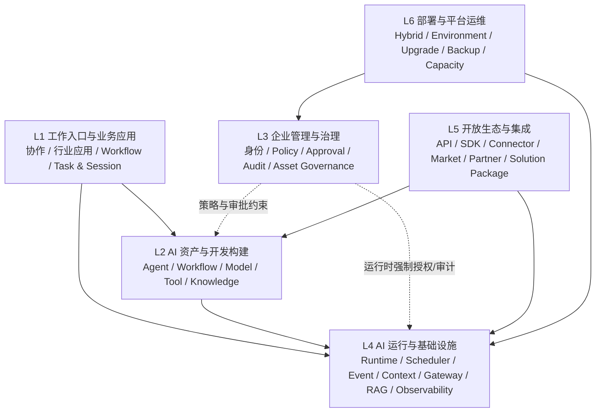

# B3 产品能力分层映射：七个产品中心 × 六层产品结构

> Issue：#848（AI Native Enterprise Platform 全仓库差距审查）  
> 专项：B3 产品能力分层映射  
> 审查基线：`main` @ `b622d5fc9eab1c79c28dcaa13367eec3c138679d`  
> 日期：2026-11-21  
> 范围：仅映射 B2 已审查的七个产品中心，不扩展审查其他产品中心，不实施业务功能。

## 1. 结论摘要

七个产品中心不是七个平级、互不依赖的系统。按 Issue #848 第七节“产品能力分层与产品边界”定义的六层结构，建议采用“**一个主归属层 + 多个支撑层**”的映射方式：

- **第 1 层 企业 AI 工作入口与业务应用层**：多智能体协作、行业智能应用、工作流自动化、任务执行与会话是直接面向业务使用者的应用能力。
- **第 2 层 AI 资产与开发构建层**：智能体管理是核心归属；工作流、模型工具、知识内容也在此层完成定义、调试和版本化。
- **第 3 层 企业 AI 管理与治理层**：七个中心都不等同于企业组织/安全治理中心，但 Agent 发布、协作审批、模型凭据和知识 ACL 必须接受本层控制。
- **第 4 层 AI 运行与基础设施层**：多智能体、工作流、任务会话、模型工具、知识记忆的运行机制在此层执行；这是七个中心共享的技术底座。
- **第 5 层 开放生态与集成层**：行业方案包、资产分发、MCP/连接器和外部扩展在此层形成生态交付路径；当前七中心只有局部技术基础，尚无完整市场/伙伴交付闭环。
- **第 6 层 部署与平台运维层**：七个中心均不是部署运维中心；它们必须消费平台环境、配置、容量、升级、备份和灾备能力，不能各自建设一套部署系统。

关键结构性结论：**产品中心是面向用户的业务能力聚合；六层是职责与依赖分层。不能将产品中心直接等同于层，也不能将后端模块名机械转成菜单。**

## 2. 六层结构定义（以 Issue #848 为准）

| 层 | 目标职责 | 主要用户/关注点 | 不应承接的职责 |
|---|---|---|---|
| L1 企业 AI 工作入口与业务应用层 | 统一工作入口、任务与会话、AI 助手、数字员工、多智能体协作、行业应用、业务工作流 | 员工、业务团队、业务负责人 | 资产底层注册、密钥存储、运行时调度实现 |
| L2 AI 资产与开发构建层 | Agent、Workflow、Skill、Tool、Prompt、模型、知识库等资产的创建、调试、测试、版本和发布 | Agent/Workflow 开发者、AI 管理员 | 生产执行状态机、组织身份权威源、部署基础设施 |
| L3 企业 AI 管理与治理层 | 组织身份、权限策略、审批、合规、安全、审计、资产治理和运营管理 | 企业管理员、安全/合规、审计、资产负责人 | Agent/Workflow 业务编排与模型推理执行 |
| L4 AI 运行与基础设施层 | Runtime、任务调度、事件驱动、上下文、数据知识、模型路由、工具网关、观测计量和可靠性 | 平台工程、运行时服务、SRE | 面向业务用户的应用导航和伙伴商业门户 |
| L5 开放生态与集成层 | API/SDK、连接器、资产市场、开发者与伙伴门户、行业解决方案和商业合作 | 内外部开发者、集成商、行业伙伴 | 企业内部运行时的权威身份/数据平面 |
| L6 部署与平台运维层 | 企业实例、混合部署、配置、升级、备份恢复、许可证、容量和多环境运维 | 平台运维、企业 IT、基础设施团队 | Agent 资产编辑、业务任务处理 |

## 3. 七个产品中心的主归属与跨层映射

标记说明：**主** = 产品主归属；**支** = 依赖或提供能力；**缺** = 目标职责存在，但当前产品化证据不足。成熟度沿用 B2 报告判断，不因本次分层映射而上调。

| B2 产品中心 | L1 工作入口/应用 | L2 资产/构建 | L3 管理/治理 | L4 运行/基础设施 | L5 生态/集成 | L6 部署/运维 | 主归属层 |
|---|---|---|---|---|---|---|---|
| 1 智能体管理中心 | 支：Agent 使用入口 | **主**：定义、配置、版本、发布 | 支：发布审批、权限与审计 | 支：Run/Runtime 执行 | 支/缺：资产导入导出、共享和分发 | 支：环境发布目标 | **L2** |
| 2 多智能体协作中心 | **主**：协作任务与监督体验 | 支：专家 Agent/团队配置 | 支：委派授权、审批、责任审计 | **主依赖**：协作编排、Blackboard、上下文与执行 | 缺：跨组织/伙伴协作资产分发 | 支：运行环境和容量 | **L1** |
| 3 行业智能应用中心 | **主（目标）**：行业场景应用 | 支/缺：Solution Package、参数模板 | 支：行业数据权限、风险策略 | 支：复用 Agent/Workflow/Knowledge Runtime | **主（目标）**：行业方案包交付与伙伴生态 | 支：客户环境安装、升级 | **L1 + L5（双重产品面）** |
| 4 工作流自动化中心 | **主**：业务流程设计与使用 | **主依赖**：Workflow 定义、DSL、版本 | 支：节点权限、人工审批、变更审计 | **主依赖**：Workflow Runtime、调度和恢复 | 支：流程模板/组件分发 | 支：环境配置与发布 | **L1** |
| 5 任务执行与会话中心 | **主**：统一任务、会话、产物和人工接管 | 支：会话模板、可复用任务定义 | 支：任务授权、审批和审计 | **主依赖**：Task/Run/Session 持久化、worker、checkpoint | 缺：面向外部应用的任务/会话 API 产品化 | 支：队列、存储、容量和恢复 | **L1** |
| 6 模型与工具中心 | 支：配置者的操作入口 | **主**：模型/Provider/Tool/MCP 资产配置 | 支：凭据引用、权限范围、风险与审计 | **主依赖**：模型路由、Tool Gateway、MCP 执行 | 支/缺：连接器/工具生态、开发者规范和分发 | 支：模型端点、密钥配置、部署环境 | **L2** |
| 7 企业知识与记忆中心 | 支：知识问答、检索和记忆治理入口 | **主**：知识库、集合、索引和记忆资产治理 | 支：知识 ACL、数据保留/删除、审计 | **主依赖**：摄取、检索、Embedding、RAG、Memory/Graph | 支/缺：数据连接器生态和外部知识源适配 | 支：向量库、对象存储、同步 worker 运维 | **L2** |

### 3.1 各中心的产品层边界

1. **智能体管理（L2）**：负责 Agent 资产定义和生命周期，不负责替代任务工作台（L1）或 Runtime（L4）。Agent 调试/测试是 L2 的构建能力；真正执行仍由 L4 提供。
2. **多智能体协作（L1）**：负责业务用户如何组织协作、查看分工、处理冲突和接管；专家配置复用 L2 Agent 资产；协作状态与执行由 L4 维护；授权和审批由 L3 统一约束。
3. **行业智能应用（L1/L5）**：L1 展示行业业务应用，L5 管理可安装、可授权、可升级的行业解决方案包。当前代码未发现独立行业应用中心、行业包模型或专属 API，不能将通用 Agent/Workflow 拼装能力判为行业应用产品已完成。
4. **工作流自动化（L1）**：L1 提供流程设计/业务触发体验，L2 管定义、DSL、节点契约和版本，L4 执行 Workflow。不能让页面自行承载另一套执行引擎。
5. **任务执行与会话（L1）**：L1 是业务工作台；Task/Run/Session 的状态机、持久化、恢复和副作用治理归 L4；权限审批归 L3。统一详情页不能复制一套任务状态源。
6. **模型与工具（L2）**：L2 管模型和工具资产配置、版本与测试；L4 管实际路由和受控调用；L3 管凭据访问、风险策略与审计；L5 才负责面向生态的工具/连接器发布与分发。
7. **企业知识与记忆（L2）**：L2 管知识库、集合、索引配置和记忆资产治理；L4 提供摄取、检索、RAG、记忆检索与图谱运行；L3 统一约束 ACL、数据生命周期和审计；L5 管外部数据连接器的生态接入规范。

## 4. 代码与页面映射证据

以下路径来自 B2 对当前 `main` 基线的代码审查。路径存在只证明有实现线索；成熟度仍按端到端链路和测试证据判断。

| 产品中心 | 前端入口/页面 | API、领域模块与运行服务 | 数据/持久化证据 | B2 成熟度 |
|---|---|---|---|---|
| 智能体管理 | `AgentDefinitionPage`、`/agents`、Registry CRUD 配置 | Registry API、`agent_platform/control_plane/registry.py`、`agent_platform/models/registry_resolver.py` | `PostgresRegistryRepository`、registry migrations | 基础已完成；调试台和发布预检不完整 |
| 多智能体协作 | `AgentCollaborationCenter` | Blackboard API、MultiExpert services | `PostgresBlackboardRepository`、event/outbox | 部分实现；团队配置、生产级委派和 E2E 不足 |
| 行业智能应用 | 未发现专属入口 | 未发现专属行业 API；可复用 Agent/Workflow/Tool/Skill substrate | 未发现 Solution Package 专属模型 | 尚未建设为独立产品中心 |
| 工作流自动化 | `WorkflowDesignerPage` | Registry API、Runtime/Task API、LangGraph adapter | Workflow registry version、Run snapshots | 部分实现；JSON 编辑器不等于完整可视化 DSL |
| 任务执行与会话 | `TaskCommandCenter`、Task/Run 路由 | `agent_platform/api/workbench.py`、sessions/runs APIs、`agent_platform/runtime/workbench_tasks.py` | Postgres RunState/Session/Asset、相关 migrations | 基础已完成；会话/产物闭环和副作用恢复有缺口 |
| 模型与工具 | `RegistryCatalogPage`；`/admin/models/*`、`/admin/tools` | `runtime_router.py`、`tools/gateway.py`、`gateway_mcp.py`、MCP adapter | Registry、secret refs、usage ledger | 基础已完成；测试台和统一运营体验不足 |
| 企业知识与记忆 | `KnowledgeWorkbench`、`KnowledgeGraphPage`、`MemoryGovernancePage` | `agent_platform/knowledge/*`、`agent_platform/memory/*`、`agent_platform/graph/*` | Postgres docs/chunks/ACL/collections/memory/graph | 基础已完成；连接器覆盖、ACL 撤权一致性和质量运营有缺口 |

## 5. 关键共享底座与依赖方向

六层之间应保持单向依赖：上层消费下层稳定契约；治理层对运行时执行进行约束；生态层通过受控 API/资产契约接入；部署层承载企业运行平面。不得由业务 UI 绕过服务端治理直接调用工具或外部系统。

核心复用关系：

- **Registry/Asset**：Agent、Workflow、Model、Tool、Skill 等统一资产注册与版本底座（L2）；不要为七个中心分别新建资产注册系统。
- **Runtime/Task/Run**：Workflow、协作和任务中心复用同一 Run 生命周期、状态持久化、checkpoint、quota 和执行轨迹（L4）。
- **Tool Gateway/MCP**：模型/Agent/Workflow 统一通过受控 Gateway 调用工具（L4），权限和审批决策由 L3 提供。
- **Knowledge/Memory/Graph**：知识、记忆和图谱保持领域边界，通过统一身份上下文和审计关联协同；不要把知识配置 UI 与 RAG Runtime 混为一层。
- **Identity/Policy/Approval/Audit**：L3 提供跨中心一致的身份、策略、审批与审计，不在各中心复制租户/角色判断。
- **Connectors/API/SDK**：L5 将内部稳定契约开放给伙伴和集成方；企业私有数据与凭据仍由企业侧控制。

## 6. 分层发现的问题与风险

| 严重度 | 问题 | 影响层 | 证据/现状 | 建议 |
|---|---|---|---|---|
| P0 | 资产配置、执行和治理职责容易混淆 | L2/L3/L4 | Registry、Runtime、Policy 分散在不同模块；部分 UI 入口是通用 CRUD | 明确资产定义与执行实例边界；所有执行请求由 L4 统一入口并经 L3 策略检查 |
| P1 | Workflow 设计与执行契约尚未稳定 | L1/L2/L4 | Workflow Designer 当前以 JSON 编辑为主，Runtime 使用 LangGraph adapter | 先建立版本化 DSL/node contract，再完善可视化编辑器；不要另起 Runtime |
| P1 | 多 Agent 产品界面与协作运行机制耦合 | L1/L3/L4 | 协作服务和 Blackboard 有基础，团队/委派策略产品化不足 | L1 管协作任务体验；L3 管委派授权/审批；L4 管调度、上下文和协作状态 |
| P1 | 模型/工具配置入口与运行运营割裂 | L2/L3/L4 | Registry 配置与 Router/Gateway 分离，缺统一测试控制台 | L2 负责配置/测试；L3 管密钥与授权；L4 管健康、路由和执行计量 |
| P1 | 知识配置、权限治理、运行质量分散 | L2/L3/L4/L5 | Knowledge/Memory/Graph 有领域实现；连接器目前有明确 Drive/SharePoint 证据 | L2 管知识资产；L3 管 ACL/保留/撤权；L4 管索引与检索；L5 管 Connector 规范及适配覆盖 |
| P1 | 行业应用缺少可安装交付资产 | L1/L2/L5/L6 | 未发现行业 Solution Package 专属模型/API/UI | 设计 package manifest、依赖、客户参数、签名、安装预检、升级回滚和环境部署合同 |
| P2 | 七个中心容易形成重复菜单与重复状态面板 | L1/L2/L4 | 同一 Registry/Run/Knowledge 能力由多个入口消费 | 按用户任务组织导航；资产详情、执行详情、治理详情复用统一资源 ID 和深链 |
| P2 | 生态和企业部署边界尚未在七中心内形成完整闭环 | L5/L6 | 有 API/Connector/Registry 等基础，但无七中心级伙伴交付与独立部署证明 | 由 L5/L6 提供平台级服务，不在各产品中心各自实现安装器、许可证和运维控制台 |

## 7. 推荐的产品导航与职责组织

建议导航按六层组织，但不要求六层都成为一级菜单。业务用户优先看到 L1 工作入口；开发者/管理员看到 L2/L3；平台运营与生态管理按权限展示 L4/L5/L6 管理入口。

| 导航/工作区 | 对应层 | 可包含的产品中心/能力 | 主要用户 |
|---|---|---|---|
| 工作台 | L1 | 任务与会话、多智能体协作、行业 AI 应用、工作流运行 | 员工、业务团队 |
| AI 构建 | L2 | Agent、Workflow、模型与工具、知识与记忆资产的创建/调试/版本 | Agent 开发者、AI 管理员 |
| 企业治理 | L3 | 组织身份、授权策略、审批、合规、审计、资产治理 | 企业管理员、安全/合规 |
| 运行运营 | L4 | Runtime、任务调度、模型/工具运行、知识索引、观测计量与可靠性 | 平台运营、SRE |
| 开放生态 | L5 | API/SDK、连接器、市场、伙伴门户、行业方案包 | 开发者、集成商、伙伴 |
| 平台运维 | L6 | 实例、环境、配置、升级、备份恢复、许可证、容量 | 企业 IT、平台运维 |

避免重复建设的导航原则：

- L1 只呈现业务动作和工作结果，不暴露底层 provider、索引分片或 worker 队列配置。
- L2 管“定义/构建/验证/发布”；L4 管“执行/状态/追踪/恢复”。同一个 Agent 资产详情可跳转其 Run 列表，但两者不能共享混乱的状态模型。
- L3 统一提供权限、审批和审计入口；各产品中心仅展示与当前资源相关的策略结果，不实现私有授权逻辑。
- L5 是对外/跨组织分发与集成边界；企业内部资产共享仍应遵守租户、组织和授权规则。
- L6 管平台环境和部署生命周期；产品中心不自行管理容器、数据库迁移、备份和许可证。

## 8. 研发补齐顺序与可验证验收标准

| 优先级 | 分层任务 | 关联中心 | 依赖 | 验收标准 |
|---|---|---|---|---|
| P0 | 固化 L2 资产定义、L3 策略审批、L4 执行实例的资源边界与统一 ID 关联 | 1/2/4/5/6/7 | Registry、Identity、Policy、Run | Agent/Workflow/Tool/Knowledge 资产均能定位版本；Run 记录 pinned asset version；执行授权服务端判定；跨租户拒绝测试通过 |
| P1 | Workflow DSL 与节点契约分层 | 4 | Registry、Runtime、Approval、Scheduler | DSL schema versioned；节点输入输出校验；条件/循环/并行/人工任务有运行及恢复测试 |
| P1 | 多 Agent 团队配置和受监督委派 | 2 | Agent Registry、Policy/Approval、Task/Quota、Blackboard | 团队角色/范围/预算/责任人可配置；超范围拒绝、超预算停止、失败重派和 PG E2E |
| P1 | Agent/Model/Tool 构建测试与发布预检 | 1/6 | Registry、Runtime、Tool Gateway、Evaluation、Policy | 版本固定、输入/权限模拟、依赖检查、能力探测；失败阻止发布并记录审计 |
| P1 | Task/Session/Run/Approval/Artifact 统一工作台 | 5 | Task/Run、Session/Asset、Approval、Artifact | 一个资源链可跳转完整详情；流式消息、产物版本、人工接管、恢复可验收 |
| P1 | Knowledge ACL 与 Connector 分层治理 | 7 | Identity、Knowledge、Connector Sync、Audit | 源端撤权后检索/缓存/导出均拒绝；同步失败与 tombstone 重试有测试；连接器能力矩阵公开 |
| P2 | 行业 Solution Package 与生态交付 | 3 | Registry、Extension、Connector、Knowledge、Evaluation、Deployment | 行业包可声明依赖/参数/权限；签名、安装预检、升级回滚、客户环境验收报告完整 |
| P2 | 六层导航与跨层深链规范 | 1–7 | 统一资源 ID、权限、前端路由 | 同一资源跨构建/治理/运行入口保持一致 ID、权限过滤和审计；不产生重复状态源 |

## 9. 自检与验证

- 范围检查：只覆盖 B2 的七个产品中心及 Issue #848 定义的六层产品结构；未扩展到中心 8–14、B1 或 C1。
- 证据来源：B2 报告 `docs/architecture/B2_PRODUCT_CENTERS_1_7_AUDIT.md` 中的前端入口、API/后端模块、数据迁移、测试文件与成熟度结论；本报告未将文件存在等同于功能完成。
- 分层检查：六层名称和职责逐字遵循 Issue #848 第七节“产品能力分层与产品边界”；跨层能力标注为支撑/依赖，不虚构独立实现。
- 自测：已检查七个中心各有唯一主归属层（行业智能应用注明 L1/L5 双重产品面），并逐一说明跨层责任、共享底座、缺口和建议；检查所有七个中心均覆盖 L1–L6 矩阵。
- 代码/测试执行：本次交付为架构审查映射文档，不修改业务代码。当前执行环境通过 GitHub 仓库连接器读写文件，未提供本地 checkout 和服务依赖，因此未执行 Python/前端专项测试；不能将测试文件存在记为通过。
- CI：由本专项 PR 自动触发 GitHub Actions；以 PR Checks 最终状态回填。
- 真机/外部资源验证：按调度要求跳过；未申请真实服务器、外部账号或第三方资源。
- 变更边界：只新增本报告，不合并 PR，不修改 B2 报告或产品业务代码。

## 10. 最终判断

六层产品结构应作为平台级职责架构，而非七个产品中心的简单目录重命名。七中心的主归属建议为：**智能体管理→L2；多智能体协作→L1；行业智能应用→L1/L5；工作流自动化→L1；任务执行与会话→L1；模型与工具→L2；企业知识与记忆→L2。**

L3、L4 是所有中心必须共享的治理与运行底座；L5、L6 是生态交付和企业部署的横向平台能力。优先明确资源/权限/执行边界，再补齐产品体验；避免按中心重复建设 Runtime、授权、资产注册、连接器和部署运维能力。
