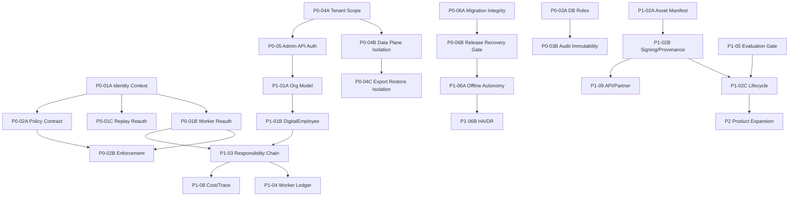

# D4 WP-F：研发任务拆解与开发 Backlog

> 本文以 Issue #848 的 docs/architecture/AI_NATIVE_PLATFORM_GAP_ASSESSMENT.md 为审计输入，将 P0/P1/P2 差距拆成可独立建 Issue、独立 PR 的研发任务。既有 38 项基础任务保留；另将审计报告第 15–27 节确认的生产装配、工具安全、连接器只读、Prompt Gate、凭据边界、Worker、成本与部署契约等具体缺陷补充为独立任务。本文是实施计划，不代表功能已经实现。

## 1. 范围与规则

- **权威输入：** docs/architecture/AI_NATIVE_PLATFORM_GAP_ASSESSMENT.md（分支 audit/issue-848-ai-native-gap-assessment）；D3 汇总与既有 WP-F 文档仅用于去重和补充依赖，不替代审计报告。
- **拆解口径：** 审计报告第 10 节 P0/P1/P2 Backlog 为主线；第 15–27 节新增的具体缺陷逐项映射到任务或新增原子任务。宏观主题不得直接作为单个开发任务。

- 输入：D3 的 P0-01…P0-07、P1-01…P1-09、P2-01…P2-08。
- 本项只交付任务拆解，不在本 PR 实现业务功能，不修改产品代码，不合并 PR。
- 代码位置分为“现有证据入口”和“建议落点”。建议落点是实施时优先核对/新增的位置，不代表当前已有实现。
- 每项实施任务启动时须再次核对目标分支中的实际符号与调用链；若路径变化，应更新任务定位，不得机械创建重复模块。
- 自测范围为文档结构、覆盖、依赖、验收和 DoD 静态校验。真机、真实服务器及外部资源验证跳过。

## 2. 拆解总览

| ID | 优先级 | 独立开发任务 | 依赖 |
|---|---|---|---|
| P0-01A | P0 | ExecutionPrincipal 统一身份上下文 | Identity 基础 |
| P0-01B | P0 | Worker/Run 执行前再授权 | P0-01A |
| P0-01C | P0 | Outbox/Webhook/Connector 重放再授权 | P0-01A、P0-01B |
| P0-02A | P0 | 统一 Policy Decision/Enforcement 契约 | P0-01A |
| P0-02B | P0 | Tool 与业务副作用入口强制策略/审批 | P0-02A、P0-01B |
| P0-03A | P0 | DB migration/runtime/audit 角色分离 | Deployment、Secrets |
| P0-03B | P0 | 审计追加写保护与 release gate | P0-03A |
| P0-04A | P0 | Tenant Scope 统一访问矩阵 | Identity、ResourceScope |
| P0-04B | P0 | 文件/对象/向量/缓存/事件隔离 | P0-04A、Storage |
| P0-04C | P0 | 导出/回放/备份恢复租户边界 | P0-04A、P0-04B、P0-06B |
| P0-05 | P0 | 管理 API 服务端授权闭环 | Identity、P0-04A |
| P0-06A | P0 | Migration 编号与依赖图完整性 | DB migrations |
| P0-06B | P0 | 备份/恢复/升级/回滚门禁 | P0-06A、Deployment、Secrets |
| P0-07A | P0 | focused/unit 测试基线修复 | 对应失败根因 |
| P0-07B | P0 | PostgreSQL/Redis 集成基线修复 | P0-01…06 |
| P0-07C | P0 | Release Evidence 契约与 required checks 收敛 | P0-07A、P0-07B |
| P1-01A | P1 | 组织部门/岗位/成员关系模型 | P0-04A、Identity |
| P1-01B | P1 | DigitalEmployee 组织身份与职责模型 | P1-01A、P0-02A |
| P1-01C | P1 | 资源可见性/生命周期统一规则 | P1-01A、P0-04A |
| P1-02A | P1 | 统一 Asset Manifest/Package | Registry、Extension |
| P1-02B | P1 | 全资产签名、来源证明与依赖锁 | P1-02A、P0-02A |
| P1-02C | P1 | 资产发布/灰度/回滚/撤销闭环 | P1-02A、P1-02B、P1-05 |
| P1-03 | P1 | Task/Run/Event/Approval/Artifact 责任链 | P1-01B、Runtime、Event |
| P1-04 | P1 | 独立 Worker 与副作用账本 | P0-01、P1-03 |
| P1-05 | P1 | 全生产发布路径评测 Gate | P1-02A |
| P1-06A | P1 | 企业运行平面断网自治 | P0-06B、Secrets |
| P1-06B | P1 | 企业 HA/DR 与故障切换/回切 | P1-06A、P0-06B |
| P1-07 | P1 | Connector SDK 与逐个领域适配 | P0-04B、P1-02A |
| P1-08 | P1 | Trace/Usage/成本预算与账单对账 | P1-03、Quota |
| P1-09 | P1 | 开放 API/SDK 与伙伴安全工作区 | P1-02B、P0-02B、P1-01A |
| P2-01 | P2 | Marketplace 与商业许可 | P1-09、P1-02C |
| P2-02 | P2 | 数字员工运营中心 | P1-01B、P1-03、P1-08 |
| P2-03 | P2 | 部门成本中心与资源池 | P1-01A、P1-08 |
| P2-04 | P2 | SLO/SLA 与值班运营 | P1-06B、P1-08 |
| P2-05 | P2 | 人工标注与 AI 价值分析 | P1-05、P1-08 |
| P2-06 | P2 | 流程挖掘与受控自主优化 | P1-03、P1-05 |
| P2-07 | P2 | 多模态入口与行业方案包 | P1-02C、P1-07 |
| P2-08 | P2 | 合同服务与创新实验室 | P1-02C、P1-05、P1-09 |

合计 38 项：P0 16 项、P1 14 项、P2 8 项。拆分原则：每项有单一可验收结果；先服务端授权再做 UI；安全断言不得靠放宽或 skip 通过；Provider SDK 不等于所有连接器已交付。

## 3. P0：上线阻断项

### P0-01A — ExecutionPrincipal 统一身份上下文
- **目标：** 统一人类用户、ServiceAccount、Agent/Worker 的执行身份，包含 tenant、subject、actor/delegator、授权版本/时效和 Run 关联；不信任客户端自报角色。
- **Gate 层级：** G0（安全与生产发布阻断门禁）。
- **现有证据入口：** agent_platform/identity/、agent_platform/runtime/、agent_platform/control_plane/；D3 已确认 IdentityService/Repository、ServiceAccount/Agent identity 和 Run Lifecycle 基础存在。
- **建议落点：** identity principal/authorization context、Run/Worker context 序列化；复用现有身份服务。
- **依赖：** IdentityService、现有 Run context。
- **验收用例：** principal 可持久化还原；请求体不能覆盖 tenant/subject；委派身份可追踪且不能扩大范围；缺失/过期/跨租户身份拒绝。
- **DoD：** 统一契约接入所有执行入口；单测与 PostgreSQL 持久化测试通过；字段语义、兼容策略和迁移说明齐备。

### P0-01B — Worker/Run 执行前再授权
- **目标：** Worker 领取、启动及产生副作用前重新读取当前授权，不依赖任务创建时的授权快照。
- **Gate 层级：** G0（安全与生产发布阻断门禁）。
- **现有证据入口：** agent_platform/runtime/、agent_platform/identity/、RunLifecycle/Worker。
- **建议落点：** Worker claim/dispatch/execute 入口及统一 authorization service。
- **依赖：** P0-01A。
- **验收用例：** 创建任务后用户被禁用、ServiceAccount/角色撤销、部门权限变化，排队任务启动时均拒绝；授权服务故障时 fail closed。
- **DoD：** 同步、异步、重试、恢复共用授权点；真实 Worker + PostgreSQL 集成测试通过；拒绝事件可审计。

### P0-01C — 异步重放再授权
- **目标：** Outbox、Redis Streams、Webhook、Connector 重试/回放时重新检查身份、授权与有效期。
- **Gate 层级：** G0（安全与生产发布阻断门禁）。
- **现有证据入口：** agent_platform/ 中 Outbox、Redis Streams、Webhook、Connector；D3 已确认 Outbox/Receipt/DLQ 基础。
- **建议落点：** dispatcher、Webhook delivery、Connector replay consumer。
- **依赖：** P0-01A、P0-01B。
- **验收用例：** 撤权后重放拒绝；重复事件幂等；策略服务故障不产生副作用；拒绝记录可追溯原事件。
- **DoD：** 所有异步重放入口复用统一 principal/授权；PG+Redis 测试覆盖 retry、pending recovery、duplicate delivery。

### P0-02A — 统一 Policy Decision/Enforcement 契约
- **目标：** 将 Identity ACL、Approval Policy、Runtime Guard、Quota Policy 统一为服务端 PDP/PEP 契约，不在此任务重写全部策略。
- **Gate 层级：** G0（安全与生产发布阻断门禁）。
- **现有证据入口：** agent_platform/identity/、agent_platform/approvals/、agent_platform/runtime/、agent_platform/control_plane/。
- **建议落点：** policy decision schema、策略版本、PEP adapter。
- **依赖：** P0-01A。
- **验收用例：** 决策可解释并带 policy version/scope/expiry；未知版本、缺字段、服务不可用均拒绝；无默认 allow。
- **DoD：** 统一接口有契约测试；现有策略逐一适配；错误语义和版本策略文档齐备。

### P0-02B — Tool/业务副作用强制策略与审批
- **目标：** Tool Gateway、Connector 写操作、Webhook action 等生产副作用执行前必须通过 PEP，校验 Approval digest、范围、时效、额度和风险级别。
- **Gate 层级：** G0（安全与生产发布阻断门禁）。
- **现有证据入口：** agent_platform/tools/、agent_platform/approvals/、agent_platform/runtime/、agent_platform/extensions/oci_runtime.py。
- **建议落点：** Tool Gateway 与业务写适配器共用 enforcement service；保留领域校验。
- **依赖：** P0-02A、P0-01B。
- **验收用例：** 未授权、审批过期/篡改、超额度、策略服务故障拒绝；高风险操作强制人工审批；直调底层 adapter 不可绕过。
- **DoD：** 生产副作用入口清单 100% 覆盖；每个入口有负向测试；审计关联决策、审批和副作用 ID。

### P0-03A — DB 运行角色分离
- **目标：** 分离 migration owner、API/Worker runtime、audit writer/reader；服务运行进程不持有 DDL/owner 权限。
- **Gate 层级：** G0（安全与生产发布阻断门禁）。
- **现有证据入口：** 数据库连接/迁移配置、部署配置；D3 将审计 DB 权限边界列为 Critical 风险。
- **建议落点：** DB connection factory、migration scripts、生产 Compose/secret 注入、release preflight。
- **依赖：** Deployment、Secrets。
- **验收用例：** runtime 无 CREATE/ALTER/DROP；migration owner 不用于服务运行；缺少角色凭据时启动失败。
- **DoD：** 权限脚本、部署配置、操作手册、自动化真实 PostgreSQL 权限测试齐备。

### P0-03B — 审计追加写保护
- **目标：** 审计历史只追加；runtime 不能 UPDATE/DELETE；读写角色分离并纳入 release gate。
- **Gate 层级：** G0（安全与生产发布阻断门禁）。
- **现有证据入口：** audit service/repository、DB migrations、docs/release/PRODUCTION_ACCEPTANCE_REGISTER.md。
- **建议落点：** audit schema/repository、DB grants/trigger、release evidence validator。
- **依赖：** P0-03A。
- **验收用例：** runtime UPDATE/DELETE 失败；writer 只能 INSERT；reader 只能 SELECT；缺少隔离证据时 release gate 阻断。
- **DoD：** 真实 PostgreSQL 权限测试、可重复迁移、Run/Policy/Approval/副作用关联测试通过。

### P0-04A — Tenant Scope 统一访问矩阵
- **目标：** 统一 tenant/organization/team/user/resource scope，覆盖 API、SQL repository 和后台任务。
- **Gate 层级：** G0（安全与生产发布阻断门禁）。
- **现有证据入口：** agent_platform/identity/、agent_platform/control_plane/、API routers/repositories。
- **建议落点：** ResourceScope、公共 repository filters、安全测试 fixtures。
- **依赖：** Identity、Tenant 模型。
- **验收用例：** 双租户 list/read/create/update/delete/search/export；通过 query/body/header/IDOR 访问其他租户均拒绝；无 scope 后台任务拒绝。
- **DoD：** 核心资源清单覆盖率 100%；repository 有强制 scope 测试；不依赖前端过滤。

### P0-04B — 多数据面租户隔离
- **目标：** 将 Tenant Scope 落到文件、对象存储、向量检索、缓存、事件流和任务队列。
- **Gate 层级：** G0（安全与生产发布阻断门禁）。
- **现有证据入口：** file assets、knowledge/RAG、cache、Outbox/Streams、task persistence。
- **建议落点：** storage adapters 的 tenant key/prefix/filter；下载/检索 API；PG/Redis/对象/向量集成测试。
- **依赖：** P0-04A、Storage adapters。
- **验收用例：** 跨租户文件下载、向量检索、缓存 key 猜测、事件订阅/回放均拒绝；撤权/删除后缓存失效。
- **DoD：** 每种存储均有 tenant-aware adapter；真实存储集成测试通过，不用 mock 证明隔离。

### P0-04C — 导出/回放/恢复租户边界
- **目标：** 导出、事件回放、备份恢复、数据迁移不跨租户泄露或错误归属。
- **Gate 层级：** G0（安全与生产发布阻断门禁）。
- **现有证据入口：** export/backup/restore、Outbox replay、部署恢复脚本。
- **建议落点：** export/restore service、replay authorization、backup manifest。
- **依赖：** P0-04A、P0-04B、P0-06B。
- **验收用例：** 用户不能导出其他租户；部分租户恢复不混入其他数据；回放前重新授权；恢复后 tenant ownership/外键一致。
- **DoD：** PG/Redis/对象存储恢复演练可重复；安全测试覆盖导出、恢复和 replay。

### P0-05 — 管理 API 服务端授权
- **目标：** 复核并补齐 organization/access-control/settings 管理 API 的管理员权限、租户范围和服务端授权。
- **Gate 层级：** G0（安全与生产发布阻断门禁）。
- **现有证据入口：** agent_platform/api/admin.py:create_admin_router；D3 指出需确认 router 外授权层，尚未直接断言为漏洞。
- **建议落点：** admin router dependencies、IdentityService.authorize/统一 authorizer、API 权限集成测试。
- **依赖：** Identity、P0-04A。
- **验收用例：** 匿名、普通成员、其他租户管理员、过期身份拒绝；同租户授权管理员允许；直接请求 API 仍被服务端控制。
- **DoD：** 每条管理路由权限表齐备；真实 FastAPI+DB 测试覆盖应用组合根；说明授权实际发生位置。

### P0-06A — Migration 编号与依赖图
- **目标：** 修复 D3/CI 记录的 migration 序号冲突，建立唯一编号、依赖图和升级顺序；实施前重新统计确认。
- **Gate 层级：** G0（安全与生产发布阻断门禁）。
- **现有证据入口：** 数据库 migration 目录；上轮统计为 127 文件、96 个唯一序号。
- **建议落点：** migration 命名/版本元数据、检查脚本、CI migration job。
- **依赖：** 当前 migration framework。
- **验收用例：** 重复编号、循环依赖、缺失父迁移均使 CI 失败；空库和上一正式版本升级成功。
- **DoD：** 编号唯一；PG CI 可复现；已发布迁移不静默改写，修复通过新增兼容迁移完成。

### P0-06B — 备份/恢复/升级/回滚门禁
- **目标：** 将 preflight、备份校验、迁移、兼容窗口、回滚和恢复串成发布流程。
- **Gate 层级：** G0（安全与生产发布阻断门禁）。
- **现有证据入口：** docs/release/PRODUCTION_ACCEPTANCE_REGISTER.md、部署/升级/备份脚本；D3 生产状态 NO-GO。
- **建议落点：** scripts/ release/backup/restore、docs/release/ evidence schema、release workflow。
- **依赖：** P0-06A、P0-03A、Secrets/Deployment。
- **验收用例：** 备份校验失败不升级；迁移失败中止并按策略回滚；恢复后 PG/Redis/对象数据一致；记录 RPO/RTO、版本、commit。
- **DoD：** 自动化 preflight/smoke/migration/rollback/restore 测试齐备；必需证据不得以 skipped 代替。

### P0-07A — focused/unit 基线修复
- **目标：** 修复审查系列 CI 已记录的 focused 测试失败，不通过放宽安全断言解决。
- **Gate 层级：** G0（安全与生产发布阻断门禁）。
- **现有证据入口：** tests/test_release_gate_evidence.py、tests/test_release_acceptance_report.py、tests/test_model_runtime_router.py。
- **建议落点：** 上述测试及对应生产模块；先判定是测试契约过期还是实现回归。
- **依赖：** Release Evidence 与 model router 维护者确认。
- **验收用例：** 缺 deployment_preflight 必填字段时拒绝；Markdown escaping 防表格注入；model router 正确导入并覆盖熔断行为。
- **DoD：** 支持 Python 版本矩阵 focused suite 全通过；不得 skip、删除断言或只改期望值掩盖产品错误。

### P0-07B — PostgreSQL/Redis 集成基线修复
- **目标：** 分别修复 migration 冲突、MemoryService contract、Worker/Intervention 构造、Knowledge ACL、Outbox/Redis 恢复及数据库约束问题。
- **Gate 层级：** G0（安全与生产发布阻断门禁）。
- **现有证据入口：** tests/ PG/Redis integration、agent_platform/ Memory/Worker/Knowledge/Outbox。
- **建议落点：** 按根因拆独立修复 PR，不将无关改动合并为大包。
- **依赖：** P0-01…P0-06 对应身份/数据/迁移契约。
- **验收用例：** PG/Redis 干净环境通过；Memory 跨租户负向断言保持严格；Outbox 重复键/恢复不重复副作用；约束错误有明确处理。
- **DoD：** 每个根因有回归测试；真实 PG/Redis 集成矩阵通过；不以 SQLite/mock 替代关键集成。

### P0-07C — Release Evidence 与 required checks
- **目标：** 统一 evidence schema 与 CI required checks；docs-only 检查不得降低代码 PR 门槛。
- **Gate 层级：** G0（安全与生产发布阻断门禁）。
- **现有证据入口：** .github/workflows/ci.yml、.github/workflows/platform-release-gate.yml、docs/release/PRODUCTION_ACCEPTANCE_REGISTER.md。
- **建议落点：** workflow path filters、evidence validator、branch protection 文档。
- **依赖：** P0-07A、P0-07B、P0-06B。
- **验收用例：** 代码变更跑完整矩阵；文档变更跑文档验证；required job 缺失/跳过/失败均不通过；main push/手动 release 仍完整验证。
- **DoD：** workflow 行为可复现；PR checks 与保护规则一致；未运行的代码测试不得报告为 pass。

## 4. P1：平台统一与企业生产化

### P1-01A — 组织部门/岗位/成员关系模型
- **目标：** 在现有 Tenant/Organization/Team/User 上补部门树、岗位、成员、主管和组织路径。
- **Gate 层级：** G1（核心平台集成与企业试点门禁）。
- **现有证据入口：** agent_platform/identity/、Organization/Team/User models、组织 API/前端入口。
- **建议落点：** identity domain、SQL migrations、organization API/schema、组织管理页面。
- **依赖：** P0-04A。
- **验收用例：** 部门树无环；调岗/离职更新关系；跨租户部门引用拒绝；主管变更审计。
- **DoD：** 模型/API/UI/迁移/权限一致；真实 DB 测试覆盖层级和生命周期。

### P1-01B — DigitalEmployee 组织身份与职责
- **目标：** 建立独立 DigitalEmployee 主体，不能将 Agent/ServiceAccount 改名替代。
- **Gate 层级：** G1（核心平台集成与企业试点门禁）。
- **现有证据入口：** agent_platform/identity/、agent_platform/runtime/、Agent/ServiceAccount、Task/Run/Approval。
- **建议落点：** identity/digital_employee domain、组织 API、Agent binding、Run/Task responsible-party relation。
- **依赖：** P1-01A、P0-02A。
- **验收用例：** 有岗位/职责/主管/监督人；绑定 Agent/Workflow/Skill/Tool；停用后拒绝新任务并支持存量任务接管；人类和数字员工身份类型不同。
- **DoD：** 组织身份、授权、责任、审计和管理 UI 端到端闭环。

### P1-01C — 资源可见性与生命周期规则
- **目标：** 统一个人、团队、部门、企业、伙伴资产的 owner/visibility/version/archive/delete 语义。
- **Gate 层级：** G1（核心平台集成与企业试点门禁）。
- **现有证据入口：** agent_platform/control_plane/registry.py、Registry API、Extension/Prompt/Connector/Knowledge 专用存储。
- **建议落点：** ResourceScope/Asset metadata schema、repository filters。
- **依赖：** P1-01A、P0-04A。
- **验收用例：** 各可见性角色矩阵；撤销共享后检索/缓存/下载同步拒绝；归档不破坏历史 Run。
- **DoD：** 核心资产共用可见性语义；API/DB/UI 一致；旧资源迁移兼容。

### P1-02A — 统一 Asset Manifest/Package
- **目标：** 为 Agent/Workflow/Skill/Tool/Prompt/Model/Connector/Knowledge 定义统一 ID、版本、依赖、权限、入口和数据契约。
- **Gate 层级：** G1（核心平台集成与企业试点门禁）。
- **现有证据入口：** agent_platform/control_plane/registry.py、agent_platform/extensions/manifest.py、agent_platform/extensions/package.py。
- **建议落点：** manifest schema、package validator、Registry adapter；保留扩展包兼容层。
- **依赖：** Registry、Extension。
- **验收用例：** schema 版本兼容；缺字段/依赖/循环/冲突拒绝；旧资产迁移或明确不兼容。
- **DoD：** schema、示例包、校验器、兼容矩阵齐备；至少两种资产通过同一 contract tests。

### P1-02B — 全资产签名/来源证明/依赖锁
- **目标：** 将 Extension 已有 Ed25519 信任机制扩展到所有可发布资产。
- **Gate 层级：** G1（核心平台集成与企业试点门禁）。
- **现有证据入口：** agent_platform/extensions/package.py、oci_runtime.py、publishers.py。
- **建议落点：** manifest provenance/signature、trusted publisher registry、dependency lock resolver。
- **依赖：** P1-02A、P0-02A。
- **验收用例：** 无签名、篡改、未知/撤销 key、tenant 不匹配、依赖摘要不匹配均拒绝；key rotation 可验证。
- **DoD：** 所有发布/安装路径 fail-closed；签名、来源、依赖锁可审计。

### P1-02C — 资产发布/灰度/回滚/撤销
- **目标：** 统一发布前验证、环境晋级、灰度、回滚和撤销传播。
- **Gate 层级：** G1（核心平台集成与企业试点门禁）。
- **现有证据入口：** Registry、Extension lifecycle、Evaluation/Rollout。
- **建议落点：** registry lifecycle service、release orchestration、资产生命周期页面。
- **依赖：** P1-02A、P1-02B、P1-05。
- **验收用例：** 未评测/不兼容资产不发布；灰度异常停止；回滚恢复旧版本；撤销后禁止安装/调用。
- **DoD：** 至少 Agent/Workflow 两类资产完成端到端发布回滚；审批、评测、审计可追溯。

### P1-03 — Task/Run/Event/Approval/Artifact 责任链
- **目标：** 统一 correlation/causation、owner、responsible party、状态、审批、事件和产物关系。
- **Gate 层级：** G1（核心平台集成与企业试点门禁）。
- **现有证据入口：** agent_platform/runtime/、agent_platform/approvals/、Outbox/Event、Artifact/File。
- **建议落点：** shared resource identifiers、Run/Task schema、audit/trace correlation、任务详情 API/UI。
- **依赖：** P1-01B、Runtime、Event。
- **验收用例：** Task 可追踪创建者/数字员工/Run/审批/事件/产物/成本；归档不丢审计；跨租户关联拒绝。
- **DoD：** 查询 API/UI 可用；关联约束或一致性校验齐备；PG 集成测试通过。

### P1-04 — 独立 Worker 与副作用账本
- **目标：** 长任务与 API 进程解耦，建立幂等副作用 ledger、回执、对账和补偿。
- **Gate 层级：** G1（核心平台集成与企业试点门禁）。
- **现有证据入口：** agent_platform/runtime/、RunLifecycle、Outbox/Redis Streams、Worker。
- **建议落点：** worker entrypoint、lease/heartbeat、side-effect ledger、deployment worker profile。
- **依赖：** P0-01、P1-03。
- **验收用例：** 副作用前后崩溃、租约过期、重复消息、取消/超时；恢复不重复已确认副作用；API/Worker 独立扩缩。
- **DoD：** PG/Redis 故障注入通过；部署监控齐备；幂等键和补偿记录可审计。

### P1-05 — 全生产发布路径评测 Gate
- **目标：** 将 Dataset/Evaluator/Comparison/Rollout 接入 Agent/Prompt/Workflow/Tool 所有生产发布入口。
- **Gate 层级：** G1（核心平台集成与企业试点门禁）。
- **现有证据入口：** evaluation/dataset/rollout、Registry、Extension 发布服务。
- **建议落点：** release policy adapter、evaluation evidence schema、发布 service precondition。
- **依赖：** P1-02A。
- **验收用例：** 缺失/过期/版本不匹配/指标回归证据阻断；安全阈值不可被人工 override；灰度恶化回滚。
- **DoD：** 发布入口清单覆盖率 100%；每入口有 fail-closed 测试；证据关联 commit/asset/dataset version。

### P1-06A — 企业运行平面断网自治
- **目标：** 公共控制面不可用时企业运行平面仍执行已授权本地任务。
- **Gate 层级：** G1（核心平台集成与企业试点门禁）。
- **现有证据入口：** agent_platform/control_plane/、runtime、license/config、部署 Compose；D3 认为自治未验证。
- **建议落点：** local policy/credential cache、offline license validation、control-plane degradation policy。
- **依赖：** P0-06B、Secrets。
- **验收用例：** 断开公共服务后已授权任务继续；新授权/缓存外权限按策略拒绝；恢复后同步不重复副作用。
- **DoD：** 网络隔离测试和状态机文档齐备；密钥/许可有过期、撤销、宽限策略。

### P1-06B — 企业 HA/DR
- **目标：** 定义故障域、数据复制、备份恢复、RPO/RTO、切换与回切。
- **Gate 层级：** G1（核心平台集成与企业试点门禁）。
- **现有证据入口：** Compose、health/readiness、backup/restore、deployment scripts、Production Acceptance Register。
- **建议落点：** deployment profiles/IaC、health probes、DR runbooks、chaos/integration tests。
- **依赖：** P1-06A、P0-06B。
- **验收用例：** 服务/存储/消息故障；切换后状态一致；回切无双主；达到声明 RPO/RTO。
- **DoD：** 自动化故障演练、runbook、监控告警和容量基线齐备；生产真机演练另行审批。

### P1-07 — Connector SDK 与逐个领域适配
- **目标：** 建立连接器开发契约，并逐个交付 ERP/CRM/OA/HR/MES/PLM 适配器。
- **Gate 层级：** G1（核心平台集成与企业试点门禁）。
- **现有证据入口：** agent_platform/ tools/connectors/MCP/Webhook、Secrets、Registry。
- **建议落点：** connector SDK、provider contract tests、credential lifecycle、独立 provider adapters。
- **依赖：** P0-04B、P1-02A。
- **验收用例：** OAuth/secret 轮换、分页/增量同步、删除传播、限流重试、租户隔离、审计；逐 Provider 列出支持操作。
- **DoD：** SDK 文档和 contract suite 发布；每个声明支持的 Provider 独立通过测试；未支持项明确列出。

### P1-08 — Trace/Usage/成本与账单对账
- **目标：** 贯通 API/Worker/模型/工具/Connector trace，将估算、供应商报告、对账成本分开。
- **Gate 层级：** G1（核心平台集成与企业试点门禁）。
- **现有证据入口：** tracing/observability、quota/budget、Run ledger、model providers。
- **建议落点：** usage event schema、cost ledger、billing adapters、Cost Center dimensions。
- **依赖：** P1-03、Quota。
- **验收用例：** Run 追踪调用/Token/耗时/成本；重复 usage 不重复计费；费率版本可重算；账单差异可对账。
- **DoD：** Run 到成本明细可追溯；estimated/provider_reported/reconciled 分字段；组织归集可复算。

### P1-09 — 开放 API/SDK 与伙伴安全工作区
- **目标：** API Consumer/Key 生命周期、限流配额审计、SDK/CLI、伙伴工作区；伙伴默认不可访问企业私有数据。
- **Gate 层级：** G1（核心平台集成与企业试点门禁）。
- **现有证据入口：** agent_platform/api/、API auth、Registry、Extension publisher trust。
- **建议落点：** API consumer service、OpenAPI/SDK、partner workspace、asset submission review。
- **依赖：** P1-02B、P0-02B、P1-01A。
- **验收用例：** Key 创建/轮换/撤销；超配额限流；伙伴只访问授权工作区；资产提交经过签名/扫描/审批；跨租户访问拒绝。
- **DoD：** 至少一个外部 API E2E 和伙伴隔离 E2E 通过；SDK 示例可运行；权限审计可查。

## 5. P2：产品化、规模化与商业能力

### P2-01 — Marketplace 与商业许可
- **目标：** 资产目录、安装授权、License/Entitlement/Subscription、离线激活、续费/撤销和伙伴结算。
- **Gate 层级：** G2（规模化产品化门禁）。
- **现有证据入口：** agent_platform/control_plane/registry.py、Extension Publisher；D3 未找到完整商业许可实现。
- **建议落点：** marketplace、license/entitlement domain、offline verifier、billing integration。
- **依赖：** P1-09、P1-02C。
- **验收用例：** 到期/撤销/离线宽限；目录隔离；实例绑定与离线签名校验；账单可对账。
- **DoD：** 购买/授权/安装/撤销/续费端到端通过；未授权使用 fail closed；许可操作可审计。

### P2-02 — 数字员工运营中心
- **目标：** 岗位、职责、目标、主管、工作时间、预算、任务分配、交付验收、异常接管和绩效。
- **Gate 层级：** G2（规模化产品化门禁）。
- **现有证据入口：** P1-01B DigitalEmployee、P1-03 责任链、P1-08 Usage。
- **建议落点：** DigitalEmployee API/UI、assignment、performance metrics、handover workflows。
- **依赖：** P1-01B、P1-03、P1-08。
- **验收用例：** 任职/调岗/停用改变权限；任务有责任人与主管；质量/成本可追溯；人工接管可恢复。
- **DoD：** 建档到授权、执行、验收、停用真实闭环；绩效数据来源和口径明确。

### P2-03 — 部门成本中心与资源池
- **目标：** 归集模型、CPU/GPU、内存、存储、并发、网络资源，支持预算、配额、审批和成本分摊。
- **Gate 层级：** G2（规模化产品化门禁）。
- **现有证据入口：** quota/budget/usage、Organization/Team。
- **建议落点：** cost center/resource pool models、reservation API、budget approval UI。
- **依赖：** P1-01A、P1-08。
- **验收用例：** 超预算阻断或审批；资源预约释放；账单按项目/Agent 分摊且总额守恒。
- **DoD：** 资源与费用可复算；预算调整有审批审计；计量来源可信等级明确。

### P2-04 — SLO/SLA 与值班运营
- **目标：** 任务成功率、延迟、可用率、错误预算、告警升级、静默、RCA 和容量预测。
- **Gate 层级：** G2（规模化产品化门禁）。
- **现有证据入口：** health/metrics/alerts、deployment readiness。
- **建议落点：** SLI/SLO definitions、alert routing、incident records、RCA reports。
- **依赖：** P1-06B、P1-08。
- **验收用例：** 故障注入触发告警；值班升级按策略执行；静默到期恢复；错误预算可复算。
- **DoD：** SLO 窗口可计算；告警有责任人与处置记录；事故关联 trace/commit/release。

### P2-05 — 人工标注与 AI 价值分析
- **目标：** 标注分派/仲裁、真实质量指标、节省工时、流程周期变化和 ROI。
- **Gate 层级：** G2（规模化产品化门禁）。
- **现有证据入口：** evaluation/dataset/feedback、P1-08 usage/cost。
- **建议落点：** annotation workflow、label adjudication、business outcome metrics、ROI reports。
- **依赖：** P1-05、P1-08。
- **验收用例：** 标注权限隔离；评分差异进入仲裁；质量与资产版本关联；ROI 含基线/样本/成本口径。
- **DoD：** 人工反馈进入回归集；价值报表可追溯原始任务和计算公式。

### P2-06 — 流程挖掘与受控自主优化
- **目标：** 从业务事件发现流程、分析瓶颈和自动化机会；候选优化经评测和人工批准后才能影响生产。
- **Gate 层级：** G2（规模化产品化门禁）。
- **现有证据入口：** Outbox/Event、Trace、Evaluation、Workflow；D1/D3 未发现完整流程挖掘闭环。
- **建议落点：** process event schema/mining service、optimization proposal、approval/release integration。
- **依赖：** P1-03、P1-05。
- **验收用例：** 事件重建流程；数据脱敏/租户隔离；建议有基线对比；未审批不得修改生产 Prompt/Policy/Workflow。
- **DoD：** 事件采集到分析、评测、人工批准、灰度发布全链路可追踪并可回滚。

### P2-07 — 多模态入口与行业方案包
- **目标：** 统一图片/OCR/语音/视频/图纸入口与模型调度，建设可安装、评测、回滚的行业方案包。
- **Gate 层级：** G2（规模化产品化门禁）。
- **现有证据入口：** model providers、knowledge/document ingestion、Registry/Extension。
- **建议落点：** modality capability contract、provider adapters、industry solution manifests。
- **依赖：** P1-02C、P1-07。
- **验收用例：** 各模态明确输入/输出/限制；权限与数据驻留一致；质量/延迟/成本统一计量；方案包安装评测回滚。
- **DoD：** 至少一条真实模态链路和一个行业方案包通过自动化验收；未适配能力不宣称支持。

### P2-08 — 合同服务与创新实验室
- **目标：** 合同生命周期、条款抽取/审查/审批/履约提醒；隔离实验、预算、评测和成果转生产。
- **Gate 层级：** G2（规模化产品化门禁）。
- **现有证据入口：** Registry/Asset、Knowledge/Document、Approval、Evaluation；D1/D3 未找到完整闭环。
- **建议落点：** contract domain/workflow、experiment workspace/sandbox、promotion gate。
- **依赖：** P1-02C、P1-05、P1-09。
- **验收用例：** 合同按租户/部门授权；抽取结果引用原文；条款变更审批；实验数据与生产隔离；转生产经评测/签名/审批。
- **DoD：** 合同生命周期可审计；实验预算/数据隔离/资源限制齐备；晋级生产可追踪、可回滚。

## 6. 依赖图与实施批次

推荐批次：
1. **安全身份与策略：** P0-01A → P0-01B/P0-01C → P0-02A → P0-02B。
2. **数据与管理面：** P0-04A → P0-04B/P0-05 → P0-04C。
3. **审计与发布可靠性：** P0-03A → P0-03B；P0-06A → P0-06B。
4. **CI 基线清零：** P0-07A/P0-07B → P0-07C；不同根因独立 PR。
5. **平台契约：** P1-01A/B/C、P1-02A/B/C、P1-03/P1-04/P1-05。
6. **企业生产化与生态：** P1-06A/B、P1-07/P1-08/P1-09。
7. **产品扩展：** P2-01…P2-08，按业务价值和数据准备度排期。

## 7. 跨任务验收用例模板

| 类别 | 最低验收用例 | 通过条件 |
|---|---|---|
| 正向功能 | 授权主体执行允许动作 | 结果正确并生成审计/trace |
| 身份安全 | 匿名、过期、禁用身份访问 | 服务端拒绝且无副作用 |
| 租户隔离 | tenant A 访问 tenant B | 拒绝且无内容/元数据侧漏 |
| 组织范围 | 部门/团队/个人/企业共享 | 仅授权范围可见/可写 |
| 撤权竞态 | 创建任务后撤销角色/密钥/委派 | Worker/retry/replay 重新授权并拒绝 |
| 审批安全 | 过期/篡改/超范围/digest 不符 | 拒绝并记录原因 |
| 故障注入 | DB/Redis/策略服务/公共控制面故障 | fail-closed 或按定义安全降级，不重复副作用 |
| 幂等恢复 | 重复消息、Worker 崩溃、恢复回放 | 账本/外部幂等契约证明不重复副作用 |
| 发布质量 | 评测缺失/过期/回归超阈值 | 阻断发布或按策略回滚 |
| 运维恢复 | 备份损坏、迁移失败、回滚、恢复 | 数据一致且 RPO/RTO 可复核 |

## 8. 统一完成定义（DoD）

每项实施任务关闭前必须同时满足：
- Issue 明确目标、非目标、风险、依赖、代码位置和不做事项；PR 只解决该任务。
- 真实服务端逻辑接入生产组合根；涉及数据时包含迁移、索引、约束和兼容策略。
- 服务端执行授权；适用的匿名/普通用户/跨租户/撤权/过期身份/策略故障负向测试通过。
- API 契约有版本和错误语义；涉及 UI 时接真实 API，包含 loading/error/empty/permission 状态。
- 单元 + API/DB 集成 + 关键 E2E 齐备；安全断言不能仅由 mock 支撑；不得通过 skip 或放宽断言消除失败。
- 适用时覆盖超时、取消、重试、重复消息、崩溃恢复、补偿和人工接管。
- 关键动作记录 actor/tenant/resource/action/decision/correlation；日志不泄露密钥或敏感数据。
- 所需 CI workflow 全部完成且通过；必需 job 被跳过不得视为通过；记录 commit SHA 和测试结果。
- 配置、迁移、回滚、监控、告警、runbook 更新；未执行的生产证据明确标记待验收。
- PR、测试命令/结果、剩余风险和验收证据回填实施 Issue；是否合并由任务所有者另行决定。

## 9. WP-F 自检

- [x] 覆盖 P0-01…P0-07 全部差距，拆为 16 项任务。
- [x] 覆盖 P1-01…P1-09 全部差距，拆为 14 项任务。
- [x] 覆盖 P2-01…P2-08 全部差距，拆为 8 项任务。
- [x] 每项均含目标边界、现有证据入口、建议代码落点、依赖、验收用例和 DoD。
- [x] 明确区分现有代码证据与建议新增/修改位置。
- [x] 提供依赖图、交付批次、跨任务验收模板和统一 DoD。
- [x] 本轮只新增研发拆解文档，未实现产品功能或修改业务代码。
- [x] 真机、真实服务器和外部资源验证跳过。

**结论：** D3 的 24 条顶层工作包已拆成 38 条独立实施任务（P0 16、P1 14、P2 8）。后续按依赖图建实施 Issue，优先处理 P0 安全、租户隔离和发布阻断项。

## 10. 从审计报告第 15–27 节补充拆出的原子任务

> 下列任务是对审计报告后续轮次发现的具体缺陷进行显式落单。它们与前述 38 项基础任务存在依赖关系，但不以“已被宏观主题覆盖”为由省略独立验收。

### P1-AUD-01 — 首次初始化并发互斥
- **目标：** 对公开首次初始化/引导接口建立数据库级单例互斥，避免并发请求重复创建初始组织、管理员或凭据。
- **现有代码证据入口：** agent_platform 初始化/bootstrap API、identity repository、相关 PostgreSQL migrations；审计报告 §15.1。
- **建议代码落点：** bootstrap service、PostgreSQL advisory lock/唯一约束、初始化状态表及对应 API。
- **依赖：** Identity/Tenant 模型、P0-04A。
- **验收用例：** 并发 N 个首次初始化请求仅一个成功；失败请求无部分写入；跨实例并发结果一致；重试可安全返回既有初始化状态。
- **完成定义：** 数据库级互斥与幂等语义落地；真实 PostgreSQL 并发集成测试通过；冲突返回稳定错误码并写审计。
- **Gate 层级：** G1（核心初始化正确性门禁）。

### P1-AUD-02 — 默认生产 Workflow/Multi-Agent 执行器接线
- **目标：** 让 Agent 的 pinned Workflow 定义真正解析、编译并驱动生产 Run；将多专家图接入默认 Task→Worker→Run 路径，不能仅校验 workflow_id。
- **现有代码证据入口：** deploy/local_runtime.py、agent_platform/runtime/workbench_tasks.py、agent_platform/runtime/registry_runtime.py、agent_platform/workflows/multi_expert.py；审计报告 §17.1–17.3。
- **建议代码落点：** trusted Workflow Executor Factory、Registry Workflow resolver、deployment profile builder、Run snapshot graph digest。
- **依赖：** P0-01A、P0-02A、P1-02A、P1-03。
- **验收用例：** 通过生产 Task API 提交任务，Worker 从 pinned snapshot 装配指定 Workflow；多专家并行、Blackboard、审批 interrupt/resume 可完成；重启后不重复执行分支或副作用；未知节点/不兼容版本 fail closed。
- **完成定义：** 至少一个真实生产组合根 E2E 覆盖 API→Worker→Workflow→Tool/Approval→Artifact/Trace；Workflow version、compiled graph digest 与 Run 关联可审计。
- **Gate 层级：** G0（默认生产执行路径与统一执行安全边界）。

### P1-AUD-03 — Tool Gateway、Approval Verifier 与 Effect Reconciliation 契约统一
- **目标：** 默认 graph 的所有工具调用经过 SupervisedToolGateway；修复 ApprovalVerifier 的 run_id/consume 契约；生产 Effect Reconciliation 注入真实 tenant/Run 授权和 append-only audit writer。
- **现有代码证据入口：** agent_platform/tools/、agent_platform/approvals/、agent_platform/runtime/、agent_platform/production.py；审计报告 §19.1、§20.1、§23.1。
- **建议代码落点：** Gateway adapter、ApprovalVerifier protocol、production resolver wiring、effect audit repository。
- **依赖：** P0-01A、P0-02A、P0-02B、P0-03B。
- **验收用例：** 直接调用底层 handler 无法绕过 Gateway；审批缺 run_id、跨 Run、过期、重复消费均拒绝；未授权/审计写入失败时无业务副作用；有效操作员授权与审计关联成功。
- **完成定义：** 默认生产图、Gateway、审批 verifier、effect reconciliation 使用同一契约；真实 PostgreSQL + Gateway + Worker 集成测试通过。
- **Gate 层级：** G0（高风险工具执行与审计阻断门禁）。

### P1-AUD-04 — PostgreSQL/MySQL Connector 强制只读
- **目标：** 在连接器服务端和数据库事务层强制 query scope 只读，不能仅依赖 UI 或 SQL 文本约定。
- **现有代码证据入口：** agent_platform/tools/、Connector query adapters、PostgreSQL/MySQL connector tests；审计报告 §20.2。
- **建议代码落点：** read-only transaction/session factory、只读 DB role、statement allowlist/parser、connector contract tests。
- **依赖：** P0-02B、P0-04B、Secrets。
- **验收用例：** SELECT 可执行；INSERT/UPDATE/DELETE/DDL/多语句写入在有写权限的测试账号下仍被拒绝；超时/错误不泄漏凭据；跨租户查询拒绝。
- **完成定义：** 连接器以数据库只读身份运行并有服务端二次限制；真实 PostgreSQL/MySQL 测试覆盖正反向 SQL。
- **Gate 层级：** G0（数据最小权限安全门禁）。

### P1-AUD-05 — Memory Extraction API 与 Service 契约修复
- **目标：** 对齐 Memory Extraction API 请求 schema、service 方法签名和生产依赖注入，修复当前请求构造与服务契约不兼容导致的提取失败。
- **现有代码证据入口：** agent_platform/memory/、memory API router、production.py、memory service tests；审计报告 §19.2。
- **建议代码落点：** request/response schema、router adapter、service protocol 与 API integration tests。
- **依赖：** MemoryService、Identity/tenant scope。
- **验收用例：** 合法请求成功创建候选记忆；缺字段/越权/跨租户请求拒绝；持久化失败返回稳定错误且不留下半成品；旧 API 兼容策略有测试。
- **完成定义：** API→Service→Repository→审计链路在生产 app 组合根通过真实 DB 测试；契约文档同步。
- **Gate 层级：** G1（核心服务端到端集成门禁）。

### P1-AUD-06 — Prompt Evaluation Gate 注入默认生产发布链路
- **目标：** 将 Prompt Registry 的发布 Gate 接入默认生产组合根和所有相关发布动作，防止绕过评测证据发布。
- **现有代码证据入口：** Prompt Registry、Evaluation、production composition root、release workflow；审计报告 §21.2。
- **建议代码落点：** production builder injection、Prompt publish/activate/rollback service preconditions、evaluation evidence resolver。
- **依赖：** P0-02A、P1-05、P1-02A。
- **验收用例：** 缺失/过期/跨租户/Prompt 版本不匹配/评测回归证据均阻断；有效证据仅对目标版本放行；默认生产配置不允许空 Gate。
- **完成定义：** 三类发布动作均经 Gate；生产组合根测试与 fail-closed 回归测试通过。
- **Gate 层级：** G1（生产质量发布门禁）。

### P1-AUD-07 — 离线 Service Worker 构建产物与路由契约修复
- **目标：** 让 Service Worker 文件真实进入构建/部署产物并由专用路由以正确 MIME/header 提供；明确离线能力仅覆盖范围。
- **现有代码证据入口：** agent_platform/web/app.py、agent_platform/web/static/、tests/test_issue_667_a_667_07_offline_fallback.py；审计报告 §16.3。
- **建议代码落点：** Vite/build asset pipeline、静态文件路由、Service Worker registration 与 deploy artifact。
- **依赖：** Frontend build、deployment static assets。
- **验收用例：** 构建后 sw.js 文件存在；GET /app/sw.js 返回 JavaScript MIME 与正确 scope header；Node 测试读取真实构建产物通过；明确缓存 UI shell 不等于离线任务执行。
- **完成定义：** build→package→deploy→HTTP route 全链路一致；CI 在真实产物上运行离线测试。
- **Gate 层级：** G2（离线产品能力门禁）。

### P1-AUD-08 — 出站网络强制边界与代理旁路防护
- **目标：** 将出站 allowlist 从环境变量配置升级为可验证网络强制策略，阻止 API/Worker 直接绕过代理访问外网。
- **现有代码证据入口：** deploy/production.compose.yaml、egress proxy config、deployment security tests；审计报告 §27.2。
- **建议代码落点：** NetworkPolicy/firewall/egress gateway IaC、容器网络规则、bypass tests。
- **依赖：** P0-02B、Secrets/Deployment。
- **验收用例：** 未 allowlist 域名直连失败；allowlist 域名仅经代理可达；移除代理变量不能恢复直连；API 与 Worker 使用相同强制策略。
- **完成定义：** 部署模板包含强制网络策略；自动化旁路负向测试和运行手册齐备。
- **Gate 层级：** G0（生产网络安全门禁）。

### P1-AUD-09 — MinIO/S3 应用身份最小权限
- **目标：** 移除 API/Worker 复用 MinIO root credential，改为 bucket/prefix scoped 应用身份并支持轮换。
- **现有代码证据入口：** deploy/production.compose.yaml、object storage adapter、secret injection；审计报告 §27.3。
- **建议代码落点：** MinIO policy/bootstrap、API/Worker 独立 service identity、secret rotation/preflight。
- **依赖：** P0-02B、P0-04B、P0-03A。
- **验收用例：** API/Worker 只能访问授权 bucket/prefix；不能创建用户/修改全局策略；root credential 不进入应用容器环境/文件；轮换期间任务安全恢复。
- **完成定义：** 部署默认使用最小权限身份；真实对象存储权限负向测试通过；凭据轮换可审计。
- **Gate 层级：** G0（存储凭据最小权限门禁）。

### P2-AUD-10 — Provider Usage 成本来源与账本精度
- **目标：** 区分 Provider 实报 usage、平台估算和最终对账成本，修正所有 Provider usage 被统一标记为 estimated 的问题。
- **现有代码证据入口：** agent_platform/runtime/、model provider adapters、Usage Ledger、CostQuality API/UI；审计报告 §21.1。
- **建议代码落点：** usage provenance enum、provider response normalizer、ledger schema、report aggregation。
- **依赖：** P1-08。
- **验收用例：** Provider 实报 usage 保留原始来源；估算值与实报值分开；价格卡版本可追溯；重复 usage 不重复入账；账单对账差异可复核。
- **完成定义：** API/Worker→Usage Ledger→报表链路通过 provider contract tests；成本字段和口径文档齐备。
- **Gate 层级：** G2（成本运营准确性门禁）。

### P2-AUD-11 — Run Worker 独立部署与对象存储 Readiness
- **目标：** 将 Run execution worker 从 API 进程生命周期解耦，并让 readiness 检查真实 MinIO/S3 可用性；避免独立 Worker 只承担 Outbox relay。
- **现有代码证据入口：** agent_platform/production.py、Run lifecycle/worker、deploy/production.compose.yaml、object storage health/readiness；审计报告 §22.1–22.2。
- **建议代码落点：** 独立 Run Worker entrypoint/profile、lease/heartbeat/drain、readiness dependency probes。
- **依赖：** P1-04、P0-06B、Storage。
- **验收用例：** API 与 Run Worker 可独立扩缩；Worker 多实例 lease/故障接管不重复执行；MinIO 不可用时 readiness/降级状态准确反映；对象存储恢复后任务可继续。
- **完成定义：** Compose/deployment profile 启动独立 Run Worker；多实例 PG 测试和 MinIO 故障注入通过。
- **Gate 层级：** G1（可靠执行与依赖健康门禁）。

### P2-AUD-12 — 生产 No-auth 模式误配置防护
- **目标：** 阻止生产部署启用 no-auth 双模式或将身份/CSRF 旁路误用于生产。
- **现有代码证据入口：** auth middleware、agent_platform/production.py、deployment env/config、release preflight；审计报告 §25.2。
- **建议代码落点：** production profile validation、startup fail-closed checks、release evidence validator。
- **依赖：** Identity、P0-01A、P0-02A。
- **验收用例：** production profile 下 auth_enabled=false 启动失败；CSRF bypass 与 no-auth 组合被拒绝；development/test profile 可显式启用并有环境标记。
- **完成定义：** 启动前和 CI/release gate 双重阻断；生产部署配置负向测试通过。
- **Gate 层级：** G0（身份认证生产安全门禁）。

### P2-AUD-13 — Consumer 通用副作用幂等契约
- **目标：** 让事件 Consumer/Handler 显式声明并执行幂等策略，不再仅依赖 Handler 自身遵守约定。
- **现有代码证据入口：** agent_platform/events/、Outbox/Redis Streams consumers、receipt/DLQ；审计报告 §26.3、§27.4。
- **建议代码落点：** consumer middleware、idempotency ledger、handler registration contract、replay tooling。
- **依赖：** P0-01C、P1-04。
- **验收用例：** 在 handler 前/后崩溃、重复投递、pending recovery、DLQ replay 下外部副作用至多一次；无幂等声明的副作用 handler 注册失败。
- **完成定义：** 通用 Consumer 层强制幂等契约；真实 PostgreSQL+Redis 崩溃窗口测试通过。
- **Gate 层级：** G1（异步副作用可靠性门禁）。

### P2-AUD-14 — 跨组件异地备份与一致性恢复点
- **目标：** 在现有加密备份基础上补充异地/独立账号复制和 PostgreSQL、Redis、对象存储的一致性恢复点。
- **现有代码证据入口：** backup/restore scripts、deploy/production.compose.yaml、Production Acceptance Register；审计报告 §27.4。
- **建议代码落点：** backup catalog、snapshot coordinator、offsite replication、restore verifier。
- **依赖：** P0-06B、P1-06B、Secrets。
- **验收用例：** 异地副本不可被生产运行账号删除；跨组件恢复后 tenant/resource/run/event 引用一致；记录可验证 RPO/RTO；损坏副本不能通过 preflight。
- **完成定义：** 自动化一致性快照、异地复制、恢复演练与独立审计报告齐备。
- **Gate 层级：** G1（业务连续性门禁）。

### P2-AUD-15 — 部署级产品能力契约与多模型评测路由
- **目标：** 为部署 profile 声明可用产品中心/路由/worker/依赖能力，并将多模型变体评测 API 纳入生产应用，避免页面入口和独立 API 被误认为已上线能力。
- **现有代码证据入口：** agent_platform/api/、production router registration、frontend route config、deployment env/profile；审计报告 §18.2–18.3。
- **建议代码落点：** deployment capability manifest、router registry、frontend capability gating、model evaluation router registration。
- **依赖：** P1-05、P1-06A、P1-09。
- **验收用例：** 每个 profile 的 capability manifest 与实际 router/worker/dependency 一致；未启用能力不显示可操作入口；多模型评测 dataset→variants→report→UI E2E 可用。
- **完成定义：** profile contract 有 schema/测试；评测 API 在生产 app 注册并有 E2E；不支持项明确标记而非静默暴露。
- **Gate 层级：** G2（部署产品化与模型评测门禁）。

### P2-AUD-16 — 企业混合部署/高可用与断网自治验收
- **目标：** 把公共控制面断连自治、单机 Compose 到企业 HA 拓扑、模型/数据/密钥本地可用、恢复同步等差距拆为可演练交付。
- **现有代码证据入口：** deploy/production.compose.yaml、control-plane/runtime、license/secrets、backup/restore；审计报告 §10、§27.5。
- **建议代码落点：** enterprise deployment profile、IaC/NetworkPolicy、local capability cache、HA/DR runbooks。
- **依赖：** P1-06A、P1-06B、P0-06B。
- **验收用例：** 公共控制面断开后已授权企业任务继续运行；本地身份/密钥/Registry snapshot 有效；恢复连接后安全同步；节点/存储故障切换和回切无双主；声明 RPO/RTO 可复核。
- **完成定义：** 至少提供可复现企业部署模板与自动化故障演练；生产真机演练作为独立 Gate 证据，不用 Compose 静态文件替代。
- **Gate 层级：** G1（企业生产部署与连续性门禁）。

## 11. Gate 层级定义与优先级映射

| Gate | 含义 | 进入下一阶段的条件 |
|---|---|---|
| **G0** | 安全与生产发布阻断 | 身份/授权、租户隔离、工具副作用、DB/对象存储最小权限、审计不可变、生产认证与网络边界、核心 CI 必须通过；任一失败不得进入生产 |
| **G1** | 核心平台集成与企业试点 | Workflow/Worker/Connector/Memory/事件恢复/HA-DR 等关键链路真实集成验收通过；G0 全部通过 |
| **G2** | 规模化产品化与商业运营 | Marketplace、数字员工运营、成本/价值、离线 UX、多模态、部署能力契约等验收通过；G0/G1 按目标部署范围通过 |

## 12. 审计差距到开发任务追踪矩阵

| 审计报告来源 | 差距主题/具体发现 | 对应开发任务 | Gate |
|---|---|---|---|
| §10 P0 | 全仓库能力矩阵、生产身份/租户、混合自治、生产 E2E | P0-01A…P0-07C；P1-AUD-02；P2-AUD-16 | G0/G1 |
| §10 P1 | 资产生命周期、连接器、可靠性/灾备、质量评测/成本、前端产品中心 E2E | P1-01A…P1-09；P1-AUD-04/06/08/09 | G0/G1 |
| §10 P2 | 数字员工、伙伴生态、战略扩展中心 | P1-01B；P1-09；P2-01…P2-08；P2-AUD-15 | G1/G2 |
| §14.1 | Workbench retry 将 Task ID/Run ID 混用，重试目标与运行实例关联不可靠 | P1-03（Task/Run/Event 责任链）；P0-07B 仅承接集成回归，不替代领域修复 | G0/G1 |
| §14.2 | Migration 文件存在重复版本前缀/编号冲突，升级顺序不确定 | P0-06A；P0-07B（真实 PostgreSQL 回归） | G0 |
| §14.3 | Redis Outbox 重复 claim、Stream pending/丢失恢复路径不完整 | P0-01C；P1-04；P2-AUD-13；P0-07B（PG+Redis 崩溃窗口回归） | G0/G1 |
| §14.4 | pgvector schema 维度与默认 embedding/provider/测试维度不一致（1024/1536） | P0-04B（向量数据面租户隔离与 schema 契约）；P0-07B（集成矩阵） | G0 |
| §14.5 | SQL 参数类型、Prompt Audit action constraint、MemoryService/fixture 契约不一致 | P0-07A（focused 契约测试）；P0-07B（PG 约束/Memory 集成）；对应领域 Issue #10/#12/#15 | G0/G1 |
| §14.6 | ModelRuntimeRouter transport、fake/test double 与错误语义漂移 | P0-07A；P1-AUD-02（生产运行时装配） | G0/G1 |
| §14.7 | 文件资产 API 路由、OpenAPI、前端 client、测试路径出现 HTTP 405 契约偏差 | P0-05（API 授权/路由组合根）；领域 Issue #8；P0-07A（契约回归） | G0/G1 |
| §14.8 | Knowledge ACL 缺列表读取 API，公开/受限 Chunk ACL fixture 语义不一致 | P0-04A/P0-04B；领域 Issue #10；P0-07B（真实 PG/租户负向测试） | G0 |
| §14.9 | Memory Extraction 直接 API 缺 completed/source_ref/owner/tenant 来源约束 | P1-AUD-05；P0-01A/P0-04A；领域 Issue #10 | G0/G1 |
| §14.10 | 初始化 API 并发竞争，可能重复创建或产生部分初始化状态 | P1-AUD-01；P0-01A；领域 Issue #15 | G0/G1 |
| §15.1 | 首次初始化并发竞争 | P1-AUD-01 | G1 |
| §16.3 | Service Worker 构建产物/路由不一致 | P1-AUD-07 | G2 |
| §17.1–17.3 | 默认生产图未装配 Workflow/Multi-Agent；local adapter 成为默认生产边界 | P1-AUD-02；P2-AUD-16 | G0/G1 |
| §18.2–18.3 | 多模型变体评测 API 未挂载；产品中心能力开关无统一部署契约 | P2-AUD-15 | G2 |
| §19.1、§20.1、§23.1 | 默认图绕过 Gateway；ApprovalVerifier 契约不一致；Effect Reconciliation 授权/审计注入无效 | P1-AUD-03 | G0 |
| §19.2 | Memory Extraction API 与 Service 契约不兼容 | P1-AUD-05 | G1 |
| §20.2 | SQL Connector 未强制只读 | P1-AUD-04 | G0 |
| §21.1 | Provider usage 来源错误标记为 estimated | P2-AUD-10 | G2 |
| §21.2 | Prompt Evaluation Gate 未注入生产组合根 | P1-AUD-06 | G1 |
| §22.1–22.2 | Run Worker/API 生命周期耦合；MinIO readiness 缺失 | P2-AUD-11 | G1 |
| §25.2 | No-auth 模式生产误配置风险 | P2-AUD-12 | G0 |
| §26.3 | Consumer 幂等依赖 Handler 约定 | P2-AUD-13 | G1 |
| §27.2–27.3 | Egress 代理非强制；MinIO Root credential 复用 | P1-AUD-08/09 | G0 |
| §27.4–27.5 | 异地备份/跨组件恢复；单机 Compose 不构成混合部署/HA 交付 | P2-AUD-14/16 | G1 |

## 13. 本次交付自检（D4 WP-F）

- [x] 保留既有 38 项原子任务（P0 16、P1 14、P2 8），每项具备目标、代码位置、依赖、验收用例和完成定义。
- [x] 对审计报告第 15–27 节的具体缺陷新增 16 项独立任务，逐项具备相同字段。
- [x] 每项任务显式标注 Gate 层级；G0/G1/G2 定义与准入条件明确。
- [x] 审计报告 P0/P1/P2 主线与具体章节发现均有任务追踪映射。
- [x] 明确现有证据入口与建议代码落点，建议位置不等同于现状实现。
- [x] 增加依赖图、交付批次、跨任务验收模板与统一 DoD。
- [x] 本项仅新增研发 Backlog 文档，不修改业务代码；不合并 PR。
- [x] 真机、真实服务器、外部业务系统验证跳过。

**结论：** D4 WP-F 形成 54 项可独立实施任务（基础 38 项 + 审计发现补充 16 项），按 G0/G1/G2 门禁分层。建议先处理 G0，再推进 G1 企业试点链路，最后交付 G2 规模化产品能力。

## 14. §14 具体缺陷逐项验收补充

以下任务映射将 §14 发现从宽泛 CI 基线中拆出。P0-07A/P0-07B 只负责测试基线与回归执行；领域修复必须在对应领域 Issue 中完成，并提供真实服务/数据库证据。

| 稳定缺陷键 | 发现 | 主实施任务 | 领域追踪 | 最低验收证据 |
|---|---|---|---|---|
| D4-14-01 | Workbench retry Task/Run ID 关系 | P1-03 | #9 | Task→Run 关系约束、retry 新旧 Run 关联、PostgreSQL 回归 |
| D4-14-02 | Migration 重复编号 | P0-06A | #18 | 全量 migration prefix 唯一性检查、空库安装及上一版本升级 |
| D4-14-03 | Redis Outbox 重复 claim/Stream 恢复 | P0-01C、P1-04、P2-AUD-13 | #9、#18 | 重复 claim、pending reclaim、consumer crash/replay、外部副作用至多一次 |
| D4-14-04 | pgvector 维度契约 | P0-04B | #10 | schema/provider/config/fixture 维度统一；错误维度拒绝；真实 PG+pgvector 测试 |
| D4-14-05 | SQL/Prompt Audit/Memory 契约 | P0-07A、P0-07B | #10、#12、#15 | SQL 参数绑定、DB constraint、Memory API→Service→Repository 集成证据 |
| D4-14-06 | ModelRuntimeRouter transport/error 契约 | P0-07A、P1-AUD-02 | #12 | 真实 transport adapter 与 fake protocol 一致；超时/限流/服务端错误语义测试 |
| D4-14-07 | 文件 API 405 路由契约 | P0-05 | #8 | OpenAPI/client/router/test path 一致；合法路径成功、旧路径兼容策略明确 |
| D4-14-08 | Knowledge ACL 列表与 Chunk 语义 | P0-04A、P0-04B | #10 | ACL 列表分页筛选；公开/受限 Chunk；匿名/同租户/跨租户负向矩阵 |
| D4-14-09 | Memory Extraction 来源契约 | P1-AUD-05 | #10 | completed、SESSION source_ref、owner、tenant 与持久化候选记忆验证 |
| D4-14-10 | 初始化并发竞争 | P1-AUD-01 | #15 | 并发初始化唯一性、事务回滚、重复请求幂等和审计证据 |

**边界：** 本矩阵是任务归属与验收定义，不代表缺陷已修复；每项须在 #267 记录代码路径、测试路径、PR/Commit、CI run 和现场验收状态。
