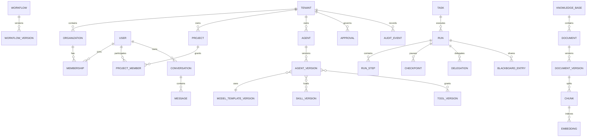

# 智能体平台领域模型与 ERD

- 版本：v1.0
- 日期：2026-11-15
- 状态：逻辑模型基线；物理 DDL 以迁移脚本为准

## 1. 建模原则
- 每个业务实体均有明确租户归属；全局目录数据需显式标记平台级作用域。
- 主键采用稳定 ID；租户内唯一约束必须包含 tenant_id。
- 配置采用不可变版本快照；运行引用具体版本，不引用“最新版本”。
- 时间统一存 UTC；用户界面按租户/用户时区展示。
- 软删除用于可恢复业务对象；敏感数据删除另按数据治理策略执行物理清理/密钥销毁。
- 领域模型与存储表不是一一对应；事件、审计和检索索引可采用独立存储模型。

## 2. 核心实体清单

| 领域 | 实体 | 关键关系 |
|---|---|---|
| 身份 | User、Identity、Session、ApiCredential | User 关联多个 Identity/Session/Credential |
| 多租户 | Tenant、Organization、Membership、Team | Tenant 包含 Organization/Project；Membership 连接 User 与组织/租户 |
| 授权 | Role、Permission、RoleBinding、ResourcePolicy | RoleBinding 作用于用户/团队/服务身份和资源范围 |
| 项目 | Project、Workspace、ProjectMember | Project 属于 Tenant；Workspace 可归属 Project |
| Agent | Agent、AgentVersion、AgentDeployment | Agent 多版本；Deployment 固定发布版本 |
| 工作流 | Workflow、WorkflowVersion、WorkflowRunBinding | Workflow 多版本；Agent/应用引用版本 |
| 模型 | Provider、ModelCatalog、ModelTemplate、ModelTemplateVersion、SecretRef | TemplateVersion 引用 Provider/Model 与 SecretRef，不存明文密钥 |
| 工具 | Tool、ToolVersion、ToolGrant、ToolExecution | ToolVersion 有 JSON Schema、风险级别、资源解析器和授权声明 |
| Skills/Prompt | Skill、SkillVersion、PromptTemplate、PromptVersion | AgentVersion 固定引用版本 |
| 会话 | Conversation、Message、MessageAttachment | Conversation 归属用户/项目/租户 |
| 任务运行 | Task、Run、RunStep、Checkpoint、Delegation | Task 可产生多个 Run；Run 有步骤、检查点和子委派 |
| 协作 | ExpertGroup、ExpertMembership、BlackboardEntry、Evidence、Claim、Challenge、Conflict、Decision | Blackboard 以 run/task/project/tenant 作用域协作 |
| 知识 | KnowledgeBase、Document、DocumentVersion、Chunk、Embedding、IngestionJob、RetrievalLog | Document 属于 KnowledgeBase；Chunk 属于版本；Embedding 绑定模型版本 |
| 记忆 | Memory、MemoryVersion、MemorySource、MemoryAccessLog | 记忆按用户/Agent/项目/租户作用域管理 |
| 文件 | FileAsset、FileVersion、StorageObject | 元数据与对象存储分离；权限由资源 ACL 决定 |
| 治理 | Approval、AuditEvent、Policy、PolicyDecision | 审批绑定动作摘要/资源/调用者；审计追加写 |
| 运营 | TraceLink、UsageRecord、Budget、EvaluationDataset、EvaluationCase、EvaluationRun、Alert | 运行可关联成本、评测、告警 |
| 集成 | Connector、ConnectorCredentialRef、SyncCursor、WebhookSubscription、WebhookDelivery | 同步可增量、可重试、可撤销 |
| 运维 | MigrationRecord、BackupRecord、DeploymentRecord、EventReceipt、OutboxEvent | 支撑升级、恢复、幂等和事件投递 |

## 3. 核心关系图

## 4. 关键约束
1. 跨租户引用必须由复合外键或服务层强校验保证，禁止只靠前端过滤。
2. 知识库检索必须在召回阶段执行 tenant/resource ACL 过滤；向量索引不能成为权限旁路。
3. Run 创建时固定 AgentVersion、WorkflowVersion、ModelTemplateVersion、PromptVersion、SkillVersion、ToolVersion 快照。
4. Blackboard 只承担运行协作认知；Memory 保存跨会话可复用的个体/Agent 状态；Knowledge Base 保存经管理的外部资料。
5. Conversation 是交互历史；不自动等同于 Memory。
6. AuditEvent 与 Decision 采用追加式记录；纠错以新事件/版本表达。
7. FileAsset 元数据与对象存储内容分离，文件删除需处理派生文本、向量、缓存和备份保留策略。
8. 外部副作用必须有幂等键；平台不宣称跨系统 exactly-once。

## 5. 当前 schema 差距
现有 001_platform_core.sql 已有 tenants、agents、model_templates、runs、blackboard、approvals、outbox、tool_audit、embeddings。尚缺 User/Identity/Membership/RoleBinding、Project/Workspace、Agent/Workflow 版本快照、Tool/Skill/Prompt 注册、Conversation/Message、Task/RunStep/Checkpoint/Delegation、KnowledgeBase/Document/Chunk/ACL、Memory、FileAsset、Evaluation、Usage/Budget、Connector/Webhook 等平台对象。

## 6. ERD 使用说明
本文件是平台领域逻辑 ERD；docs/erd.md 仍由 tools/erd.py 从旧 agency.db 自动生成，必须保留其“存量 SQLite ERD”身份，不可误称为新平台 ERD。后续物理模型拆分为有序 PostgreSQL migration，并通过 schema 测试核对实体、索引、约束与租户隔离。
