# ERD｜agency.db 表结构

> 由 `python3 tools/erd.py` 从 `sqlite_master` 与 `PRAGMA foreign_key_list` 自动生成，
> 表结构变更后重跑即可，不手工维护。

```mermaid
erDiagram
    agent_runs {
        INTEGER id PK
        TEXT role
        TEXT task_id FK
        TEXT model
        TEXT prompt_hash
        TEXT output_path
        INTEGER tokens_in
        INTEGER tokens_out
        INTEGER ok
        TEXT error
        TEXT created_at
    }
    clients {
        TEXT id PK
        TEXT name
        TEXT contact
        TEXT phone
        TEXT email
        TEXT note
        TEXT created_at
    }
    config_kv {
        TEXT key PK
        TEXT value
    }
    content_plan {
        TEXT id PK
        TEXT channel
        TEXT topic
        TEXT title
        TEXT planned_at
        TEXT status
        TEXT published_at
        INTEGER views
        INTEGER likes
        INTEGER comments
        INTEGER dms
        TEXT note
        TEXT created_at
    }
    contracts {
        TEXT id PK
        TEXT project_id FK
        TEXT quote_id FK
        REAL amount
        TEXT signed_at
        TEXT payment_terms
        TEXT file_path
        TEXT content_hash
        TEXT created_at
        TEXT client_id FK
        TEXT diff_reason
    }
    conversations {
        INTEGER id PK
        TEXT open_id
        TEXT role
        TEXT text
        TEXT created_at
    }
    costs {
        TEXT id PK
        TEXT project_id FK
        TEXT category
        REAL amount
        REAL hours
        TEXT occurred_at
        TEXT note
        TEXT created_at
    }
    dead_letter {
        INTEGER id PK
        INTEGER event_id FK
        TEXT role
        TEXT error
        INTEGER attempts
        TEXT created_at
        TEXT resolved_at
        TEXT task_id
        TEXT note
        TEXT last_try_at
        TEXT chat_id
    }
    deliveries {
        TEXT token PK
        TEXT path
        TEXT project_id
        TEXT title
        TEXT created_at
        TEXT expires_at
        TEXT revoked_at
    }
    dependencies {
        TEXT id PK
        TEXT need
        TEXT impact
        TEXT assignee
        TEXT due_at
        TEXT status
        TEXT provided_at
        TEXT note
        TEXT source
        TEXT created_at
        TEXT updated_at
    }
    docs {
        INTEGER id PK
        TEXT local_path
        TEXT node_token
        TEXT content_hash
        TEXT classification
        TEXT synced_at
        TEXT state
    }
    embedding_models {
        TEXT model PK
        INTEGER dim PK
        INTEGER normalize
        TEXT provider
        TEXT state
        TEXT added_at
    }
    embeddings {
        INTEGER id PK
        TEXT project_id FK
        TEXT source_type
        TEXT source_id
        TEXT source_version
        INTEGER chunk_no
        TEXT text
        TEXT content_hash
        TEXT model
        INTEGER dim
        BLOB vector
        TEXT state
        TEXT created_at
    }
    entities {
        TEXT id PK
        TEXT type
        TEXT name
        TEXT project_id FK
        TEXT source_ref
        TEXT content_hash
        TEXT created_at
    }
    events {
        INTEGER id PK
        TEXT type
        TEXT task_id FK
        TEXT payload
        TEXT dedup_key
        TEXT created_at
        TEXT delivered_at
    }
    experiences {
        INTEGER id PK
        TEXT task_id
        TEXT project_id
        TEXT role
        TEXT did
        TEXT result
        TEXT reuse
        TEXT evidence
        TEXT content_hash
        TEXT created_at
    }
    facts {
        TEXT id PK
        TEXT project_id FK
        TEXT content
        TEXT source_level
        TEXT source_ref
        TEXT content_hash
        TEXT state
        TEXT expires_at
        TEXT created_at
    }
    feishu_seen {
        TEXT message_id PK
        REAL seen_at
    }
    feishu_tasks {
        TEXT local_task_id PK
        TEXT feishu_guid
        TEXT identity
        TEXT sync_status
        TEXT last_synced_at
        INTEGER remote_done
    }
    invoices {
        TEXT id PK
        TEXT contract_id FK
        TEXT no
        REAL amount
        TEXT issued_at
        TEXT due_at
        TEXT status
        TEXT created_at
    }
    job_runs {
        INTEGER id PK
        TEXT job
        TEXT env
        TEXT trigger
        TEXT started_at
        TEXT finished_at
        INTEGER ok
        TEXT detail
        TEXT created_at
    }
    outbound_sent {
        TEXT event_id PK
        TEXT kind PK
        TEXT chat_id
        TEXT message_id
        REAL sent_at
    }
    payments {
        TEXT id PK
        TEXT invoice_id FK
        REAL amount
        TEXT paid_at
        TEXT method
        TEXT note
        TEXT created_at
    }
    projects {
        TEXT id PK
        TEXT code
        TEXT name
        TEXT status
        TEXT created_at
        TEXT confirmed_at
        TEXT confirm_scope
        TEXT confirm_by
        TEXT gate_revoked_at
    }
    quotes {
        TEXT id PK
        TEXT project_id FK
        REAL amount
        REAL cost
        REAL margin
        TEXT terms
        TEXT valid_until
        TEXT status
        TEXT content_hash
        TEXT created_at
        TEXT client_id FK
    }
    relations {
        TEXT src_id PK
        TEXT rel_type PK
        TEXT dst_id PK
        TEXT content_hash
        TEXT created_at
    }
    reminders {
        INTEGER id PK
        TEXT task_id FK
        TEXT kind
        TEXT scheduled_at
        TEXT sent_at
        INTEGER count
    }
    schema_version {
        INTEGER version PK
        TEXT note
        TEXT applied_at
    }
    subscriptions {
        TEXT event_type PK
        TEXT target PK
        TEXT action PK
        INTEGER enabled
        INTEGER budget
        TEXT created_at
    }
    tasks {
        TEXT id PK
        TEXT project_id FK
        TEXT title
        TEXT kind
        TEXT owner
        TEXT status
        TEXT start_at
        TEXT due_at
        TEXT done_when
        TEXT evidence
        TEXT blocked_reason
        REAL hours
        TEXT dep
        TEXT deliverable
        TEXT milestone
        TEXT content_hash
        TEXT created_at
        TEXT closed_at
        TEXT updated_at
        INTEGER reopen_count
        TEXT reopen_reason
    }
    users {
        TEXT open_id PK
        TEXT name
        TEXT role
        TEXT projects
        TEXT console_token
        TEXT created_at
    }
    wm_session {
        INTEGER id PK
        TEXT task_id FK
        TEXT role
        INTEGER turn
        TEXT goal
        TEXT constraints
        TEXT decisions
        TEXT open_questions
        TEXT artifacts
        TEXT digest
        INTEGER token_used
        INTEGER compacted_from
        TEXT updated_at
    }
    clients ||--o{ contracts : "client_id"
    clients ||--o{ quotes : "client_id"
    contracts ||--o{ invoices : "contract_id"
    events ||--o{ dead_letter : "event_id"
    invoices ||--o{ payments : "invoice_id"
    projects ||--o{ contracts : "project_id"
    projects ||--o{ costs : "project_id"
    projects ||--o{ embeddings : "project_id"
    projects ||--o{ entities : "project_id"
    projects ||--o{ facts : "project_id"
    projects ||--o{ quotes : "project_id"
    projects ||--o{ tasks : "project_id"
    quotes ||--o{ contracts : "quote_id"
    tasks ||--o{ agent_runs : "task_id"
    tasks ||--o{ events : "task_id"
    tasks ||--o{ feishu_tasks : "local_task_id"
    tasks ||--o{ reminders : "task_id"
    tasks ||--o{ wm_session : "task_id"
```

## 表清单

| 表 | 列数 | 外键数 | 行数 |
|---|---:|---:|---:|
| `agent_runs` | 11 | 1 | 135 |
| `clients` | 7 | 0 | 0 |
| `config_kv` | 2 | 0 | 64 |
| `content_plan` | 13 | 0 | 0 |
| `contracts` | 11 | 3 | 0 |
| `conversations` | 5 | 0 | 11 |
| `costs` | 8 | 1 | 0 |
| `dead_letter` | 11 | 1 | 15 |
| `deliveries` | 7 | 0 | 0 |
| `dependencies` | 11 | 0 | 4 |
| `docs` | 7 | 0 | 0 |
| `embedding_models` | 6 | 0 | 2 |
| `embeddings` | 13 | 1 | 382 |
| `entities` | 7 | 1 | 0 |
| `events` | 7 | 1 | 476 |
| `experiences` | 10 | 0 | 0 |
| `facts` | 9 | 1 | 4 |
| `feishu_seen` | 2 | 0 | 97 |
| `feishu_tasks` | 6 | 1 | 0 |
| `invoices` | 8 | 1 | 0 |
| `job_runs` | 9 | 0 | 37 |
| `outbound_sent` | 5 | 0 | 49 |
| `payments` | 7 | 1 | 0 |
| `projects` | 9 | 0 | 1 |
| `quotes` | 11 | 2 | 0 |
| `relations` | 5 | 0 | 0 |
| `reminders` | 6 | 1 | 0 |
| `schema_version` | 3 | 0 | 24 |
| `subscriptions` | 6 | 0 | 11 |
| `tasks` | 21 | 1 | 125 |
| `users` | 6 | 0 | 2 |
| `wm_session` | 13 | 1 | 18 |
