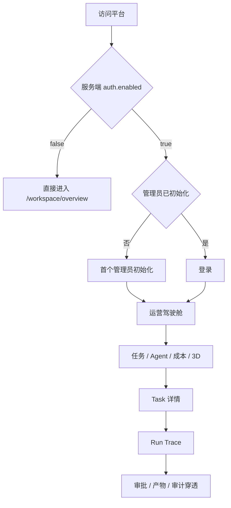

# 前端全站页面地图（Gate 0 初版）

> 状态：Draft / 待与真实前端路由、API Schema 和页面实现逐项核对。  
> Parent：[#742](https://github.com/dujiu1024-dotcom/Agent-pingtai/issues/742) · Scope：[#753](https://github.com/dujiu1024-dotcom/Agent-pingtai/issues/753)  
> 本文是产品目标态页面地图，不代表这些页面/API 已经实现。未核实能力统一标记为「待核实」或「缺 API」，不得以静态 Mock 充当实现。

## 1. 导航信息架构

```mermaid
flowchart TD
  A[智能体数字公司 OS] --> W[工作空间]
  A --> O[智能体运营]
  A --> M[平台管理]
  A --> G[全局能力]
  W --> W1[运营驾驶舱 / 默认首页]
  W --> W2[任务指挥中心]
  W --> W3[Agent 协作中心]
  W --> W4[成本与质量中心]
  W --> W5[3D 数字办公室]
  O --> O1[Agent 与团队]
  O --> O2[任务与运行]
  O --> O3[Workflow 运行态]
  O --> O4[Blackboard]
  O --> O5[人工审批]
  O --> O6[会话与消息]
  O --> O7[知识库与记忆]
  O --> O8[文件与产物]
  M --> M1[组织与成员（仅 auth=true）]
  M --> M2[角色与权限（仅 auth=true）]
  M --> M3[Agent 定义]
  M --> M4[Workflow 设计器]
  M --> M5[模型配置中心]
  M --> M6[工具与 MCP]
  M --> M7[Skills]
  M --> M8[数据集与评测]
  M --> M9[系统设置]
  G --> G1[全局搜索]
  G --> G2[通知中心]
  G --> G3[审计中心]
  G --> G4[系统运维]
```

### 导航规则
- 默认首页：运营驾驶舱 `/workspace/overview`。
- 工作空间负责态势与下钻；智能体运营负责业务对象和运行过程；平台管理负责定义、配置与生命周期；全局能力负责跨模块检索、通知、审计和运维。
- 左侧导航仅展示页面入口，不复制其他模块的实体详情与 CRUD。
- 3D 办公室是工作空间独立页面；其 Agent/Task/Run 点击后跳转到对应实体唯一详情页。
- Workflow 设计器归 #749；Workflow 运行态归 #746；唯一执行编排引擎为 LangGraph。
- 模型供应商、模型目录/模板、路由策略必须在平台管理中作为模型配置中心一级入口，不得折叠成 Agent 表单里的单一 model 字段。

## 2. 页面清单

**实体归属原则：** Agent 运行态（当前状态、活跃 Run、负载）归 #746；Agent 定义（指令、模型模板、工具/Skill 绑定、版本发布）归 #749。评测运行/样本事实详情归 #750；#747 只负责成本与质量聚合指标及趋势，不复制评测实体详情。系统级运维设置归 #751。Prompt/模板管理若后端能力确认存在，归 #749；否则保持隐藏并登记 API 缺口。

| page_id | 页面 | 路由 | 类型 / 主实体 | 主责 | 权限关闭 | 权限启用 |
|---|---|---|---|---|---|---|
| WS-OVERVIEW | 运营驾驶舱 | /workspace/overview | Dashboard / 聚合指标 | #744 | 可见 | RBAC |
| WS-TASKS | 任务指挥中心 | /workspace/tasks | Board+List / Task | #745 | 可见 | RBAC |
| WS-TASK-DETAIL | 任务详情 | /operations/tasks/:taskId | Detail / Task | #745 | 可见 | RBAC |
| WS-RUN-DETAIL | Run Trace 详情 | /operations/runs/:runId | Trace / Run | #745 | 可见 | RBAC |
| WS-COLLAB | Agent 协作中心 | /workspace/collaboration | Dashboard / Agent+Workflow Run+Blackboard | #746 | 可见 | RBAC |
| WS-WORKFLOW-RUN | Workflow 运行详情 | /operations/workflow-runs/:runId | Timeline/Graph / Workflow Run | #746 | 可见 | RBAC |
| WS-BLACKBOARD | Blackboard 条目详情 | /operations/blackboard/:entryId | Detail / Entry | #746 | 可见 | RBAC |
| WS-COST | 成本与质量中心 | /workspace/quality-cost | Dashboard / Usage+Evaluation metrics | #747 | 可见 | RBAC |
| WS-OFFICE | 3D 数字办公室 | /workspace/office | 3D Scene / Office layout+Agent status | #748 | 可见 | RBAC |
| OPS-AGENTS | Agent 运行态列表 | /operations/agents | List / Agent Runtime | #746 | 可见 | RBAC |
| OPS-AGENT-DETAIL | Agent 运行详情 | /operations/agents/:agentId | Runtime Detail / Agent Runtime | #746 | 可见 | RBAC |
| ADM-AGENTS | Agent 定义管理 | /admin/agents | List / Agent Registry | #749 | 可见 | RBAC |
| ADM-AGENT-DETAIL | Agent 定义详情 | /admin/agents/:agentId | Detail/Edit / Agent Registry | #749 | 可见 | RBAC |
| ADM-WORKFLOWS | Workflow 管理 | /admin/workflows | List / Workflow Definition | #749 | 可见 | RBAC |
| ADM-WORKFLOW-EDITOR | Workflow 设计器 | /admin/workflows/:workflowId/edit | Visual Editor / Workflow Definition | #749 | 可见 | RBAC |
| ADM-MODEL-PROVIDERS | 模型供应商 | /admin/models/providers | List/Edit / Model Provider | #749 | 可见 | RBAC |
| ADM-MODEL-TEMPLATES | 模型模板与目录 | /admin/models/templates | List/Edit / Model Template | #749 | 可见 | RBAC |
| ADM-MODEL-ROUTING | 模型路由策略 | /admin/models/routing | Policy Editor / Routing Policy | #749 | 可见 | RBAC |
| ADM-TOOLS | 工具与 MCP | /admin/tools | List/Edit / Tool+Server | #749 | 可见 | RBAC |
| ADM-SKILLS | Skills | /admin/skills | List/Edit / Skill | #749 | 可见 | RBAC |
| ADM-PROMPTS | Prompt 与模板管理（条件能力） | /admin/prompts | List/Edit / Prompt Registry | #749 | 按能力隐藏 | RBAC |
| ADM-ORG | 组织/部门/项目/成员 | /admin/organization | Tree+List / Org+Member | #749 | 隐藏 | RBAC |
| ADM-RBAC | 角色与权限 | /admin/access-control | Matrix / Role+Permission | #749 | 隐藏 | RBAC |
| OPS-APPROVALS | 审批中心 | /operations/approvals | Inbox / Approval | #750 | 可见 | RBAC |
| OPS-APPROVAL-DETAIL | 审批详情 | /operations/approvals/:approvalId | Detail / Approval | #750 | 可见 | RBAC |
| OPS-KNOWLEDGE | 知识库 | /operations/knowledge-bases | List / Knowledge Base | #750 | 可见 | RBAC |
| OPS-DOCUMENT | 文档详情 | /operations/documents/:documentId | Detail / Document | #750 | 可见 | RBAC |
| OPS-MEMORY | 记忆治理 | /operations/memories | List / Memory | #750 | 可见 | RBAC |
| OPS-CONVERSATIONS | 会话与消息 | /operations/conversations | List / Conversation | #750 | 可见 | RBAC |
| OPS-FILES | 文件与产物 | /operations/files | List / File/Artifact | #750 | 可见 | RBAC |
| OPS-EVAL-DATASETS | 评测数据集 | /operations/evaluation/datasets | List / Dataset | #750 | 可见 | RBAC |
| OPS-EVAL-RUNS | 评测运行与样本详情 | /operations/evaluation/runs | List/Detail / Evaluation Run | #750 | 可见 | RBAC |
| GLOBAL-SEARCH | 全局搜索 | /search | Search / 多实体 | #751 | 可见 | RBAC |
| GLOBAL-NOTIFICATIONS | 通知中心 | /notifications | Inbox / Notification | #751 | 可见 | RBAC |
| GLOBAL-AUDIT | 审计中心 | /admin/audit | Query / Audit Event | #751 | 可见 | RBAC |
| GLOBAL-OPS | 系统运维 | /admin/operations | Diagnostics / Component+Event | #751 | 可见 | RBAC |
| SYS-SETTINGS | 系统设置与运维配置 | /admin/settings | Settings / Instance config | #751 | 可见（非身份设置） | RBAC |
| AUTH-LOGIN | 登录 | /auth/login | Auth | #743 | 不存在 | 仅 auth=true |
| AUTH-INITIALIZE | 首个管理员初始化 | /auth/initialize | Setup | #743/#749 | 不存在 | 仅未初始化且 auth=true |

说明：
1. 表内路由是拟定的稳定契约，不是当前仓库已存在的路由；实施前必须与现有路由盘点结果核对。
2. 若后端没有独立 Document/Approval/Memory 等详情接口，详情页仍可用列表/聚合 API 组合，但缺失契约必须标注，不得假造 endpoint。
3. 页面拆分允许最终合并为 tabs/drawers，但 page_id、实体主责和深链语义保持稳定。

## 3. 实体详情唯一归属与穿透

| 实体 | 唯一详情路由 | 主责 | 常见入口 |
|---|---|---|---|
| Task | /operations/tasks/:taskId | #745 | 驾驶舱、看板、Agent、通知、搜索 |
| Run | /operations/runs/:runId | #745 | Task、驾驶舱、模型用量 |
| Workflow Run | /operations/workflow-runs/:runId | #746 | 协作中心、Task/Run |
| Agent Runtime | /operations/agents/:agentId | #746 | 协作中心、3D 工位、Task/Run |
| Agent Definition | /admin/agents/:agentId | #749 | Agent 定义列表、模型绑定 |
| Workflow Definition | /admin/workflows/:workflowId/edit | #749 | 管理列表、Run 详情（只读跳转） |
| Blackboard Entry | /operations/blackboard/:entryId | #746 | 协作中心、Run |
| Model Provider | /admin/models/providers/:providerId | #749 | 模型中心、模板详情 |
| Model Template | /admin/models/templates/:templateId | #749 | Agent/Workflow 配置、成本中心 |
| Routing Policy | /admin/models/routing/:policyId | #749 | 模型中心 |
| Tool / MCP Server | /admin/tools/:toolId | #749 | Agent 配置、调用审计 |
| Skill | /admin/skills/:skillId | #749 | Agent 配置 |
| Approval | /operations/approvals/:approvalId | #750 | Task、Run、通知 |
| Knowledge Base | /operations/knowledge-bases/:knowledgeBaseId | #750 | 搜索、知识库列表 |
| Document | /operations/documents/:documentId | #750 | 知识库、检索引用 |
| Memory | /operations/memories/:memoryId | #750 | Agent、知识治理 |
| Conversation | /operations/conversations/:conversationId | #750 | Agent、Task |
| File / Artifact | /operations/files/:fileId | #750 | Task、Run、会话 |
| Dataset | /operations/evaluation/datasets/:datasetId | #750 | 评测中心 |
| Evaluation Run | /operations/evaluation/runs/:evaluationRunId | #750 | Dataset、样本列表 |
| Audit Event | /admin/audit/:eventId | #751 | 任意资源审计入口 |

## 4. Query 参数约定（摘要）

- 列表筛选：`status`、`projectId`、`agentId`、`modelTemplateId`、`from`、`to`、`q`、`sort`、`page`、`pageSize`。
- 时间范围统一 ISO-8601；URL 使用 UTC 时间戳/带 offset 的 ISO 字符串，界面按用户本地时区显示。
- 跨页穿透保留来源上下文：`fromPage`（来源 page_id）、`returnTo`（受控的站内相对路径）、筛选条件和分页；`from` 只用于时间范围起点，与 route-contract 的时间参数语义一致。禁止接受任意外部 redirect URL。
- 详情内 tab 使用 `tab`；定位 Run 节点使用 `nodeId`；搜索结果可带 `entityType`。
- query 参数必须可序列化、可分享；敏感信息、密钥、Prompt 私密内容不得写入 URL。
- 无效/未知 query 参数忽略并记录诊断，不使页面崩溃；无效主键显示标准 Not Found。

## 5. 关键用户流程

Workflow：`/admin/workflows` → 草稿编辑 → 节点/边 Schema 校验 → 发布版本 → LangGraph 执行 → #746 运行态观察 → Task/Run Trace。编辑器不负责调度、checkpoint 或恢复。

模型：`/admin/models/providers` → 凭据 secret_ref 写入/轮换 → 连接测试（API 待核实）→ 模型发现（API 待核实）→ 模板配置 → 路由策略 → Agent/Workflow 绑定 → Run 用量/费用穿透。密钥永不回显。

## 6. 权限模式矩阵

| 能力 | auth.enabled=false（默认） | auth.enabled=true |
|---|---|---|
| 登录/注册/账号审查 | 不存在 | 登录存在；公开注册关闭 |
| 首个管理员初始化 | 不需要 | 首次启用时需要 |
| 用户/组织/角色/RBAC 页面 | 隐藏，不阻断业务 | 管理员按权限访问 |
| Agent/Task/Run/Model/Workflow/Knowledge 等业务页面 | 直接访问，无身份/数据范围过滤 | 服务端认证授权 |
| REST/SSE/WebSocket/文件访问 | 与 no-auth 策略一致，不得隐式要求 token | 服务端统一认证授权 |
| 前端权限判断 | 不得制造身份门槛 | 仅用于体验，服务端为安全边界 |
| 模式切换 | 改部署配置并重启 | 改部署配置并重启 |

## 7. 视觉基准

- 后台首页：`示意图/首页示意图.png`，只指导首页信息布局与企业后台视觉。
- 3D 办公室：`示意图/3D办公室示意图.jpeg`，只指导空间、桌椅、工位、人物、材质与灯光。
- 两图不可互换。全站共享色彩语义、间距、字体、圆角、阴影、状态色和组件密度 Token；3D 场景可使用沉浸式深色主题。
- 所有截图中的数值仅可来自真实 API；设计稿占位必须显式标识，不得作为验收数据。

## 8. 待核实与缺口登记

| ID | 内容 | 当前状态 | 后续责任 |
|---|---|---|---|
| API-MODEL-TEST | Provider 连通性测试 API | 待核实/可能缺失 | #749 后端契约核查 |
| API-MODEL-DISCOVERY | Provider 模型目录发现 API | 待核实/可能缺失 | #749 后端契约核查 |
| API-ROUTING | 模型路由策略 CRUD/验证 API | 待核实 | #749 |
| API-SEARCH | 全局跨实体搜索 API | 待核实 | #751 |
| API-NOTIFICATION | 通知列表/已读/投递状态 API | 待核实 | #751 |
| API-OFFICE-LAYOUT | 办公室空间布局读写/版本 API | 待核实 | #748 |
| API-BOOTSTRAP | 服务端 auth.enabled bootstrap 元信息 | 待核实 | #743 |
| ROUTE-LEGACY | 当前仓库 UI 入口/路由逐页映射 | 已完成关键入口初审；全量旧视图映射待完成 | #743/#753 |
| API-ENTITY-MAP | 各实体详情 API 与 schema 对照 | 尚未完成 | 各页面主责 Issue |

## 9. 冻结前检查清单

- [ ] 对照仓库当前所有 UI 入口、路由和页面，完成新旧页面映射。
- [ ] 对照 OpenAPI/路由注册/schema，为每个页面字段补 API 契约 ID。
- [ ] 核验每个详情实体的主键、详情 API、列表分页、筛选和错误语义。
- [ ] 核验所有模型配置子功能，区分已存在、部分存在、缺 API。
- [ ] 与 #743–#752 负责人确认职责边界和路由。
- [ ] 用首页/3D 两张指定素材完成视觉对照。
- [ ] 页面地图、路由契约、字段字典和 API 映射评审通过后，才可标记 Gate 0 设计冻结。

## 10. 代码现状核对（2026-11-18，基于 main 当前代码）

> 本节是已检查代码的事实基线。它优先于上文拟定的目标态路由；目标态路由不得被误读为当前已实现。

### 10.1 当前前端入口

| 类型 | 真实入口/文件 | 当前状态 |
|---|---|---|
| 新平台静态工作台 | `/app`、`/app/` → `agent_platform/web/static/index.html` + `app.js` + `style.css` | 当前主 UI；原生 HTML/CSS/JavaScript 单页视图，不是 React/TypeScript/Vite 工程 |
| 旧版平台 UI | `platform-ui/index.html` | 独立旧页面，仍保留 Agent、Task、审批、知识、记忆、Blackboard、模型模板、工具/Skill、会话、文件、运营和评测等入口 |
| 图谱可视化 | `/graph-view` | 独立只读页面（是否可用取决于静态资产） |
| 静态资源 | `/app/assets/{name}` | 由后端白名单提供 app.js/style.css 等 |
| 旧控制台回退 | `/app?legacy=true` → `/office` | 旧版回退入口；不等于已建成新的 3D Office SPA |
| 目标态页面路由 | 本文第 2 节 `/workspace/*`、`/operations/*`、`/admin/*` | 全部是拟定路由，当前代码未见 React Router/路由注册实现 |

当前 `/app` 的视图由 `data-view` 和 JavaScript 状态切换，主要视图为 overview、board、tasks、sessions、replay、batch、artifacts、approvals、registry、prompt-lab、knowledge-graph、governance、observability。Task/Session/Approval 详情主要由内存状态渲染，尚不是可复制、刷新恢复的独立 URL 深链。

仓库根目录及 `frontend/`、`web/`、`agent_platform/web/` 未发现 `package.json`；已检查的 CI workflow 没有前端 npm install/build/typecheck/E2E 步骤。因此 #743 所列 React+TS+Vite 是待建设的独立新前端，不是当前已有工程栈。

### 10.2 当前 API 组合事实

`agent_platform/api/app.py` 通过 `create_platform_app` 组合 API；多项路由按 service/authorizer 是否注入而条件挂载。当前可见/已核对的业务路由包括：
- `/auth/login`、`/auth/logout`、`/auth/me`
- `/api/platform/v1/workbench/capabilities`、`/workbench/tasks`、批量任务
- `/api/platform/v1/registry/{kind}` 与版本、发布、回滚、停用、active
- `/api/platform/v1/approvals`
- `/api/platform/v1/runs/{run_id}`、事件、stream、cancel/pause/resume/interventions（依配置）
- `/api/platform/v1/blackboard`
- `/api/platform/v1/knowledge/*`、`/memories/*`
- `/api/platform/v1/sessions/*`、`/files/*`
- `/api/platform/v1/observability/*`、`/quotas/*`、`/audit/*`（依配置）

这些是后端现有端点家族，不代表每个部署都已挂载；前端应以 capabilities/bootstrap 和 OpenAPI 实际返回为准。

### 10.3 已发现的关键缺口/冲突

| ID | 代码事实 | 对页面地图/Issue 的影响 | 严重度 |
|---|---|---|---|
| CODE-AUTH-001 | `create_platform_app` 要求 identity、identity_repository；始终挂载 IdentityASGIMiddleware，保护 `/api`、`/auth`。未认证访问受保护路径返回 401。local_principal 仅对配置的本地客户端地址回退，不是实例级 no-auth。 | #742/#743/#752 要求的 auth.enabled=false 零账号/零认证/零隔离模式尚未在当前组合层实现；需后端先补可插拔 auth 策略及 REST/SSE/文件一致测试。 | P0 |
| CODE-API-001 | `docs/api-contract.md` 将平台 API 定义为身份中间件保护；当前测试明确断言匿名知识 API 返回 401。 | API 总契约与 #742 第 14 节新决策冲突，必须修订文档和测试矩阵；不能只在 UI 侧绕过。 | P0 |
| CODE-OFFICE-001 | `agent_platform/api/office.py` 有 `/api/platform/v1/office/state`，但当前 `agent_platform/api/app.py` 未导入/注册 `create_office_router`；该 handler 本身也要求 Principal。 | #748 不能把该模块视为当前已接通的 Office API；新页面地图的 `/workspace/office` 是新前端页面路由，不是该 API。 | P1 |
| CODE-MODEL-001 | Registry 的 kind 包含 `model_provider`、`model_template`；通用版本 API 支持列表/草稿/发布/回滚/停用。Resolver 当前只支持 `openai-compatible`。 | 模型供应商/模板的基础注册能力存在；专用连通性测试、模型发现、独立路由策略 API/UI 未在当前检查的路由组合中找到，仍属缺口/待核实。 | P1 |
| CODE-GLOBAL-001 | 当前 app composition 的已检查路由清单未见全局搜索、通知中心专用 API；现有 UI 导航也未见相应入口。 | #751 是新增建设范围，不应按现有能力接线；需明确搜索索引/通知持久化与事件投递后端依赖。 | P1 |
| CODE-ORG-001 | 当前新平台静态 UI 及已检查的 app route composition 未见组织/部门/项目成员和 RBAC 管理 UI/API 完整入口；identity API 目前看到 login/logout/me。 | #749 的组织/RBAC 管理是需补齐/核验的产品功能，不能由登录 API 或 identity service 的存在推定完成。 | P1 |
| CODE-ROUTE-001 | 当前工作台以 `/app` + 内部 view 状态导航；详情通过 JS 状态渲染。 | 本文 `/workspace/*`、`/operations/*`、`/admin/*` 均为目标态路由，需要新增路由器、深链、刷新和兼容重定向；不能宣称已存在。 | P1 |
| CODE-FE-001 | 当前主 UI 是静态 HTML/CSS/JS，旧 UI 为 `platform-ui/index.html`；未发现前端 package.json 或前端 CI build。 | #743 必须包含独立工程创建、依赖锁定、构建/类型检查/组件测试/浏览器 E2E 与部署，而非只改造现有静态 UI。 | P1 |

### 10.4 页面地图实施规则

- 先保留“当前代码入口/API”与“目标态页面路由”两套列，不得把拟定路径混成已实现路由。
- 新前端首期路由可采用本页目标态命名，但必须提供从 `/app` 的明确入口策略和旧入口回退/重定向矩阵。
- /office 的旧控制台回退与未来 /workspace/office 3D 场景必须区分；先确认旧 /office 的实际路由/静态资源，再接入新场景。
- API 端点必须按“源码已注册、配置条件挂载、模块存在但未注册、完全缺失”四态记录。
- 组织/RBAC、搜索、通知、模型测试/发现/路由策略、Office 布局 CRUD/状态 API 都必须有独立 API 缺口条目和责任 Issue。

### 10.5 归属冲突修正
- Agent 运行态与 Agent 定义拆为两个 page_id/详情路由：#746 负责 `/operations/agents/:agentId`，#749 负责 `/admin/agents/:agentId`。不得让同一页面同时承担运行态和注册定义 CRUD。
- Evaluation Run/Case 事实详情由 #750 唯一负责；#747 只做指标、趋势和对账聚合。
- 系统设置与运维配置由 #751 负责；#749 不重复建设系统级运维设置。
- Prompt 管理为条件页面：仅在 Prompt Registry API 能力真实启用时显示，页面主责 #749。

## 11. 现有入口逐页盘点与迁移索引（源码核对）

本节区分“当前入口事实”与“目标路由”。当前页面没有独立 URL 的，不得为其虚构已注册 path；目标 path 仅引用第 2 节 page_id。

### 11.1 `/app` 静态工作台 view key 全量清单

证据文件：`agent_platform/web/static/index.html`、`agent_platform/web/static/app.js`、路由组合 `agent_platform/web/app.py`。入口由 `GET /app` 与 `GET /app/` 返回；导航通过 `data-view` 设置 JS 内存态 `S.view`，不是 URL 路由。

| 当前 view key | 当前显示名 | 目标 page_id | 目标 path | 当前状态 / 迁移说明 |
|---|---|---|---|---|
| `overview` | 驾驶舱 | WS-OVERVIEW | `/workspace/overview` | verified：默认内部视图；不是独立 URL |
| `board` | 运营看板 | WS-TASKS | `/workspace/tasks` | verified：导航链接另开 `/board`；该路径与 JS view key 是两个入口，不推定后端 board 页面 |
| `tasks` | 在办任务 | WS-TASKS | `/workspace/tasks` | verified：内部视图；详情由内存状态切换 |
| `sessions` | 会话中心 | OPS-CONVERSATIONS | `/operations/conversations` | verified：内部视图；会话详情非稳定深链 |
| `batch` | 批量执行 | WS-TASKS | `/workspace/tasks?tab=batch` | verified：内部视图；作为任务中心子视图，不另立 Task 实体详情 |
| `replay` | Run 回放 | WS-RUN-DETAIL | `/operations/runs/:runId` | verified：内部视图；需 runId 才能定位运行记录 |
| `artifacts` | 产物交付 | OPS-FILES | `/operations/files` | verified：内部视图；文件/Artifact 详情归 #750 |
| `approvals` | 待我拍板 | OPS-APPROVALS | `/operations/approvals` | verified：内部视图；详情归审批唯一详情路由 |
| `registry` | Agent 与资源管理 | ADM-AGENTS | `/admin/agents` | verified：复合入口，含 Agent/模型/工具等资源；必须拆分链接到各自 page_id，不得合并详情责任 |
| `knowledge-graph` | 知识图谱 | WS-COLLAB | `/workspace/collaboration?tab=graph` | verified：工作台内视图；另有独立 `/graph-view` |
| `governance` | 知识与运营管理 | OPS-KNOWLEDGE | `/operations/knowledge-bases` | verified：复合入口；知识库/记忆/审计子能力按独立 page_id 分流 |
| `observability` | 可观测性 | GLOBAL-OPS | `/admin/operations` | verified：内部视图；API 是否可用依赖后端注入与 capability |
| `prompt-lab` | Prompt 版本管理 | ADM-PROMPTS | `/admin/prompts` | verified：内部视图入口；仅 Prompt Registry capability 启用时显示，缺能力不代表 API 已存在 |

**内部详情 view key / 状态：** `task-detail`、`session-detail` 由 JS 内存状态承载；当前 `S.task` / `S.session` 不构成可复制的 URL 主键。Run/Approval 详情若由列表选择进入，也必须在新前端迁移为 `runId` / `approvalId` 深链；不得沿用纯内存详情作为目标契约。未知/临时视图不增加新的 page_id，除非形成独立导航页面并经 #753 评审。

### 11.2 旧版 `platform-ui/index.html` 页面全量清单

证据文件：仓库根目录 `platform-ui/index.html`（单文件 HTML/CSS/JS）。旧版以 `data-view` / section id 切换，不是后端 URL 路由。

| 旧版 view key / section | 页面 | 目标 page_id | 目标 path | 当前状态 / 迁移说明 |
|---|---|---|---|---|
| `overview` | 工作台 | WS-OVERVIEW | `/workspace/overview` | verified：旧版概览；统一迁移至主驾驶舱 |
| `agents` | Agent 管理 | ADM-AGENTS | `/admin/agents` | verified：定义注册入口；运行态另归 OPS-AGENTS |
| `runs` | 任务与运行 | WS-TASKS | `/workspace/tasks` | verified：旧版以 Task Center 为主；Run 详情独立归 WS-RUN-DETAIL |
| `approvals` | 人工审批 | OPS-APPROVALS | `/operations/approvals` | verified：审批列表 |
| `knowledge` | 知识库 | OPS-KNOWLEDGE | `/operations/knowledge-bases` | verified：知识库/文档/检索入口 |
| `memory` | 记忆管理 | OPS-MEMORY | `/operations/memories` | verified：记忆列表与治理 |
| `blackboard` | Blackboard | WS-BLACKBOARD | `/operations/blackboard/:entryId` | verified：旧版按 scope 查询；目标详情使用 entryId |
| `models` | 模型模板与供应商 | ADM-MODEL-TEMPLATES | `/admin/models/templates` | verified：旧版同一视图含 Provider 与 Template；目标拆为 Provider、Template、Routing 三个一级页面 |
| `tools` | 工具与 Skills | ADM-TOOLS | `/admin/tools` | verified：目标拆为 Tool/MCP 与 Skill 两个 page_id |
| `sessions` | 会话 | OPS-CONVERSATIONS | `/operations/conversations` | verified：旧版会话/消息入口 |
| `files` | 文件 | OPS-FILES | `/operations/files` | verified：旧版文件资产入口 |
| `operations` | 运营与成本 | WS-COST | `/workspace/quality-cost` | verified：复合视图含 usage/metrics/audit；审计和运维需分别链接 GLOBAL-AUDIT / GLOBAL-OPS |
| `evaluation` | RAG 评测 | OPS-EVAL-RUNS | `/operations/evaluation/runs` | verified：旧版主要是检索评测表单；数据集与评测运行详情由 #750 负责，聚合指标归 #747 |

旧版 `models`、`tools`、`operations` 是复合页面，拆分仅改变导航/页面归属，不意味着旧版已具有模型路由策略、MCP Server 独立详情、完整审计/运维或全量评测能力。

### 11.3 独立入口、回退与资源

| 当前入口 | 当前代码位置 / 行为 | page_id / 目标 path | 状态 |
|---|---|---|---|
| `GET /app`, `GET /app/` | `agent_platform/web/app.py` 返回静态 `index.html` | WS-OVERVIEW / `/workspace/overview` | verified |
| `GET /app/assets/{name}` | 只允许 ASSETS 白名单中的静态文件 | 不形成业务 page_id | verified |
| `GET /graph-view` | 静态 `graph.html` 存在时返回；否则 404 | WS-COLLAB / `/workspace/collaboration?tab=graph` | verified：路由已注册，资源存在性需部署核验 |
| `GET /app?legacy=true` | 307 Redirect 到 `/office` | 不映射 WS-OFFICE；旧回退入口 | verified |
| `/office` | 当前 web router 不注册；需查其他 legacy bridge/组合入口 | WS-OFFICE / `/workspace/office` | unregistered in `create_platform_web_router`；不可将回退等同新 3D 页面 |
| `/api/platform/v1/office/*` | `agent_platform/api/office.py` 模块存在，但 `create_platform_app` 未 include office router | WS-OFFICE | module-only-unregistered |
| `/workspace/*`, `/operations/*`, `/admin/*`, `/search`, `/notifications` | 当前未发现目标态 React Router / SPA route registration | 对应目标 page_id | proposed / not implemented |

### 11.4 API 与字段映射索引

本表只给稳定索引和源码状态，不在页面地图复制字段字典。字段名、类型、必填/空值、分页、错误、权限、事件流 schema 由各主责 Issue 的字段/API 契约维护；未知字段标记待核实，不得以页面设计稿推断。

| API 索引 ID | 当前核对范围（相对路径） | 当前状态 | 关联页面 / 主责 |
|---|---|---|---|
| API-AUTH | `/auth/login`, `/auth/logout`, `/auth/me` | source-registered；当前 middleware 仍强制认证 | AUTH-LOGIN / #743 |
| API-CAPABILITY | `GET /api/platform/v1/workbench/capabilities` | source-registered；具体 features 依 composition | 全部业务页 / #743 |
| API-TASK | `/api/platform/v1/workbench/tasks*`、batch | source-registered / 条件能力 | WS-TASKS、WS-TASK-DETAIL / #745 |
| API-RUN | `/api/platform/v1/runs/{run_id}*`、events、stream、interventions | source-registered / resolver 与 authorizer 条件挂载 | WS-RUN-DETAIL / #745 |
| API-APPROVAL | `/api/platform/v1/approvals*` | source-registered / service+authorizer 条件挂载 | OPS-APPROVALS / #750 |
| API-REGISTRY | `/api/platform/v1/registry/{kind}*`、versions、publish、rollback、disable、active | source-registered / registry resolver+authorizer 条件挂载 | ADM-AGENTS、ADM-MODEL-PROVIDERS、ADM-MODEL-TEMPLATES、ADM-TOOLS、ADM-SKILLS / #749 |
| API-MODEL-TEST | Provider connectivity test | missing / not found in checked router composition | ADM-MODEL-PROVIDERS / #749 |
| API-MODEL-DISCOVERY | Provider model discovery | missing / not found in checked router composition | ADM-MODEL-PROVIDERS / #749 |
| API-MODEL-ROUTING | Routing policy CRUD/validation | missing or unverified; no dedicated router found | ADM-MODEL-ROUTING / #749 |
| API-PROMPT | Prompt registry routes | source-registered conditionally via prompt registry dependency | ADM-PROMPTS / #749 |
| API-BLACKBOARD | `/api/platform/v1/blackboard*` | source-registered / repository+authorizer conditional | WS-BLACKBOARD、WS-COLLAB / #746 |
| API-KNOWLEDGE | `/api/platform/v1/knowledge/*` | source-registered / service and principal policy; auth=false not available in current baseline | OPS-KNOWLEDGE、OPS-DOCUMENT / #750 |
| API-MEMORY | `/api/platform/v1/memories/*` | source-registered / memory service and principal policy | OPS-MEMORY / #750 |
| API-SESSION-FILE | `/api/platform/v1/sessions/*`, `/files/*` | source-registered / session service and authorizer conditional | OPS-CONVERSATIONS、OPS-FILES / #750 |
| API-EVALUATION | knowledge RAG evaluate and evaluation rollout router | partial/conditional; durable dataset/run/case contract must be confirmed | OPS-EVAL-DATASETS、OPS-EVAL-RUNS / #750 |
| API-OBSERVABILITY | `/api/platform/v1/observability/*`, metrics/alerts | source-registered / monitor/exporter dependencies conditional | GLOBAL-OPS / #751 |
| API-QUOTA | `/api/platform/v1/quotas/*` | source-registered / store+authorizer conditional | WS-COST / #747 |
| API-AUDIT | `/api/platform/v1/audit/*` | source-registered / reader+authorizer conditional | GLOBAL-AUDIT / #751 |
| API-OFFICE | `agent_platform/api/office.py` office state | module-only-unregistered in current app composition | WS-OFFICE / #748 |
| API-SEARCH | cross-entity search | missing / not found in checked composition | GLOBAL-SEARCH / #751 |
| API-NOTIFICATION | notification inbox/read/delivery | missing / not found in checked composition | GLOBAL-NOTIFICATIONS / #751 |
| API-ORG-RBAC | org/department/member/role/permission administration | missing / not found in checked UI/API composition | ADM-ORG、ADM-RBAC / #749 |
| API-BOOTSTRAP | startup metadata incl. auth.enabled and capabilities | missing/unverified; do not infer from /auth/me | AUTH-LOGIN、all route guards / #743 |

### 11.5 每页字段/API 映射索引（主责维护）

| page_id 范围 | 字段/API 索引 | 主要实体与主键 | 主责 |
|---|---|---|---|
| WS-OVERVIEW、WS-COST | API-CAPABILITY、API-TASK、API-RUN、API-QUOTA、API-OBSERVABILITY、API-EVALUATION | 聚合指标；不设伪造实体主键 | #744、#747 |
| WS-TASKS、WS-TASK-DETAIL、WS-RUN-DETAIL | API-TASK、API-RUN、API-SESSION-FILE | Task.task_id；Run.run_id | #745 |
| WS-COLLAB、OPS-AGENTS、OPS-AGENT-DETAIL、WS-WORKFLOW-RUN、WS-BLACKBOARD | API-REGISTRY（只读引用）、API-RUN、API-BLACKBOARD | Agent.agent_id；WorkflowRun.run_id；Entry.entry_id | #746 |
| ADM-AGENTS、ADM-AGENT-DETAIL、ADM-WORKFLOWS、ADM-WORKFLOW-EDITOR、ADM-MODEL-*、ADM-TOOLS、ADM-SKILLS、ADM-PROMPTS、ADM-ORG、ADM-RBAC | API-REGISTRY、API-MODEL-TEST、API-MODEL-DISCOVERY、API-MODEL-ROUTING、API-PROMPT、API-ORG-RBAC | item_id + version；provider_id/template_id/policy_id | #749 |
| OPS-APPROVALS、OPS-KNOWLEDGE、OPS-DOCUMENT、OPS-MEMORY、OPS-CONVERSATIONS、OPS-FILES、OPS-EVAL-* | API-APPROVAL、API-KNOWLEDGE、API-MEMORY、API-SESSION-FILE、API-EVALUATION | approval_id、knowledge_base_id、document_id、memory_id、conversation_id、asset_id、evaluation_run_id | #750 |
| WS-OFFICE | API-OFFICE、API-RUN、API-CAPABILITY | layout_id（API 待补）；Agent/Run 外键引用 | #748 |
| GLOBAL-SEARCH、GLOBAL-NOTIFICATIONS、GLOBAL-AUDIT、GLOBAL-OPS、SYS-SETTINGS | API-SEARCH、API-NOTIFICATION、API-AUDIT、API-OBSERVABILITY | query / notification_id / event_id / component_id | #751 |

### 11.6 页面状态、响应式和视觉引用

所有页面必须支持并保持语义一致的状态集合：loading/skeleton、empty（无数据与无筛选结果分开）、error/retry、stale/offline、permission-denied（仅 auth=true）、read-only、partial-data、unknown-enum、not-found。页面地图不定义字段顺序或组件布局。

响应式基线：桌面端完整导航与多列信息；平板端导航折叠、表格允许横向滚动/列优先级；窄屏端单列、详情转全屏、复杂图/3D 提供可访问的列表/2D 降级。3D 低性能设备降级不改变 Agent/Run 真实状态。

视觉资产：
- 首页视觉基准：`示意图/首页示意图.png`，只引用 WS-OVERVIEW；资产当前是否在仓库可访问须以仓库文件检查为准。
- 3D 场景基准：`示意图/3D办公室示意图.jpeg`，只引用 WS-OFFICE；不得将首页图用于 3D。
- 全站 Design Token 引用 #743 的 `docs/frontend/design-system.md`；本 Issue 不冻结字段布局、表格列和表单组件。

## 12. 维护规则与冻结判定

- 每个 page_id 在本文件只定义一次；同一实体详情只能有一个主责 page_id/path。导航别名、旧 view key 只能引用目标 page_id，不得复制详情责任。
- 新增/删除页面、改变 page_id/path/主实体/主责或详情唯一归属，必须先评审本文件；字段、表格列、筛选器、表单布局的业务迭代由模块 Issue 自主维护。
- 每个新路由 PR 必须列出受影响 page_id、旧入口兼容行为、路由冲突检查和 API 映射索引。
- 当前代码状态与目标态状态必须分栏表达；不得把 proposed 路由、条件 API、未注册模块写成已实现。
- 本文件完成 Gate 0 页面结构冻结；不代表 #755 no-auth 后端能力已完成，也不代表 #743–#752 页面实现或 #752 系统 E2E 已通过。

### 11.7 page_id 逐页元数据索引（主键、面包屑、入口/出口、API）

以下表为每个 page_id 的结构索引。入口/出口列描述站内导航关系；字段细节仍由对应模块字段字典维护。目标态页面均为 proposed，不能据此宣称页面已注册。

| page_id | 主实体 / 主键 | 面包屑 | 主要入口 → 出口 | API 映射索引 |
|---|---|---|---|---|
| WS-OVERVIEW | 聚合视图 / 无单一主键 | 工作空间 / 驾驶舱 | 登录后默认入口或 no-auth 根入口 → Task、Run、Agent、Cost、Office | API-CAPABILITY、API-TASK、API-RUN、API-QUOTA、API-OBSERVABILITY |
| WS-TASKS | Task / task_id | 工作空间 / 任务指挥中心 | 驾驶舱、全局搜索 → WS-TASK-DETAIL、WS-RUN-DETAIL | API-TASK、API-CAPABILITY |
| WS-TASK-DETAIL | Task / task_id | 智能体运营 / 任务与运行 / 任务详情 | WS-TASKS、搜索、通知 → WS-RUN-DETAIL、OPS-APPROVAL-DETAIL、OPS-FILES | API-TASK、API-RUN、API-APPROVAL、API-SESSION-FILE |
| WS-RUN-DETAIL | Run / run_id | 智能体运营 / 任务与运行 / Run Trace | Task、驾驶舱、Agent → OPS-APPROVAL-DETAIL、OPS-FILES、GLOBAL-AUDIT | API-RUN、API-TASK、API-APPROVAL、API-SESSION-FILE、API-AUDIT |
| WS-COLLAB | Agent/Workflow Run/Blackboard 聚合 / 无单一主键 | 工作空间 / Agent 协作 | 驾驶舱、Agent、Workflow → OPS-AGENT-DETAIL、WS-WORKFLOW-RUN、WS-BLACKBOARD | API-REGISTRY、API-RUN、API-BLACKBOARD |
| WS-WORKFLOW-RUN | Workflow Run / run_id | 智能体运营 / 工作流运行 / 运行详情 | WS-COLLAB、Task → WS-RUN-DETAIL、ADM-WORKFLOW-EDITOR（只读定义链接） | API-RUN |
| WS-BLACKBOARD | Entry / entry_id | 智能体运营 / Blackboard / 条目详情 | WS-COLLAB、Run → WS-RUN-DETAIL、WS-TASK-DETAIL | API-BLACKBOARD |
| WS-COST | Usage/Evaluation 聚合 / 无单一主键 | 工作空间 / 成本与质量 | 驾驶舱、全局导航 → OPS-EVAL-RUNS、WS-RUN-DETAIL、ADM-MODEL-TEMPLATES | API-QUOTA、API-OBSERVABILITY、API-EVALUATION、API-RUN |
| WS-OFFICE | Office Layout / layout_id（API 待补） | 工作空间 / 3D 数字办公室 | 驾驶舱 → OPS-AGENT-DETAIL、WS-TASK-DETAIL、WS-RUN-DETAIL | API-OFFICE、API-RUN、API-CAPABILITY |
| OPS-AGENTS | Agent Runtime / agent_id | 智能体运营 / Agent 与团队 | WS-COLLAB、WS-OFFICE → OPS-AGENT-DETAIL、ADM-AGENT-DETAIL | API-REGISTRY、API-RUN |
| OPS-AGENT-DETAIL | Agent Runtime / agent_id | 智能体运营 / Agent 与团队 / 运行详情 | OPS-AGENTS、WS-OFFICE → WS-RUN-DETAIL、WS-TASK-DETAIL、ADM-AGENT-DETAIL | API-REGISTRY、API-RUN、API-TASK |
| ADM-AGENTS | Agent Definition / item_id | 平台管理 / Agent 定义 | WS-COLLAB（只读链接）、平台管理导航 → ADM-AGENT-DETAIL | API-REGISTRY |
| ADM-AGENT-DETAIL | Agent Definition / item_id + version | 平台管理 / Agent 定义 / 详情 | ADM-AGENTS、OPS-AGENT-DETAIL（只读运行链接）→ ADM-MODEL-TEMPLATES、ADM-TOOLS、ADM-SKILLS、ADM-WORKFLOWS | API-REGISTRY |
| ADM-WORKFLOWS | Workflow Definition / workflow_id | 平台管理 / Workflow | 平台管理导航、Agent 配置 → ADM-WORKFLOW-EDITOR | API-REGISTRY |
| ADM-WORKFLOW-EDITOR | Workflow Definition / workflow_id + version | 平台管理 / Workflow / 设计器 | ADM-WORKFLOWS、Agent 配置 → WS-WORKFLOW-RUN（发布后运行链接） | API-REGISTRY |
| ADM-MODEL-PROVIDERS | Model Provider / provider_id | 平台管理 / 模型配置 / 供应商 | 平台管理导航 → ADM-MODEL-TEMPLATES、ADM-MODEL-ROUTING | API-REGISTRY、API-MODEL-TEST、API-MODEL-DISCOVERY |
| ADM-MODEL-TEMPLATES | Model Template / template_id | 平台管理 / 模型配置 / 模板 | Provider、Agent/Workflow 配置、成本中心 → ADM-MODEL-PROVIDERS、ADM-MODEL-ROUTING、ADM-AGENT-DETAIL | API-REGISTRY |
| ADM-MODEL-ROUTING | Routing Policy / policy_id | 平台管理 / 模型配置 / 路由策略 | Provider、Template → ADM-MODEL-PROVIDERS、ADM-MODEL-TEMPLATES | API-MODEL-ROUTING |
| ADM-TOOLS | Tool/MCP Server / tool_id 或 server_id（契约待定） | 平台管理 / 工具与 MCP | Agent 配置 → ADM-AGENT-DETAIL、GLOBAL-AUDIT | API-REGISTRY |
| ADM-SKILLS | Skill / skill_id | 平台管理 / Skills | Agent 配置 → ADM-AGENT-DETAIL | API-REGISTRY |
| ADM-PROMPTS | Prompt Registry / item_id + version | 平台管理 / Prompt | Agent/Workflow 配置 → ADM-AGENT-DETAIL、ADM-WORKFLOW-EDITOR | API-PROMPT |
| ADM-ORG | Organization/Department/Project/Member / 各自稳定 ID | 平台管理 / 组织与成员 | 管理导航 → ADM-RBAC | API-ORG-RBAC |
| ADM-RBAC | Role/Permission / role_id、permission_id | 平台管理 / 角色与权限 | ADM-ORG、管理导航 → 受控页面入口 | API-ORG-RBAC |
| OPS-APPROVALS | Approval / approval_id | 智能体运营 / 人工审批 | Task、Run、通知 → OPS-APPROVAL-DETAIL、WS-RUN-DETAIL | API-APPROVAL |
| OPS-APPROVAL-DETAIL | Approval / approval_id | 智能体运营 / 人工审批 / 详情 | OPS-APPROVALS、Task、Run → WS-TASK-DETAIL、WS-RUN-DETAIL | API-APPROVAL |
| OPS-KNOWLEDGE | Knowledge Base / knowledge_base_id | 智能体运营 / 知识库 | 搜索、Agent、运营导航 → OPS-DOCUMENT、OPS-MEMORY | API-KNOWLEDGE |
| OPS-DOCUMENT | Document / document_id | 智能体运营 / 知识库 / 文档详情 | OPS-KNOWLEDGE、RAG 引用 → Chunk 锚点、OPS-FILES | API-KNOWLEDGE、API-SESSION-FILE |
| OPS-MEMORY | Memory / memory_id | 智能体运营 / 记忆治理 | Agent、知识治理 → OPS-AGENT-DETAIL、OPS-CONVERSATIONS | API-MEMORY |
| OPS-CONVERSATIONS | Conversation / conversation_id | 智能体运营 / 会话与消息 | Agent、Task → Task、OPS-FILES | API-SESSION-FILE |
| OPS-FILES | File/Artifact / asset_id（URL 参数名 fileId） | 智能体运营 / 文件与产物 | Task、Run、Conversation → WS-TASK-DETAIL、WS-RUN-DETAIL、OPS-CONVERSATIONS | API-SESSION-FILE |
| OPS-EVAL-DATASETS | Dataset / dataset_id | 智能体运营 / 评测 / 数据集 | WS-COST、评测导航 → OPS-EVAL-RUNS | API-EVALUATION |
| OPS-EVAL-RUNS | Evaluation Run/Case / evaluation_run_id、case_id | 智能体运营 / 评测 / 运行详情 | WS-COST、OPS-EVAL-DATASETS → WS-RUN-DETAIL（如关联业务 Run） | API-EVALUATION |
| GLOBAL-SEARCH | Search Query / q | 全局能力 / 搜索 | 全局搜索入口 → 对应实体唯一详情页 | API-SEARCH |
| GLOBAL-NOTIFICATIONS | Notification / notification_id | 全局能力 / 通知中心 | 顶栏通知 → Task、Run、Approval 唯一详情 | API-NOTIFICATION |
| GLOBAL-AUDIT | Audit Event / event_id | 全局能力 / 审计中心 | 运维/实体详情 → 对应资源唯一详情页 | API-AUDIT |
| GLOBAL-OPS | Component/Event / component_id、event_id | 全局能力 / 系统运维 | 系统导航、健康告警 → GLOBAL-AUDIT、受控 Run/Task 详情 | API-OBSERVABILITY、API-AUDIT |
| SYS-SETTINGS | Instance Setting / setting key（非秘密） | 平台管理 / 系统设置 | 管理导航 → GLOBAL-OPS | API-OBSERVABILITY、服务端 bootstrap（API-BOOTSTRAP） |
| AUTH-LOGIN | Auth Session / session_id（不暴露在 URL） | 身份 / 登录 | auth=true 未登录直达 → WS-OVERVIEW | API-AUTH、API-BOOTSTRAP |
| AUTH-INITIALIZE | Initial Admin Setup / setup state（不暴露密钥） | 身份 / 管理员初始化 | auth=true 且未初始化 → AUTH-LOGIN、WS-OVERVIEW | API-BOOTSTRAP、API-ORG-RBAC |

Chunk 不作为独立导航页面；在 Document 详情中以稳定 `chunkId` 锚点/子资源定位，避免把检索片段误建成全站一级详情页。API 映射为索引引用，不代表对应 API 已实现；状态以 11.4 为准。

### 11.8 视觉资产与设计系统核验结果

- `示意图/首页示意图.png`：已在 main 找到，作为 WS-OVERVIEW 唯一首页视觉基准。
- `示意图/3D办公室示意图.jpeg`：GitHub Contents API 返回二进制 UTF-8 解码错误；该错误不能证明文件缺失。按仓库文件存在性应在 PR 链接检查中以 Git tree/原始文件路径核验，不在此声称已通过。
- `docs/frontend/design-system.md`：当前 main 未找到；该文档由 #743 负责建设。本 Issue 仅引用 #743 的设计系统交付，不把未存在文件标为已验证。
- 视觉基准引用必须保持一对一：WS-OVERVIEW → 首页 PNG；WS-OFFICE → 3D 办公室 JPEG。
